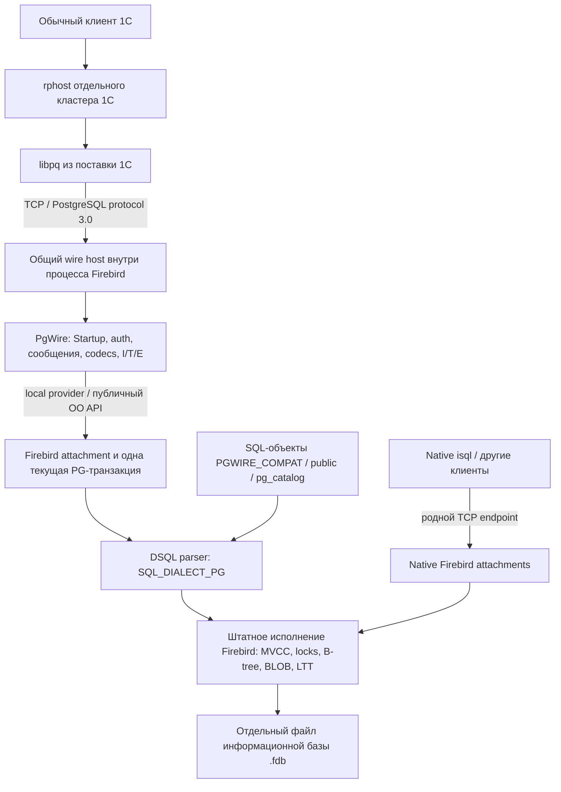

# Firebird + PgWire + 1С: разбор реализации и выполненного запуска теста Гилёва

**Срез кода: 13 ноября 2026 года.** Базовая ревизия master Firebird 6:
`bf94598f8deefeb7cc4a8217ee43b3040d5d6650`; исследованная вершина ветки
`pg_wire_protocol`: `fbe909741479981781bfd279634bdf6d87fbf605`.
Документ описывает конечное состояние этого диапазона, а не обещания первоначального
плана. Он подготовлен для технической оценки объёма, целесообразности и дальнейшего
развития fork. Изменения, внесённые после указанной вершины, требуют отдельной сверки.

**Достигнутый результат:** подготовленная информационная база открылась настоящим
клиентом 1С; затем обычный толстый клиент 1С 8.5.4.1306 выполнил один полный
функциональный прогон «Тест Гилёва : 2.1.1.48» через PostgreSQL wire protocol
на Firebird. Итоговый экран показал 100%, «TPC: Тест завершен!» и 2,14.
Это подтверждает конкретный сквозной сценарий на подготовленной базе.
Создание новой базы средствами 1С, загрузка .dt, произвольная конфигурация 1С,
полная совместимость PostgreSQL, повторяемость нагрузки и корректность
конкурентного редактирования этим результатом не подтверждены.

Результат 2,14 получен на Release **с включённой подробной трассировкой**.
Он не принят как сравнительная оценка производительности. Последующая подготовка
Release-стенда без трассировки для ручного запуска пользователя — отдельное действие;
результат нового запуска здесь не предполагается.

## Оглавление

- [Как читать документ](#review-001)
  - [Источники и способ проверки](#review-002)
  - [Шкала влияния на Firebird](#review-003)
- [Общая архитектура и граница задачи](#review-004)
  - [Путь реального запроса](#review-005)
  - [Почему работы вышли далеко за пределы TCP и пакетов](#review-006)
  - [Из какого наблюдаемого профиля исходили](#review-007)
  - [Какие механизмы уже были в master](#review-008)
  - [Количественный объём](#review-009)
  - [Принятые границы и отменённые подходы](#review-010)
- [Сетевой слой, подключение к движку и исполнение запросов PgWire](#review-011)
  - [W1. Второй серверный frontend и границы его ответственности](#review-012)
  - [W2. CLOOP ABI, module lifecycle и ownership](#review-013)
  - [W3. Конфигурация и независимость native listener](#review-014)
  - [W4. TCP, threads, budgets, shutdown и удалённые timers](#review-015)
  - [W5. Аутентификация и настоящий local attach](#review-016)
  - [W6. Startup, framing и ответы клиенту](#review-017)
  - [W7. Лексический descriptor вместо origin/command API ядра](#review-018)
  - [W8. Simple Query: CRUD, PSQL, sequential scripts](#review-019)
  - [W9. I/T/E, native transactions и session controls](#review-020)
  - [W10. Узкая history settings и событие protocol abort](#review-021)
  - [W11. Extended Query: prepared statements и portals](#review-022)
  - [W12. Metadata и codecs](#review-023)
  - [W13. Structured diagnostics и отмена](#review-024)
  - [W14. Сборка, dependencies и инструменты](#review-025)
  - [W15. Evidence и предел доказательств](#review-026)
  - [W16. Остаточные ограничения и будущие isolation points](#review-027)
  - [W17. Coverage production files и retained commits](#review-028)
- [SQL-диалект, настройки сессии, имена, каталоги и прикладной SQL](#review-029)
  - [S1. Зачем понадобился отдельный SQL-диалект](#review-030)
  - [S2. Минимальные синтаксические формы, на которых остановился обычный клиент](#review-031)
  - [S3. Настройки соединения: подтверждение режима, намеренные no-op и реальное состояние](#review-032)
  - [S4. Сохраняемый SQL: почему недостаточно принять новую грамматику](#review-033)
  - [S5. Имена, схемы и путь поиска](#review-034)
  - [S6. SQL-каталоги: что реально читается и где остаётся ограниченный профиль](#review-035)
  - [S7. Общая установка compatibility SQL](#review-036)
  - [S8. Прикладные функции 1С и совместимость расширений Postgres Pro](#review-037)
  - [S9. Что эти изменения доказывают и чего не доказывают](#review-038)
  - [S10. Карта production-файлов и коммитов этого раздела](#review-039)
- [E. Изменения движка: типы, временные объекты, транзакционные службы и исправления native поведения](#review-040)
  - [E.1. Почему совместимость с типами перестала быть задачей только сетевого плагина](#review-041)
  - [E.2. Type identity: parser → descriptor → BLR → сообщения → stored source](#review-042)
  - [E.3. Bytea: бинарное значение, которое нельзя сравнивать как старый BLOB](#review-043)
  - [E.4. Mchar/mvarchar: не только названия и кодировка вывода](#review-044)
  - [E.5. Regnamespace: namespace ID как значение SQL](#review-045)
  - [E.6. ODS 14.1: граница хранения и цена обновления](#review-046)
  - [E.7. PG temporary tables поверх native LTT](#review-047)
  - [E.8. NAT-06: исправление metadata undo LTT независимо от PostgreSQL](#review-048)
  - [E.9. Native LTT identity и serial/serial4](#review-049)
  - [E.10. Advisory locks: настоящая межсоединительная координация](#review-050)
  - [E.11. ANALYZE и fasttruncate: реальные эффекты](#review-051)
  - [E.12. Дополнительные native исправления](#review-052)
  - [E.13. Что проверено и чего проверки не доказывают](#review-053)
  - [E.14. Будущая изоляция без смены текущей концепции](#review-054)
  - [E.15. Покрытие production-файлов и коммитов главы](#review-055)
- [Подготовка настоящей информационной базы](#review-056)
  - [Почему понадобился отдельный инструмент переноса](#review-057)
  - [Чтение исходной схемы и границы допуска](#review-058)
  - [DDL preflight и native ограничения индексов](#review-059)
  - [Отдельный блокер: nullable UNIQUE](#review-060)
  - [Двоичный перенос и сверка](#review-061)
  - [Коррекция ранее подготовленной базы](#review-062)
  - [Реально подготовленная база и сохранённые ограничения](#review-063)
- [Реальное приложение, постоянный стенд и ручной запуск](#review-064)
  - [Почему открытие базы и запуск Гилёва — разные результаты](#review-065)
  - [Откуда запускается Firebird](#review-066)
  - [Инструмент запуска и управления](#review-067)
  - [Добавление базы в обычный список 1С](#review-068)
  - [Release и выключение трассировки для ручного запуска](#review-069)
- [Сквозная проверка Гилёва: что именно доказано](#review-070)
  - [Последовательность фактических попыток](#review-071)
  - [Связь GUI, wire, engine и файла базы](#review-072)
  - [Проверка записей native-подключением](#review-073)
  - [Версии объектов и конкурентное редактирование](#review-074)
  - [Наблюдения о скорости и пределы выводов](#review-075)
- [Оценка архитектурных решений и объёма вмешательства](#review-076)
  - [Что уже хорошо отделено от ядра](#review-077)
  - [Где изоляция пока только логическая](#review-078)
  - [Почему нельзя просто перенести весь новый код в .so](#review-079)
  - [Какие решения наиболее значимы для принятия человеком](#review-080)
- [Проверки, регрессии и качество доказательств](#review-081)
  - [Использованные уровни проверки](#review-082)
  - [Крупные контрольные результаты](#review-083)
  - [Что означал исторический FAIL на VARCHAR](#review-084)
  - [Сохранённые дефекты и неполные проверки](#review-085)
- [Оставшийся объём и решения для дальнейшей работы](#review-086)
  - [Ограничения, которые прямо влияют на возможный следующий пользовательский сценарий](#review-087)
  - [Полнота SQL/сеанса/каталогов](#review-088)
  - [Дополнительные вопросы, выявленные именно при составлении отчёта](#review-089)
  - [Как использовать оценку для принятия дальнейших решений](#review-090)
- [Приложение A. Все коммиты исследованного диапазона](#review-091)
- [Приложение B. Полная инвентаризация конечного diff](#review-092)
  - [B1. Общий wire host](#review-093)
  - [B2. PgWire plugin](#review-094)
  - [B3. Изменённые существующие jrd/dsql файлы](#review-095)
  - [B4. Новые jrd/dsql файлы](#review-096)
  - [B5. Остальная интеграция, common, public API и generated bindings](#review-097)
  - [B6. Build/config/parser generator](#review-098)
  - [B7. SQL совместимости и настройка locale](#review-099)
  - [B8. Установка, перенос и launcher](#review-100)
  - [B9. C++ tests](#review-101)
  - [B10. Сетевые, прикладные и ручные проверки](#review-102)
  - [B11. Документация, задания и evidence manifests](#review-103)
- [Приложение C. Навигация к действующим контрактам и доказательствам](#review-104)

<a id="review-001"></a>

## Как читать документ

**Условия чтения примеров.** В каждом смысловом разделе и подпункте ниже
есть блок «Конкретный пример»: запрос, последовательность сообщений или команда,
ожидаемое поведение, отличие исходного Firebird и результат реализации. Примеры
добавлены по исходникам, существующим проверкам и сохранённым результатам;
**при дополнении этого документа SQL и тесты заново не запускались**.
Ссылка «Основание» отличает записанный результат от иллюстрации, составленной
по контракту или коду. Для настройки, сборки, ABI и запуска вместо искусственного
SQL приведена соответствующая команда, конфигурация или последовательность вызовов.

«Исходный Firebird» означает указанный в начале master, если прямо не названа
другая ревизия. Воспроизведение ошибки на предыдущей версии fork не приписывается
чистому master. «Этот fork» означает исследованную вершину, а не новый прогон
текущего сервера. Функции `mchar`, `fulleq` и подобные относятся к исследованному
профилю Postgres Pro/1С; это не обещание их наличия в любой PostgreSQL.

SQL-примеры независимы: для каждого предполагается отдельное исходное состояние
тестовой UTF8-базы, native database dialect 3 и PG4 для PgWire. Совместимые SQL-объекты
установлены, если пример их использует. Таблицы и данные, указанные в условиях
конкретного примера, подготавливаются отдельно. Общая таблица для коротких
CRUD-примеров создаётся native SQL так:

```sql
CREATE TABLE "PUBLIC"."EX_ROWS" (
    "ID" INTEGER PRIMARY KEY,
    "V" INTEGER
);
INSERT INTO "PUBLIC"."EX_ROWS" VALUES (1, 10);
INSERT INTO "PUBLIC"."EX_ROWS" VALUES (2, 20);
COMMIT;
```

При сопоставлении с PostgreSQL такая же таблица должна находиться в отдельно
созданной схеме с точным quoted-именем `"PUBLIC"`. Native `"PUBLIC"` и PG `public`
в нашем диалекте — разные имена. Системную native таблицу из PG4 указывают как
`"SYSTEM"."RDB$DATABASE"`. SQLSTATE и точный результат приводятся только там,
где для этого есть основание; случайные allocator IDs не фиксируются константой.

Если указано «один Query», весь текст передаётся одним сообщением протокола,
например через libpq. Если указаны Q1/Q2, отдельные Query или разные сессии,
это существенная часть примера: разбиение по `;` в клиенте может изменить
транзакционные границы и момент выбора режима строковых литералов.
Без такого указания многострочный блок обозначает логическую последовательность
операций, а не требование отправить их одним пакетом. `SET TERM`/`SET BAIL`
относятся к isql; `\g` относится к psql или указанному тестовому клиенту.

Команды shell выполняются из корня репозитория, если не указан иной каталог.
`PGWIRE_REVIEW_DSN` — libpq conninfo отдельной тестовой PgWire-базы,
`PGWIRE_REVIEW_NATIVE` — её native connection string,
`PGWIRE_REVIEW_ISQL` — путь к соответствующему native isql. В командах переноса
`PGWIRE_SOURCE_DSN` и `PGWIRE_TARGET_DSN` обозначают отдельные source/target.
Пути `/data/ex_review.fdb`, `/path/to/...`, пользователи `REVIEW_USER`/`EX_USER`
и имена тестовых баз — условия примеров. Пароли в документ не включены:
psql использует штатный механизм libpq, а `pgwire_client.py` предполагает
заданный `PGPASSWORD` либо явный аргумент `-P`.

**Конкретный пример.**

```sql
SELECT CAST(1 AS INTEGER);
```

- **Ожидается:** PostgreSQL вычисляет одну строку со значением 1 без таблицы-источника.
- **Исходный Firebird:** в native dialects 1/2/3 такой SELECT без FROM отвергается синтаксически. Эквивалентная native запись — SELECT CAST(1 AS INTEGER) FROM RDB$DATABASE; — допустима.
- **Этот fork:** PG4 принимает запрос и отдаёт integer/OID23; native режимы сохраняют требование FROM. Это пример расширения языка, а не замены INTEGER новым типом.
- **Основание:** адаптированный пример из профиля SELECT без FROM; grammar в [parse.y](../../src/dsql/parse.y), проверки в [VALIDATION](../VALIDATION.md). Пример при дополнении отчёта не запускался.

Основные разделы устроены по функциональным блокерам: исходное различие систем,
реализованное решение, используемые механизмы Firebird, альтернативы, влияние
на внутренний код, доказательства и границы. Разделы о запуске и переносе
отделены от production-кода. В приложениях приведены полный перечень коммитов
и инвентаризация изменённых файлов.

Слово «поддерживается» ниже всегда относится к явно описанному профилю.
Например, поддержка `bytea` не означает поддержку всех типов PostgreSQL,
а `pg_class` — всех его столбцов, видов отношений и служебных инструментов.
Факт успешного разбора SQL не считается доказательством его эффекта.

<a id="review-002"></a>

### Источники и способ проверки

**Конкретный пример.**

```sql
SELECT CAST('x' AS VARCHAR(1)) FROM RDB$DATABASE;
```

- **Ожидается:** при проверке Firebird VARCHAR ожидается одна строка x, wire OID1043 и tag SELECT 1. Сам RDB$DATABASE — native объект, поэтому это не неизменённый PostgreSQL oracle SQL.
- **Исходный Firebird:** для сравнения конкретного исторического FAIL использована предыдущая ревизия fork 97e44d0188 до $n: она уже возвращала именно x/OID1043/SELECT 1; это не отдельный запуск чистого master.
- **Этот fork:** в текущем PG4 тот же результат `x`/OID1043/`SELECT 1` получается у `SELECT CAST('x' AS VARCHAR(1)) FROM "SYSTEM"."RDB$DATABASE";`. SQL в блоке выше — исторический, до lowercase folding; сейчас неквалифицированный `RDB$DATABASE` ищет другое имя. Старый FAIL проверял устаревшее ожидание `0A000`, а не обнаруживал регрессию VARCHAR.
- **Основание:** сохранённый baseline/current результат [VALIDATION](../VALIDATION.md), раздел review numbered parameters; новый прогон не выполнялся.

При подготовке сопоставлены конечный `git diff` относительно master, история
54 коммитов, реализация, SQL installers, тестовые программы и результаты
в [VALIDATION](../VALIDATION.md). Отдельно сверены
[PROGRESS](PROGRESS.md), [OPEN_INFOBASE](OPEN_INFOBASE.md),
[GILEV_RUN](GILEV_RUN.md), [GILEV_GUI](GILEV_GUI.md),
[BACKLOG](../BACKLOG.md) и [EXTENSION_POINTS](../EXTENSION_POINTS.md).
Подробные файлы заданий используются для объяснения решений, но не заменяют
проверку кода: требование в задании ещё не является реализованной возможностью.

В отчёте различаются следующие уровни доказательств:

| Уровень | Что он устанавливает | Чего не устанавливает |
|---|---|---|
| Код и diff | Реальное место изменения, выбранный механизм и проверки условий | Отсутствие ошибок исполнения |
| Unit / mock / native OO | Поведение заданных ветвей, ownership, форматов, отказов | Полный сетевой сценарий и поведение настоящего приложения |
| Реальный libpq / raw wire | Протокол, параметры, результаты, состояния транзакции | Полноту SQL и поведения всей 1С |
| Сравнение с Postgres Pro | Совпадение наблюдаемых результатов конкретных случаев | Универсальную эквивалентность движков |
| Реальный клиент и native-наблюдатель | Что приложение дошло до результата через нужный сервер и файл базы | Правильность всех данных, конкурентной работы и измерений скорости |

Числа тестов относятся к конкретным ревизиям и отчётам. Повтор одного набора
не превращает его в новый независимый набор возможностей. `SKIP` и сохранённый
отрицательный reproducer не обозначаются как `PASS`. Во время составления
этого документа сервер, база и GUI не перестраивались и не использовались
для нового нагрузочного запуска.

Первоначальные `BASELINE.md`, ранние task-файлы и отдельные исторические
абзацы README описывают прежние этапы. Например, отсутствие BEGIN, временных
таблиц или больших BLOB в раннем профиле не следует переносить в описание
текущего кода. Обнаруженные расхождения документации отмечены отдельно.

<a id="review-003"></a>

### Шкала влияния на Firebird

**Конкретный пример.**

Три независимых по смыслу действия; CREATE выполняется однократно в отдельной тестовой базе.

```sql
SELECT 1;
CREATE TABLE public.ex_binary (id INTEGER, payload bytea);
CREATE UNIQUE INDEX ex_binary_payload ON public.ex_binary(payload);
```

- **Ожидается:** PG должен вычислить константу, создать binary column и обеспечивать уникальность по байтам значения.
- **Исходный Firebird:** первый запрос без FROM и имя типа bytea отсутствуют в native grammar; обычный BLOB не даёт автоматически нужного bytea-компаратора и такого индексного контракта.
- **Этот fork:** SELECT без FROM — I2; spelling bytea — I2, его сравнение/index — I3, сохранённый type/index contract и ODS14.1 — I4. Упаковка ответа DataRow отдельно остаётся I0.
- **Основание:** иллюстрация классификации по текущему parser/APP-16; [EXTENSION_POINTS](../EXTENSION_POINTS.md). Конкретные DDL — для чистой scratch-базы с compat.

Это качественная инженерная оценка, а не численная оценка риска или стоимости:

| Метка | Где находится изменение | Что требуется проверять |
|---|---|---|
| **I0** | Wire-плагин, SQL-объекты базы, внешние инструменты | Контракт плагина/скрипта, отсутствие подмены семантики, ресурсы и права |
| **I1** | Общий host, plugin ABI, public constants/interfaces, сборка | Совместимость интерфейсов, запуск/остановка native сервера, платформы |
| **I2** | Parser, DSQL, политика диалекта, attachment state, разрешение имён | Native dialects 1/2/3, кэш, stored SQL, смена контекста |
| **I3** | Исполнение, транзакции, undo, сравнения, сортировка, индексы, locks, optimizer | Общие native механизмы, ошибки и rollback, многосессионность, эксплуатационная устойчивость |
| **I4** | BLR, ODS, представление и интерпретация сохраняемых типов | Старые/новые runtime, upgrade, backup/restore, чтение сохранённых данных |

Одно решение может иметь несколько меток. Добавление нескольких строк в sorter
может иметь большую область риска, чем сотни строк независимого wire codec.
Отсутствие изменения OO-сигнатуры не означает отсутствие нового публичного
контракта: новые значения info/prepare flags, SQL dialect, subtype и BLR
также требуют сопровождения.

<a id="review-004"></a>

## Общая архитектура и граница задачи

**Конкретный пример.**

Используется общая fixture EX_ROWS; PGWIRE_REVIEW_DSN указывает на scratch PgWire endpoint, не рабочую базу.

```sh
psql "$PGWIRE_REVIEW_DSN" -X -v ON_ERROR_STOP=1       -c 'UPDATE "PUBLIC"."EX_ROWS" SET "V" = 33 WHERE "ID" = 1'
```

- **Ожидается:** libpq посылает SQL через TCP; после успешной неявной фиксации отдельный native SELECT видит V=33 для ID=1.
- **Исходный Firebird:** сам UPDATE штатно поддержан через native API, но libpq не может подключиться к native listener: PG handshake не является Firebird wire.
- **Этот fork:** PgWire вызывает engine execute/commit; native SELECT по тому же файлу видит реальную запись, а не ответ из памяти плагина.
- **Основание:** адаптированная иллюстрация Simple Query и cross-visibility; [Execute.cpp](../../src/plugins/wire/pg/Execute.cpp), сохранённые P6 checks.

<a id="review-005"></a>

### Путь реального запроса

**Конкретный пример.**

```sql
SELECT "ID", "V"
FROM "PUBLIC"."EX_ROWS"
WHERE "ID" = 2;
```

- **Ожидается:** одна строка (2,20), integer metadata для обеих колонок.
- **Исходный Firebird:** тот же SQL работает через родной драйвер на такой же native fixture. Через libpq к исходному серверу выполнение не начинается из-за другого handshake.
- **Этот fork:** Parse/Query поступает в PgWire, prepare и фильтр WHERE исполняет Engine14; плагин кодирует полученные (2,20). Отдельного PostgreSQL executor нет.
- **Основание:** пример по действующему executor и shared-fixture контракту; новый live-прогон не выполнялся.



В рабочей цепочке нет PostgreSQL-процесса, который исполняет SQL вместо Firebird,
и нет проксирования запросов к исходной базе. PostgreSQL/Postgres Pro использовался
как источник переносимых данных и эталон проверок. Плагин работает внутри
сервера Firebird, а данные, транзакции, индексы и блокировки обслуживает Firebird.

Родной endpoint сохранён и доступен параллельно. Правило «одна текущая транзакция»
относится к модели **одного PostgreSQL wire-сеанса**, а не отменяет возможность
native Firebird иметь несколько транзакций на attachment.

<a id="review-006"></a>

### Почему работы вышли далеко за пределы TCP и пакетов

**Конкретный пример.**

Отдельные команды одной сессии PG4; до примера у неё ещё нет PG TEMP namespace.

```sql
BEGIN;
CREATE TEMP TABLE ex_work (id serial4, payload bytea);
SELECT pg_my_temp_schema();
ROLLBACK;
```

- **Ожидается:** PG/Postgres Pro понимает transaction block, приватную таблицу, serial4/bytea и temp namespace; rollback отменяет CREATE.
- **Исходный Firebird:** одного PG listener недостаточно: native BEGIN/PG TEMP/serial4/bytea и pg_my_temp_schema не были доступны в такой форме. Подходящие native механизмы — SET TRANSACTION, LTT, identity, BLOB — имеют другие spelling/часть правил.
- **Этот fork:** в принятом профиле команды используют native transaction/LTT/counter/BLOB и живой namespace catalog; rollback первой temp activation восстанавливает отсутствие namespace.
- **Основание:** составная иллюстрация APP-15/16 и services на основе существующих checks; идентичный блок при редактировании не запускался.

Первоначальная цель — подключить libpq к Firebird и исполнять совместимый SQL —
действительно решается преимущественно wire-плагином. Настоящая 1С предъявила
дополнительные контракты, без которых успешная аутентификация бесполезна:

1. Она посылает SQL PostgreSQL/Postgres Pro: BEGIN, последовательные `$n`,
   casts `::`, temporary tables, служебные SET, функции и DELETE USING.
2. Она читает каталоги и выбирает дальнейшее поведение по типам, индексам,
   локали и видимости объектов. Нельзя ответить только статической строкой версии.
3. Она ожидает поведение данных: точные двоичные значения, типизированные строки
   mchar/mvarchar, сравнения и индексирование, временные таблицы, locks.
4. Ей нужна настоящая конфигурация и данные информационной базы, а не набор
   специально подобранных тестовых таблиц.
5. Открытие управляемого приложения ещё не запускает форму Гилёва в обычном
   приложении; потребовалась подходящая конфигурация самого сервера и клиента 1С.

Следовательно, «wire protocol», «SQL dialect», «совместимость типов/каталогов»,
«подготовка базы» и «запуск приложения» — разные части результата.
Объединять их в оценку «размер PostgreSQL драйвера» технически неверно.

<a id="review-007"></a>

### Из какого наблюдаемого профиля исходили

**Конкретный пример.**

Пакет посылается одним Query. Показанный SET strings не меняет snapshot разбора этого же сообщения.

```sql
SET enable_mergejoin = off;
SET escape_string_warning = off;
SET cpu_operator_cost = 0.001;
SET client_encoding = 'utf8';
SET standard_conforming_strings = off;
SET client_min_messages = error;
SET lock_timeout = 20000;
```

- **Ожидается:** в источнике это один Query начала сеанса; PostgreSQL/Postgres Pro применяет смысл каждой настройки.
- **Исходный Firebird:** native Firebird не знает эти PG SET имена, поэтому сам такой startup batch не пройдёт.
- **Этот fork:** семь команд дают SET; strings=off реально действует на следующие сообщения. enable_mergejoin/cpu_operator_cost/lock_timeout приняты как явно согласованные no-op, поэтому 20000 не создаёт 20-секундный lock timeout.
- **Основание:** исходный startup SQL из задания/capture; [IGNORED_STARTUP_SETTINGS_TASK](IGNORED_STARTUP_SETTINGS_TASK.md) и string checks.

Прикладное задание началось после уже работающего базового PgWire, на ревизии
`0e505759d0deb1693d912bbc9fee978a55d1e1f0`. Исходные материалы находятся
в `/home/aleksey/dev/1c`: задание `CODEX_PGWIRE_1C_TASK.md`, анализ,
SQL-схема и capture `20261109T105635Z`.
В записи **604453 SQL-события, шесть соединений, 243 сгруппированные формы**;
для начальной проверки выбраны 24 неизменённых примера с параметрами.
Это SQL-запись наблюдаемого сценария, а не полный wire transcript и не
исчерпывающая спецификация всей 1С. Одно соединение существовало ещё до записи.

Эталон — Postgres Pro 18.6 для 1С; платформа — 8.5.4.1306.
Проверки выполняли исходный SQL на синтетических типизированных fixtures,
затем на настоящих перенесённых данных и наконец через настоящий клиент.
Прохождение 24 выбранных форм не переводится в процент готовности приложения.
В частности, selected19 проверял механизм 92 параметров/68 BLOB, а полная
исходная register-схема selected20 не получила самостоятельной приёмки.

Исходный запрет на фиктивные SET и отдельный SQL splitter впоследствии был
явно уточнён пользователем: согласованы три перечисленных no-op SET и
последовательный Simple Query на штатном FrontendLexer с parser-проверкой.
Документ описывает эти действующие решения, а не выдаёт их за буквальное
выполнение более ранней редакции задания.

<a id="review-008"></a>

### Какие механизмы уже были в master

**Конкретный пример.**

```sql
SELECT 1 FROM RDB$DATABASE;
SELECT CAST(NULL AS INTEGER) IS NOT DISTINCT FROM
       CAST(NULL AS INTEGER)
FROM RDB$DATABASE;
```

- **Ожидается:** native SQL вычисляет 1 и TRUE; для NULL-aware сравнения не требуется новый исполнитель сравнения.
- **Исходный Firebird:** уже предоставляет singleton table, CAST, BOOLEAN и IS NOT DISTINCT FROM. Это положительный native пример, а не отсутствие возможности.
- **Этот fork:** переиспользует эти узлы; PG-only запись SELECT CAST(NULL AS INTEGER) == CAST(NULL AS INTEGER) отображается на native equivalence после проверки типов.
- **Основание:** native grammar и [FULLEQ](FULLEQ.md); логический пример, результаты отдельных equivalence cases сохранены в checks.

Firebird 6 уже предоставлял plugin manager и CLOOP, local provider/OO API,
парсер и DSQL nodes, native схемы и SEARCH_PATH, транзакции/savepoints, LTT/GTT,
PSQL и системный external engine, identity/sequences, BLOB, ICU,
частичные индексы, lock manager и статистику индексов. Большая часть выполненной
работы адаптирует и соединяет эти механизмы. Например, PG TEMP использует native
LTT, NULL-aware equality — native `IS NOT DISTINCT FROM`, nullable UNIQUE при
переносе — native partial indexes, ANALYZE — существующий расчёт статистики.

Однако наличие подходящего механизма не гарантирует совпадения контракта:
native LTT по умолчанию, PG TEMP по умолчанию, правила rollback, пространства
имён, строковое сравнение и область действия настроек отличаются. Такие различия
и являются причинами описанных ниже доработок.

<a id="review-009"></a>

### Количественный объём

**Конкретный пример.**

```sh
git diff --numstat bf94598f8deefeb7cc4a8217ee43b3040d5d6650 fbe909741479981781bfd279634bdf6d87fbf605
git diff 0e505759d0 fbe9097414 -- src/jrd src/dsql
```

- **Ожидается:** первая команда показывает конечный объём всего диапазона; вторая выделяет изменения jrd/dsql после работающего базового PgWire.
- **Исходный Firebird:** это сравнение исходников, SQL-ответа нет: base — исходный master, 0e505759d0 — уже первый wire fork.
- **Этот fork:** зафиксированные числа всего diff — 285 файлов, +52295/−395; jrd/dsql прикладного периода — 67 файлов, +3522/−355. Новые блоки примеров в эти числа не входят.
- **Основание:** зафиксированная git-инвентаризация; команды приведены для воспроизведения подсчёта, не запущены заново как тест сервера.

В диапазоне master → исследованная вершина **54 коммита, 285 изменённых файлов**.
Это итоговый diff; удалённые ранее экспериментальные решения не считаются
сохранившейся реализацией. Полный список файлов с добавлениями/удалениями и
признаком существования в baseline дан в приложении.

| Группа конечного diff | Файлы | Добавлено строк | Удалено строк |
|---|---:|---:|---:|
| Общий wire host | 9 | 1787 | 0 |
| PgWire plugin | 21 | 5218 | 0 |
| Изменённые существующие файлы jrd/dsql | 62 | 3038 | 357 |
| Новые файлы jrd/dsql | 6 | 491 | 0 |
| Прочие src: common, public API, generated bindings, конфиги, интеграция | 26 | 1516 | 17 |
| Build/generator вне предыдущих групп | 5 | 155 | 4 |
| SQL-слой базы | 19 | 980 | 0 |
| Инструменты установки, переноса и запуска | 3 | 854 | 0 |
| C++ tests | 16 | 5108 | 0 |
| Python/shell проверки и ручные клиенты | 63 | 16228 | 0 |
| Документация, задания, evidence manifests | 55 | 16920 | 17 |

Категории взаимоисключающие и определены по путям. Например, CMake-файлы внутри
`src` входят в «прочие src», а не повторно в build. В generated
`IdlFbInterfaces.h` и `Firebird.pas` находятся **1198 добавленных строк**
из группы «прочие src»: это результат генерации интерфейсов, а не 1198 строк
новой вручную написанной бизнес-логики.

Для оценки вмешательства в ядро особенно существенны 62 существующих
`jrd/dsql` файла и шесть новых: `PgNamespace.cpp/.h`,
`PgString.cpp/.h`, `PgTempOperations.cpp/.h`. Но и этот показатель не включает
все риски: common descriptors, public constants и BLR затрагивают соседние слои.
Количество строк не является оценкой трудоёмкости, качества или безопасности.

Чтобы отделить стоимость самого протокола от последующей совместимости 1С:

| Диапазон | Коммиты | Все файлы / + / − | Только jrd/dsql: файлы / + / − |
|---|---:|---:|---:|
| Master → `0e505759d0`: фундамент PgWire до задания 1С | 15 | 94 / 22212 / 9 | 1 / 7 / 2 |
| `0e505759d0` → исследованный HEAD: профиль 1С и реальный запуск | 39 | 244 / 30940 / 1243 | 67 / 3522 / 355 |

Эти два diff нельзя складывать по количеству уникальных файлов или строкам
с итоговой таблицей: некоторые файлы менялись повторно, часть раннего кода
заменена. Но разделение показывает причину роста core diff: основная глубина
пришла с SQL/типами/временными объектами настоящего приложения, а не с framing
PostgreSQL TCP.

<a id="review-010"></a>

### Принятые границы и отменённые подходы

**Конкретный пример.**

```text
Query: BEGIN; INSERT INTO "PUBLIC"."EX_ROWS" VALUES (3,30); COMMIT; SELCT 1;
```

- **Ожидается:** PostgreSQL обнаруживает syntax error всего Simple Query до исполнения: ранний INSERT не фиксируется. При корректном SELECT 1/0 вместо SELCT ранний COMMIT, напротив, сохраняется.
- **Исходный Firebird:** native API готовит одну команду, а isql является отдельным клиентским script runner; PG whole-Query preparse не является native контрактом.
- **Этот fork:** последовательно исполняет команды и фиксирует (3,30) до поздней опечатки, затем прекращает хвост. Это согласованное ограничение, а не незаметно заявленная PG-эквивалентность.
- **Основание:** сохранённое решение о scripts и [VALIDATION](../VALIDATION.md); адаптированный пример общей fixture.

Решения менялись по мере уточнения требований; в текущем состоянии:

- SQL-диалект PG4 изолирует правила языка от native dialects 1/2/3.
  Native engine всё равно исполняет общий план, поэтому типы/индексы не могут
  целиком жить только в wire-плагине.
- Ограниченная лексика в плагине допустима для command tags, transaction controls
  и выделения границ Simple Query; полноценная грамматика и семантика — в parser.
  Runtime SQL не переписывается строковыми заменами.
- Новые публичные виды SQL-команд и `isc_info_sql_stmt_origin` удалены.
  Плагин не требует отдельной классификации всех команд от ядра.
- `ConfigManager::getPluginConfig2` не сохранялся; применяется существующий
  конфигурационный контракт.
- Собственные таймауты транспорта/аутентификации/сообщений, добавленные на раннем
  этапе, удалены по решению пользователя. Штатные настройки Firebird не следует
  путать с удалённым watchdog в wire.
- Предварительный синтаксический разбор **всего** Simple Query до выполнения
  отложен. Выполнение последовательное с остановкой на первой ошибке.
- `enable_mergejoin`, `cpu_operator_cost`, `lock_timeout` принимаются
  в ограниченных формах без эффекта по явному решению пользователя.
- Полная поддержка pgcli исключена из обязательной цели; ручной CLI — psql.
- Новые MySQL/MSSQL протоколы, универсальный plugin API для произвольной грамматики,
  все PG catalogs/types и создание новой информационной базы через GUI
  автоматически в выполненный объём не включаются.

<a id="review-011"></a>

## Сетевой слой, подключение к движку и исполнение запросов PgWire

**Конкретный пример.** Alias, пользователь и права настроены в отдельной тестовой базе; пароль берётся из штатного механизма libpq.

```sh
psql -X "host=127.0.0.1 port=15432 dbname=pgwire_test user=EX_USER sslmode=disable" -c "SELECT 42 AS answer"
```

- **Ожидается:** libpq получает одну строку `42`, INTEGER/OID23, `SELECT 1`; приложение общается по TCP PostgreSQL.
- **Исходный Firebird:** На native 3050 PostgreSQL Startup не принимается; до SQL дело не доходит. Через native API эквивалент — `SELECT 42 FROM RDB$DATABASE`.
- **Этот fork:** PgWire принимает Startup на отдельном порту, готовит PG4 SQL в Engine14 и возвращает результат libpq.
- **Основание:** [PgWire.cpp](../../src/plugins/wire/pg/PgWire.cpp), [query smoke](../tools/pgwire_query_smoke.py); адаптированный пример, заново не запускался.

<a id="review-012"></a>

### W1. Второй серверный frontend и границы его ответственности

**Конкретный пример.** Общая fixture для wire-примеров: отдельно созданная в каждой сравниваемой системе таблица `"PUBLIC"."EX_ROWS"("ID" INTEGER PRIMARY KEY,"V" INTEGER)` со строками `(1,10),(2,20)`.

```sql
SELECT "V" FROM "PUBLIC"."EX_ROWS" WHERE "ID" = 1;
```

- **Ожидается:** Через PostgreSQL protocol возвращается `10`; чтение должно выполняться настоящим движком, а не proxy к PG.
- **Исходный Firebird:** Этот quoted SQL уже исполняется native Firebird и возвращает `10`, но libpq к native listener подключиться не может.
- **Этот fork:** Тот же SQL исполняется внутри Firebird; через PgWire клиент получает одну строку и `SELECT 1`.
- **Основание:** [PgWire.cpp](../../src/plugins/wire/pg/PgWire.cpp), [query smoke](../tools/pgwire_query_smoke.py); адаптированный пример, заново не запускался.

#### Блокер

**Конкретный пример.**

```text
TCP connect(native_port=3050)
StartupMessage(protocol=196608, user=EX_USER, database=pgwire_test)
Query("SELECT 42")
```

- **Ожидается:** На PostgreSQL endpoint Startup приводит к аутентификации, затем запрос возвращает `42`.
- **Исходный Firebird:** Порт 3050 ожидает native handshake; такую последовательность сообщений не понимает. Конкретный текст сетевой ошибки зависит от клиента, поэтому SQLSTATE здесь не назначается.
- **Этот fork:** Последовательность допустима на настроенном PgWire endpoint 15432; native 3050 остаётся другим протоколом.
- **Основание:** [Protocol.cpp](../../src/plugins/wire/pg/Protocol.cpp), [startup smoke](../tools/pgwire_startup_smoke.py); схема обмена по коду.

PostgreSQL-драйвер устанавливает TCP и обменивается PostgreSQL messages. Родной Firebird listener ожидает другой handshake, auth и формат команд. Совпадение SQL-текста не позволяет libpq говорить native Firebird wire. Поэтому сделан настоящий дополнительный сетевой вход в **процесс Firebird**: он преобразует PG messages в штатные attachment/transaction/statement/result-set API, а результаты движка — обратно в wire. Планирование, выполнение, чтение и запись страниц выполняет Engine14. PostgreSQL/Postgres Pro не участвует в execution path; отдельно он служил эталоном и источником данных.

```text
1C / psql / libpq
    │ TCP, PostgreSQL protocol 3.0
    ▼
общий wire host в Firebird server
    │ IWireConnection + IWireServerHost
    ▼
libPgWire / QueryExecutor
    │ IAttachment, ITransaction, IStatement, IResultSet, IBlob
    ▼
локальный Engine14 → настоящая Firebird database

native Firebird client → прежний native frontend → тот же Engine14
```

«Локальный» означает direct provider attach внутри процесса, а не замену требуемого TCP embedded-клиентом. Приложение действительно подключается по PG TCP; второе backend TCP/Unix соединение к Firebird не создаётся. Startup/query/transaction syscall traces подтвердили ноль backend connect attempts в своих scopes; это не утверждение о трассировке всех последующих проверок.

#### Реализация и reuse

**Конкретный пример.** Вставка — отдельное Query, observer — отдельное подключение с новой транзакцией.

```sql
INSERT INTO "PUBLIC"."EX_ROWS" VALUES (3, 30);
-- После ReadyForQuery I: native observer
SELECT "V" FROM "PUBLIC"."EX_ROWS" WHERE "ID" = 3;
```

- **Ожидается:** Вставка через PG TCP после implicit commit видна native observer как `30`.
- **Исходный Firebird:** Native INSERT/transaction/SELECT уже доступны; отсутствует только PG frontend. В native API commit делает вызывающая сторона.
- **Этот fork:** QueryExecutor использует IStatement/ITransaction, фиксирует implicit block; native observer читает тот же файл базы.
- **Основание:** [Execute.cpp](../../src/plugins/wire/pg/Execute.cpp), [transaction smoke](../tools/pgwire_transaction_smoke.py); адаптированная проверка cross-visibility.

Общий host находится в [remote/server/wire](../../src/remote/server/wire/Server.h), протокол — в [plugins/wire/pg](../../src/plugins/wire/pg/PgWire.cpp). В POSIX [inet_server.cpp](../../src/remote/server/os/posix/inet_server.cpp) добавлен startup hook дополнительных endpoints. Прежние native обработчики и `SRVR_multi_thread` сохранены; PG сообщения не встроены в native PACKET/XDR.

Host владеет конфигурацией, listener/workers/queue, byte transport, module lifetime, shutdown и auth/local-attach bridge. PgWire владеет framing, I/T/E, statements/portals, tags/codecs. Engine владеет SQL-семантикой. Поздние parser/type/storage доработки понадобились для реальных выражений и объектов 1С, а не для самой возможности принять TCP.

**Влияние:** I1 host, I0 plugin. Этот слой не требует изменения ODS, planner, record format или native wire.

**Альтернативы.** Исторически выбран plugin вместо монолитного второго frontend в native remote code. Внешний proxy с native backend connection добавлял бы второй transport/lifecycle; модифицированный клиентский driver не выполнял бы требование неизменённого libpq приложения. Аналитическая будущая альтернатива — отдельный процесс с Firebird API — лучше изолирует аварии, но требует собственной модели запуска/credentials/monitoring. Текущий in-process plugin доверенный: memory corruption в нём может повредить server process, sandbox отсутствует.

<a id="review-013"></a>

### W2. CLOOP ABI, module lifecycle и ownership

**Конкретный пример.**

```text
host → protocol.createSession(host, connection)
worker → session.run(): attach → prepare("SELECT 42") → fetch
client → Terminate
session: close result/statement → host.detachDatabase → release session
host: release plugin после завершения всех его sessions
```

- **Ожидается:** Закрытие соединения освобождает связанные ресурсы; код .so не выгружается, пока session ещё исполняется. Это контракт нового ABI, а не SQL-правило PG.
- **Исходный Firebird:** OO attachment/statement interfaces уже существуют, но такого wire-plugin lifecycle и четырёх IWire* interfaces нет.
- **Этот fork:** Host владеет borrowed attachment и module lifetime; plugin закрывает child handles и передаёт detach host. Double release не нужен.
- **Основание:** [FirebirdInterface.idl](../../src/include/firebird/FirebirdInterface.idl), [ProtocolPlugin.cpp](../../src/remote/server/wire/ProtocolPlugin.cpp), [wire host smoke](../tools/wire_host_smoke.py); последовательность по контракту.

В [FirebirdInterface.idl](../../src/include/firebird/FirebirdInterface.idl) добавлены `TYPE_WIRE_PROTOCOL=13`, обновлён TYPE_COUNT и четыре интерфейса. [IdlFbInterfaces.h](../../src/include/firebird/IdlFbInterfaces.h) и [Firebird.pas](../../src/include/gen/Firebird.pas) — сгенерированные bindings.

| Интерфейс | Реализует | Контракт |
|---|---|---|
| IWireProtocol : PluginBase | Plugin | `createSession(status, host, connection)` сериализован на instance; быстрый, без I/O, engine calls и threads |
| IWireSession : ReferenceCounted | Plugin | `run(status)` один раз на worker; concurrent `stop()` idempotent/nonblocking, допустим до run; без join/engine calls/self-release |
| IWireConnection : ReferenceCounted | Host | Partial read/write, shutdown, immutable numeric peer address/port, isEncrypted |
| IWireServerHost : ReferenceCounted | Host | stopping, bounded logging, local attach/detach |

Module регистрируется через прежний FB_PLUGIN_ENTRY_POINT/PluginManager. Собственный dlopen registry не введён. Configured alias, factory name и module filename различаются; одна library обслуживает несколько независимых instances. Через ABI не передаются STL containers, exceptions, OS sockets/TLS objects. Версии проверяются; PgWire требует host с attach/detach services. Сервер и modules собираются согласованно с generated headers.

[ProtocolPlugin.cpp](../../src/remote/server/wire/ProtocolPlugin.cpp) удерживает plugin, освобождая его через `manager->releasePlugin`. ProtocolSession удерживает plugin owner и host/connection до final session release. Нельзя выгрузить библиотеку, пока её код выполняется. Factory обязана при ошибке очистить partial objects и вернуть null: существующий PluginManager может не передать adapter объект, возвращённый одновременно с error.

`createSession` получает borrowed inputs, возвращает owned session. Если session сохраняет inputs, она удерживает references. `host.attachDatabase` возвращает **borrowed IAttachment**, принадлежащий HostContext. Plugin не делает direct release/detach/dropDatabase; host закрывает attachment. Plugin владеет child handles и закрывает их раньше. Host registry позволяет очистить attachments после abnormal run и отменить активные calls при shutdown. У consuming close/free/detach/rollback успешный результат не сопровождается повторным release; при неуспехе reference освобождается отдельно.

#### Исправление stop deadlock

**Конкретный пример.**

```text
worker: lock(session_mutex) → connection.read() ждёт bytes
shutdown: connection.shutdown() → plugin.stop()
worker: read просыпается → unlock(session_mutex)
```

- **Ожидается:** Остановка разрывает заблокированное I/O до вызова stop, которому может понадобиться тот же mutex.
- **Исходный Firebird:** В master нет этого plugin stop path. Ошибка относится к раннему wire-host fork с обратным порядком, а не ко всем native shutdown.
- **Этот fork:** Порядок transport shutdown → plugin stop исключает описанный deadlock; stop всё равно обязан быть неблокирующим.
- **Основание:** [ProtocolPlugin.cpp](../../src/remote/server/wire/ProtocolPlugin.cpp), коммит `402bf684d6`; модель конкретного interleaving по коду.

`ProtocolSession::stop()` сначала вызывает **connection.shutdown**, потом plugin.stop. В первоначальной обратной последовательности stop мог ждать mutex, который удерживал thread, заблокированный на read. Transport shutdown сначала разбудит I/O. Это generic lifecycle fix; неправильный plugin всё равно может зависнуть, поэтому stop contract остаётся неблокирующим. Shared test module проверяет настоящую загрузку, aliases, cleanup/unload и stop.

**Влияние:** I1; базовый existing attachment/statement execution API не расширялся. Наличие generic ABI не означает реализованные MySQL/MSSQL frontends.

<a id="review-014"></a>

### W3. Конфигурация и независимость native listener

**Конкретный пример.**

```ini
WireProtocolPlugins = MissingProtocol, PgWire
WireProtocolPorts = 15431, 15432
```

- **Ожидается:** При отсутствии первого module второй не должен «съехать» на 15431; порт остаётся привязанным к имени.
- **Исходный Firebird:** В master нет этих дополнительных endpoints. Штатный generic plugin iterator сам по себе не обеспечивает позиционную привязку портов.
- **Этот fork:** MissingProtocol получает ошибку загрузки; при исправном PgWire его endpoint остаётся 15432, native listener продолжает работать.
- **Основание:** [EndpointConfig.h](../../src/remote/server/wire/EndpointConfig.h), [ProtocolPlugin.cpp](../../src/remote/server/wire/ProtocolPlugin.cpp), [wire host smoke](../tools/wire_host_smoke.py); адаптированный конфигурационный случай.

[config.cpp](../../src/common/config/config.cpp), [config.h](../../src/common/config/config.h) и template [firebird.conf](../../builds/install/misc/firebird.conf) добавляют два пустых по умолчанию списка:

```ini
WireProtocolPlugins = PgWire
WireProtocolPorts = 15432
```

[EndpointConfig.h](../../src/remote/server/wire/EndpointConfig.h) связывает их позиционно. Запятые разделяют элементы; внешние пробелы допускаются, пустые позиции не выкидываются. Trailing comma, разное число names/ports, дубликаты, port вне 1…65535, signs/hex/overflow отвергаются. Name не содержит whitespace/control, comma/semicolon/slash/backslash/colon. Парсинг строит новый vector и заменяет output только при успехе.

Host загружает **один exact configured name за раз**. Generic PluginManager iteration умеет молча пропускать missing optional modules; это сдвинуло бы следующий plugin на чужой port. Поэтому `Config::getPlugins(TYPE_WIRE_PROTOCOL)` явно запрещает implicit list iteration, adapter проверяет фактически returned name и не принимает list separators.

#### Штатный plugins.conf вместо нового resolver

**Конкретный пример.**

```ini
Plugin = PgWire {
    Module = $(dir_plugins)/PgWire
    RegisterName = PgWire
    Config = ExamplePg
}
Config = ExamplePg {
    BindAddress = 127.0.0.1
    Workers = 4
    QueueSize = 16
    DatabaseAliases = pgwire_test
}
```

- **Ожидается:** Instance получает именно именованный Config; успешный Startup к pgwire_test возможен при корректном databases.conf и пароле.
- **Исходный Firebird:** IConfigManager уже умеет named Plugin/Config, поэтому новый getPluginConfig2 не нужен; native сервер не создаёт PgWire от одного такого блока.
- **Этот fork:** Прежний getPluginConfig читает параметры; `Port = 15432` или `TLS = ...` внутри этого Config — отказ host config, поскольку port задан общим списком, а TLS не реализован.
- **Основание:** [Server.cpp](../../src/remote/server/wire/os/posix/Server.cpp), [quickstart](../quickstart.md); конфигурационный пример по коду.

Используются прежние `Plugin {Module, RegisterName, Config}` и named Config blocks. Только ports остаются positional; bind/workers/queue/aliases относятся к instance:

| Host setting | Default | Принято сейчас |
|---|---:|---|
| BindAddress |127.0.0.1|Только ровно этот адрес |
| Workers |4|Decimal 1…16 |
| QueueSize |16|Decimal 1…64 |
| DatabaseAliases |Пусто|Явно разрешённые local aliases |

Дубли settings и nested block вместо scalar — ошибки. Port в Config запрещён: один источник port. Любой TLS entry отвергается, поскольку encryption ещё нет. Plugin-specific entries доступны factory. Общий предел 16 endpoints и 64 workers.

Host перед bind/load использует существующий `IConfigManager::getPluginConfig(name)`, включая стандартный module `.conf` fallback. Настройки должны быть правильными до запуска; hot reload отсутствует.

**Исторически отвергнуто:** `getPluginConfig2` и дополнительный строгий resolver. Пользователь счёл расширение общего ConfigManager лишним. Current IDL сохраняет прежний ConfigManager; ранние strict-resolver PASS не доказывают наличие этой версии сегодня. Некоторые промежуточные правки объединены в retained history, поэтому отдельный исторический diff не всегда представлен самостоятельным commit.

#### Native port conflict

**Конкретный пример.**

```ini
RemoteServicePort = 3050
WireProtocolPlugins = PgWire
WireProtocolPorts = 3050
```

- **Ожидается:** Один фактически занятый TCP endpoint нельзя передать обоим протоколам.
- **Исходный Firebird:** Native сервер занимает 3050 своим listener; второй wire endpoint отсутствует.
- **Этот fork:** Host обнаруживает конфликт с реальным native fd до загрузки PgWire и сохраняет native listener. Если сервер запущен с `-p 15432`, сравнение делается с 15432, даже при другом RemoteServicePort в файле.
- **Основание:** [Server.cpp](../../src/remote/server/wire/os/posix/Server.cpp), [wire host smoke](../tools/wire_host_smoke.py); конфигурационный сценарий по коду.

Host получает уже bound native fd и читает getsockname: учитываются CLI `-p`, service resolution, IPv4 wildcard/loopback, IPv6 wildcard dual-stack и mapped адреса. Проверка только raw RemoteServicePort была бы недостаточна. IPv6-only и Unix socket не занимают дополнительный IPv4 loopback endpoint.

Conflict и успешный bind проверяются до загрузки wire module. Native fd не меняется/не закрывается. Неверный общий список отключает дополнительные endpoints, local config / load / bind error конкретного instance логируется; остальные instances и native продолжают работу.

**Влияние:** I1, без SQL/storage. Цена — ручная согласованность двух списков. Альтернатива «Port тоже в named Config» проще для множества endpoints, но current code сохраняет выбранный пользовательский format; новые параллельные TLS/bind списки не добавлены.

<a id="review-015"></a>

### W4. TCP, threads, budgets, shutdown и удалённые timers

**Конкретный пример.** Условие: ConnectionIdleTimeout=0 и другие native ограничения не прерывают сеанс.

```text
Клиент A: SELECT 1; затем 45 s без новых сообщений
Клиент A: SELECT 2;
Администратор: штатная остановка отдельного test server
```

- **Ожидается:** Сам протокол не должен закрывать idle connection из-за произвольных 30 секунд; штатная остановка должна разбудить ожидающий read.
- **Исходный Firebird:** Native сервер имеет свои timeout/shutdown механизмы; PG сообщений он не принимает.
- **Этот fork:** При отключённых native idle limits оба SELECT проходят; собственных 30-second timers нет. Shutdown идёт через host phases, с отдельным общим deadline завершения threads.
- **Основание:** [SocketConnection.cpp](../../src/remote/server/wire/os/posix/SocketConnection.cpp), коммит `8005167f97`; иллюстрация по коду, новая проверка пауз не запускалась.

#### Рабочая модель

**Конкретный пример.**

```text
Workers = 1
QueueSize = 1
A: активная idle session
B: accepted socket ожидает worker
C: новое подключение при заполненной queue
```

- **Ожидается:** Ресурсный контракт должен быть предсказуем: один worker не обслуживает одновременно несколько блокирующих SQL-сеансов.
- **Исходный Firebird:** Native server modes имеют собственную модель соединений; перечисленные PgWire settings отсутствуют.
- **Этот fork:** A занимает worker; B ждёт без созданного attachment; C закрывается из-за полной queue. После закрытия A worker может начать B. Это не модель тысячи idle sessions на одном worker.
- **Основание:** [Server.cpp](../../src/remote/server/wire/os/posix/Server.cpp), [wire host smoke](../tools/wire_host_smoke.py); адаптированная queue-схема.

[POSIX Server.cpp](../../src/remote/server/wire/os/posix/Server.cpp) реализует Linux / Super / IPv4 loopback. Classic/SuperClassic диагностируют отказ additional protocols, сохраняя native. Windows host wiring/runtime acceptance отсутствуют; переносимый ABI и CMake plugin target не доказывают готовность Windows.

У endpoint один acceptor и фиксированные workers. Accepted sockets ждут bounded queue; session/attachment создаются лишь при свободном worker. Полная queue закрывает новые connections; queue expiry отсутствует. Worker обслуживает одну сессию до конца, включая idle read. Значит, simultaneous active connections ограничены workers, а не являются тысячами multiplexed idle sessions.

Применены существующий Firebird Thread и синхронный provider API. Event loop потребовал бы scheduler для блокирующих engine calls; это потенциальная будущая работа, не уже готовое масштабирование.

#### Byte transport

**Конкретный пример.**

```text
Query bytes: Q 00 00 00 0e S E L E C T <space> 1 ; 00
TCP delivery: первые 2 bytes → следующие 5 bytes → остаток
```

- **Ожидается:** Любое TCP-разбиение того же сообщения должно давать один `SELECT 1`, а не три запроса или ошибку длины.
- **Исходный Firebird:** Native transport также не вправе полагаться на границы recv, но этот PG frame native parser не понимает.
- **Этот fork:** readExact собирает header/body через partial reads; результат — одна строка `1`. При TcpNoNagle accepted socket получает TCP_NODELAY, что не меняет SQL-результат.
- **Основание:** [Protocol.cpp](../../src/plugins/wire/pg/Protocol.cpp), [SocketConnection.cpp](../../src/remote/server/wire/os/posix/SocketConnection.cpp); framing case по коду.

[SocketConnection.cpp](../../src/remote/server/wire/os/posix/SocketConnection.cpp) использует nonblocking fd, recv/send, EINTR retry и poll(-1) при EAGAIN. Публичный read/write ждёт progress/EOF/error/shutdown и возвращает partial count. Read0 для непустого request — EOF, write0 — error, size0 — noop.

FD имеет CLOEXEC; SIGPIPE подавляется. Shutdown атомарно marks stopped и вызывает SHUT_RDWR, **не close**: parallel read/poll не должен увидеть повторно использованный descriptor. Close делает финальный owner; close после EINTR не повторяется по той же причине.

При существующем TcpNoNagle accepted socket получает TCP_NODELAY. Правка `6d33f6daf4` нужна для коротких последовательных PG messages/Nagle-delayedACK. Нового config knob нет; native network path не переписан.

#### Что удалили

**Конкретный пример.**

```text
Query header и половина body → пауза → оставшаяся часть body
```

- **Ожидается:** Если native политика и размер сообщения позволяют, пауза сама по себе не должна включать удалённый prototype watchdog.
- **Исходный Firebird:** У master нет этих PgWire timers; native ConnectionIdleTimeout/StatementTimeout — отдельные механизмы.
- **Этот fork:** Нет IOTimeout, startup/frame deadline или queue expiry, включая уже начатое message. Этот пример объясняет удаление кода; новый pause-test здесь не добавляется.
- **Основание:** Коммит `8005167f97`, [Protocol.cpp](../../src/plugins/wire/pg/Protocol.cpp), [SocketConnection.cpp](../../src/remote/server/wire/os/posix/SocketConnection.cpp); вывод по коду.

Первоначально были IOTimeout, startup/password/frame/output deadlines, queue expiry, plugin statement/lock timeout. Ручной idle SQL input мог неожиданно терять connection. По просьбе пользователя **все дополнительные timers удалены** (`8005167f97`), включая timer уже начатого message.

Current read/write ABI не принимает timeout, poll indefinite, PgWire не навязывает IStatement::setTimeout и TPB lock timeout. Native ConnectionIdleTimeout/StatementTimeout и SQL controls сохраняются. При native idle termination диагностируется57P05; это не обещание proactive socket close без следующей операции, собственного watcher нет.

Пять секунд ожидания при **server shutdown** — отдельный сохранившийся lifecycle deadline, не лимит клиентского query/auth/frame. Byte budget также не timer. Нет background disconnect watcher: client EOF во время engine call обнаруживается после возврата в I/O.

#### Shutdown по фазам

**Конкретный пример.**

```text
A: statement ожидает native lock
B: PgWire session ожидает следующий header
fb_shut_preproviders → abort attachment A + shutdown transport B
fb_shut_postproviders → wait/join workers
```

- **Ожидается:** Нельзя выгрузить plugin при ещё работающем thread; ожидание I/O/locks должно получить shutdown/cancel.
- **Исходный Firebird:** Native provider shutdown существует, но не знает новых PgWire worker/module owners.
- **Этот fork:** Preproviders прекращает accepts и вызывает terminal abort для опубликованных attachments; postproviders освобождает owners только после завершения threads. При timeout owners удерживаются, возвращается ошибка shutdown.
- **Основание:** [Server.cpp](../../src/remote/server/wire/os/posix/Server.cpp), [server smoke](../tools/pgwire_server_smoke.py); адаптированная lifecycle последовательность.

`fb_shut_preproviders` marks stopping, прекращает новые accepts/engine operations, shutdown listener/queued/active transports, вызывает nonblocking plugin stop и `cancelOperation(fb_cancel_abort)` для registry attachments вне lock. Terminal abort выбран вместо one-shot raise: raise мог попасть между API calls, не запретив следующий. PgWire повторно проверяет stopping после read. Join до provider shutdown не делается.

`fb_shut_postproviders` ждёт всех threads до одного общего deadline 5 s. При успехе join и release owners; при timeout callback возвращает error, **удерживая owners**, чтобы не выгрузить работающий module. Это не safe thread kill.

Host может адресно отменить только опубликованный attachment. Attach внутри ON CONNECT до возврата handle не зарегистрирован; helper проверяет stop между auth callbacks, global provider shutdown — отдельный механизм. Нельзя обещать hard preemption произвольного auth plugin или ON CONNECT через socket timeout, которого уже нет.

#### Два разных native shutdown дефекта

**Конкретный пример.**

```text
Случай A: prepare("SELECT 1 FROM RDB$DATABASE") дважды → shutdown attachment
Случай B: ON CONNECT ещё выполняется → остановка сервера
```

- **Ожидается:** A должен освободить все request clones общего Statement; B должен корректно закончить attach/shutdown.
- **Исходный Firebird:** A падал на предыдущем fork при native API, исправлен в P7. B воспроизводился также native-only и остаётся отдельным NAT-01; это не вывод о любой версии master.
- **Этот fork:** A: сначала снимается used у всех requests attachment, затем release. B: исправление не включено; этот FAIL не превращается в PASS от успеха A.
- **Основание:** [jrd.cpp](../../src/jrd/jrd.cpp), [attach/shutdown reproducer](../tools/pgwire_attach_shutdown_smoke.py), [VALIDATION](../VALIDATION.md); два зафиксированных класса воспроизведений.

P6 shutdown во время ON CONNECT дал Debug `alloc.cpp:2075 (!child)` также при native-only TCP с отключённым PgWire. По решению пользователя fix исключён из этапа. Reproducer `pgwire_attach_shutdown_smoke.py` сохраняет реальный FAIL; его нельзя включать в PASS.

Другой дефект исправлен P7: два prepares одного SQL оставляли другие request clones used, когда CMP_release освобождал общий Statement. В jrd.cpp native cleanup сначала снимает used у всех requests уничтожаемого attachment, затем освобождает statements. Reproducer без PgWire/native OO/TCP подтвердил fix. Это отдельный I3 lifetime change, не исправление ON CONNECT.

**Влияние:** host/transport I1; native request cleanup I3. Network limits сами по себе не меняют isolation/ODS/native wire.

<a id="review-016"></a>

### W5. Аутентификация и настоящий local attach

**Конкретный пример.**

```text
Startup(user=EX_USER, database=pgwire_test)
AuthenticationCleartextPassword → PasswordMessage
AuthenticationOk → Query("SELECT CURRENT_USER")
```

- **Ожидается:** Возвращается действительно аутентифицированный EX_USER с его правами, а не SYSDBA для любого логина.
- **Исходный Firebird:** Этот пользователь может пройти native SRP login; libpq не реализует native Firebird handshake.
- **Этот fork:** Bridge проверяет пароль через Srp256, создаёт trusted auth block и direct local attach; неверный пароль даёт 28P01 до SQL.
- **Основание:** [Authentication.cpp](../../src/remote/server/wire/Authentication.cpp), [startup smoke](../tools/pgwire_startup_smoke.py); адаптированный положительный/отрицательный сценарий.

#### Блокер и решение

**Конкретный пример.**

```ini
AuthServer = Srp
AuthClient = Srp
# Затем попытка libpq-подключения через PgWire
```

- **Ожидается:** Для выбранного текущего bridge нужен Srp256 в обоих effective lists.
- **Исходный Firebird:** Native Firebird может аутентифицировать через Srp, если этот профиль настроен; это не глобально запрещённый механизм.
- **Этот fork:** Текущий bridge отказывает (28P01), даже если учётная запись существует. При разрешённом Srp256 тот же пользователь проверяется без изменения схемы password storage. UserManager остаётся Srp.
- **Основание:** [Authentication.cpp](../../src/remote/server/wire/Authentication.cpp); отказ по фиксированному plugin name проверяется до успешного attach.

libpq не умеет Firebird SRP negotiation. Host принимает стандартный PG password message и проверяет credentials через штатные Firebird client/server auth plugins внутри процесса. [Authentication.cpp](../../src/remote/server/wire/Authentication.cpp) использует PluginManager/IClient/IServer; fixed name сейчас **Srp256**. Поэтому effective AuthServer/AuthClient обязаны содержать Srp256; Srp не взаимозаменяемое имя текущего bridge. Это не ограничение native Firebird authentication вообще.

#### Allowed database и credentials

**Конкретный пример.**

```text
DatabaseAliases = pgwire_test
Startup(database=other_db, user=EX_USER)
Startup(database=/srv/data/test.fdb, user=EX_USER)
```

- **Ожидается:** Клиент не должен выбирать произвольный файл/remote provider через Startup.
- **Исходный Firebird:** Native API умеет принимать допустимые connection strings/paths; это другой контракт, не причина разрешать их в PG listener.
- **Этот fork:** Обе попытки отвергаются до SQL; для отсутствующего разрешённого alias используется 3D000. Даже правильный пароль не отменяет allowlist и databases.conf.
- **Основание:** [Server.cpp](../../src/remote/server/wire/os/posix/Server.cpp), [Authentication.cpp](../../src/remote/server/wire/Authentication.cpp), [startup smoke](../tools/pgwire_startup_smoke.py); сценарий по коду.

Host требует alias в endpoint DatabaseAliases. Путь, remote host:alias, provider string или произвольный security DB от клиента не принимаются. Alias разрешается через databases.conf, должен указывать на local absolute path; native helper проверяет remote names/mounts. Пустой allowlist запрещает все attaches.

Effective database overrides учитываются: RemoteAccess, оба auth lists, local security DB с текущим Engine14 среди Providers. Remote/Loopback-only security profile не поддержан. Alias/user до 255 bytes, normalized SRP login до 63, password buffer до 4096, auth data до 65536, до 16 rounds. User нормализуется dpbItemUpper, не PG SQL lower-case. Strings проходят UTF8/NUL checks; password copies и wire Message body стираются.

#### Trusted DPB без обхода прав

**Конкретный пример.** EX_SECRET существует; запрос выполняется обычным EX_USER, а не владельцем/администратором.

```sql
SELECT * FROM "PUBLIC"."EX_SECRET";
```

- **Ожидается:** Пользователь EX_USER, которому не выдан SELECT на EX_SECRET, должен получить отказ доступа после успешного login.
- **Исходный Firebird:** Native Firebird уже проверяет этот SELECT и не даёт EX_USER права SYSDBA.
- **Этот fork:** Host передаёт подтверждённый auth block, не клиентский trusted-role flag; engine сохраняет проверку прав, PgWire возвращает 42501.
- **Основание:** [Authentication.cpp](../../src/remote/server/wire/Authentication.cpp), [transaction smoke](../tools/pgwire_transaction_smoke.py); адаптированная permission fixture.

Успешный in-memory native обмен создаёт штатный auth block. DPB собирается с нуля: auth block, UTF8 filename/charset, attachment SQL dialect3, Engine14-only embedded provider, фактический peer/protocol, application_name→process_name. Клиент не может передать trusted role/internal flag/provider override. Raw password не остаётся в DPB; Dispatcher делает direct local attach. SRP crypt keys отбрасываются и **не шифруют PG TCP**.

EDS_validate_password не подходит: требует уже существующий attachment/thread_db. Loopback native login добавлял бы второй transport. Password bypass/trusted SYSDBA для всех не применён. Host владеет returned attachment, plugin — child handles.

**Влияние:** I1 authbridge, reuse security plugins/Dispatcher; native privilege evaluator и auth storage ради bridge не менялись. Remote security DB, другие auth plugins и базы с client-supplied encryption key остаются вне профиля.

#### Plaintext — реальное ограничение

**Конкретный пример.**

```sh
psql -X "host=127.0.0.1 port=15432 dbname=pgwire_test user=EX_USER sslmode=require"
```

- **Ожидается:** При sslmode=require клиенту требуется реальный TLS; одного корректного пароля недостаточно.
- **Исходный Firebird:** Native WireCrypt и PostgreSQL TLS — разные протоколы. Настройка native WireCrypt=Required не превращает native или PgWire socket в PG SSL endpoint.
- **Этот fork:** На SSLRequest возвращается `N`; libpq с require прекращает подключение до запроса. sslmode=disable разрешает текущий loopback профиль, но пароль передаётся plaintext.
- **Основание:** [Protocol.cpp](../../src/plugins/wire/pg/Protocol.cpp), [startup smoke](../tools/pgwire_startup_smoke.py); последовательность и результат libpq следуют из отказа SSL.

Plugin выдаёт AuthenticationCleartextPassword(code 3), затем AuthenticationOk только после auth/attach. SSLRequest/GSSENCRequest получают N. Native WireCryptRequired не шифрует PgWire; поэтому listener restricted127.0.0.1. TLS/PG SCRAM/MD5/channel binding/GSS encryption отсутствуют. [Официальные authentication formats](https://www.postgresql.org/docs/17/protocol-message-formats.html).

Startup errors используют общий текст `Database connection rejected`: login 28P01, unavailable alias 3D000, permission 42501, shutdown 57P01, otherwise XX000. Это затрудняет ручную диагностику неверного alias, но не раскрывает raw authentication status/password. Нельзя считать успешный native login proof правильного PgWire allowlist/config.

<a id="review-017"></a>

### W6. Startup, framing и ответы клиенту

**Конкретный пример.**

```text
Startup(protocol=3.0,user=EX_USER,database=pgwire_test,client_encoding=UTF8)
PasswordMessage → AuthenticationOk
Query("SELECT 1") → RowDescription → DataRow(1) → CommandComplete("SELECT 1") → ReadyForQuery(I)
```

- **Ожидается:** Клиент узнаёт тип/формат результата и окончательное состояние сеанса.
- **Исходный Firebird:** Native сервер использует другие сообщения и descriptors; такого Startup/ReadyForQuery обмена у него нет.
- **Этот fork:** Выдаёт показанную цепочку и ParameterStatus. `PQparameterStatus("server_version")` сообщает prototype string; `PQftable`/`PQftablecol` пока 0, несмотря на реальные pg_class IDs.
- **Основание:** [PgWire.cpp](../../src/plugins/wire/pg/PgWire.cpp), [Protocol.cpp](../../src/plugins/wire/pg/Protocol.cpp); схема текущего обмена по коду.

[PgWire.cpp](../../src/plugins/wire/pg/PgWire.cpp) регистрирует PgWire factory, получает от host byte stream и не создаёт собственный listener/thread. Поддержана startup version **3.0 (`196608`)**. По одному SSLRequest/GSSENCRequest могут предшествовать startup; повтор одного negotiation отвергается. CancelRequest не реализован и не проходит как обычный startup.

Поддержаны keys user/database/application_name/client_encoding. Дубли ошибочны; user обязателен, отсутствующий database берётся из user, явно пустой database ошибочен. Encoding — только ровно UTF8. Произвольные startup options/GUC и protocol 3.2 не поддержаны.

После attach executor устанавливает native search path, затем AuthenticationOk и ParameterStatus:

| ParameterStatus | Источник |
|---|---|
| server_version | `16.0 (Firebird pgwire prototype)` |
| server_encoding / client_encoding | UTF8 |
| DateStyle | ISO, MDY |
| integer_datetimes | on |
| standard_conforming_strings | Actual attachment getInfo |
| application_name | Startup value |

Далее ReadyForQuery I. Server_version нужен client branching, не является Engine14 version или обещанием всего PG 16. BackendKeyData/cancel secret отсутствуют. SQL helper pg_backend_pid() не восполняет handshake cancellation.

#### Framing

**Конкретный пример.** Bind направлен на типизированный bytea-параметр; встроенный NUL допустим в binary value, не в SQL-тексте.

```text
Bind value A: length=-1
Bind value B: length=0
Bind value C: length=3, bytes=61 00 62
Некорректный frame: declared length=3 (<4)
```

- **Ожидается:** NULL, empty и три binary bytes должны остаться разными; недопустимая структурная длина не должна приводить к чтению/выделению произвольной памяти.
- **Исходный Firebird:** Native messages также различают null indicator и значение, но не используют этот PG framing.
- **Этот fork:** A — SQL NULL, B — пустое bytea, C — байты `61 00 62` в допустимом binary типе. Frame length<4 даёт fatal protocol failure; повреждённый stream не продолжается.
- **Основание:** [Protocol.cpp](../../src/plugins/wire/pg/Protocol.cpp), [extended smoke](../tools/pgwire_extended_query_smoke.py); адаптированный boundary пример.

[Protocol.cpp](../../src/plugins/wire/pg/Protocol.cpp) собирает partial transfers через readExact/writeExact. Один recv не предполагается равным одному message. Проверяется, что transport не вернул больше requested bytes. EOF перед новым message допускает обычный выход, внутри header/body — malformed. Typed length включает 4 bytes length, не tag; startup имеет отдельный header.

Проверяются lengths, arithmetic до allocation, item counts до multiplication/read, terminating NUL, trailing bytes и UTF8. Terminate/Flush/Sync имеют пустые bodies. Bind values length-delimited: binary NUL допустим, NULL length=-1 отличается от empty value.

Пределы: startup 16 KiB, typed frame 1 MiB, password body 4096 bytes включая NUL, input/result fields до 32767. Это ограниченный профиль PG length space: большая native SQL/строка может не пройти wire. Backend row/header проверяется целиком до send, включая aggregate budget всех columns. Но send всё равно может оборваться посреди frame; тогда connection closes, ErrorResponse не дописывается в середину повреждённых bytes.

Реализованы Authentication*, ParameterStatus, ReadyForQuery, ErrorResponse, RowDescription, DataRow, CommandComplete, EmptyQueryResponse, Parse/Bind/CloseComplete, ParameterDescription, NoData, PortalSuspended. ErrorResponse содержит severity, nonlocalized severity, SQLSTATE и message; Detail/Hint/Position/schema/table/constraint fields не синтезируются полностью.

RowDescription берёт alias/native metadata, wire OID/type size/typmod/format. **Table OID и attribute number всегда 0**, даже после добавления живого pg_class. Каталожный ID отношения и происхождение конкретной projected column — разные задачи. PQftable/PQftablecol не получают полной provenance.

**Влияние:** I0. PG OIDs/framing сами не требуют storage changes; поздние semantic types описываются отдельно. Наличие encoder для message не доказывает полный subprotocol, например COPY/cancellation.

<a id="review-018"></a>

### W7. Лексический descriptor вместо origin/command API ядра

**Конкретный пример.**

```sql
UPDATE "PUBLIC"."EX_ROWS" SET "V" = 11 WHERE "ID" = 1 RETURNING "ID";
```

- **Ожидается:** Одна возвращённая строка `1` и tag `UPDATE 1`, а не SELECT только потому, что имеется cursor.
- **Исходный Firebird:** Native engine уже исполняет UPDATE RETURNING; FLAG_HAS_CURSOR описывает наличие результата, но не PostgreSQL command tag.
- **Этот fork:** SqlInfo выбирает UPDATE по подтверждённому исходному виду; engine metadata/getAffectedRecords определяют execution и count. Нового stmt_origin API нет.
- **Основание:** [SqlInfo.cpp](../../src/plugins/wire/pg/SqlInfo.cpp), [Execute.cpp](../../src/plugins/wire/pg/Execute.cpp); адаптированный DML RETURNING пример.

#### Отказ от расширения core metadata

**Конкретный пример.**

```sql
INSERT INTO "PUBLIC"."EX_ROWS" VALUES (3, 30) RETURNING "ID";
```

- **Ожидается:** Клиент получает строку `3` и `INSERT 0 1`; число строк результата не меняет тип операции на SELECT.
- **Исходный Firebird:** IStatement предоставляет native type/flags/affected records, но не новый PG-specific command family. Эта native операция сама по себе поддержана.
- **Этот fork:** Prefix descriptor + обычный prepare/affected records дают нужный tag; удалённые isc_info_sql_stmt_origin/command items не запрашиваются.
- **Основание:** [SqlInfo.cpp](../../src/plugins/wire/pg/SqlInfo.cpp), [simple query smoke](../tools/pgwire_simple_query_smoke.py); адаптированный пример мотивации refactor.

В раннем SELECT-only прототипе был isc_info_sql_stmt_origin, позже — подробные command/result/DDL items. Причина: после DSQL transformations coarse type может объединять разные исходные команды, а FLAG_HAS_CURSOR относится также к DML RETURNING/EXECUTE BLOCK. Для правильного CommandComplete одного cursor flag недостаточно.

Пользователь счёл накопление AST/getInfo metadata ради protocol adapters нежелательным. Дополнительные origin/command/result/DDL items, поля/методы DSQL/AST, parser hooks, отдельный empty-statement error и tests **удалены**. В HEAD нет isc_info_sql_stmt_origin или семейства isc_info_sql_stmt_command_select. Ранние PASS тестирования этих контрактов относятся к отменённой версии.

Теперь [SqlInfo.cpp](../../src/plugins/wire/pg/SqlInfo.cpp) формирует plugin-local tag/count/control/empty/support descriptor. Существующие getType/getFlags/input/output metadata/getAffectedRecords остаются источником engine фактов. Следующие parser/engine изменения вводят реальную SQL-семантику; это не скрытый возврат command-origin API.

#### Полный SQL всё равно разбирает engine

**Конкретный пример.**

```sql
UPDATE "PUBLIC"."EX_ROWS" SET "V" = WHERE "ID" = 1;
```

- **Ожидается:** Синтаксическая ошибка; строка не изменяется, успешного UPDATE tag нет.
- **Исходный Firebird:** Native parser также отвергает отсутствующее выражение после `=`.
- **Этот fork:** SqlInfo узнаёт только UPDATE, но не разрешает execution: настоящий prepare возвращает 42601. Для `/* только комментарий */` EmptyQueryResponse допустим лишь после подтверждённого tokenless parse failure, а `/* незакрыто` остаётся ошибкой.
- **Основание:** [SqlInfo.cpp](../../src/plugins/wire/pg/SqlInfo.cpp), [Execute.cpp](../../src/plugins/wire/pg/Execute.cpp); отрицательный пример по коду.

inspectSql читает небольшой prefix: whitespace/comments, quoted tokens, keyword boundaries, DDL/control modifiers. Он не строит SQL AST, не переписывает SQL и не объявляет его правильным. Native prepare исходного текста должен пройти до использования descriptor для execution. Распознанное INSERT не обходится без проверки тела запроса.

- SELECT/WITH/допустимый top-level `(` дают SELECT и count fetched rows.
- INSERT даёт INSERT 0 n, UPDATE/DELETE/MERGE — исходный tag плюс native affected records. RETURNING остаётся DML, даже с cursor.
- Native UPDATE OR INSERT, EXECUTE PROCEDURE/CALL, EXECUTE BLOCK получают собственные tags.
- DDL учитывает object kind, INDEX/TEMP modifiers, PACKAGE BODY против package по имени BODY; quoted text не keyword.
- Transaction control дополнительно сверяется с coarse native type. Непредусмотренный valid native statement получает 0A000 до side effects.
- Session whitelist: ROLE/TRUSTED ROLE, OPTIMIZE, DEBUG OPTION, DECFLOAT ROUND/TRAPS, SESSION IDLE TIMEOUT, STATEMENT TIMEOUT, TIME ZONE, BIND OF, SEARCH_PATH TO и введённые PG settings. Значения/effects проверяет движок.

Native AUTO COMMIT/NO AUTO UNDO options не сканируются plugin. Savepoint name декодируется только для setting history после успешного engine prepare: unquoted ASCII lower-case PG4, quoted doubled quotes, MetaString normalization. Plugin не присваивает savepoint IDs и не выполняет data undo.

EMPTY — zero text/whitespace/полностью закрытые comments. Даже они проходят ordinary prepare. Только реальная 42601 плюс tokenless и успешный cleanup дают EmptyQueryResponse. Standalone semicolon, unfinished comment/string/statement остаются syntax error; resource/permission/cancel не маскируются. Native parser diagnostics сохраняются.

**Влияние:** I0. Цена — whitelist надо дополнять новыми top-level engine forms. Альтернатива generic validated command descriptor API исторически рассмотрена и отвергнута из-за core surface. Full parser в plugin или regex SQL rewriting не применены.

<a id="review-019"></a>

### W8. Simple Query: CRUD, PSQL, sequential scripts

**Конкретный пример.** Послать всё одним libpq Query; интерактивный psql без специальных действий может разделить строки раньше сервера.

```sql
INSERT INTO "PUBLIC"."EX_ROWS" VALUES (3, 30);
UPDATE "PUBLIC"."EX_ROWS" SET "V"=31 WHERE "ID"=3;
SELECT "V" FROM "PUBLIC"."EX_ROWS" WHERE "ID"=3;
DELETE FROM "PUBLIC"."EX_ROWS" WHERE "ID"=3;
```

- **Ожидается:** В одном Query выдаются INSERT 0 1, UPDATE 1, строка 31/SELECT 1, DELETE 1; один итоговый ReadyForQuery I.
- **Исходный Firebird:** Отдельные native команды поддержаны; один IAttachment::prepare не является исполнителем всего скрипта. Native isql имеет собственный цикл команд.
- **Этот fork:** QueryExecutor последовательно готовит и исполняет исходные spans; один implicit transaction segment фиксируется в конце, если не было ошибки/явной границы.
- **Основание:** [scripts checks](../tools/pgwire_script_smoke.py), [Execute.cpp](../../src/plugins/wire/pg/Execute.cpp); адаптированный сценарий.

[Execute.cpp](../../src/plugins/wire/pg/Execute.cpp) вызывает настоящий prepare и читает metadata. Cursor execution использует openCursor/fetchNext, singleton/no-output — execute. ResultCodec создан до application execution, поэтому известный неподдержанный output type отвергается до side effects. Input parameters в Simple не подставляются: при slots возвращается 0A000, нужен Extended. SQL передаётся original bytes с explicit length.

Rows отправляются потоково. Count DML берётся из getAffectedRecords, SELECT — число fetch. Cursor/statement закрываются до implicit commit. **Последний CommandComplete ждёт успешного commit**, но rows могли уйти раньше; поздняя fetch/commit error может следовать после partial rows. Intermediate CommandComplete многооператорного message также не означает durable commit.

#### Почему не SET BAIL ON

**Конкретный пример.**

```sql
SET BAIL ON;
SELECT 1 FROM RDB$DATABASE;
```

- **Ожидается:** В native isql BAIL прекращает оставшийся script при ошибке; это настройка утилиты, не команда серверного языка.
- **Исходный Firebird:** isql понимает SET BAIL сам; IAttachment::prepare("SET BAIL ON") как обычный SQL не реализует этот режим.
- **Этот fork:** PgWire не запускает isql и не принимает его команду как настройку engine. Остановка после первой ошибки встроена в Simple Query executor и действует без SET BAIL.
- **Основание:** [FrontendLexer.cpp](../../src/isql/FrontendLexer.cpp), [Execute.cpp](../../src/plugins/wire/pg/Execute.cpp); сравнение клиентской команды и server API.

SET BAIL ON — команда isql, не server SQL execution service. Запуск isql subprocess означал бы второй connection, другой transaction owner и CLI dependency сервера. Переиспользованы existing [FrontendLexer](../../src/isql/FrontendLexer.cpp) и AUTOTERM pattern; «остановка на первой ошибке» реализована в QueryExecutor.

FrontendLexer получил внутренний getStatementEnd(), возвращающий исходный offset semicolon вне strings/comments, без trim/rewrite. При strings=off scanner пропускает escape bytes, не декодируя value. Исходник включён в plugin build без новой library. Старые isql paths имеют прежний default и regression coverage.

#### Алгоритм script

**Конкретный пример.** Передать весь текст одним Query, не интерактивными отправками каждого semicolon.

```sql
EXECUTE BLOCK RETURNS (N INTEGER) AS
BEGIN
  N = 7;
  SUSPEND;
END;
SELECT 8;
```

- **Ожидается:** Первый результат — строка 7 из законченного EXECUTE BLOCK, второй — строка 8; внутренний `;` после N=7 не завершает PSQL block. Это native PSQL через PG transport, не PostgreSQL grammar compatibility.
- **Исходный Firebird:** Native engine умеет целый EXECUTE BLOCK; native SELECT 8 требует FROM. Наивный разрез по каждому `;` передал бы incomplete block и получил ошибку.
- **Этот fork:** FrontendLexer выделяет кандидатов, prepare с PREPARE_REQUIRE_SEMICOLON возвращает incomplete-command до END; затем block исполняется целиком, следующий SELECT — отдельно.
- **Основание:** [scripts checks](../tools/pgwire_script_smoke.py), [Execute.cpp](../../src/plugins/wire/pg/Execute.cpp); адаптированный AUTOTERM пример.

1. На входе Query фиксируется standard_conforming_strings для scanner и всех prepares сообщения.
2. Lexer находит потенциальный semicolon boundary.
3. Оригинальный span идёт в prepare с PREPARE_REQUIRE_SEMICOLON.
4. Если получена именно incomplete-command причина isc_command_end_err2/42601, semicolon может быть внутри PSQL: span расширяется до следующего boundary; execution ещё нет.
5. Успешно подготовленный полный statement исполняется; затем начинается следующий span.
6. Первая окончательная ошибка прерывает хвост; в конце один ReadyForQuery.

Так EXECUTE BLOCK/процедура с внутренними semicolons не требуют второго PSQL parser. Trailing whitespace/comments не создают лишнего EmptyQueryResponse; standalone пустые команды между delimiters пока syntax errors.

#### Transaction segments и осознанный gap

**Конкретный пример.** Один Simple Query, строка с ID=3 отсутствует до начала.

```sql
INSERT INTO "PUBLIC"."EX_ROWS" VALUES (3,30); COMMIT; SELCT 1;
```

- **Ожидается:** PostgreSQL обнаруживает late syntax error при разборе всей строки до исполнения; ранний INSERT не выполняется. При корректном `SELECT 1/0` вместо SELCT ранний COMMIT, напротив, сохраняет INSERT.
- **Исходный Firebird:** Native OO API не имеет PG whole-message parser. Клиентский script executor, выполняющий команды по очереди, может успеть сделать COMMIT до опечатки.
- **Этот fork:** Последовательный executor зафиксирует строку 3 и затем вернёт 42601. Это согласованное ограничение, а не заявленная полная PG atomicity. Без промежуточного COMMIT ошибка откатит implicit segment.
- **Основание:** [scripts checks](../tools/pgwire_script_smoke.py), [зафиксированное решение](README.md); пример принятого syntax-prevalidation gap.

Statements одного Query при I образуют implicit native segment до full COMMIT/ROLLBACK или конца Query. BEGIN может повысить segment до T без commit/второго handle. Error откатывает текущий implicit segment, ранее explicitly committed segment сохраняется. В T конец Query не commit.

**Whole-message предварительный lexical/syntax parse отложен по решению пользователя.** Каждый следующий prepare делается после исполнения предыдущего. В PostgreSQL опечатка в позднем statement может отменить запуск даже раннего explicit block, потому что начальный syntax parse охватывает всю строку. Runtime error после явного COMMIT, напротив, не отменяет этот COMMIT. [Официальная семантика Simple Query](https://www.postgresql.org/docs/17/protocol-flow.html#PROTOCOL-FLOW-MULTI-STATEMENT).

Таким образом `BEGIN; INSERT …; COMMIT; SELCT …;` сейчас уже сохранит INSERT до обнаружения опечатки; с корректным `SELECT 1/0` сохранение раннего commit ожидаемо и в PG. Stop-on-first-error и preparse — разные гарантии.

Просто заранее prepare все commands нельзя: CREATE TABLE→INSERT зависит от появившейся metadata. Нужен raw syntax parser contract или другая интеграция engine parser; это намеренно не добавляли ради минимальных API/core изменений. Sequences, autonomous calls, session changes и external effects сохраняют native semantics, а rollback не отменяет всё произвольное.

**Влияние:** I0 executor, I1 internal FrontendLexer reuse, без нового public engine ABI. Script acceptance:8 групп, isql12 cases / 317 assertions; отдельные Simple/transactions/Extended/native regressions. Это не полная PG script compatibility.

<a id="review-020"></a>

### W9. I/T/E, native transactions и session controls

**Конкретный пример.** Каждая строка отправляется отдельным Query; в fixture ID=1 имеет V=10.

```sql
BEGIN;
UPDATE "PUBLIC"."EX_ROWS" SET "V"=11 WHERE "ID"=1;
ROLLBACK;
```

- **Ожидается:** По отдельным Query: T после BEGIN и UPDATE, I после ROLLBACK; native observer видит прежнее 10.
- **Исходный Firebird:** Native SET TRANSACTION/rollback уже обеспечивают отмену; PG BEGIN spelling и ReadyForQuery I/T/E отсутствуют.
- **Этот fork:** BEGIN создаёт native read-consistency transaction, UPDATE использует её, ROLLBACK откатывает; wire state отражает единый блок.
- **Основание:** [transaction smoke](../tools/pgwire_transaction_smoke.py), [BEGIN checks](../tools/pgwire_begin_checks.py); адаптированная проверка.

#### Один handle только для PgWire session

**Конкретный пример.** INSERT направлен в EX_ROWS, observer — независимое native подключение.

```text
Parse S("INSERT INTO ... VALUES ($1,$2)")
Bind P(S,[3,30]) → Execute P → Flush
observer: строка 3 отсутствует
Sync
observer с новой transaction: строка 3 видна
```

- **Ожидается:** Flush не является commit; implicit extended transaction заканчивается на Sync.
- **Исходный Firebird:** Native API допускает несколько transactions на attachment; prepare не требует создания отдельной application transaction только ради PG Parse.
- **Этот fork:** Для Parse/Bind/Execute используется максимум один current handle; до Sync блок может быть implicit при логическом I. Отдельная prepare transaction не создаётся.
- **Основание:** [extended smoke](../tools/pgwire_extended_query_smoke.py), [Extended.cpp](../../src/plugins/wire/pg/Extended.cpp); адаптированная wire последовательность.

Native Firebird по-прежнему допускает несколько application transactions на attachment. QueryExecutor PgWire владеет максимум **одним** current ITransaction, поскольку PG ReadyForQuery описывает один connection block. System/security/autonomous engine transactions не входят в этот подсчёт. Нативный protocol/global host для другого plugin этого ограничения не получил.

Parse/Describe/portals не создают отдельные prepare transactions. Prepare использует current handle либо nullptr; application TX начинается native BEGIN/SET TRANSACTION или перед data execution. Это согласуется и с ALTER SESSION RESET, который не допускает прочих open application transactions attachment.

| State | Смысл | Current native handle |
|---|---|---|
| I | Нет explicit block | Может существовать implicit segment до Query/Sync |
| T | Explicit block работает | Один handle |
| E | Explicit block failed | Handle сохранён для savepoint/full rollback |

После Extended Execute+Flush до Sync при I существует одна незавершённая native transaction; observer не видит её rows. Следовательно, autocommit не означает commit после каждого отдельного SQL вне контекста protocol cycle.

#### Begin/commit

**Конкретный пример.**

```sql
BEGIN;
BEGIN;
INSERT INTO "PUBLIC"."EX_ROWS" VALUES (3,30);
COMMIT;
```

- **Ожидается:** Повторный PG BEGIN не создаёт вторую transaction; запись фиксируется одним COMMIT. PostgreSQL может дополнительно выдавать warning, которого этот пример не требует.
- **Исходный Firebird:** Native SET TRANSACTION — отдельный контроль с собственными options; API в принципе позволяет несколько transactions, поэтому нельзя просто создавать ещё один handle на любой BEGIN.
- **Этот fork:** Повторный BEGIN сохраняет T; native `SET TRANSACTION` внутри активного блока получает 25001. Plain BEGIN использует READ COMMITTED READ CONSISTENCY, а native SET TRANSACTION без опций сохраняет SNAPSHOT default.
- **Основание:** [BEGIN checks](../tools/pgwire_begin_checks.py), [transaction smoke](../tools/pgwire_transaction_smoke.py); адаптированный пример.

Implicit TPB — version3/write/read_committed/read_consistency/wait. Native SET TRANSACTION сохраняет собственные options/default SNAPSHOT. PG BEGIN/START TRANSACTION добавлен engine parser; plugin использует validated start metadata. Повторный PG BEGIN либо BEGIN внутри implicit segment сохраняет/повышает T без второго handle. Строгий native SET TRANSACTION при active handle получает 25001; explicit block становится E.

Full COMMIT/ROLLBACK в I без handle noop, с implicit handle завершает segment. Savepoints/retaining в I дают 25000. Boundary закрывает portals. Native RETAIN сохраняет handle по своим правилам и начинает новый logical interval settings. RETAINING как PG-подобное слово не стало universal grammar; native syntax — COMMIT/ROLLBACK [WORK] RETAIN [SNAPSHOT].

#### Error в explicit block

**Конкретный пример.** Каждая строка — отдельный запрос, иначе fail-fast остановит остаток одного Simple Query.

```sql
BEGIN;
SAVEPOINT a;
SELECT 1 / 0;
SELECT 42;
ROLLBACK TO SAVEPOINT a;
SELECT 42;
ROLLBACK;
```

- **Ожидается:** По отдельным Query: ошибка деления → E; следующий SELECT → 25P02; ROLLBACK TO → T; последний SELECT возвращает 42.
- **Исходный Firebird:** Native эквивалент начинает SET TRANSACTION и использует FROM RDB$DATABASE. Ошибка statement не вводит PostgreSQL запрет всех последующих команд на уровне native API.
- **Этот fork:** Плагин удерживает живую transaction/savepoints и блокирует обычный Execute в E; recovery восстанавливает T. COMMIT в E вместо успеха делает rollback/tag ROLLBACK.
- **Основание:** [transaction smoke](../tools/pgwire_transaction_smoke.py); адаптированный recovery сценарий.

Full native rollback уничтожил бы savepoints, поэтому в T error закрывает request/portals, но сохраняет transaction. В E ordinary prepare возможен, execution обычной подготовленной команды запрещён 25P02. Разрешены full ROLLBACK, COMMIT (фактически rollback/tag ROLLBACK), ROLLBACK RETAIN и ROLLBACK TO. Последний восстанавливает T. COMMIT RETAIN в E не recovery.

Syntax errors в E остаются 42601; privilege/shutdown/cancel/resource не скрываются. Только реальный native missing-relation cause с итоговым42P01 при failed-block prepare переводится в25P02. Один explicit пользовательский SQLSTATE без cause недостаточен. Полное совпадение precedence всех ошибок PG не обещано.

Unknown full/retaining commit failure, reset reconciliation или cleanup могут уже изменить durable state. `ending` повышает такую ошибку до FATAL: продолжать с неопределённым handle нельзя. Клиент не получает ложный success tag.

Позднее добавлен узкий recoverable exception для **implicit** deferred LTT index validation: настоящий keytoobig→54000 или no_dup→23505 до durable commit плюс доказанный успешный full rollback. Только тогда ending снимается. Explicit commit/неизвестные failures остаются fatal. Это не retry commit.

#### Session reset и native options

**Конкретный пример.**

```sql
SET SEARCH_PATH TO "PUBLIC", "SYSTEM";
ALTER SESSION RESET;
SELECT CURRENT_SCHEMA;
```

- **Ожидается:** Native RESET должен согласованно очистить session resources; у PostgreSQL нет этой Firebird команды, сравнивается принятый fork contract.
- **Исходный Firebird:** Native ALTER SESSION RESET уже существует и возвращает native defaults; оно не обязано устанавливать lowercase PG path.
- **Этот fork:** До RESET закрываются prepared/portals, затем PgWire повторно задаёт "public","pg_catalog","SYSTEM". При установленном lowercase bootstrap CURRENT_SCHEMA соответствует public. Пользовательский прежний path не сохраняется.
- **Основание:** [Execute.cpp](../../src/plugins/wire/pg/Execute.cpp), [transaction smoke](../tools/pgwire_transaction_smoke.py); адаптированный reset пример.

SET исполняется native statement; plugin проверяет отсутствие неожиданной смены transaction. ALTER SESSION RESET может заменить underlying transaction за тем же interface pointer, поэтому pointer equality недостаточна. Перед reset закрываются все statements/portals, после проверяется наличие handle, повторяется search path init и начинается новая setting history. I остаётся I, T — T; E отвергает reset как не-recovery.

Startup/direct reset фиксированно выполняет native `SET SEARCH_PATH TO "public", "pg_catalog", "SYSTEM"`. Это plugin profile, не DB/native default. Пользовательский SET SEARCH_PATH действует между commands до reconnect/reset; детали name resolution описаны отдельно.

AUTO COMMIT/NO AUTO UNDO выполняются движком. Native AUTO COMMIT может сохранить rows до конца logical block: поздний ROLLBACK не отменяет прежний native commit. READ CONSISTENCY+AUTO COMMIT воспроизводило native Debug assertion и остаётся исключением; SNAPSHOT AUTO COMMIT имеет отдельный positive baseline. I/T/E само не заменяет isolation/locking/DDL Firebird на PG.

**Влияние:** I0 state machine; отдельные используемые поздние semantic features — I2/I3. Engine multi-transaction API сохранён.

<a id="review-021"></a>

### W10. Узкая history settings и событие protocol abort

**Конкретный пример.** Исходно strings=on, statement S уже зарегистрирован; строки SQL и Parse — последовательные сообщения.

```sql
BEGIN;
SET standard_conforming_strings = off;
-- Extended Parse с тем же именем S повторно -> ErrorResponse 42P05
-- Затем Extended Sync -> ReadyForQuery E; только после него следующий Query:
ROLLBACK;
```

- **Ожидается:** Даже ошибка, возникшая только в protocol registry, должна перевести блок в E и сразу восстановить string mode на входе scope.
- **Исходный Firebird:** Native engine не получает SQL при duplicate prepared name и не знает об E PostgreSQL; в master нет этого SET.
- **Этот fork:** Первый duplicate Parse даёт 42P05; shared fail path восстанавливает настройку по plugin history без уничтожения transaction. После rollback состояние I.
- **Основание:** [strings checks](../tools/pgwire_strings_checks.py), [Execute.cpp](../../src/plugins/wire/pg/Execute.cpp); адаптированный protocol-only error сценарий.

#### standard_conforming_strings

**Конкретный пример.**

```sql
SET standard_conforming_strings = off;
-- Следующее сообщение Parse(S):
SELECT CHAR_LENGTH('a\n');
-- Затем отдельный Query:
SET standard_conforming_strings = on;
-- Bind/Execute ранее подготовленного S
```

- **Ожидается:** Prepared SQL сохраняет смысл на момент Parse: литерал a + newline имеет длину 2 даже после переключения session обратно в on.
- **Исходный Firebird:** Master не поддерживает этот PG SET; обычная native строка с backslash-n содержит три символа. Native equivalent SELECT использует FROM.
- **Этот fork:** Prepared хранит parse-time mode; повторный prepare при Bind получает OFF override и возвращает 2. Новый Parse такого же текста в ON вернул бы 3.
- **Основание:** [strings checks](../tools/pgwire_strings_checks.py), [strings OO checks](../tools/pgwire_strings_api.cpp); адаптированный cache/reprepare пример.

Actual setting хранится/applies в attachment/parser. Plugin не декодирует SQL strings вместо parser. Но error вроде duplicate prepared name возникает только в protocol layer; engine не знает, что PG scope уже aborted и setting надо немедленно восстановить. Поэтому QueryExecutor хранит snapshot начала logical block, savepoint name/value и последний отправленный ParameterStatus. Предел 1024 разных tracked savepoint names. Data undo остаётся native; копии native savepoint IDs/record undo нет.

Existing IAttachment::getInfo читает новый item фактического bool; **сигнатура метода не менялась**. Проверяются item/length 4 / value 0 или 1/end marker. Restore выполняет одну из двух fixed maintenance SET on/off с nullptr transaction, напрямую минуя user dispatcher/25P02. Неожиданная transaction или failed readback/restore делает session fatal.

Первая error восстанавливает snapshot последнего savepoint/начала scope до возвращения E. ROLLBACK TO берёт target snapshot, удаляет поздние; RELEASE учитывает native ONLY; rollback восстанавливает начало, commit сохраняет новое. Repeated-name native savepoint заменяет свою точку, history повторяет это правило. Это ограниченная семантика одной настройки, не автоматическая транзакционность всех GUC.

Parse сохраняет effective mode. Bind reprepare использует именно его, даже после SET между Parse/Bind. Simple Query фиксирует mode для исходной строки целиком. Для этого в existing prepare flags добавлены ON/OFF constants, mutually exclusive; vtable IStatement не расширен. Иначе identical SQL literal менял бы смысл при reprepare.

**Альтернативы:** full native rollback ломал savepoint recovery; engine API «abort PG scope» добавлял protocol policy в core; restoration только по ROLLBACK уже показала отличие от reference. Выбран plugin journal, но он требует строгого согласования с controls.

**Влияние:** I0 history, I1 info/prepare constants без signature changes, I2 parser setting. Это поздние semantic metadata contracts, отличные от удалённых command-origin items.

#### Advisory locks

**Конкретный пример.** После проверки обе sessions выполняют ROLLBACK; wrapper установлен.

```text
A: BEGIN; SAVEPOINT s; SELECT pg_advisory_xact_lock(9001);
A: duplicate named Parse → ErrorResponse, internal state E
A: Sync → ReadyForQuery E; после этого можно отправить Query ROLLBACK
B: BEGIN; SELECT pg_advisory_xact_lock(9001);
```

- **Ожидается:** Lock, впервые взятый в abort-нутом scope A, должен освободиться уже при E; B не обязан ждать полного ROLLBACK A.
- **Исходный Firebird:** В master нет pg_advisory_xact_lock и PG E event. Native transaction/savepoints сами не узнают об ошибке в wire registry.
- **Этот fork:** QueryExecutor сообщает abort через фиксированный internal helper; native lock manager снимает scope lock, B получает его. Outer-scope locks A остаются.
- **Основание:** [advisory-lock checks](../tools/pgwire_advisory_checks.py), [Execute.cpp](../../src/plugins/wire/pg/Execute.cpp); адаптированный двухсеансовый сценарий.

Поздний 1С профиль имеет реальные native transaction/savepoint-aware advisory locks. Shared fail path в T с live transaction выполняет fixed native EXECUTE BLOCK с `RDB$PG_ADVISORY_LOCK(0,0)`, немедленно освобождая locks failed PG scope, даже при protocol-only error. Returned handle обязан остаться прежним.

Lock ownership/contention/savepoint hooks — engine; plugin передаёт недостающее abort event. Это явная coupling point для будущего выделения policy, а не noop setting. Детали lock manager/timeout — в service/engine главе.

<a id="review-022"></a>

### W11. Extended Query: prepared statements и portals

**Конкретный пример.**

```text
Parse S: SELECT CAST($1 AS INTEGER) + 1
Bind P from S: parameter text "41", result format binary
Describe portal P
Execute P (MaxRows=0)
Sync
```

- **Ожидается:** Один параметр INTEGER, значение результата 42; binary result — четыре network-order bytes `00 00 00 2a`. Parse/Bind не должны сами исполнять SQL.
- **Исходный Firebird:** Тот же расчёт выполняется через native prepare/bind/execute для `SELECT CAST(? AS INTEGER) + 1 FROM RDB$DATABASE`; registry PG statements/portals и сообщения Parse/Bind отсутствуют.
- **Этот fork:** Воспроизводит эту последовательность поверх native IStatement, отдельно от добавленной поддержки `$1` в PG4. После завершения implicit cycle выдаётся Ready `I`.
- **Основание:** Адаптация [extended harness](../tools/pgwire_extended_query_smoke.py), [codecs harness](../tools/pgwire_codec_smoke.py) и [Extended.cpp](../../src/plugins/wire/pg/Extended.cpp); пример не запускался заново.

#### Блокер и native reuse

**Конкретный пример.**

```text
Parse S: SELECT "ID" FROM "PUBLIC"."EX_ROWS" ORDER BY "ID"
Bind P1 from S
Bind P2 from S
Execute P1 (MaxRows=1)   -> row 1, PortalSuspended
Execute P2 (MaxRows=0)   -> rows 1, 2, CommandComplete
Execute P1 (MaxRows=0)   -> row 2, CommandComplete
Sync
```

- **Ожидается:** Два portals одного statement имеют независимые позиции курсора: чтение P2 не перемещает P1.
- **Исходный Firebird:** Один native IStatement не предоставляет два одновременно открытых независимых cursor; можно подготовить тот же SQL вторым IStatement и переиспользовать одну транзакцию.
- **Этот fork:** Именно повторный native prepare при Bind даёт каждому portal отдельный statement/cursor. Shared source сохраняет SQL/parse mode, а новый transaction handle на portal не создаётся.
- **Основание:** Адаптация проверки independent portals в [extended harness](../tools/pgwire_extended_query_smoke.py); ownership — [Extended.cpp](../../src/plugins/wire/pg/Extended.cpp). Не новый прогон.

Одиночного Query/PQexec достаточно многим ручным psql commands, но драйверы/1С используют preparation, values отдельно от SQL и repeated execution. [Extended.cpp](../../src/plugins/wire/pg/Extended.cpp) реализует Parse/Bind/Describe/Execute/Close/Flush/Sync. Wire state machine отдельно от `$n` grammar: P7 уже работал с native `?`, а обычный driver генерировал тогда неподдержанный `$1`; parser этап закрывал другую границу.

Prepared хранит original SQL, SqlInfo, parse-time string mode, native IStatement и codecs. Parse делает native prepare, capability/metadata checks, без SQL execution. Named duplicate 42P05; unnamed заменяется. Limit 128 statements.

Bind создаёт **отдельный native statement повторным prepare** original SQL. Firebird позволяет один open cursor на statement, а разные PG portals одного SQL должны иметь разные values/fetch positions. Transaction на portal не создаётся. Parameter OIDs и output names/OIDs/typeSize/typmod сравниваются с Parse snapshot; несовпадение даёт 0A000 «prepare again», а не silent decode после schema change.

Portal хранит shared source owner, свой native statement/cursor, input/output metadata/buffers, formats, rows/tag/started/done. Bind декодирует values, но SQL не исполняет и IBlob пока не создаёт. Duplicate portal 42P03, missing statement 26000, missing portal 34000; limit 128 portals.

Цена reuse — повторный prepare/plan на Bind и дополнительная память. Native clone-statement API ради PG не добавлен. Prepared benefit остаётся на protocol registry/native cache, но полной PG generic/custom plan оптимизации нет.

#### Describe/Execute

**Конкретный пример.**

```text
Parse S: SELECT CAST($1 AS INTEGER)
Describe statement S          -> parameter OID 23; result format 0
Bind P from S: value 42, result format 1
Describe portal P             -> result OID 23, format 1
Execute P (MaxRows=0)         -> DataRow, CommandComplete
Execute P (MaxRows=0)         -> saved CommandComplete
Sync
```

- **Ожидается:** Describe statement ещё не знает выбранный Bind format; Describe portal уже знает. Execute не присылает повторный RowDescription. Повтор Execute завершённого portal не должен повторять операцию.
- **Исходный Firebird:** Native metadata описывает SQL types, но не PG result formats. Повторный вызов native execute сам по себе снова выполнит запрос, поэтому признак completed относится к portal adapter.
- **Этот fork:** Сохраняет формат и terminal tag в portal; при SELECT результат первой операции содержит 42, повторный Execute возвращает сохранённый `SELECT 1` без нового fetch. Это же защищает DML от повторного изменения.
- **Основание:** [Extended.cpp](../../src/plugins/wire/pg/Extended.cpp), проверки describe/done portals в [extended harness](../tools/pgwire_extended_query_smoke.py); адаптированный пример.

Describe statement выдаёт ParameterDescription и RowDescription/NoData, format text: Bind ещё не выбрал formats. Describe portal выдаёт metadata с выбранным format. Execute RowDescription не повторяет. Перед первым execution используется/начинается единственная TX, materialize BLOB parameters, затем cursor/singleton execute.

MaxRows 0 читает всё; ненулевой предел возвращает PortalSuspended, сохраняя native cursor. Следующий Execute продолжает; итоговый count накапливается, CommandComplete только на completion. Если ровноN rows достигли предела, EOF может определиться следующим Execute: лишний lookahead fetch не делается. Done portal возвращает сохранённый tag без повторного DML.

Control command может очистить свой portal registry при commit/reset. In-flight shared owner удерживает объект для безопасного завершения/cleanup. Это важная ownership деталь, а не независимая transaction.

#### Sync/Flush/error recovery

**Конкретный пример.**

```text
Parse S: INSERT INTO "PUBLIC"."EX_ROWS" VALUES (3, 30)
Bind P from S
Execute P
Flush                       -> no commit
Sync                        -> commit, Ready I

Parse Dup: SELECT 1
Parse Dup: SELECT 2          -> 42P05
Parse Ignored: DELETE FROM "PUBLIC"."EX_ROWS"
Bind Ignored from Ignored
Execute Ignored
Sync                        -> Ready I; DELETE was discarded
```

- **Ожидается:** Flush не является transaction boundary; Sync завершает implicit cycle. После recoverable Extended error queued commands не исполняются до Sync.
- **Исходный Firebird:** Native execute/commit реализуют изменение и фиксацию, но не очередь протокольных сообщений и discard-until-Sync. Native API не знает имени Dup.
- **Этот fork:** До первого Sync native observer не видит row 3; после него видит. Во второй части дубликат statement даёт 42P05, таблица не очищается. В explicit transaction Sync сохраняет `T`/`E`, вместо implicit commit.
- **Основание:** [extended harness](../tools/pgwire_extended_query_smoke.py) проверяет observer visibility, duplicates и discarded side effects; здесь сценарии объединены и не перезапускались.

Flush не меняет transaction: запись синхронна, отдельного buffered output flush нет. Sync завершает implicit cycle/portals, сообщает changed standard_strings и Ready; explicit T/E сохраняет.

Recoverable Extended error закрывает pending/current portals и включает discard-until-Sync. Внешние frame lengths/limits продолжают проверяться, bodies допустимых queued commands игнорируются для resynchronization. Sync/Terminate остаются строгими. Error в Sync не требует нового Sync: при пригодной connection выдаются error и один Ready. Malformed normal body декодируется **до** recoverable handler и считается fatal.

Named statements переживают commit/rollback; portals закрываются на boundary/reset/error. Simple Query удаляет unnamed statement/portal. ALTER SESSION RESET очищает весь server cache; arbitrary driver-side stale cache автоматически не восстанавливается. Ошибки Bind отсеиваются до irreversible sequence effect; это проверялось negative fixtures.

#### Budgets и ограничения

**Конкретный пример.**

```text
Parse S0 ... Parse S127: SELECT 42
Sync
Parse Overflow: SELECT 42   -> Error 54000
Sync
Close statement S0
Parse Replacement: SELECT 42
Sync                       -> success
```

- **Ожидается:** Установка конечного resource budget допустима; отказ одного запроса должен быть определённым, после Sync соединение должно оставаться пригодным. Число 128 — policy этого plugin, не общий PostgreSQL limit.
- **Исходный Firebird:** В native API нет PG registry имён или лимита «128 PG prepared statements»; engine/allocator имеют собственные ограничения.
- **Этот fork:** Отказывает на 129-м сохранённом statement, освобождение S0 позволяет новое имя. Аналогично 129-й portal получает 54000; большие SQL/BLOB могут раньше исчерпать 8 MiB tracked budget. Это не проверка process RSS и не pipeline acceptance.
- **Основание:** Точные count/budget cases: [extended harness](../tools/pgwire_extended_query_smoke.py), BLOB accounting: [blob input checks](../tools/pgwire_blob_input_checks.py). Пример взят из существующих проверок.

Tracked objects budget 8 MiB/session учитывает saved SQL/names/metadata descriptions/native buffers/BLOB bytes, shared source один раз. Это **не process RSS cap**: engine plans, allocator overhead, temporary message copies, stacks не измерены. Native message/frame limit 1 MiB отдельно.

Raw tests проверяли128objects, byte budget до count limit, independent portals, suspended cleanup, transaction counts и observer visibility. Async libpq send/consume/get-result проверен, но **pipeline mode не принят**. Несколько frames в потоке не доказывают весь pipeline contract.

#### Открытый вопрос Close(S)

**Конкретный пример.**

```text
Parse S: SELECT "ID" FROM "PUBLIC"."EX_ROWS" ORDER BY "ID"
Bind P from S
Close statement S
Execute P (MaxRows=0)
Sync
```

- **Ожидается:** По приведённому в разделе PG 17 contract закрытие statement также закрывает созданные из него portals; последующий Execute P не должен успешно читать оставшийся portal. Фактический oracle целевой версии ещё требуется.
- **Исходный Firebird:** Жизнь двух отдельно подготовленных native IStatement независима: освобождение одного не закрывает cursor другого. PG relationship statement→portal в native API отсутствует.
- **Этот fork:** P удерживает source и собственный IStatement; current behavior позволяет вернуть rows 1,2. Этот local PASS описывает реализацию и оставляет совместимость Close(S) открытым вопросом.
- **Основание:** [Extended.cpp](../../src/plugins/wire/pg/Extended.cpp), существующий case в [extended harness](../tools/pgwire_extended_query_smoke.py); ссылка на PG contract приведена выше. Новый сравнительный запуск не выполнялся.

Current Close prepared statement закрывает Prepared.native и удаляет registry entry, но bound portals сохраняют source shared_ptr и собственные native statements. P7 положительно проверял продолжение этих portals.

Официальный PG 17 текст Close говорит об implicit close open portals, созданных из statement. Поэтому local PASS не доказывает совпадение с документированной PG-семантикой. Нужен focused oracle на целевой версии PG/Postgres Pro и явное решение; обзор код не менял. [Официальный Extended Query contract](https://www.postgresql.org/docs/17/protocol-flow.html#PROTOCOL-FLOW-EXT-QUERY).

**Влияние:** I0. SQL parameter grammar — отдельный I2; native prepared-request shutdown fix — отдельный I3.

<a id="review-023"></a>

### W12. Metadata и codecs

**Конкретный пример.**

```sql
SELECT CAST(-2 AS SMALLINT), CAST(42 AS INTEGER), CAST(42 AS BIGINT),
       CAST(123.4500 AS NUMERIC(18,4)), CAST(1.25 AS FLOAT),
       CAST(-2.5 AS DOUBLE PRECISION), TRUE,
       DATE '1999-12-31', TIME '00:00:00.0001',
       TIMESTAMP '1999-12-31 23:59:59.9999',
       CAST('x' AS CHAR(1)), CAST('x' AS VARCHAR(1));
```

- **Ожидается:** Клиент получает собственный тип каждой колонки, а при binary format — соответствующее ему представление; числа и даты не объявляются text только ради удобной отправки.
- **Исходный Firebird:** Native эквивалент с `FROM RDB$DATABASE` уже вычисляет эти значения и сообщает SQL_SHORT/LONG/INT64/INT128, scale и charset. Native message buffer не имеет PG layout/OIDs; передать его libpq напрямую нельзя.
- **Этот fork:** Для колонок примера OIDs: `21,23,20,1700,700,701,16,1082,1083,1114,1042,1043`. Binary примеры: SMALLINT −2 → `ff fe`; INTEGER 42 → `00 00 00 2a`; BOOLEAN true → `01`; DATE перед PG epoch → signed int32 −1; TIME → int64 100 µs; TIMESTAMP → int64 −100 µs. Дополнительные семейства из таблицы: binary BLOB → OID 17 и реальные bytes, mchar/mvarchar → `0x00fb0001/2` и UTF16LE, regnamespace → OID 4089 и uint32; их отдельные примеры ниже.
- **Основание:** Адаптация scalar fixtures [codec harness](../tools/pgwire_codec_smoke.py), [libpq codecs](../tools/pgwire_libpq_codecs.c), [ResultCodec.cpp](../../src/plugins/wire/pg/ResultCodec.cpp). Не новый запуск.

#### Почему не всё преобразовано в VARCHAR

**Конкретный пример.**

```text
Parse S: SELECT CAST($1 AS INTEGER), CAST($2 AS VARCHAR(3))
Bind P: param1 binary 00 00 00 2a; param2 length -1 (NULL)
Describe P; Execute P; Sync

Bind P2: param1 binary 00 00 00 2a; param2 length 0 (empty)
Execute P2; Sync
```

- **Ожидается:** Первая колонка остаётся INTEGER 42; во второй NULL и пустая строка должны различаться. OID 1043 вместо INTEGER заставил бы драйвер неверно интерпретировать bytes либо потерять typing.
- **Исходный Firebird:** Native metadata и null indicator уже различают INTEGER, VARCHAR, NULL и пустую строку. PG length −1 и network-order int32 требуется преобразовать в native buffers.
- **Этот fork:** Первый результат — `(42,NULL)`, второй — `(42,'')`, с OIDs 23/1043. Hints проверяются против engine type: `Parse: SELECT $1` с hint 23 сам по себе не является автоматическим CAST; если engine не вывел тип, запрос отвергается.
- **Основание:** [InputCodec.cpp](../../src/plugins/wire/pg/InputCodec.cpp), [ResultCodec.cpp](../../src/plugins/wire/pg/ResultCodec.cpp), типизированные/NULL checks в [extended harness](../tools/pgwire_extended_query_smoke.py). Адаптированный пример.

InputCodec/ResultCodec используют существующие IMessageMetadata/IMetadataBuilder. Проверяют type/subtype/scale/charset/length, value/null offsets и aggregate message size. Unaligned scalar load/store выполняются memcpy. NULL indicator отдельно от value; NULL/empty различаются.

Metadata определяет физический native message и способ decode клиента. Общий VARCHAR shortcut сломал бы typed Bind, binary parameters, client arithmetic/date interpretation и discovery. Неподдержанная family получает явную error, не фиктивный text OID.

Parse hints не управляют native grammar/inference: zero/отсутствующий OID берётся из native metadata, nonzero должен совпасть; допускается ограниченная совместимость text25/1042/1043/profile strings. Если engine не вывел slot type, plugin не добавляет CAST. Sql parser inference и wire conversion — разные задачи.

| Native family | Wire OID | Current contract |
|---|---|---|
| SMALLINT/INTEGER/BIGINT без scale/subtype |21/23/20| Text signed decimal, binary network 2/4/8 bytes |
| NUMERIC/DECIMAL, scaled integers, INT128 |1700| Exact text и PG binary base10000; pure INT128 тоже numeric |
| FLOAT/DOUBLE |700/701| IEEE binary 4/8, locale-independent text, special values |
| BOOLEAN |16| t/f или binary byte 0/1 |
| DATE/TIME/TIMESTAMP безTZ |1082/1083/1114| ISO text, PG binary epochs, exact 100 µs |
| CHAR/VARCHAR допустимых charsets |1042/1043; hints 25| UTF8, NUL/range checks, native CHAR conversion |
| Binary BLOB 0/bytea |17| Реальные bytes, text hex/escape input, hex output/raw binary |
| mchar/mvarchar |0x00fb0001/0x00fb0002| Profile-owned stable OIDs, UTF8 text/UTF16LE binary |
| regnamespace |4089| Native subtype, uint32 binary, native conversion text |

ARRAY, arbitrary custom types, range/json/uuid/interval как самостоятельные wire families, DECFLOAT, timezone-aware temporal автоматически не поддержаны. Native OCTETS не переименовывается повсеместно в bytea; semantic binary profile имеет собственную metadata/type модель.

#### Exact numeric

**Конкретный пример.**

```text
Parse N: SELECT CAST($1 AS NUMERIC(38,38))
Bind/Execute N: text "1e-38"; binary result requested
Expected binary numeric words: ndigits=1, weight=-10,
  sign=0, dscale=38, digit[0]=100

Parse R: SELECT CAST($1 AS NUMERIC(38,2))
Bind R: text "1.001" -> rejected before Execute
```

- **Ожидается:** `1e-38` должно сохраниться точно, а не стать нулём из-за FLOAT conversion. Для второго случая выбран строгий wire contract: plugin не округляет значение, не представимое в заданном native scale; это не обещание копировать rounding PostgreSQL CAST.
- **Исходный Firebird:** Native NUMERIC(38,38) уже имеет exact INT128 storage. Native CAST может выполнять собственное округление; binary PG numeric header/base10000 ему неизвестен.
- **Этот fork:** Первый параметр переводится в native coefficient 1/scale −38 и обратно без потери. Второй даёт 22003 в codec. На границах pure INT128 сохраняется signed 128-bit range, а NaN/Infinity для fixed-point отвергаются.
- **Основание:** Независимые binary fixtures и negative cases: [codec harness](../tools/pgwire_codec_smoke.py); [NumericCodec.cpp](../../src/plugins/wire/pg/NumericCodec.cpp). Не новый запуск.

[NumericCodec.cpp](../../src/plugins/wire/pg/NumericCodec.cpp) принимает decimal sign/digits/exponent либо PG numeric header/base10000 digits. Проверяет body length, digits<10000, weight/sign/dscale, hidden nonzero digits за declared scale и exact representability в native width/scale. Непредставимая fractional precision не округляется молча.

SHORT/LONG/INT64 scale 0…-18, INT128 0…-38. Pure INT128 сохраняет весь signed 128 range; это не равно обещанию arbitrary SQL NUMERIC precision. Fixed-point NaN/infinity отвергаются. Existing native representation используется без PostgreSQL numeric library. P8 включал min/max 128,38 fractional digits,502 numeric checks и standalone UBSan.

#### Float

**Конкретный пример.**

```text
Parse F: SELECT CAST($1 AS FLOAT), CAST($2 AS DOUBLE PRECISION)
Bind F: text "1.25", text "-2.5"; binary result
Result: 3f a0 00 00 | c0 04 00 00 00 00 00 00

Bind FLOAT: text "1e100" -> 22003
Bind DOUBLE: text "1,25" -> 22P02
```

- **Ожидается:** IEEE значения 1.25/−2.5 передаются точно, decimal separator — точка независимо от locale. Overflow и некорректное число не превращаются в 0.
- **Исходный Firebird:** FLOAT/DOUBLE и IEEE representation уже существуют; native API принимает свой scalar buffer, а не PG text/big-endian binary. Правила engine arithmetic/NaN comparisons принадлежат native движку.
- **Этот fork:** Выполняет текстовое и binary преобразование, в том числе signed zero/NaN/Infinity. Пример доказывает transport; из него не следует совпадение сортировки NaN и всех вычислений с PostgreSQL.
- **Основание:** [FloatCodec.cpp](../../src/plugins/wire/pg/FloatCodec.cpp), точные positive/negative fixtures в [codec harness](../tools/pgwire_codec_smoke.py). Не новый запуск.

[FloatCodec.cpp](../../src/plugins/wire/pg/FloatCodec.cpp) использует std::to_chars/from_chars и проверенный decimal grammar; locale процесса не меняет text. Binary переносит IEEE bits, signed zero, NaN/±Infinity. Overflow/invalid не становятся0. Codec transport proof не доказывает совпадение всех native arithmetic/NaN ordering rules с PG — это engine semantics.

#### Temporal и реальная 1С

**Конкретный пример.**

```text
Parse T: SELECT CAST($1 AS TIMESTAMP)
Bind T: text "20261113 120430.123400"
Execute T -> 2026-11-13 12:04:30.1234

Bind T: text "20261113 120430.000001" -> 22008
Bind T: binary int64 -100 -> 1999-12-31 23:59:59.9999
```

- **Ожидается:** Compact timestamp, реально используемый 1С, должен сохранить дату/время. PostgreSQL способен хранить 1 µs, а для данного Firebird transport profile неподдержанная точность должна дать явный отказ, не скрытую потерю.
- **Исходный Firebird:** Native TIMESTAMP имеет точность 100 µs и epoch 1858-11-17; значения из typed native input поддержаны. Native API не принимает PG timestamp microseconds/compact Bind text: требуется adapter.
- **Этот fork:** Пропускает compact timestamp через те же calendar/precision checks, что ISO. `.123400` представимо точно, `.000001` отвергается; binary −100 пересчитывается от 2000-01-01. Вариант compact добавлен для TIMESTAMP parameters, не для DATE/TIME или произвольного SQL literal parser.
- **Основание:** Точные compact fixtures в [codec harness](../tools/pgwire_codec_smoke.py), [TemporalCodec.cpp](../../src/plugins/wire/pg/TemporalCodec.cpp), commit `db0ffc4dd3`; не новый прогон.

[TemporalCodec.cpp](../../src/plugins/wire/pg/TemporalCodec.cpp) переводит epoch 1858-11-17→2000-01-01 и native 100 µs ticks→wire microseconds. Поддержаны years 0001…9999, calendar/leap checks, negative timestamp offsets. Sub 100 µs values отвергаются без rounding;24:00/BC/infinity/arbitraryDateStyle/TZ не входят в contract.

Реальная 1С присылала timestamp text `YYYYMMDD HHMMSS[.fraction]`. ISO-only codec отвергал его до execute. `db0ffc4dd3` добавляет compact **timestamp parameter** variant через те же calendar/time/exactness checks. DATE/TIME codecs и SQL literal parser не переписаны, storage type не добавлен. Это I0 устранение application blocker. Recorded 369 temporal unit checks, real-libpq/raw positive/negative-before-effects; полный historical C suite в этом прогоне не запускался из-за отсутствующих headers.

#### CHAR: logical metadata и physical message

**Конкретный пример.**

```sql
SELECT CAST('x' AS CHAR(3)), CAST('x' AS VARCHAR(3));
```

- **Ожидается:** Первый столбец объявлен CHAR/bpchar (OID 1042), второй VARCHAR (1043). Способ получения bytes не должен незаметно менять logical type первой колонки.
- **Исходный Firebird:** Native metadata различает SQL_TEXT/SQL_VARYING; CHAR padding/conversion уже делает engine. Физическая длина UTF8 fetch не обязана совпадать с объявленным числом символов.
- **Этот fork:** Запрашивает physical varying fetch для текста, но оставляет первой колонке OID 1042. Полученную от engine строку передаёт без самостоятельно придуманного byte padding и глобального trim; VARCHAR остаётся 1043. Input CHAR также использует native conversion/padding.
- **Основание:** [ResultCodec.cpp](../../src/plugins/wire/pg/ResultCodec.cpp), [InputCodec.cpp](../../src/plugins/wire/pg/InputCodec.cpp), CHAR cases в [libpq codecs](../tools/pgwire_libpq_codecs.c); пример по коду, без нового измерения padding.

Logical native CHAR metadata и actual internal varying text различаются. ResultCodec builder запрашивает varying fetch, сохраняя logical CHAR wire OID; это передаёт фактическую UTF8 длину без выдуманного byte padding. Input CHAR передаёт varying source, engine делает padding/conversion. Text проверяется UTF8/NUL/ASCII representability/capacity.

Нельзя глобально удалять trailing spaces: native CHAR и profile mchar имеют разные semantics. Wire OID должен отражать logical type, а native fetch buffer — фактическое physical representation. Изменение fetch metadata на VARYING не означает замену logical CHAR на VARCHAR для клиента.

#### Что означал исторический P3 FAIL по VARCHAR

**Конкретный пример.**

```sql
SELECT CAST('x' AS VARCHAR(1)) FROM "SYSTEM"."RDB$DATABASE";
```

- **Ожидается:** По actual supported profile строка `x`, OID 1043 и tag `SELECT 1`; ожидание 0A000 в историческом negative fixture нужно было пересмотреть после добавления VARCHAR.
- **Исходный Firebird:** Чистый native Firebird умеет такой VARCHAR SELECT через свой API. Однако «baseline» сравнительного прогона в VALIDATION здесь — fork commit `97e44d0188` перед `$n`, а не чистый master; именно на нём уже наблюдался wire успех.
- **Этот fork:** До/после numbered-parameter change запрос давал одинаковый успешный wire результат; провал старого assertion не доказал regression `$n`. В историческом прогоне использовали `FROM RDB$DATABASE` и тогдашние правила имён; в блоке выше дана актуальная квалификация для PG4 `"SYSTEM"."RDB$DATABASE"`.
- **Основание:** Recorded review в [VALIDATION.md](../VALIDATION.md) (snapshot строки 2828–2834) и [pgwire_libpq_query.c](../tools/pgwire_libpq_query.c). Исторический результат, не новый PASS.

Это отдельный вопрос, не связанный с CHAR padding. Старый `pgwire_libpq_query.c` ожидал отказ 0A000 для `SELECT CAST('x' AS VARCHAR(1)) FROM RDB$DATABASE`: такой negative fixture соответствовал раннему SELECT-only/type-limited срезу. Позднее VARCHAR уже поддерживался. Baseline и current probes вернули одинаковые `x`, OID 1043 и tag SELECT 1. Под «исходным engine» в том review понималась ревизия **97e44d0188 до добавления `$n`**, а не чистый master. Это исключает регрессию данного запроса от numbered parameters, но не превращает весь устаревший P3 suite в PASS. Свидетельство: VALIDATION.md, раздел review параметров, строки 2828–2834 текущего snapshot.

#### BLOB output

**Конкретный пример.** Дополнительная scratch fixture EX_BINARY создаётся native API с BLOB SUB_TYPE 0 и тремя указанными значениями.

```sql
SELECT "B" FROM "PUBLIC"."EX_BINARY" ORDER BY "ID";
-- fixtures: ID 1 => bytes 00 ff 01 00; ID 2 => empty; ID 3 => NULL
```

- **Ожидается:** Для bytea/BLOB payload первый text result — `\x00ff0100`, binary result — ровно bytes `00 ff 01 00`; empty field и NULL field различаются.
- **Исходный Firebird:** Native query возвращает BLOB ID, по которому клиент открывает IBlob и читает segments. Сам идентификатор не является значением bytea; native storage/IBlob уже поддерживают все три fixture.
- **Этот fork:** Открывает native IBlob и отправляет bytes с OID 17. В text режиме делает hex, в binary — raw bytes; NULL имеет DataRow length −1 в обоих форматах; empty в binary имеет length 0, а в text — length 2 и значение `\x` (hex prefix без байтов). Payload сверх whole-frame budget не превращается в streaming/COPY автоматически.
- **Основание:** Адаптация [blob checks](../tools/pgwire_blob_checks.py), [blob fixture](../tools/pgwire_blob_fixture.cpp), [ResultCodec.cpp](../../src/plugins/wire/pg/ResultCodec.cpp). Не новый запуск.

Firebird BLOB ID не является bytea payload. Output открывает IBlob, читает segments, передаёт содержимое: raw binary либо `\x`+hex. NULL/empty/zero bytes различаются. Aggregate DataRow budget учитывает удвоение text hex; native BLOB больше wire frame не проходит целиком. COPY/large-object streaming отдельного subprotocol нет.

#### BLOB input: исторический bridge заменён полноценным IBlob

**Конкретный пример.** EX_BINARY — scratch table из предыдущего примера; fixture сброшена перед сценарием.

```text
Parse I: INSERT INTO "PUBLIC"."EX_BINARY" ("ID","B") VALUES ($1,$2)
Bind P from I: ID=4, B=binary payload of 150001 bytes
Execute P; Sync
Native observer: open BLOB for ID=4 and compare all 150001 bytes

Bind NotExecuted from I: ID=5, same payload
Close portal NotExecuted
Sync
```

- **Ожидается:** 150001-byte bytea не должен усекаться до VARCHAR capacity. Bind/Close без Execute не должен вставлять row 5 или оставлять открытый native BLOB handle.
- **Исходный Firebird:** Native IBlob/createBlob/putSegment уже пишет payload такого размера внутри transaction; master не нуждается в PG Bind. Ограничение 65533 относилось к раннему bridge этого fork, не к native Firebird BLOB.
- **Этот fork:** На Bind хранит owned bytes; на Execute создаёт IBlob и записывает несколько segments, затем native BLOB ID в input message. ID 4 содержит все bytes после commit, ID 5 не появляется. Общие 1 MiB frame и 8 MiB tracked budgets остаются.
- **Основание:** APP-16 cases [blob input checks](../tools/pgwire_blob_input_checks.py), [InputCodec.cpp](../../src/plugins/wire/pg/InputCodec.cpp). Размер 150001 взят из существующей проверки; сценарий адаптирован.

Ранний input использовал VARCHAR OCTETS и предел 65533 decoded bytes. **Это уже не текущий maximum binary BLOB input.** Current Bind сохраняет decoded bytes в owned memory и проверяет budgets, не создавая native BLOB. Перед Execute в current application TX вызываются createBlob/putSegment до 65535 bytes/segment; IDs пишутся в native message после успешной materialization.

Handles остаются cancellable до записи всех parameters. При ошибке, в том числе второго BLOB, отменяются открытые handles; исходные owned bytes не теряются. Close без Execute не создаёт BLOB/TX. APP-16 проверял150001 bytes и1 MiB/8 MiB budget boundaries. Wire frame остаётся общим ограничением.

Wire materialization — I0 reuse IBlob. Native bytea storage/comparison/index semantics — отдельные I3/I4 изменения. Их нельзя скрывать под словом «codec», но и открытие IBlob не требует нового storage API.

#### mchar/mvarchar и regnamespace

**Конкретный пример.** Профильные types/catalog уже установлены; PostgreSQL без соответствующего расширения mchar/mvarchar тоже их не знает.

```sql
SELECT CAST('A' AS mchar(1)),
       CAST('A' AS mvarchar(1)),
       CAST('public' AS regnamespace);
```

- **Ожидается:** Для согласованного Postgres Pro profile mchar/mvarchar binary несёт UTF16LE: `41 00` для A, text — UTF8. Regnamespace выдаёт имя в text и schema OID в binary; numeric OID конкретной schema не следует жёстко фиксировать.
- **Исходный Firebird:** Эти PostgreSQL/Postgres Pro semantic type names исходному native parser/catalog неизвестны; обычный CHAR/VARCHAR не заменяет их operator/cast semantics и OIDs.
- **Этот fork:** Первые два OIDs — `0x00fb0001`/`0x00fb0002`, text `A`, binary `41 00`; третий — 4089, text `public`, binary uint32 для соответствующей `pg_namespace.oid`. Name resolution/conversion regnamespace выполняет engine; codec не ищет схему вторым алгоритмом. Пустая профильная строка также должна оставаться пустой, а не давать ошибку конверсии.
- **Основание:** [type checks](../tools/pgwire_types_checks.py), [StringCodec.h](../../src/plugins/wire/pg/StringCodec.h), [InputCodec.cpp](../../src/plugins/wire/pg/InputCodec.cpp), [ResultCodec.cpp](../../src/plugins/wire/pg/ResultCodec.cpp); адаптация, не новый запуск.

Postgres Pro extension OIDs installation-specific. StringCodec.h задаёт profile stable OIDs, согласованные с установленным pg_type. Binary UTF16LE, text UTF8. Сохранена проверенная mchar 2.3 особенность: финальный odd byte input игнорируется, malformed UTF16 отвергается. Empty conversion имеет отдельную ветку; `dab0178aa5` исправил её после реального переноса данных.

Bounded profile strings сообщают typmod native character capacity; unrestricted BLOB передаёт текст без internal typmod header. Input builder задаёт UTF8 source нужной длины, а native assignment/cast выполняет semantic rules. Только нужный mchar BLOB path обрабатывает trailing spaces; обычный CHAR/VARCHAR этим правилом не затрагивается.

Regnamespace binary — unsigned 32 network bytes при внутреннем INT64/subtype 3. Text output запрашивает native conversion к UTF8 VARCHAR, input также использует native coercion; name rendering/resolution не дублируются plugin. Сам semantic type имеет I2–I4 влияние, transport I0.

<a id="review-024"></a>

### W13. Structured diagnostics и отмена

**Конкретный пример.** Три команды посылаются отдельно в implicit mode; EX_ROWS содержит исходную row ID=1.

```sql
SELECT 1 / 0;
INSERT INTO "PUBLIC"."EX_ROWS" VALUES (1, 99);
SELECT "NO_SUCH_COLUMN" FROM "PUBLIC"."EX_ROWS";
```

- **Ожидается:** В отдельных запросах: division by zero, duplicate key ID=1 и undefined column; клиент должен различать причины, а server/другие connections продолжать работать.
- **Исходный Firebird:** Engine уже выдаёт соответствующие structured status codes; native API не упаковывает их в PG ErrorResponse и может иметь несколько вложенных causes.
- **Этот fork:** Передаёт соответственно SQLSTATE 22012, 23505, 42703. Другие конкретные mapping scenarios: SELECT без GRANT →42501; native cancel/statement deadline →57014 ERROR; DB/host shutdown →57P01 FATAL; idle attachment termination →57P05 FATAL; invalid handle →08006 FATAL; I/O/memory status →58030/53200 FATAL; FK/check violation →23503/23514; generic validation остаётся23000; syntax→42601, range→22003, unsupported/budget→0A000/54000 по месту. Последние fatal статусы моделируют входной IStatus, а не предложение портить рабочую БД.
- **Основание:** [ErrorStatus.cpp](../../src/plugins/wire/pg/ErrorStatus.cpp), [server smoke](../tools/pgwire_server_smoke.py), [extended harness](../tools/pgwire_extended_query_smoke.py). Первые SQL — адаптированные cases; остальные status scenarios выведены из mapping кода, не новые fault-injection runs.

Firebird IStatus содержит nested causes; один legacy fb_sqlstate может потерять точную вложенную причину. [ErrorStatus.cpp](../../src/plugins/wire/pg/ErrorStatus.cpp) обходит весь vector, выбирая mapped error по приоритету, не разбирает локализованный text.

| Native cause | Wire |
|---|---|
| Idle attachment termination |57P05 FATAL |
| Shutdown/killed/db-down/engine-down |57P01 FATAL |
| Bad DB/TX/request handle |08006 FATAL |
| I/O / memory exhaustion |58030/53200 FATAL |
| Cancel/native statement timeout |57014 ERROR |
| Permission |42501 |
| Missing relation/column |42P01/42703 |
| Unique/FK/check |23505/23503/23514 |
| Общая column/domain validation |23000, без выдуманного NOTNULL subtype |
| Syntax/incomplete |42601 |
| Division by zero/range |22012/22003 |
| Unsupported/budget |Обычно0A000/54000 по месту |

ExplicitSQLSTATE принимается только valid и не подавляет более сильный fatal cause. Generic42000/22000/23000 имеют низший приоритет. Unknown status часто имеет текст `Firebird SQL operation failed`: честная, но неполная диагностика. Нет string parsing для выдуманных constraint names.

Malformed framing разрушает доверие к stream; semantic Bind error лечится Sync. Cleanup failure fatal: состояние handles уже недоказуемо. Fatal session disconnect не означает падение всего сервера — native clients могут продолжать работать.

#### Что сейчас означает cancellation

**Конкретный пример.** Только изолированный стенд и права native администратора; Оба ID выбираются точно для активного тестового запроса A.

```sql
-- Session A: long-running/blocked SQL in the isolated fixture.
-- Native admin session B, after identifying A's current statement:
DELETE FROM MON$STATEMENTS
WHERE MON$ATTACHMENT_ID = <attachment_id_of_A>
  AND MON$STATEMENT_ID = <statement_id_of_A>
  AND MON$STATE = 1;
COMMIT;
-- Session A receives cancellation; then tests recovery.
```

- **Ожидается:** Отменяется нужная операция A; её ошибка не означает остановку всего сервера. Для PostgreSQL client Ctrl+C дополнительно нужен отдельный CancelRequest contract.
- **Исходный Firebird:** Отмена через monitoring и native statement timeout уже существует. Native monitoring statement ID — не PostgreSQL BackendKeyData.
- **Этот fork:** После native cancellation выдаёт57014; implicit работа откатывается до `I`, explicit block переходит в `E`. Ctrl+C/PQcancel не равнозначен этому сценарию и пока не поддержан. `SET lock_timeout=...` принят без deadline, поэтому не заменяет отмену blocked SQL.
- **Основание:** [server smoke](../tools/pgwire_server_smoke.py), [ErrorStatus.cpp](../../src/plugins/wire/pg/ErrorStatus.cpp), [Execute.cpp](../../src/plugins/wire/pg/Execute.cpp). Сценарий существующей проверки; placeholder ID требует fixture discovery, не исполняемая вслепую команда.

DELETE MON$STATEMENTS, database shutdown и host abort используют native cancellation, переходят57014/57P01 и правильные I/E/recovery; P6 это проверял. **PG CancelRequest/PQcancel/Ctrl+C contract не реализован**: BackendKeyData/cancel registry отсутствуют. SQL backend identity helper этого не исправляет.

Поздний SET statement_timeout использует native mechanism; прежний IOTimeout не вернулся. lock_timeout временно принимается syntactically **без effect**, как и согласованные enable_mergejoin/cpu_operator_cost. Успешный SET не гарантирует lock wait deadline.

**Влияние:** I0 adapter/reuse IStatus/monitoring. Детальные diagnostics можно развивать внутри plugin; полноценная клиентская cancellation потребует generic host/session lifetime design, не простого закрытия socket.

<a id="review-025"></a>

### W14. Сборка, dependencies и инструменты

**Конкретный пример.**

```sh
readelf -d <runtime>/plugins/libPgWire.so
psql -X 'host=127.0.0.1 port=15432 dbname=pgwire_test user=EX_USER sslmode=disable'   -c 'SELECT 42 AS answer;'
```

- **Ожидается:** libpq/psql находятся на стороне клиента; для выполнения SELECT серверу не нужна установленная PostgreSQL server/parser library.
- **Исходный Firebird:** Master собирает native сервер/клиентские libraries, но не PgWire target. Native SELECT already supported; libpq не подключится к native3050.
- **Этот fork:** Собирает PgWire как shared plugin вместе с существующими common/yvalve/host components; `readelf` не должен показывать зависимость plugin от libpq/libpg_query. SELECT даёт42 через сеть. Это не подтверждение Windows/CMake acceptance или TLS.
- **Основание:** [make.shared.variables](../../builds/posix/make.shared.variables), [Makefile.in](../../builds/posix/Makefile.in), [CMakeLists.txt](../../src/CMakeLists.txt), recorded dependency comparison [VALIDATION.md](../VALIDATION.md); команды иллюстративны, заново не запускались.

[POSIX Makefile.in](../../builds/posix/Makefile.in) добавляет pgwire в production plugins; [make.shared.variables](../../builds/posix/make.shared.variables) включает host objects в remote server и FrontendLexer в PgWire. [src/CMakeLists.txt](../../src/CMakeLists.txt) задаёт shared target PgWire, CLOOP dependency, common/yvalve linkage.

Сервер **не зависит от libpq**. libpq — настоящая client/test library. Не добавлены libpg_query/PostgreSQL server/parser, ORM или Python runtime dependency сервера. TLS dependency не добавлена, потому что TLS не реализован. Script-stage NEEDED/ldd сравнение подтвердило неизменный dependency set относительно предыдущего подэтапа.

Opt-in wire_tests/pgwire_tests создают test shared module, ABI/socket smoke и девять PgWire executables. Test plugin не ставится в production modules. Положительные builds — POSIX Linux Debug/Release; CMake target не доказывает полный CMake/Windows runtime acceptance.

#### Где libpq в Python

**Конкретный пример.** Пароль EX_USER передан выбранным клиентским способом; он не является частью примера SQL.

```sh
python3 pg_wire_protocol/tools/pgwire_client.py   -H 127.0.0.1 -p 15432 -d pgwire_test -U EX_USER   -c 'SELECT 1; SELECT 2;'
```

- **Ожидается:** PQexec для такой строки возвращает PGresult последней команды — row2. Для получения обоих наборов нужен PQsendQuery/PQgetResult loop; это контракт client API, не потеря первого результата сервером.
- **Исходный Firebird:** Native API умеет execute/fetch, но ctypes загрузка libpq не превращает PG connection в native attachment. На native port эта команда не дойдёт до SQL.
- **Этот fork:** Python tool вызывает настоящую libpq; в данном -c выводит последнюю row2. Raw/async harness может увидеть обе последовательности SELECT1/SELECT1 и общий Ready. Interactive buffer с `\g` также отправляется целиком одним Query.
- **Основание:** [pgwire_client.py](../tools/pgwire_client.py) (`ctypes.CDLL`, PQexec), [script smoke](../tools/pgwire_script_smoke.py); адаптированная команда, не новый прогон.

[pgwire_client.py](../tools/pgwire_client.py) загружает системную/указанную libpq через ctypes.CDLL и вызывает PQconnectdbParams/PQexec/PQtransactionStatus/result accessors/PQclear/PQfinish. Это не Python implementation wire и не Firebird-driver adapter. SQL остаётся в одной TCP session, PQexec не добавляет BEGIN.

CLI принимает endpoint/database/user/password, повторяемый -c / file; interactive buffer посылается отдельной строкой `\g`, доступны `\p`, `\r`, `\q`. Semicolons не режут input, PSQL посылается целиком. Печатаются rows/OIDs/tag/SQLSTATE/I-T-E. Password argument добавлен по запросу пользователя, diagnostic redaction сохраняется. Для actual PgWire database должен быть allowlisted alias, независимо от generic CLI metavar.

PQexec возвращает PGresult последней выполненной команды string; для всех результатов scripts harness использует PQsendQuery/PQgetResult и raw decoder. Это свойство client API, не потеря сервером строк. [Документация PQexec](https://www.postgresql.org/docs/17/libpq-exec.html).

C clients pgwire_libpq_query/simple_query/transaction/extended/codecs.c проверяют настоящий driver. Raw TCP проверяет exact messages/bytes. Native observer доказывает реальные effects/commit/rollback в той же Firebird DB. Эти уровни взаимодополняют друг друга, ни один не заменяет весь acceptance.

#### psql/EXECUTE BLOCK

**Конкретный пример.** Ввод именно в interactive psql; default native block result support присутствует.

```sql
EXECUTE BLOCK RETURNS (out1 CHAR(13))
AS
BEGIN
  out1 = 'hello PgWire'\;
  SUSPEND\;
END;
```

- **Ожидается:** psql должен отправить весь Firebird PSQL block одной Query, после чего ожидается row `hello PgWire`. Сам PostgreSQL не поддерживает Firebird EXECUTE BLOCK; это использование native SQL через PG transport.
- **Исходный Firebird:** Engine уже исполняет целый EXECUTE BLOCK. Native isql использует клиентский SET TERM для внутренних semicolons; SET TERM не является SQL server grammar.
- **Этот fork:** В psql internal `\;` предотвращает преждевременную отправку фрагментов. Обычный final semicolon отправляет block; `psql -c "EXECUTE BLOCK ...; ...; END;"` уже передаёт весь аргумент и не требует internal escapes. Без этого в interactive psql возникают отдельные syntax errors до получения полного block движком.
- **Основание:** [quickstart](../quickstart.md), [script smoke](../tools/pgwire_script_smoke.py), [pgwire_client.py](../tools/pgwire_client.py). Рецепт из существующей документации, не новый запуск.

Штатный PostgreSQL client-only psql работает через ту же libpq без PostgreSQL server. `-X` исключает startup scripts. Ранний EXECUTE BLOCK failure возникал до сервера: interactive psql посылал fragment на каждом semicolon.

[Quickstart](../quickstart.md) показывает internal semicolons `\;`, final обычный `;` посылает block. При psql -c whole SQL argument передаётся целиком с обычными internal semicolons. Native SET TERM — команда isql, её не добавляли в server grammar. Альтернатива — ручной pgwire_client с `\g`. pgcli introspection не стала обязательным критерием: пользователь выбрал psql. [Режимы psql](https://www.postgresql.org/docs/17/app-psql.html).

Число scripts и отдельные bootstrap ограничения в quickstart исторические. Текущий 1С installer/README имеют приоритет: текущий manifest содержит 18 SQL files, а не шесть. Каждый файл выполняется с отдельным COMMIT; установка всего manifest не является одной общей atomic transaction. Детали installer/upgrade рассматриваются в соответствующей главе.

**Влияние:** I0 tests/tools, I1 build. Python packages/C headers/strace/reference PostgreSQL — development evidence, не новые production requirements Firebird.

<a id="review-026"></a>

### W15. Evidence и предел доказательств

**Конкретный пример.**

```sql
-- PgWire session A, commands sent separately:
BEGIN;
UPDATE "PUBLIC"."EX_ROWS" SET "V"=99 WHERE "ID"=1;
-- Native observer B in a fresh read transaction still sees V=10.
ROLLBACK;
-- Native observer B in another fresh read transaction sees V=10.
```

- **Ожидается:** Незакоммиченное изменение не видно observer; rollback удаляет его. Успех одного SELECT не доказывает эту связь SQL, transaction state и настоящего storage.
- **Исходный Firebird:** Native transactions уже дают это поведение; независимый observer важен именно для доказательства, что plugin использует тот же engine/DB, а не формирует canned replies.
- **Этот fork:** BEGIN/UPDATE/ROLLBACK должны дать `T/T/I`, observer остаётся10. Такой evidence дополняет wire/driver assertions. Он не покрывает TLS, pipeline, ON CONNECT shutdown defect или запуск другой версии 1С.
- **Основание:** Сценарий адаптирован из [transaction smoke](../tools/pgwire_transaction_smoke.py) и записанных этапов [VALIDATION.md](../VALIDATION.md); здесь не объявляется общий новый PASS.

Источник — [VALIDATION.md](../VALIDATION.md), не новый запуск при обзоре.

| Этап | Результат | Граница |
|---|---|---|
| P1 host/ABI |Real shared module, aliases/unload/ownership/config |Не mock PluginManager; accepted platform only |
| P2 |Real libpq/auth/local attach; later 49 startup checks |Нет TLS/SCRAM |
| P4 refactor |12 Simple groups,7 lifecycle,52 startup,9 native,284 lexer checks |CRUD/DDL/RETURNING сохранились без core command metadata |
| P5 |14 transaction/session groups |Native AUTO COMMIT exception отдельно |
| P6 |7 server groups,58 driver cases,resource cycles,FD 15 → 15 |Observed FD/attachment cleanup, не общий RSS proof |
| P6 ON CONNECT |Actual FAIL/native-only тоже |Исключён, не PASS |
| P7 |16 Extended groups,3 native prepared-shutdown checks |Registry/suspension/Sync/effects, конкретная семантика Close |
| P8 |8 codec groups, targeted regressions,502 numericUBSan |Exact transport, не вся PG type semantics |
| P9 |C libpq 14.24 async, Psycopg 3.3.6 / libpq 18.6, Psycopg 2.9.11 / libpq 17.6 |Driver profiles, pipeline выключен |
| Scripts |8 groups, isql12 cases / 317 assertions |Stop-on-error, PSQL boundaries; no full preparse |
| APP-16/17 |Big BLOB budgets, empty strings, profile types,369 temporal checks |Supersede старые datatype negatives |
| Real 1С |8.5.4.1306 со своей libpq 14.2 открыла prepared DB; позже GUI Gilev complete |Конкретный app/base/profile, не universal PG certification |

P9 тогда подтвердил native SQL/autocommit/preparation/async, но default BEGIN/`$1`/`::date`/DEALLOCATE ALL ещё давали syntax error. Поздние parser stages закрыли первые три; arbitrary deallocate/cache/discovery других drivers автоматически не приняты. pgjdbc/Npgsql/pgx/SQLAlchemy требуют собственных verified profiles.

Manual symptoms «INSERT/UPDATE не работает» имели разные причины: неверный alias/auth/allowlist; запущенный старыйSELECT-only plugin; удалённый idle timer; psql semicolon split; search_path/namecase. Review должен различать actual running module и source branch.

<a id="review-027"></a>

### W16. Остаточные ограничения и будущие isolation points

**Конкретный пример.**

```text
Parse S: SELECT $1          -- even with parameter hint OID=23
psql with sslmode=require
client PQcancel during a long query
Query: INSERT INTO "PUBLIC"."EX_ROWS" VALUES (3,30); COMMIT; SELCT 1;
```

- **Ожидается:** Для полной PostgreSQL compatibility ожидаются parameter inference, TLS при configured server, CancelRequest и whole-message syntax prevalidation. Эти функции должны оцениваться отдельно, а не выводиться из успешного открытия 1С.
- **Исходный Firebird:** Native typed parameters/TLS alternatives/cancellation имеют собственный контракт; master не предоставляет PG wire. Native последовательный executor также не обязан предварительно проверять весь скрипт.
- **Этот fork:** Первый запрос не получает недостающий type из wire hint; TLS startup отвергается, PG CancelRequest не реализован. Последний Query способен сохранить row3 после COMMIT и лишь затем найти SELCT — явно сохранённое отличие. Дополнительные конкретные границы: 129-й одновременно сохранённый prepared statement →54000; `Close(S)` с bound portal требует oracle; один wire result сверх frame budget не превращается в COPY; native RETAIN/AUTO COMMIT не даёт автоматически PG transaction semantics.
- **Основание:** Ограничения и примеры выше W5/W8/W11/W12/W13, [COMPATIBILITY.md](../COMPATIBILITY.md), [Extended.cpp](../../src/plugins/wire/pg/Extended.cpp). Иллюстрация известных gaps, не новые отрицательные прогоны.

1. Linux / Super / loopback plaintext, Srp256 / local security DB. Нет remoteTLS/certificates/SCRAM/GSS/client crypt-key profile.
2. Нет BackendKeyData/CancelRequest, COPY, large-object API, LISTEN/NOTIFY, replication, SQL named cursors, отдельного pipeline acceptance.
3. Sequential scripts без whole-message raw syntax prevalidation. Native nontransactional effects сохраняются.
4. RowDescription provenance0; ограниченные type families; custom OIDs принадлежат installed profile, не arbitrary Postgres Pro installation.
5. Fixed workers/bounded queue,1 MiBframe/native message,8 MiBtracked objects,128 statements/portals. Нет queue expiry/idle/disconnect watcher, process RSS cap не доказан.
6. Unknown commit/cleanup fatal; ON CONNECT native shutdown remains. Native cancel не равен PG client cancel.
7. Search-path initialization, standard_strings journal, advisory-abort signal и control whitelist — конкретные PgWire policy coupling points для будущего выделения.
8. Source Close→portal lifetime требует focused reference check. Native RETAIN/AUTO COMMIT не превращаются в PG из-за общего I/T/E.
9. Historical milestones нельзя складывать в один final-run PASS; ограничения устаревшего среза нельзя выдавать за HEAD.

Дешёвые по core future improvements: richer structured diagnostics, provenance там, где API даёт нужные сведения, driver cache/Close tests. TLS/cancel/другие server modes затрагивают host, но не обязательно parser/storage. Новые SQL type/operator/transaction semantics могут требовать I2–I4 независимо от plugin packaging.

<a id="review-028"></a>

### W17. Coverage production files и retained commits

**Конкретный пример.**

```sh
git show db0ffc4dd3 -- src/plugins/wire/pg/TemporalCodec.cpp
# Application trigger: Bind TIMESTAMP parameter "20261113 120430.123400"
# Expected SQL value: 2026-11-13 12:04:30.1234
```

- **Ожидается:** Для конкретного blocker должно быть видно, какой слой изменён и каким примером доказано поведение; wire-format fix нельзя автоматически считать новым storage type или DDL feature.
- **Исходный Firebird:** Native TIMESTAMP уже хранит приведённое значение с точностью100µs; отсутствовал PG endpoint/compact Bind decoder. Ошибка ISO-only decoder принадлежала предыдущей версии fork, не native master parser.
- **Этот fork:** В данном retained commit меняется wire TemporalCodec и его tests, без новой BLR/ODS representation. Для сравнения `$1`/mchar/bytea semantics затрагивают engine chapters. Удалённые origin/command/getPluginConfig2 не следует искать как действующий API только потому, что ранний commit их когда-то содержал.
- **Основание:** [TemporalCodec.cpp](../../src/plugins/wire/pg/TemporalCodec.cpp), [codec harness](../tools/pgwire_codec_smoke.py), таблица retained commits выше; пример traceability по исходникам, команда показана для чтения, не новый тест.

| Файлы | Раздел |
|---|---|
| src/include/firebird/FirebirdInterface.idl |W2 ABI, W10 prepare flags |
| src/include/firebird/IdlFbInterfaces.h; src/include/gen/Firebird.pas |W2 generated bindings; semantic constants см. engine chapters |
| src/common/config/config.cpp/.h; builds/install/misc/firebird.conf |W3 config/iterator/defaults |
| src/remote/server/os/posix/inet_server.cpp |W1/W4 startup hook |
| src/remote/server/wire/EndpointConfig.h |W3 positional validation |
| src/remote/server/wire/ProtocolPlugin.h/.cpp |W2 loader/ownership/stop |
| src/remote/server/wire/Server.h; SocketConnection.h |W1/W4 internal host boundary |
| src/remote/server/wire/os/posix/Server.cpp |W3 config/conflict, W4 workers/shutdown, W5 ownership |
| src/remote/server/wire/os/posix/SocketConnection.cpp |W4 transfer/FD lifetime |
| src/remote/server/wire/Authentication.h/.cpp |W5 auth/localattach |
| src/plugins/wire/pg/PgWire.cpp |W5/W6 factory/startup/session |
| src/plugins/wire/pg/Protocol.h/.cpp |W6 framing/writers/limits |
| src/plugins/wire/pg/SqlInfo.h/.cpp |W7 descriptor/controls/EMPTY |
| src/plugins/wire/pg/Execute.h/.cpp |W8 Simple/scripts, W9 state, W10 history/abort |
| src/plugins/wire/pg/Extended.cpp |W11 objects/Sync/discard/memory |
| src/plugins/wire/pg/ErrorStatus.h/.cpp |W13 mapping |
| src/plugins/wire/pg/InputCodec.h/.cpp |W12 decode/materialize |
| src/plugins/wire/pg/ResultCodec.h/.cpp |W12 metadata/results/BLOB |
| src/plugins/wire/pg/FloatCodec.h/.cpp; NumericCodec.h/.cpp; TemporalCodec.h/.cpp; StringCodec.h |W12 type families |
| src/isql/FrontendLexer.h/.cpp |W8 boundary reuse |
| builds/posix/Makefile.in; make.shared.variables; src/CMakeLists.txt |W14 build/test integration |
| src/yvalve/gds.cpp |Late blr_pg_regnamespace printer: type/BLR chapter; W12 wire consumption |

jrd.cpp/info constants/semantic structures пересекают главы: W4 shutdown fix, W10 readback, W12 types здесь описаны со стороны wire. Их полный native/I2–I4 impact следует читать в engine/parser chapters.

| Commit | Изменение |
|---|---|
|102290bd5d|Plugin architecture/engineSQL parsing |
|304cc23392|Wire config groundwork |
|2c35a39ffe|ABI/lifecycle |
|402bf684d6|Stop/exact endpoint name hardening |
|a2cd7a19f6|TCP host |
|77f7fdf45f|Startup/auth/local attach |
|547a91bfab|Engine query execution раннего profile |
|6174f86a95|ExplicitTX/session controls |
|8005167f97|Removal custom timeouts |
|0570b5bb2a|P6 acceptance/terminal abort |
|766da13154|Extended/native prepared cleanup |
|ad89de7900|Scalar codecs |
|18723f0ff3|P9 driver acceptance |
|0e505759d0|psql quickstart |
|5374cc50e5|Sequential scripts/FrontendLexer |
|9e5b7bd07a|Standard strings history/readback/mode |
|5478a589d8; c27a3a4c5a|Initial binary BLOB bridges, later extended |
|78e193be68|APP-16 typed profile / codecs / IBlob input |
|dab0178aa5|Empty binary profile strings |
|6d33f6daf4|TcpNoNagle reuse |
|92b47bef36|Native transaction services/advisory abort |
|db0ffc4dd3|Compact timestamp 1С |

Удалённые origin/command metadata и getPluginConfig2 — **исторически отвергнутые решения**, не текущие public API additions, даже если ранняя validation их тестировала.

<a id="review-029"></a>

## SQL-диалект, настройки сессии, имена, каталоги и прикладной SQL

**Конкретный пример.** Один запрос показывает различие между совместимостью транспорта и языка; параметр передаётся через Extended Query.

```sql
SELECT CAST($1 AS INTEGER) + 1 AS answer;
```

- **Ожидается:** При Bind значения 41 PostgreSQL возвращает одну строку answer=42, а не текст SQL или подставленный литерал.
- **Исходный Firebird:** Даже после доставки SQL native parser не принимает $1 и SELECT без FROM. Его штатный эквивалент — SELECT CAST(? AS INTEGER)+1 AS ANSWER FROM RDB$DATABASE с параметром 41; он тоже вычисляет 42.
- **Этот fork:** PG4 принимает исходный запрос, DSQL выводит тип INTEGER, плагин передаёт Bind отдельно; результат — 42. В native диалектах сохраняется прежний синтаксис.
- **Основание:** Иллюстрация по [проверкам параметров](../tools/pgwire_parameters_checks.py) и [Parser.cpp](../../src/dsql/Parser.cpp); здесь не выполнялась.

<a id="review-030"></a>

### S1. Зачем понадобился отдельный SQL-диалект

**Конкретный пример.** Одинаковый текст готовится через существующий OO API с разными значениями client dialect.

```text
IAttachment::prepare(..., "SELECT 1 AS answer", dialect=4, ...)
IAttachment::prepare(..., "SELECT 1 AS answer", dialect=3, ...)
```

- **Ожидается:** Для PG-совместимого режима запрос без FROM должен вычислить одну строку answer=1; включение режима не должно глобально менять native SQL.
- **Исходный Firebird:** В master значение client dialect 4 не является поддержанным PG-режимом; в native dialect 3 SELECT 1 без FROM синтаксически не принимается. SELECT 1 FROM RDB$DATABASE допустим.
- **Этот fork:** Первый Prepare успешен и возвращает 1 при исполнении; второй сохраняет native отказ без FROM. Это не переключение dialect файла базы на 4.
- **Основание:** Сопоставление кода [dsql.cpp](../../src/dsql/dsql.cpp), [Parser.cpp](../../src/dsql/Parser.cpp) и [первого прикладного smoke](../tools/pgwire_1c_smoke.py); сценарий API иллюстративный.

Сетевой протокол и язык запросов — разные уровни совместимости. Драйвер libpq можно подключить к Firebird через PgWire, но переданный им `SELECT pg_catalog.pg_backend_pid()` не становится допустимым запросом Firebird только от правильного разбора пакета. В первоначальном native SQL требовался `FROM`, имена без кавычек приводились к верхнему регистру, параметры записывались `?`, а используемые 1С настройки и функции либо назывались иначе, либо отсутствовали. Перехватить несколько заранее известных строк было бы недостаточно: приложение строит новые запросы, использует Bind, меняет search path, создаёт временные таблицы и рассчитывает на исполнение запросов самим движком.

В [sqlda_pub.h](../../src/include/firebird/impl/sqlda_pub.h) добавлена публичная константа `SQL_DIALECT_PG = 4`. Это **клиентский режим подготовки SQL**, а не новый диалект файла базы. `SQL_DIALECT_CURRENT`, диалект базы и допустимое значение соответствующего DPB остаются 3. Через родной isql не предлагается переводить базу в dialect 4. Плагин явно передаёт 4 в существующий `IAttachment::prepare`: для Simple Query, Extended Parse и повторной подготовки portal при Bind.

В [dsql.cpp](../../src/dsql/dsql.cpp) режим разрешён на входе подготовки; в [DsqlCompilerScratch.h](../../src/dsql/DsqlCompilerScratch.h) хранится отдельный `pgDialect`. Числовой `clientDialect` внутри обычных вычислений нормализуется к dialect 3. Аналогично устроен конструктор [Parser.cpp](../../src/dsql/Parser.cpp): признаки PostgreSQL управляют дополнительной грамматикой, а базовые типы, арифметика и существующие проверки Firebird продолжают работать в режиме 3. Это существенно: передавать число 4 через все прежние сравнения dialect без нормализации означало бы неявно менять поведение native ветвей.

Общий parser и DSQL остаются одними. В PgWire есть ограниченный лексический разбор для разделения Simple Query, командных tags и управления протокольным состоянием, но он не является альтернативным SQL-компилятором. Ни каталоги, ни пользовательские SELECT/INSERT/UPDATE/DELETE не заменены ответами, собранными из текста запроса. Для синтаксиса используются новые продукции [parse.y](../../src/dsql/parse.y), преимущественно создающие прежние AST-узлы. Существующий cache различает исходный клиентский dialect; PG и native планы не разделяют один ключ.

**Генерация parser и цена расширенной грамматики.** В [extern/btyacc/defs.h](../../extern/btyacc/defs.h) build-time ёмкость генерируемой таблицы `MAXTABLE` повышена с 200000 до 250000. Это лимит генератора parser, а не допустимый размер SQL-запроса, wire message или session buffer. В [btyacc_fb.ske](../../src/dsql/btyacc_fb.ske) добавлен `YYERROR` → `yyerrhandler`, необходимый для возврата условных PG grammar productions в штатный путь отказа/поиска допустимой ветки; native guards не должны принимать PG-only форму или ломать продолжение native разбора. Это общий parser skeleton, поэтому влияние не ограничено одним wire message.

Конечный [parse-conflicts.txt](../../src/dsql/parse-conflicts.txt) отличается от master: **153 shift/reduce + 8 reduce/reduce → 165 + 12**. Отдельный поздний DELETE USING не увеличил уже принятые 165/12, но это не означает, что вся ветка сохранила master conflict count. Расширилась поверхность потенциально неоднозначных grammar paths; btyacc разрешает её своими механизмами speculative parsing и semantic guards. Согласованный conflict baseline и успешные focused tests не являются доказательством отсутствия всех неожиданных разборов.

[ParserTokens.h](../../src/common/ParserTokens.h) добавляет ANALYZE, имена новых SET и RDB$PG helpers как **nonreserved tokens**. Вместе с dialect guards это сохраняет их допустимость в прежних native identifier-позициях; наличие нового spelling в общей таблице само по себе не должно глобально резервировать слово или включать PG-команду. Grammar-specific PG LIMIT/INT8/::/$n и другие специальные формы отдельно контролируются parser.

**Что переиспользовано.** Аргумент dialect существующего API, btyacc-parser, AST, DSQL type inference, обычный BLR, optimizer, права доступа, транзакции, native SQL-объекты. Для большинства простых синтаксических форм не создавались новые BLR-команды, типы протокольных операций или механизмы выполнения.

**Альтернативы и их статус.** Исторически пользователь рассматривал полную изоляцию SQL-адаптации в wire-плагине и возражал против специализированных метаданных команд в core. От этих метаданных отказались. Но произвольное переписывание SQL в плагине потребовало бы собственного parser и второго name/type resolver. Вариант расширения общей native-грамматики без dialect guard был бы короче по числу условий, но менял бы контракт всех существующих клиентов. Использование отдельного клиента-dialect — принятый компромисс. Вынесение parser policy в сменяемый модуль остаётся архитектурной возможностью, **не существующим extension API**.

**Влияние: I1 + I2.** Одна новая публичная константа; публичная сигнатура prepare не менялась. Parser и DSQL изменены непосредственно, условие включения локализовано, но это не изолированный код одного `.so`. Сохранённые ограничения наследования dialect во внутреннем SQL, динамическом `EXECUTE STATEMENT`, репликации и stored-source разобраны ниже. Основной коммит — `c2da6a2c7a`.

<a id="review-031"></a>

### S2. Минимальные синтаксические формы, на которых остановился обычный клиент

**Конкретный пример.** В Extended Query используется общая scratch-таблица PUBLIC.EX_ROWS с ID=1,2; в SQL указаны её точные quoted names.

```sql
SELECT "ID"::BIGINT
FROM "PUBLIC"."EX_ROWS"
WHERE "ID" >= CAST($1 AS INTEGER)
ORDER BY "ID"
LIMIT 1;
```

- **Ожидается:** При Bind $1=2 результат — одна строка 2 с типом bigint; LIMIT ограничивает результат после фильтра и сортировки.
- **Исходный Firebird:** Исходный текст не принимается из-за ::, $1 и LIMIT. Native запрос SELECT CAST("ID" AS BIGINT) FROM "PUBLIC"."EX_ROWS" WHERE "ID">=? ORDER BY "ID" ROWS 1 решает тот же ограниченный пример, но имеет иной клиентский синтаксис.
- **Этот fork:** Все три формы работают совместно в PG4. Значение параметра остаётся отдельным Bind; engine выполняет отбор и row limit.
- **Основание:** Комбинированная иллюстрация по [casts](../tools/pgwire_cast_checks.py), [LIMIT](../tools/pgwire_limit_checks.py) и parameter checks; это не отдельный новый прогон.

#### S2.1. SELECT без FROM и идентификатор подключения

**Конкретный пример.**

```sql
SELECT 1 AS answer, pg_catalog.pg_backend_pid() AS connection_id;
```

- **Ожидается:** Одна строка: answer=1 и идентификатор backend текущего PG-соединения; повторное обращение в том же соединении возвращает тот же идентификатор.
- **Исходный Firebird:** Без FROM запрос не принимается; pg_catalog.pg_backend_pid отсутствует. Native SELECT 1, CURRENT_CONNECTION FROM RDB$DATABASE вычисляет аналогичные значения, но CURRENT_CONNECTION — ID attachment, а не PID ОС.
- **Этот fork:** Возвращает 1 и проверенный INTEGER от CURRENT_CONNECTION. Идентификатор не превращается в ключ отмены и не обещает глобальной уникальности между базами.
- **Основание:** [compat.sql](compat.sql), [install_pg_names.sql](sql/install_pg_names.sql), [pgwire_1c_smoke.py](../tools/pgwire_1c_smoke.py). Значение connection_id заранее не фиксируется.

Первый зафиксированный запрос нескольких соединений 1С — `SELECT pg_catalog.pg_backend_pid()`. В PG-режиме `from_clause_opt` теперь может возвращать пустой `RecSourceListNode`. Существующий DSQL/optimizer уже умеет обрабатывать запрос с нулём источников как вычисление одной строки: не понадобились фиктивная таблица, подстановка `RDB$DATABASE` в запрос или специальный сетевой ответ. В [pass1.cpp](../../src/dsql/pass1.cpp) добавлен отказ для `SELECT *` без источника, поскольку звёздочке неоткуда получить список колонок. Native dialects 1/2/3 продолжают требовать `FROM`.

`pg_backend_pid()` — настоящая native PSQL-функция, первоначально в [compat.sql](compat.sql), затем с lowercase wrapper в [install_pg_names.sql](sql/install_pg_names.sql). Она возвращает проверяемое преобразование `CURRENT_CONNECTION` в INTEGER. Идентификатор стабилен для attachment и различен для одновременных соединений этой базы. В SuperServer один процесс обслуживает множество соединений, поэтому PID процесса не давал бы требуемой различимости. Это **не настоящий PostgreSQL backend PID**: не обещаны уникальность между базами, связь с ОС-процессом или использование результата для CancelRequest. Переполнение int4 вызывает native error, а не усечение или modulo.

**Влияние: I2 для необязательного FROM; I0 для функции.** Один API-флаг не добавлялся. У функции обычные права EXECUTE, metadata и INTEGER wire codec. Альтернатива — builtin в SysFunction — увеличила бы core ради операции, полностью выражаемой в PSQL. Подстановка `FROM RDB$DATABASE` в плагине осложняла бы вложенные запросы и исходные позиции ошибок.

**Проверки и пределы.** Сохранённые проверки сравнивают attachment ID с `MON$ATTACHMENT_ID`, разные подключения, ошибки, native dialect guards и cache. Из этого не следует корректность любой persistent view над SELECT без FROM: в backlog сохраняется NAT-07 — assertion при последующем чтении такой view. Сам факт успешной обычной команды SELECT не закрывает путь хранения и recompilation view. Для положительных stored-source тестов использовался реальный FROM.

#### S2.2. BEGIN/START TRANSACTION

**Конкретный пример.** Отправки раздельные, начальное состояние соединения I.

```sql
BEGIN TRANSACTION;
-- следующая команда того же соединения:
SELECT "ID" FROM "PUBLIC"."EX_ROWS" WHERE "ID" = 1;
ROLLBACK;
```

- **Ожидается:** BEGIN открывает явный блок, SELECT возвращает 1, ROLLBACK возвращает idle. Обычный PG default isolation — READ COMMITTED.
- **Исходный Firebird:** Standalone BEGIN TRANSACTION не является native DSQL-командой начала транзакции. SET TRANSACTION допустим, но его вариант без опций использует SNAPSHOT; это не точная замена default BEGIN.
- **Этот fork:** BEGIN создаёт native READ COMMITTED READ CONSISTENCY / READ WRITE / WAIT и состояние T. SELECT возвращает 1; после ROLLBACK — I.
- **Основание:** [BEGIN checks](../tools/pgwire_begin_checks.py), [grammar](../../src/dsql/parse.y). Конкретное расписание конкурентных транзакций этим коротким примером не проверяется.

Формы `BEGIN`, `BEGIN WORK`, `BEGIN TRANSACTION`, `START TRANSACTION` добавлены только в PG4. Они создают существующий `SetTransactionNode` с `READ COMMITTED READ CONSISTENCY`, `READ WRITE`, `WAIT`. Прямой алиас к `SET TRANSACTION` без опций был бы неверен: штатный default Firebird в этом пути — SNAPSHOT. Нужное отличие задано в AST перед исполнением, а сам запуск транзакции, TPB и ownership сохраняются native.

Плагин отличает PG-начало от native `SET TRANSACTION`: повторный PG BEGIN не создаёт второй native handle внутри существующего блока; поведение протокольного состояния проверяется отдельно. Это ограничение одного transaction handle относится к модели **PgWire-соединения**, а не к Firebird в целом. Родной attachment по-прежнему может иметь несколько транзакций.

**Пределы.** Опции PostgreSQL `ISOLATION LEVEL`, `READ ONLY`, `DEFERRABLE` в этих формах не добавлены. Native `SET TRANSACTION` сохраняет собственные возможности. Нет обещания полного совпадения всех уровней изоляции PG и Firebird. Положительные сценарии и guards находятся в [pgwire_begin_checks.py](../tools/pgwire_begin_checks.py); коммит `97e44d0188`. **Влияние I2**, без новых методов API, формата данных или transaction engine.

#### S2.3. `$1`, `$2`, … и граница существующего ввода параметров

**Конкретный пример.** Ниже — сообщения клиента, а не SQL-команды PREPARE/EXECUTE на сервере.

```text
Parse: SELECT CAST($1 AS INTEGER) + CAST($2 AS INTEGER) AS total
Bind:  $1 = 20, $2 = 22
Execute

Отдельный Parse: SELECT CAST($1 AS INTEGER) + CAST($1 AS INTEGER)
```

- **Ожидается:** PostgreSQL принимает обе формы: первая возвращает 42, повторный $1 обращается к тому же slot и при значении 20 дал бы 40.
- **Исходный Firebird:** $n не принимаются. Штатные ? обозначают отдельные последовательные slots; два ? не выражают повторное использование одного PG-параметра.
- **Этот fork:** Первая форма возвращает 42. Вторая явно отклоняется 0A000: повторные номера ещё не поддержаны. SELECT $1 без достаточного SQL-контекста также не становится типизированным только от Parse OID=23.
- **Основание:** [Проверки numbered parameters](../tools/pgwire_parameters_checks.py), [NUMBERED_PARAMETERS_TASK](NUMBERED_PARAMETERS_TASK.md). Это иллюстрация действующего ограниченного контракта, не новый тест.

Native Firebird выводит типы и формирует input message для позиционных `?`. Чтобы не перестраивать этот механизм, PG-лексер распознаёт `$` с ASCII-цифрами, а подтверждённые semantic actions разрешают **каждый номер один раз, строго по порядку**: `$1`, `$2`, … . Для допустимого номера вызывается прежний `make_parameter()`, затем работают обычные DSQL inference, `GEN_port`, Extended Bind и codecs. Значения никогда не вклеиваются в SQL.

Эта реализация сознательно уже PostgreSQL. `SELECT $2, $1`, повтор `$1`, пропуск номера и смешивание `?` с `$n` дают 0A000. `$0` даёт 42P02, число выше 32767 или переполнение при чтении — 54000; проверка выполняется до narrowing/allocation. Ведущие нули допустимы: `$01` — номер 1. `$1foo` не превращается в параметр с неявным alias, а даёт syntax error. В строках, комментариях и quoted identifiers такая последовательность — текст. Native identifiers с `$`, например `RDB$DATABASE`, сохранены.

Тип определяется по SQL-контексту — колонке, DML-назначению или `CAST`. Parse OID hints проверяются плагином **после** этого inference. Они не сообщают тип неопределённому `SELECT $1`: такая форма остаётся ошибкой HY004 даже с OID 23. Поддержка 32767 как предела номера не означает, что движок или wire message фактически вмещает столько параметров.

После разбора проверяется исходный корневой AST до DSQL transformations: numbered parameters разрешены для SELECT/INSERT/UPDATE/DELETE/MERGE, в том числе CTE и вложенных выражений этих roots. Они не разрешены автоматически в CALL, EXECUTE BLOCK, stored PSQL, DDL или UPDATE OR INSERT, где перестановки сообщений могли бы нарушить контракт Bind. Плагин отклоняет Simple Query с входными параметрами вместо исполнения с NULL.

**Альтернативы.** Полная поддержка произвольных номеров потребовала бы таблицы соответствия SQL occurrences ↔ Bind positions, согласования типов повторного номера, корректного порядка портов и OID inference. Это полезное дальнейшее расширение, но его отсутствие нельзя считать лишь небольшим лексическим недочётом. Regex `$n`→`?` в плагине терял бы номера, повторы, строки и позиции ошибок.

**Влияние I2.** Новый token и guards; собственный parameter runtime не добавлен. Коммит `df37bb11fa`. Проверки [pgwire_parameters_checks.py](../tools/pgwire_parameters_checks.py), режимы `pgwire_1c_smoke.py` проверяют настоящий libpq Bind, разные значения, native readback, DML/CTE/MERGE/RETURNING и ошибки I/T/E. В backlog остаются SQL-03, SQL-04 и часть SQL-05.

#### S2.4. Postfix cast `expression::type`

**Конкретный пример.**

```sql
SELECT '42'::INTEGER AS n;
SELECT CAST('42' AS INTEGER) AS n FROM "SYSTEM"."RDB$DATABASE";
```

- **Ожидается:** Обе формы дают integer 42; :: означает приведение выражения, а не замену текста в пакете.
- **Исходный Firebird:** Первая форма не принимается; native CAST во второй форме работает. Даже добавление FROM к первой не делает :: допустимым.
- **Этот fork:** В PG4 первая форма создаёт прежний CastNode и даёт 42. Вторая показывает переиспользуемый native механизм. SELECT 1::some_uninstalled_type остаётся отказом, а не автоматическим пользовательским type lookup PostgreSQL.
- **Основание:** [pgwire_cast_checks.py](../tools/pgwire_cast_checks.py), [Parser::makePgType](../../src/dsql/Parser.cpp).

Непрерывный `::` в PG4 создаёт обычный `CastNode`; `: :` и `:/*comment*/:` не являются оператором. В грамматике сохранены нужные приоритеты и левая ассоциативность цепочки. Действительное преобразование выполняет Firebird CAST: синтаксическое сходство не заменяет всю PostgreSQL-систему implicit coercion, typmods, округления и overflow.

Первый срез (`9f94454527`) переиспользовал native `non_array_type` и alias INT8. Позднее APP-16 (`78e193be68`) добавил текущие профильные `bytea`, `mchar`, `mvarchar`, `regnamespace` и INT8 также в подтверждённых type-позициях. Поэтому историческое утверждение «bytea после :: ещё не поддерживается» **не описывает HEAD**. Текущий `Parser::makePgType` принимает только заданные комбинации имени/схемы: mchar/mvarchar без схемы либо `public`, остальные профильные aliases без схемы либо `pg_catalog`; произвольный пользовательский domain или schema-qualified cast target этим не вводится.

Общие guards root те же, что для `$n`: SELECT/INSERT/UPDATE/DELETE/MERGE. Признанный DDL/stored-PSQL root с postfix cast отвергается, чтобы PG-текст не попадал в путь последующей native-переподготовки без надёжной канонизации. Native CAST и реальные native domains остаются самостоятельными механизмами. Bare native VARCHAR сохраняет native default length, NUMERIC — native precision/scale; они не становятся безразмерными PG-типами.

**Влияние I2 для синтаксиса.** Собственная семантика профильных типов имеет гораздо более глубокое влияние и описывается в главе движка; нельзя отнести весь APP-16 к «ещё одному CastNode». Проверки: [pgwire_cast_checks.py](../tools/pgwire_cast_checks.py), APP-16 type checks, native-guards, chain/precedence, metadata, Bind и stored-root refusals. SQL-05/06 остаются частично открыты.

#### S2.5. Literal LIMIT

**Конкретный пример.**

```sql
SELECT "ID" FROM "PUBLIC"."EX_ROWS" ORDER BY "ID" LIMIT 1;
SELECT "ID" FROM "PUBLIC"."EX_ROWS" ORDER BY "ID" LIMIT 0;
SELECT "ID" FROM "PUBLIC"."EX_ROWS" ORDER BY "ID" LIMIT ALL;
```

- **Ожидается:** В PG результаты соответственно {1}, пустой набор и {1,2}.
- **Исходный Firebird:** LIMIT не принимается; штатные FIRST/ROWS уже позволяют ограничивать native выборку. Наличие row-limit executor не делает PG spelling допустимым.
- **Этот fork:** Первые два запроса возвращают {1} и пустой набор. LIMIT ALL за текущим literal-профилем и отвергается; это не реализованное отсутствие ограничения.
- **Основание:** [pgwire_limit_checks.py](../tools/pgwire_limit_checks.py), [LIMIT_TASK](LIMIT_TASK.md); значения относятся к общей fixture.

В PG4 реализован `LIMIT n`, где n — неотрицательный целочисленный литерал 0…2147483647. Parser создаёт прежний `RowsClause` с native constant length. SELECT, подзапросы, CTE и разрешённые DML roots используют прежний optimizer/row-limit execution. Общая часть query-limit грамматики переиспользована и для parenthesized query; native ROWS остаётся отдельной веткой.

`LIMIT ALL`, `LIMIT NULL`, `$n` или выражение вместо count, более широкий диапазон, PG `OFFSET` и сочетания полного PostgreSQL LIMIT/OFFSET не реализованы. Нельзя просто трактовать NULL как отсутствие ограничения: прежнее native поведение NULL-count отличается. DDL/stored roots с LIMIT ограничены тем же AST guard. Порядок строк без ORDER BY остаётся неопределённым, новый синтаксис не обеспечивает детерминированную выборку.

**Влияние I2;** коммит `ccd81f6473`; проверка [pgwire_limit_checks.py](../tools/pgwire_limit_checks.py). Альтернатива — текстовая замена на FIRST/ROWS — создаёт сложности с UNION, вложенностью и размещением clause. Полное расширение RowsClause допустимо будущим этапом; текущая форма закрывает наблюдаемый literal-запрос и SQL-01, но не SQL-02.

#### S2.6. Дополнения для TEMP, identity и выражений

**Конкретный пример.** Отдельная тестовая сессия; каждую команду можно отправлять отдельным Query.

```sql
CREATE TEMPORARY TABLE ex_temp (id serial4, v INTEGER) WITHOUT OIDS;
INSERT INTO ex_temp(v) VALUES (7);
SELECT id, v, substr('abcd', 2, 2) AS piece FROM ex_temp;
ANALYZE ex_temp;
```

- **Ожидается:** В профильном Postgres Pro сценарии TEMP принадлежит сессии, serial выдаёт первый ID, substr возвращает bc, ANALYZE обновляет статистику. WITHOUT OIDS — форма исследованного профиля, не заявление о каждой версии PostgreSQL.
- **Исходный Firebird:** Такое сочетание PG TEMP, serial4, WITHOUT OIDS и ANALYZE не является native синтаксисом. Есть собственные LTT/IDENTITY/SUBSTRING и расчёт статистики; именно они используются после адаптации.
- **Этот fork:** Строка результата — (1,7,bc); таблица реализована PG-owned native LTT, ANALYZE выполняет реальную статистическую операцию. CTAS и ON COMMIT DROP этим примером не становятся поддержанными.
- **Основание:** [SERIAL_IDENTITY](SERIAL_IDENTITY.md), [TEMP_SERVICES](TEMP_SERVICES.md), [parse.y](../../src/dsql/parse.y). Комбинированная иллюстрация по проверенным отдельным операциям.

Грамматика также получает PG TEMP/TEMPORARY, `WITHOUT OIDS` в поддержанном TEMP-профиле, `serial`/`serial4` в объявлениях колонок, `ANALYZE relation`, трёхаргументный `substr`, `==` и `DELETE ... USING`. Это не общий режим «любой PostgreSQL SQL».

`serial`/`serial4` — column declaration alias для native `INTEGER GENERATED BY DEFAULT AS IDENTITY`, не самостоятельный cast/value type. Persistent tables используют прежние identity. Поддержка identity для created LTT потребовала уже движкового counter/undo — она подробно относится к главе движка. Не реализованы PostgreSQL `nextval/currval/setval`, имена и ownership sequences, CYCLE и весь ALTER identity. `serial` сам по себе не обещает PostgreSQL sequence bounds или независимую изменяемость default/NOT NULL. [SERIAL_IDENTITY.md](SERIAL_IDENTITY.md), коммит `92b47bef36`.

`substr(value, start, length)` в PG4 создаёт прежний `SubstringNode` с преобразованием единичного начала к принятому внутреннему индексу. Сохраняемый текст переводится в native `SUBSTRING ... FROM ... FOR ...`. В отличие от буквальной замены, типы, BLOB/string execution и ошибки остаются в DSQL/движке. Поддержка операций над bytea/mchar и regnamespace не заканчивается этой грамматикой — там есть runtime/codecs/BLR, описанные отдельно.

`ANALYZE` не является успешной пустышкой: он направляет работу в native статистику собственной PG-owned LTT, а не произвольного persistent отношения. Fasttruncate также не маскируется как стандартный DELETE. Их семантика, ограничения и права относятся к [TEMP_SERVICES.md](TEMP_SERVICES.md) и главе движка. На уровне SQL публичные entry points представляют реальные функции, а не распознавание известной строки в плагине.

<a id="review-032"></a>

### S3. Настройки соединения: подтверждение режима, намеренные no-op и реальное состояние

**Конкретный пример.** Каждый SET — отдельный Query. Ниже отделены проверка режима и настоящий эффект.

```sql
SET lc_messages = 'en_US.UTF-8';
SET client_encoding = 'UTF8';
SET escape_string_warning = off;
SET client_min_messages = error;
SET enable_mergejoin = off;
SET cpu_operator_cost = 0.001;
SET lock_timeout = 20000;
SET standard_conforming_strings = off;
SET statement_timeout = 20000;
```

- **Ожидается:** В PG/Postgres Pro эти имена обозначают параметры сообщений, кодировки, lexer, planner и ожиданий/исполнения. Настройки с реальным эффектом нельзя считать эквивалентными только по ответу SET.
- **Исходный Firebird:** PG spelling этих девяти SET не является общим native контрактом; например, реальный native timeout задаётся SET STATEMENT TIMEOUT 20000 MILLISECOND. Настройки планировщика PostgreSQL отсутствуют.
- **Этот fork:** Первые четыре подтверждают фиксированный профиль. enable_mergejoin/cpu_operator_cost/lock_timeout возвращают SET без изменения поведения. standard_conforming_strings меняет lexer последующих сообщений; statement_timeout применяет native timeout 20000 ms с native session lifetime.
- **Основание:** [SetPgSessionNode/SetSessionNode](../../src/dsql/StmtNodes.cpp), [startup settings](IGNORED_STARTUP_SETTINGS_TASK.md), [ADVISORY_LOCKS](ADVISORY_LOCKS.md). Эффекты конкретизированы в подпунктах ниже.

1С выполняет пакет SET при открытии соединения. Нельзя оценивать все эти команды одинаково: часть лишь подтверждает уже действующий профиль, три настройки намеренно игнорируются, а `standard_conforming_strings` действительно меняет последующий разбор SQL. Отдельно `statement_timeout` использует настоящий native timeout. Общая точка реализации — grammar `set_pg_session` и [SetPgSessionNode](../../src/dsql/StmtNodes.cpp); результаты проходят обычный QueryExecutor и CommandComplete `SET`.

| Настройка | Что происходит в HEAD | Что не реализовано |
|---|---|---|
| `lc_messages` | Execute принимает только точное `en_US.UTF-8` | Не меняет locale ОС, язык firebird.msg или язык native diagnostics; права PostgreSQL на этот параметр не воспроизводятся |
| `client_encoding` | Принимает `UTF8`/`UTF-8` без учёта регистра; проверяет настоящий UTF8 attachment | Не переключает charset открытого attachment |
| `escape_string_warning` | Принимает только `off` без учёта регистра | Не создаёт и не фильтрует предупреждения об escapes |
| `client_min_messages` | Принимает только `error` без учёта регистра | Нет общего уровня INFO/NOTICE/WARNING или полноценного NoticeResponse |
| `enable_mergejoin` | Разбирает один scalar и успешно ничего не делает | Native optimizer не получает настройку join strategy |
| `cpu_operator_cost` | Разбирает один scalar и успешно ничего не делает | Оценка стоимости не меняется |
| `lock_timeout` | Разбирает один scalar и успешно ничего не делает | Ожидание lock не ограничивается указанными миллисекундами |
| `standard_conforming_strings` | Меняет bool на attachment при Execute; используется parser/cache | Нет общего реестра PostgreSQL GUC и всех вариантов SET |
| `statement_timeout` | Integer milliseconds или DEFAULT→0 направляются в `SetSessionNode(TYPE_STMT_TIMEOUT, ..., millisecond)` | Это native statement timeout, не полное воспроизведение PG lifecycle/GUC undo и всех единиц/форм значений |

#### S3.1. Фиксированный профиль English/UTF8/diagnostics

**Конкретный пример.**

```sql
SET lc_messages = 'en_US.UTF-8';
SET client_encoding = 'utf8';
SET escape_string_warning = OFF;
SET client_min_messages = error;
-- отдельные отрицательные команды:
SET lc_messages = 'ru_RU.UTF-8';
SET client_encoding = 'WIN1251';
```

- **Ожидается:** Параметры locale/encoding в полном PG выбирают фактически поддерживаемый сервером режим; смена должна либо иметь соответствующий эффект, либо явно отклоняться.
- **Исходный Firebird:** Эти PG SET отсутствуют; charset native attachment выбирается штатным подключением. Добавление имён команд само по себе не меняет native charset или firebird.msg.
- **Этот fork:** В UTF8 attachment первые четыре команды успешны. Две последние отвергаются 22023; сервер не объявляет ложную русскую локализацию или WIN1251. lc_messages=en_US.UTF-8 разрешён и неадминистратору согласно принятому ограничению.
- **Основание:** [FIXED_DIAGNOSTICS_TASK](FIXED_DIAGNOSTICS_TASK.md), [SetPgSessionNode::execute](../../src/dsql/StmtNodes.cpp). Проверяется при Execute, не при Parse.

Значения проверяются **при Execute**, не при Parse/Bind. Подготовленный SET с синтаксически корректным, но неподдержанным значением может успешно подготовиться и отказать при выполнении. Поэтому изменение состояния attachment между Prepare и Execute не обходит проверку реального charset. Неподдержанные значения фиксированных параметров дают 22023; попытка применять UTF8-профиль к другому charset — 0A000.

Успешный fixed SET не добавляет новых полей, cache invalidation, истории undo или фонового механизма. Это не «пустая проверка ради галочки»: для выбранных значений проверка подтверждает единственный уже действующий режим. Однако она не должна описываться как поддержка локализации или динамического переключения encoding. При `lc_messages` по прямому решению пользователя снята первоначально предложенная административная проверка; это зарегистрированное отличие от PostgreSQL permissions модели, а не общий обход прав Firebird.

Новые SET доступны только в PG4; внутри PSQL `SetPgSessionNode::dsqlPass` выдаёт 0A000. Причина — native session-management wrapper повторно готовит сохранённый текст в диалекте базы, и ему пока не передаётся PG parse context. Native слова, использовавшиеся как обычные identifiers, не превращены глобально в новые зарезервированные ключевые слова. Bare values, строки, `=` и `TO` поддержаны в явно описанном grammar; произвольные `SET LOCAL`, `SET SESSION`, `SHOW`, `RESET parameter` и default всех GUC не добавлены.

Коммиты `da23d2d60c`, `4abc5af919`; **влияние I2**. Альтернатива — отвечать SET на уровне плагина, не отдавая команду parser, — нарушала бы единый путь синтаксической проверки, Execute-time semantics и работу прямого native API PG4. Реальная многоязычность или переключение charset потребовали бы другого объёма и не нужны для проверенного startup.

#### S3.2. Три намеренно игнорируемые настройки

**Конкретный пример.** Для lock_timeout важен смысл последующего ожидания блокировки, а не только успешный command tag.

```sql
SET enable_mergejoin = off;
SET cpu_operator_cost = 0.001;
SET lock_timeout = 20000;
```

- **Ожидается:** В полноценном PG lock_timeout=20000 ограничивает соответствующее ожидание блокировки; две planner-настройки участвуют в выборе/стоимости плана. Конкретное изменение плана зависит от запроса и статистики.
- **Исходный Firebird:** Нет прямого набора этих трёх GUC. Native lock wait и optimizer продолжают работать по собственным настройкам.
- **Этот fork:** Все три возвращают SET, значения не сохраняются. При последующем lock wait нельзя ожидать ошибку именно через 20 секунд; enable_mergejoin не гарантирует запрет какого-либо native join. Для startup это намеренный синтаксический допуск.
- **Основание:** [IGNORED_STARTUP_SETTINGS_TASK](IGNORED_STARTUP_SETTINGS_TASK.md), [TYPE_IGNORED](../../src/dsql/StmtNodes.cpp). Ожидание lock здесь описано по коду, новый live wait не запускался.

`enable_mergejoin`, `cpu_operator_cost`, `lock_timeout` добавлены в `TYPE_IGNORED` по явному решению пользователя. В AST не хранится их фактическое значение, при Execute не меняется ничего. Допустим один строковый/идентификаторный scalar или штатный numeric literal со знаком. Не проверяются PG-диапазон и единицы: например, `'5s'` для lock_timeout синтаксически принимается, но таймаут не устанавливает. Произвольное выражение или неизвестное имя GUC всё ещё дают ошибку.

Здесь важно не использовать формулировку «поддержка lock_timeout»: закрыта **совместимость стартового синтаксиса**, эффекты открыты. Не выполняется приблизительная замена lock_timeout на statement_timeout или enable_mergejoin на native optimizer option. В состоянии E эти команды так же получают 25P02; они не становятся способом выйти из failed transaction. Новые ParameterStatus/SHOW значения и warnings для no-op не добавлялись.

Коммит `1f9af20db4`; **влияние I2**, очень небольшой код. Проверки startup batch подтверждают семь успешных SET и требуемый string mode, но не доказывают изменения optimizer/locks. Реальные эффекты остаются в [BACKLOG.md](../BACKLOG.md).

#### S3.3. Почему `standard_conforming_strings` потребовал больше, чем SET node

**Конкретный пример.** Исходный режим — on. Ниже явно показаны три отдельных сообщения Simple Query; точка с запятой внутри Q2 не создаёт нового сообщения.

```text
Q1: SELECT CAST('\n' AS VARCHAR(8));
Q2: SET standard_conforming_strings = off; SELECT CAST('\n' AS VARCHAR(8));
Q3: SELECT CAST('\n' AS VARCHAR(8));
```

- **Ожидается:** Q1 и SELECT внутри Q2 возвращают два символа backslash+n (байты 5C 6E); Q3 — один LF (0A). Всё Q2 разбирается с режимом, действовавшим на входе.
- **Исходный Firebird:** У native литерала backslash не является escape: SELECT CAST('\n' AS VARCHAR(8)) FROM RDB$DATABASE возвращает 5C 6E; такого SET нет.
- **Этот fork:** Снимок режима привязан к целому Query и к моменту Extended Parse. SET меняет attachment state для следующих сообщений, а повторный prepare при Bind сохраняет режим исходного Parse.
- **Основание:** Именно такая последовательность есть в [pgwire_strings_checks.py](../tools/pgwire_strings_checks.py); механизм — [Execute.cpp](../../src/plugins/wire/pg/Execute.cpp), [Extended.cpp](../../src/plugins/wire/pg/Extended.cpp). Нового запуска здесь нет.

При `on` обычный литерал `'\n'` содержит обратную косую черту и `n`; при `off` содержит перевод строки. Если изменяется смысл SQL-байтов, необходимо согласовать parser, границу сообщения, prepared statements, cache и уведомление libpq. Простое bool-поле без такого контракта позволило бы переиспользовать план, подготовленный в другом режиме, либо изменить смысл уже Parse-нутого запроса при позднем Bind.

Attachment получает `att_standard_conforming_strings`, default `true`; ALTER SESSION RESET возвращает его к true. SET ON/OFF принимает строки и bare words без учёта регистра, остальные значения — 22023. OFF разрешён только в UTF8 attachment. В [Parser.cpp](../../src/dsql/Parser.cpp) `lexPgString` декодирует ordinary single-quoted literals: quote doubling, backslash, `b/f/n/r/t/v`, octal 1–3 цифры, hex 1–2, `u`/`U`, корректные surrogate pairs. Неизвестный escape оставляет символ после backslash. NUL и недопустимые UTF8 bytes отклоняются, неверный Unicode syntax/range — отдельные ошибки. Строка не превращается в C string с незаметным обрезанием по NUL.

Native Q-literals, hex literals и quoted identifiers не пропускаются через decoder. При charset introducer OFF-профиль дополнительно требует UTF8, в том числе когда lexer прочитал lookahead до того, как grammar уточнила introducer. Пределы native literal сохраняются: 65535 bytes и 16383 UTF8 characters в соответствующем пути. Сцепление соседних строк сохраняет существующее Firebird whitespace-правило; PostgreSQL newline-only concatenation, E-literals, dollar quoting и backslash_quote не реализованы.

**Граница Simple Query.** String mode читается до разделения всего сообщения и сохраняется для каждого prepare в этом Query. SET внутри сообщения влияет на следующее сообщение, а не на иной разбор уже полученного текста. Это относится и к чтению блоков с внутренними `;` существующим FrontendLexer/AUTOTERM.

**Граница Extended Query.** Parse сохраняет `Prepared::standardStrings`. Для отдельных portals нужен повторный native prepare при Bind, потому что native statement не даёт произвольно много одновременных cursors. Повторный prepare получает прежний режим Parse, даже если между сообщениями клиент изменил SET. Bind-параметры — готовые значения, не SQL; они не проходят backslash-decoding.

#### S3.4. Что именно изменилось в публичном контракте

**Конкретный пример.** Пример существующего OO API; SQL выполняется с dialect 4 на UTF8 attachment. Псевдокод показывает аргументы, а не новую сигнатуру метода.

```text
execute("SET standard_conforming_strings=off", dialect=4)
getInfo(items=[fb_info_standard_conforming_strings])
    -> item 163, length 4, integer 0
prepare("SELECT CAST('\n' AS VARCHAR(8))", dialect=4, flags=0x100)
    -> значение 5C 6E при Execute
getInfo(items=[fb_info_standard_conforming_strings])
    -> integer 0
prepare(..., dialect=4, flags=0x100 | 0x200)
    -> ошибка 22023
```

- **Ожидается:** Prepare-time override влияет только на разбор одного statement, не переключая session state; оба противоположных флага вместе недопустимы.
- **Исходный Firebird:** getInfo и prepare уже существуют с теми же сигнатурами, но этого info item/PG override-контракта в baseline нет. Native dialect 3 продолжает трактовать backslash буквально.
- **Этот fork:** Добавлены item 163 и два флага существующего prepare; новый метод/vtable не нужен. Значение читается из реального attachment, а не из предполагаемого состояния драйвера.
- **Основание:** [pgwire_strings_api.cpp](../tools/pgwire_strings_api.cpp), [FirebirdInterface.idl](../../src/include/firebird/FirebirdInterface.idl), [inf.cpp](../../src/jrd/inf.cpp). Коды флагов и формат ответа взяты из реализации.

`IAttachment::getInfo` **не получил новый параметр и не изменил сигнатуру**. В существующем наборе info items добавлен `fb_info_standard_conforming_strings = 163`; [inf.cpp](../../src/jrd/inf.cpp) возвращает 4-byte integer 0/1. QueryExecutor строго проверяет tag, длину, диапазон и завершающий info marker. Это чтение реального состояния движка, не оценка последней SQL-строки в плагине.

В существующий `IStatement` добавлены две публичные константы prepare flags: `PREPARE_STANDARD_CONFORMING_STRINGS_ON = 0x100`, `..._OFF = 0x200`. Сигнатура prepare, версия интерфейса и vtable для этого расширения не менялись; обновлены сгенерированные CLOOP bindings. Без flags PG4 читает attachment; один flag задаёт **только контекст этой подготовки**, два сразу — 22023. Native dialects не включают PG escape mode даже с OFF.

[dsql.cpp](../../src/dsql/dsql.cpp) вычисляет эффективный режим один раз и передаёт его parser, cache lookup и cache insertion. [DsqlStatementCache.cpp](../../src/dsql/DsqlStatementCache.cpp) добавляет его в ключ. Поэтому два идентичных SQL-текста при ON/OFF не разделяют скомпилированный план, а prepare override не меняет session bool.

**Влияние I1 + I2.** Новые значения в публичном расширяемом протоколе getInfo/flags всё равно являются API-обязательством, хотя сигнатуры неизменны. Это специализированная parse-context возможность, которую придётся учитывать при будущем отделении диалектов. Альтернатива временно переключать session bool вокруг prepare не сохраняла бы корректный контракт при вложенной подготовке/ошибках и делала бы состояние наблюдаемо нестабильным. Дублирование escape-parser в плагине приводило бы к второму источнику смысла SQL.

#### S3.5. Почему история отката находится в плагине

**Конкретный пример.** Начальный режим on; каждую строку отправить отдельным Query. После ошибки читать PQparameterStatus, не выполнять SELECT в состоянии E.

```sql
BEGIN;
SET standard_conforming_strings = off;
SAVEPOINT a;
SET standard_conforming_strings = on;
SAVEPOINT b;
SET standard_conforming_strings = off;
SELECT 1 / 0;
ROLLBACK TO a;
ROLLBACK;
```

- **Ожидается:** После деления на ноль: ReadyForQuery E, параметр уже on — значение на входе в b. После ROLLBACK TO a: T и off. После полного ROLLBACK: I и исходное on.
- **Исходный Firebird:** Savepoints и живая транзакция уже есть, но этой настройки нет. В самом fork native OO rollback без участия PgWire не восстанавливает session bool автоматически.
- **Этот fork:** Плагин хранит историю только strings и восстанавливает настройку фиксированной командой при первом переходе в E, включая ошибки протокола без вызова движка; native транзакция остаётся доступной для ROLLBACK TO.
- **Основание:** [pgwire_strings_checks.py](../tools/pgwire_strings_checks.py), [Execute.cpp](../../src/plugins/wire/pg/Execute.cpp). Последовательность отражает существующие проверки, не повторный live эксперимент.

Native SET меняет bool attachment вне data undo. Но PgWire должен обеспечивать поведение транзакционного блока: после ROLLBACK и ROLLBACK TO возвращать предыдущий режим, а при первом переходе в E восстанавливать его немедленно. Ошибка может возникнуть целиком в плагине — например, duplicate prepared statement name — и тогда движок вообще не получает SQL, на котором мог бы автоматически изменить bool. Выполнить полный native rollback тоже нельзя: теряются savepoints, необходимые для последующего recovery.

Принято узкое решение: [QueryExecutor](../../src/plugins/wire/pg/Execute.cpp) хранит **только историю этой настройки** для своего соединения: baseline логического блока и массив пользовательских savepoint names/snapshots. Это не копия transaction engine и не журнал данных. История начинается до SET, в том числе когда native transaction handle ещё не появился. Она ограничена 1024 активными именами; prospective entry/reserve готовятся до native SAVEPOINT, чтобы ошибка выделения памяти после успешной команды не рассогласовала состояния.

После успешного SAVEPOINT сохраняется текущее readback-значение. Повторное имя отражает native правило замены соответствующей точки. ROLLBACK TO восстанавливает snapshot и удаляет более поздние записи, сохраняя цель. RELEASE удаляет целевую и последующие точки; native RELEASE ONLY — только целевую. Имена декодируются лишь после успешного engine prepare; unquoted ASCII folding согласован с PG parser, quoted names — с проверенной native metadata representation. Внутренние savepoints PSQL история не моделирует.

При первой ошибке в активном блоке восстанавливается значение последнего savepoint или baseline, native транзакция остаётся живой, состояние становится E. Ошибки при Parse/Bind и чисто протокольные ошибки проходят тот же fail path. Повторная ошибка в уже E не отменяет следующий внешний уровень. COMMIT в E выполняет native rollback и возвращает tag ROLLBACK. Обычный COMMIT сохраняет настройку, ROLLBACK возвращает baseline; retaining/reset начинают новую историю по фактически полученному состоянию. Implicit Simple block заканчивается на границе Query/явной команды, Extended — на Sync; Flush сам по себе историю не закрывает.

Восстановление делает одно из двух **фиксированных** SET через существующие prepare/execute с NULL transaction, не вызывая SQL dispatcher и не добавляя application handle. После него readback проверяет фактический результат. Неудача восстановления считается fatal: продолжение с ложным ParameterStatus было бы опаснее закрытия соединения. ParameterStatus формируется по действительному состоянию при startup и перед ReadyForQuery; не рассылаются догадки на основе написанного клиентом SET.

**Принципиальное ограничение:** прямой OO API с PG dialect получает decoder, SET, prepare override и cache isolation, но **его native rollback не откатывает этот attachment bool**. PostgreSQL lifetime реализует именно PgWire. Нет универсальной transactional GUC-системы Firebird, нет undo-полей этой настройки в `jrd_tra` или `Savepoint`. Скрытые границы native AUTO COMMIT, RESET внутри PSQL и внутренний SAVEPOINT через EXECUTE STATEMENT не входят в подтверждённый профиль; известные native/fork assertions отмечены отдельно в backlog.

Коммиты `9e5b7bd07a`, исправление stored-source `a31c890e1b`. Проверки [pgwire_strings_checks.py](../tools/pgwire_strings_checks.py), [pgwire_strings_api.cpp](../tools/pgwire_strings_api.cpp) охватывают decoder, ошибки, cache, ON/OFF overrides, Parse/Bind lifetime, Pure-plugin errors, savepoints, recovery, stored source и native dialects. В отчётах есть независимый повтор 156 запросов/1209 API assertions после name-policy изменений. Документация PostgreSQL подтверждает transactional SET/rollback-to-savepoint; точный момент уведомления при E дополнительно проверялся на отдельном Postgres Pro через настоящий libpq. [SET](https://www.postgresql.org/docs/18/sql-set.html), [Message flow](https://www.postgresql.org/docs/18/protocol-flow.html).

<a id="review-033"></a>

### S4. Сохраняемый SQL: почему недостаточно принять новую грамматику

**Конкретный пример.** Каждый блок — отдельная отправка. Процедуры EX_SOURCE ещё нет; после DDL выполнить COMMIT, если клиент открыл явную транзакцию. CREATE PROCEDURE отправляется целиком, включая внутренние точки с запятой.

```sql
SET standard_conforming_strings = off;

CREATE PROCEDURE "PUBLIC"."EX_SOURCE"
RETURNS ("V" VARCHAR(8))
AS
BEGIN
  "V" = '\n';
  SUSPEND;
END;

SET standard_conforming_strings = on;

SELECT "V" FROM "PUBLIC"."EX_SOURCE";

SELECT "RDB$PROCEDURE_SOURCE"
FROM "SYSTEM"."RDB$PROCEDURES"
WHERE "RDB$SCHEMA_NAME" = 'PUBLIC'
  AND "RDB$PROCEDURE_NAME" = 'EX_SOURCE';
```

- **Ожидается:** Процедура возвращает LF и после изменения session mode. В сохранённом source литерал имеет native-совместимое представление _UTF8 X'0A'; чтение source и native ALTER/reprepare не должны превращать LF обратно в backslash+n.
- **Исходный Firebird:** Native PSQL-процедура с исходным '\n' возвращала бы два символа, но уже умеет хранить/исполнять hex literal. Существующее хранение source само по себе не знает, с каким PG escape-режимом был разобран текст.
- **Этот fork:** Канонизирует отмеченные grammar позиции при сохранении. Исполнение готового BLR и повторная native компиляция дают одинаковый literal без добавления dialect column к metadata.
- **Основание:** Сценарии procedure source/native reprepare в [pgwire_strings_checks.py](../tools/pgwire_strings_checks.py); [Parser.cpp](../../src/dsql/Parser.cpp). Это адаптация имеющихся проверок с отдельным именем объекта.

Firebird хранит не только скомпилированный BLR, но и SQL source объектов; часть путей повторно готовит этот текст в native dialect. Если PG-лексер однажды принял lowercase identifiers или декодировал escapes, сохранение исходных байтов не гарантирует того же результата после внутреннего reprepare. Типичный дефект: PG unquoted `foo` обозначал `"foo"`, а native повторный разбор source `foo` ищет `FOO`. Другой — `\n` при strings=off был newline, а после native повторной подготовки становится двумя символами.

В существующем механизме `StrMark` / `Parser::transformString` добавлены позиции и виды подтверждённых замен:

- grammar-confirmed identifiers получают native quoted spelling после PG folding;
- декодированные ordinary literals сохраняются native hex notation;
- подтверждённые профильные type names заменяются native type declaration;
- отдельные синтаксические конструкции, например substr и `==`, сохраняются native эквивалентом;
- маркеры сортируются по исходным позициям, перекрывающиеся identifier marks внутри полной type/syntax replacement не применяются повторно.

Это **канонизация source внутри parser по semantic actions**, а не SQL-rewriting wire-плагина. Для пользовательской диагностики сохраняются позиции исходного текста, включая фактические строки/столбцы. Native source получается только там, где дальнейшая переподготовка действительно должна сохранить семантику.

#### S4.1. Различие `sql_string` и bare STRING

**Конкретный пример.** Режим off установлен предыдущим отдельным Query. EX_DATE_SOURCE — новая процедура; передайте весь CREATE одним сообщением.

```sql
CREATE PROCEDURE "PUBLIC"."EX_DATE_SOURCE"
RETURNS ("D" DATE, "V" VARCHAR(8))
AS
BEGIN
  "D" = DATE '2026-\x30\x31-01';
  "V" = '\n';
  SUSPEND;
END;

SELECT "D", "V" FROM "PUBLIC"."EX_DATE_SOURCE";
```

- **Ожидается:** D = 2026-01-01, V содержит LF. Native source должен содержать DATE X'323032362D30312D3031' для даты и _UTF8 X'0A' для обычной строки.
- **Исходный Firebird:** DATE X'323032362D30312D3031' допустим в bare STRING позиции. Подстановка DATE _UTF8 X'...' в эту позицию не соответствует native grammar; исходный escaped текст также не означает нужную дату.
- **Этот fork:** Маркер introducerAllowed различает обычные строки и DATE/TIME/TIMESTAMP/WHEN SQLSTATE, поэтому source пригоден для native reprepare. Старые уже ошибочно сохранённые объекты автоматически не исправляются.
- **Основание:** [Parser.cpp](../../src/dsql/Parser.cpp), temporal/source/CTAS cases в [pgwire_strings_checks.py](../tools/pgwire_strings_checks.py). Иллюстрация того же исправления, без нового запуска.

Не везде native grammar допускает `_UTF8 X'...'`. Для обычного `sql_string` introducer допустим; для `DATE '...'`, `TIME '...'`, `TIMESTAMP '...'`, `WHEN SQLSTATE '...'` parser ожидает bare STRING. Первоначальная общая сериализация escapes ошибочно ставила introducer и в эти позиции, что проявилось при CTAS/reprepare. В `a31c890e1b` добавлен `introducerAllowed`, выставляемый только подтверждённой редукцией `sql_string: STRING`; bare-контексты сохраняются как `X'...'`, обычные — `_UTF8 X'...'`. Уже существующий introducer удерживается прежним механизмом.

Это исправление касается новых сохраняемых объектов. Ранее сохранённый ошибочный source автоматически не мигрируется; такие объекты требуется пересоздавать из исходного корректного SQL. Не добавлен отдельный public parse-analysis API, которого опасались на ранних этапах проектирования.

#### S4.2. Имена и типы не заменяются по совпадению слова

**Конкретный пример.** Подготовлена новая таблица "public"."ex_words" с колонками "bytea" INTEGER и "payload" BLOB SUB_TYPE 10. EX_WORD_SOURCE ещё нет. Такое разделение имён/типов важно именно при чтении и повторной компиляции source.

```sql
CREATE VIEW public.ex_word_source AS
SELECT bytea, CAST(payload AS bytea) AS bytes
FROM public.ex_words;
```

- **Ожидается:** bytea в первом выражении остаётся именем INTEGER-колонки; bytea в CAST — бинарный тип. Сохранённый native source содержит точные quoted identifiers и BLOB SUB_TYPE 10 только в позиции типа.
- **Исходный Firebird:** Имя колонки BYTEA допустимо как identifier, но PG alias bytea не является стандартным native типом. Глобальная текстовая замена слова испортила бы имя колонки.
- **Этот fork:** markPgType вызывается только после grammar-confirmed type production; makeIdentifier — после identifier production. Тот же подход сохраняет native spelling charset/plugin/options и скобки вокруг lowered ==.
- **Основание:** [Parser.cpp](../../src/dsql/Parser.cpp), [parse.y](../../src/dsql/parse.y), source cases в [pgwire_types_checks.py](../tools/pgwire_types_checks.py). Это поясняющий пример source canonicalization; отдельно здесь не выполнялся.

`Parser::makeIdentifier` вызывается только для подтверждённой identifier production, не для любого token с буквами. Значения протокольных/engine options, имена authentication plugins, charset introducers, symbolic subtype и системные ключевые имена сохраняют native canonical spelling через `canonical_symbol_name` и смежные продукции. Иначе PG lowercase повредил бы, например, имена native plugins и system privileges.

`markPgType` вызывается лишь в grammar-confirmed type position. Поэтому колонка с именем bytea не превращается в BLOB declaration. Поддержанные типы сериализуются как `BLOB SUB_TYPE ...`, `CHAR/VARCHAR(n) CHARACTER SET "SYSTEM"."PG_MCHAR"/...`, `BIGINT SUB_TYPE 3`, native BIGINT. `serial`-объявление сохраняется в native identity syntax. Оператор `==` дополнительно окружает замену скобками, чтобы различие приоритетов PG generic operator и native `IS NOT DISTINCT FROM` не изменило группировку после reprepare.

#### S4.3. Границы, в которых сохранение ещё не обещано

**Конкретный пример.** Views EX_LIMIT_VIEW/EX_CAST_VIEW отсутствуют. FROM задан явно, чтобы пример показывал ограничения stored root, а не отсутствие источника.

```sql
CREATE VIEW "PUBLIC"."EX_LIMIT_VIEW" AS
SELECT "ID" FROM "PUBLIC"."EX_ROWS" LIMIT 1;

CREATE VIEW "PUBLIC"."EX_CAST_VIEW" AS
SELECT "ID"::BIGINT AS "ID" FROM "PUBLIC"."EX_ROWS";
```

- **Ожидается:** Для полной PG-совместимости оба views допустимы; текущий ограниченный профиль обязан явно отказать, пока source/reprepare этого root не поддержаны.
- **Исходный Firebird:** LIMIT и postfix :: в native grammar отсутствуют; эквиваленты на FIRST/ROWS и CAST уже существуют.
- **Этот fork:** Root guards ограничивают LIMIT, :: и $n DML statements. Из того, что standalone SELECT работает, не следует поддержка CREATE VIEW. Отдельная проблема NAT-07 с persistent view без FROM была зафиксирована на прежнем fork; она не выдается здесь за доказанный дефект исходного master.
- **Основание:** [Parser.cpp](../../src/dsql/Parser.cpp), [LIMIT_TASK.md](LIMIT_TASK.md), [POSTFIX_CAST_TASK.md](POSTFIX_CAST_TASK.md), [BACKLOG.md](../BACKLOG.md). Пример guard следует из кода.

AST root guards намеренно не снимаются «потому что parse прошёл»: `$n`, postfix casts и LIMIT ограничены DML-roots. PG SET и DELETE USING внутри stored PSQL запрещены. Persistent view без FROM сохраняет отдельный известный defect NAT-07. Dynamic EXECUTE STATEMENT не наследует произвольно все PG/session свойства. SQL replication и перенос source в другой engine/dialect не являются автоматически проверенными путями.

**Влияние I2.** Здесь изменяются общие Parser.cpp/Parser.h/parse.y и структура маркеров, а не storage format. Это один из основных кандидатов на будущую изоляцию dialect-aware serialization: lexer/grammar должны выдавать нейтральное представление source, которое native reprepare понимает без знания плагина. Но удалять этот код без замены нельзя — он защищает уже сохранённые объекты. Альтернатива сохранять dialect вместе с каждым объектом означала бы дополнительные metadata и правила внутреннего prepare; это гораздо шире принятого изменения. Полностью запрещать любой PG-created persistent object уменьшило бы риск, но не позволило бы импортировать и использовать требуемую схему.

<a id="review-034"></a>

### S5. Имена, схемы и путь поиска

**Конкретный пример.** Есть native таблица "PUBLIC"."COUNTRY"; таблицы "public"."COUNTRY" нет. Начальный путь PgWire — lowercase public, pg_catalog, SYSTEM.

```sql
SELECT * FROM "COUNTRY";
SELECT * FROM "PUBLIC"."COUNTRY";
```

- **Ожидается:** Первый запрос не должен самовольно переходить в другую schema; второй должен находить точно названную native таблицу.
- **Исходный Firebird:** При обычном native пути PUBLIC неуточнённое COUNTRY находит PUBLIC.COUNTRY. Quoted identifiers и schema-qualified поиск уже есть; отличие — начальный путь PgWire и folding PG.
- **Этот fork:** Первый запрос получает ошибку отсутствующей relation, второй возвращает строки native таблицы. Это не исчезновение данных и не необходимость копировать COUNTRY в lowercase schema.
- **Основание:** [install_pg_names.sql](sql/install_pg_names.sql), [Execute.cpp](../../src/plugins/wire/pg/Execute.cpp), [Attachment.cpp](../../src/jrd/Attachment.cpp). Пояснение пользовательского сценария при указанных prerequisites.

#### S5.1. Почему одного upper-case поведения Firebird было недостаточно

**Конкретный пример.** В новой lowercase schema public ещё нет объектов ex_fold/EX_FOLD; команды выполняет пользователь с правом CREATE TABLE.

```sql
CREATE TABLE public.Ex_Fold (Id INTEGER);
INSERT INTO public.ex_fold VALUES (7);
SELECT id FROM public.EX_FOLD;
SELECT "id" FROM "public"."ex_fold";
SELECT "ID" FROM "public"."EX_FOLD";
```

- **Ожидается:** Первые два SELECT возвращают 7; последний обращается к другому точному имени и получает ошибку. Каталог должен сообщать ex_fold/id, а не переименованное отображение EX_FOLD/ID.
- **Исходный Firebird:** Unquoted Ex_Fold и Id превращаются в EX_FOLD и ID. Native CREATE TABLE "public".Ex_Fold создаёт uppercase table внутри точно указанной lowercase schema, поэтому последующий "ex_fold" её не находит.
- **Этот fork:** ASCII folding выбран client dialect; metadata действительно хранит lowercase. Native dialect сохраняет uppercase. Leading underscore в _Reference1 разрешён, но Unicode folding, PG byte-truncation и trailing-space quoted identifiers не обещаны.
- **Основание:** [Parser.cpp](../../src/dsql/Parser.cpp), [pgwire_names_checks.py](../tools/pgwire_names_checks.py). Иллюстрация тестируемого различия native/PG names.

Если приложение всегда создаёт и читает `foo` без кавычек, native folding в `FOO` действительно может выглядеть совместимым. Но оно часто читает точные имена из каталога, строит `"foo"`, сравнивает имя строковым значением, указывает `public.foo`, использует временные homonyms и search_path. Простое совпадение двух unquoted SQL не решает эти сценарии. После обсуждения пользователь выбрал **PG-правила имён в PG-диалекте**; native диалекты сохраняют свои правила.

В `4520f371e9` введён ASCII lowercase для unquoted PG identifiers. `foo`, `FOO`, `"foo"` обозначают один lowercase объект. `"FOO"` — другой точный объект. Quoted identifiers не подвергаются folding. Не делается uppercase fallback, создание копий таблиц или отображение нижнего регистра в каталогах поверх верхнего имени. Поэтому прежнюю native таблицу нужно указывать с точной схемой и именем, например `"PUBLIC"."COUNTRY"`; одно `"COUNTRY"` не обязывает искать `PUBLIC`, если текущий путь содержит lowercase `public`.

Стандартное PG folding без кавычек и точность quoted names подтверждаются [PostgreSQL lexical structure](https://www.postgresql.org/docs/18/sql-syntax-lexical.html). Реализация здесь намеренно ограничена native lexical/metadata границами: ASCII case folding, без общего Unicode case-folding и U& identifiers; native предел 63 **символа** не заменён PG-поведением отсечения до 63 **байт**. Quoted имя с завершающим ASCII-space или NUL отвергается до помещения в `MetaName`, поскольку native representation иначе могла бы обрезать/склеить разные имена.

В APP-15 (`7799cd3a54`) разрешён начальный `_`, необходимый именам 1С `_Reference...`, `_Document...`. Lexer различает такой identifier и native charset introducer: introducer распознаётся по последующему строковому literal с учётом разделяющих пробелов/комментариев. Прежние `_UTF8 '...'`, qualified/quoted charset names, Q/hex literals и `$` внутри имени сохраняются. Это отдельная правка общей лексической точки, а не переименование таблиц импортёром.

**Влияние I2.** Parser/serialization и начальная session policy плагина. Имеющиеся `canonical_symbol_name` предохраняют непредметные имена — плагины, engine options, charset introducers и т. п. — от случайного lowercase. Native имя пользователя для authentication не переводится глобально в lowercase вместе с SQL identifiers.

#### S5.2. Реальные lowercase schemas и права

**Конкретный пример.** Есть "PUBLIC"."EX_ROWS" из общей fixture и новая таблица "public"."ex_lower"(id INTEGER), содержащая 30. Запросы через PgWire, а затем native isql относятся к той же базе.

```sql
SET SEARCH_PATH TO "public", "pg_catalog", "SYSTEM";
SELECT id FROM ex_lower;
SELECT "ID" FROM "PUBLIC"."EX_ROWS" ORDER BY "ID";

-- Native isql, dialect 3:
SELECT "id" FROM "public"."ex_lower";
```

- **Ожидается:** Первый и третий SELECT возвращают 30; второй — 1, 2. Обе schemas существуют одновременно и имеют разные identities.
- **Исходный Firebird:** Схемы, точные quoted имена, SET SEARCH_PATH и ACL уже существуют. Baseline не создаёт автоматически lowercase public/pg_catalog и их SQL projections.
- **Этот fork:** Устанавливает реальные lowercase schemas и начальный путь только для PgWire. Из наличия USAGE/SELECT каталога не следует право CREATE TABLE в public; при отсутствии права CREATE TABLE на эту schema запрос создания откажет.
- **Основание:** [install_pg_names.sql](sql/install_pg_names.sql), [Execute.cpp](../../src/plugins/wire/pg/Execute.cpp). Native наблюдение не требует отдельной копии данных.

[install_pg_names.sql](sql/install_pg_names.sql) создаёт настоящую `"pg_catalog"`, при необходимости `"public"`, lowercase readonly views и функцию backend_pid. Старые uppercase `PG_CATALOG`/`PUBLIC` остаются отдельными native schemas с собственными registry IDs. Каталожные values возвращают реальные имена как есть, labels нового профиля — lowercase. Native observer может читать/писать те же объекты с точными quoted names.

PUBLIC получает USAGE на compatibility schemas, SELECT views, EXECUTE wrappers. Это **не GRANT DML/DDL на любые application tables**. Для CREATE TABLE в lowercase schema нужно отдельно native право `CREATE TABLE ON SCHEMA "public"`; обычный native GRANT без ON SCHEMA может относиться к другой native schema. Доступ к metadata и возможность читать данные — разные разрешения.

На attach PgWire исполняет фиксированное native `SET SEARCH_PATH TO "public", "pg_catalog", "SYSTEM"` через обычный API без application transaction. После ALTER SESSION RESET путь устанавливается заново. В конфигурации базы не меняется общий native default; native подключения не начинают автоматически искать lowercase public. Пользовательский SET SEARCH_PATH остаётся существующим native session state и действует до явного изменения/reset. **Его полноценный transactional PostgreSQL GUC lifetime не добавлен**: специальная история S3 относится только к strings.

#### S5.3. Реальный resolver вместо SQL-приближения к видимости

**Конкретный пример.** Подготовлены schemas "a","b" с USAGE и SELECT для текущего пользователя; a.ex_visible(v) содержит 1, b.ex_visible(v) — 2. TEMP homonym отсутствует.

```sql
SET SEARCH_PATH TO "a", "b", "pg_catalog", "SYSTEM";
SELECT v FROM ex_visible;
SELECT n.nspname, pg_catalog.pg_table_is_visible(c.oid) AS visible
FROM pg_catalog.pg_class c
JOIN pg_catalog.pg_namespace n ON n.oid = c.relnamespace
WHERE c.relname = 'ex_visible'
ORDER BY n.nspname;
```

- **Ожидается:** SELECT выбирает 1. Каталог возвращает (a,true),(b,false), хотя обе таблицы существуют и обе доступны через qualified names. При смене пути на b,a результаты меняются местами.
- **Исходный Firebird:** RDB$RELATIONS перечисляет оба объекта; фильтрация только по текущей schema не выражает весь поиск с path/USAGE/temp shadowing. Native lookup не является PG visibility API.
- **Этот fork:** Wrapper сравнивает native ID кандидата с результатом фактического resolver. Отсутствующая schema/нет USAGE пропускается; отсутствие SELECT на найденную таблицу не превращает её автоматически в невидимую.
- **Основание:** [install_relation_visibility.sql](sql/install_relation_visibility.sql), [Attachment.cpp](../../src/jrd/Attachment.cpp), [pgwire_visibility_checks.py](../tools/pgwire_visibility_checks.py). Это иллюстрация homonym cases.

Главное различие поиска и наличия: при пути `a,b` и таблицах `a.test`, `b.test` обе строки есть в metadata, но простое имя `test` выбирает только первую доступную. `pg_table_is_visible` проверяет именно выбор неуточнённого имени, а не «таблица существует» или «у пользователя есть SELECT». Таблица из более поздней schema может быть невидимой из-за homonym; schema без USAGE пропускается. Это соответствует назначению PG visibility inquiry functions. [System information functions](https://www.postgresql.org/docs/18/functions-info.html).

В [DsqlCompilerScratch.cpp](../../src/dsql/DsqlCompilerScratch.cpp) PG relation/index lookup направляется в `Attachment::qualifyPgRelationName`; остальные native диалекты используют прежний путь. [Attachment.cpp](../../src/jrd/Attachment.cpp) содержит `pgRelationPath`, `qualifyPgRelationName`, `qualifyPgNewName`, `checkPgRelationProfile`:

- implicit собственный pg_temp ищется первым, если явно не расположен в path;
- pg_catalog добавляется неявно перед явным path, если его нет в списке; если указан явно, сохраняется явная позиция;
- `"$user"` расширяется точным текущим username, без arbitrary folding;
- отсутствующие schemas и schemas без native USAGE не участвуют в неуточнённом поиске;
- `pg_temp` и собственный `pg_temp_N` отображаются на native private container `PGWIRE_TEMP`;
- temporary namespaces других attachments никогда не используются; explicit чужой temp alias отклоняется;
- CREATE persistent выбирает допустимую schema из явного пути; implicit temp/catalog lookup не превращается в произвольную цель CREATE;
- CREATE в pg_temp без явного TEMP, collision с настоящей schema pg_temp/pg_temp_N, native GTT/unmanaged LTT и packaged relations получают явный отказ там, где текущий профиль не может обеспечить смысл.

Такая policy не заменяет SCL ACL или MetadataCache: она определяет порядок поиска и делегирует native проверки существования и прав. Права SELECT по-прежнему проверяются на выполнение запроса. Важно и то, что этот resolver применяется не к каждому виду Firebird-объекта автоматически: type aliases имеют отдельный фиксированный контракт, функции и остальные object kinds частично используют прежние per-schema paths. Полная PG namespace system не заявляется.

**Cache.** В PG statement key добавлена native permission identity, username/effective username, поскольку USAGE и `$user` могут изменить выбранный объект, а не только разрешить/запретить старый план. Использован существующий `buildVerifyKey`, не второй ACL cache. TEMP DDL дополнительно purges local compiled plans через существующие hooks: появление/исчезновение временного homonym может поменять binding прежде корректного SELECT. Explicit prepared plans и metadata cache lifetime не обещают любой PostgreSQL replan-policy после произвольного GRANT/REVOKE; соответствующие проверки прав на новых attachments отделены от требований немедленной invalidation.

#### S5.4. `RDB$PG_RELATION_ID` — зачем он в parser и core

**Конкретный пример.** Есть таблица "public"."ex_lookup", путь содержит public; объектов с буквальной точкой в имени нет. Имена helper arguments точные, без folding.

```sql
SELECT RDB$PG_RELATION_ID('ex_lookup') AS native_id;
SELECT RDB$PG_RELATION_ID('public.ex_lookup') AS native_id;
SELECT pg_catalog.pg_table_is_visible(CAST(NULL AS BIGINT)) AS visible;
```

- **Ожидается:** Первый результат — native relation ID таблицы (конкретное число зависит от базы); второй — NULL, поскольку строка public.ex_lookup означает одно буквальное имя; третий — NULL. Helper не разбирает qualified SQL.
- **Исходный Firebird:** RDB$PG_RELATION_ID и pg_table_is_visible отсутствуют. Native ID можно прочитать из RDB$RELATIONS, но это не воспроизводит attachment-local lookup и все правила поиска.
- **Этот fork:** Узкий helper выполняет реальный поиск, SQL wrapper назначает смысл видимости/public IDs. Аргумент вычисляется до чтения path; это важно, если вызываемая аргументом PSQL-функция изменяет session state.
- **Основание:** [SysFunction.cpp](../../src/jrd/SysFunction.cpp), [install_index_catalog.sql](sql/install_index_catalog.sql). Число native_id намеренно не выдумано.

Это встроенная SQL-функция в [SysFunction.cpp](../../src/jrd/SysFunction.cpp), а не новая колонка RDB$RELATIONS и не statement-origin metadata. Parser знает её имя как builtin, чтобы обычный SQL wrapper мог вызвать lookup реального engine state. Вход — **одно точное имя объекта**, не SQL-qualified expression: точки и кавычки внутри строки считаются символами имени. Helper не разбирает произвольный SQL, не выполняет его и не назначает PG OID.

`getPgObjectName` сначала вычисляет аргумент `EVL_expr`, затем читает актуальный path/state и выполняет guards, и лишь затем обрабатывает NULL. Эта последовательность исправлена `11dee63d2a`: аргумент сам может вызвать PSQL и поменять attachment state, поэтому проверка состояния до вычисления давала устаревший результат. Проверяются длина/UTF8/NUL/trailing space; lookup возвращает native relation ID либо NULL. Сопоставление с публичным catalog identity и BOOLEAN answer находится в SQL-функции `pg_table_is_visible`, а не core.

Для известного catalog OID wrapper получает точное имя, ищет его через helper и сравнивает с native ID соответствующей строки. Совпало — TRUE, найден другой homonym/ничего — FALSE; OID отсутствует или NULL — NULL. Состояние читается при Execute, а не фиксируется в момент Prepare функции. В современных catalog-версиях native ID для TEMP берётся из live adapter, а не механически `oid-1`.

**Почему не только RDB$RELATIONS с текущей схемой.** Текущая schema — один элемент, lookup — упорядоченный путь с USAGE, implicit temp, `$user`, shadowing и attachment-local objects. Созданные LTT не представлены как обычные persistent relation rows для чужих attachments. SQL-реализация поверх одних metadata либо ошибалась бы, либо дублировала бы resolver и потребовала публичных hooks для недостающего state. Узкий helper переиспользует действующий поиск.

**Влияние I2/I3.** Добавлены runtime builtins и policy в Attachment/DSQL; первый relation helper не добавлял новый public OO API, BLR opcode или ODS. Его SQL-call convention — всё равно внутренний extension surface. Альтернатива общего engine API «найти объект заданного вида по resolution context» могла бы снять PG-название и обслужить другие dialects; такого публичного API сейчас нет. Функцию нельзя переносить в обычную PSQL, не решив доступ к attachment-local metadata.

#### S5.5. Index и table в общем пространстве имён

**Конкретный пример.** Schema a содержит таблицу ex_owner(id INTEGER) и индекс ex_mixed на ней; schema b содержит таблицу ex_mixed(v INTEGER) со строкой 9. Есть необходимые права.

```sql
SET SEARCH_PATH TO "a", "b", "pg_catalog", "SYSTEM";
SELECT v FROM ex_mixed;
SELECT RDB$PG_INDEX_ID('ex_mixed') AS index_pair;
SELECT v FROM b.ex_mixed;
```

- **Ожидается:** Неуточнённый SELECT должен остановиться на первом объекте a.ex_mixed, обнаружить index вместо table и отказать; он не должен незаметно прочитать b.ex_mixed. Qualified SELECT возвращает 9. Helper возвращает упакованную native identity индекса.
- **Исходный Firebird:** Table и index lookup разделены; поиск relation может дойти до b.ex_mixed. Native разрешает table/index с одним именем в одной schema, что неоднозначно для PG namespace.
- **Этот fork:** Проверяет оба kinds в каждой schema. Native same-schema collision не запрещён всеми DDL путями, но helper отвергает неоднозначность. Для строки fasttruncate отдельно используется существующий name parser: public.Ex_Mixed → lowercase ex_mixed, а "PUBLIC"."EX_MIXED" остаётся точным.
- **Основание:** [pgwire_index_checks.py](../tools/pgwire_index_checks.py), [SysFunction.cpp](../../src/jrd/SysFunction.cpp), [QualifiedMetaString.h](../../src/common/classes/QualifiedMetaString.h). Wrong-kind SQLSTATE не объявляется идентичным PostgreSQL.

Поздний bootstrap 1С запрашивает persistent indexes через pg_class/pg_index. Native index IDs локальны для relation, а разрешение table и index традиционно раздельно. Если path `a,b`, index `a.x` и table `b.x`, PG не должен незаметно выбрать table из второй schema только потому, что вызывающий код искал relation. Обратный случай важен для index DDL. Коммит `0817d7a1aa` заставляет PG resolver проверять tables/views/indexes совместно в каждой schema и останавливаться на первом совпавшем kind; затем обычный native lookup выдаёт ошибку неправильного типа вместо выбора более позднего объекта.

Введён `RDB$PG_INDEX_ID` с общими validation/path правилами helper. Он возвращает упакованную native пару relation-ID/index-ID, но не публичный OID offset. TEMP index участвует в shadowing persistent homonym даже при отсутствии строки TEMP index в публичном каталоге. Индексы чужих attachments не влияют на поиск.

Native Firebird позволяет table и index с одинаковым schema/name одновременно, тогда как такой ответ в общем PG namespace неоднозначен. Helper выявляет collision и выдаёт 0A000; при вызове через PSQL внешняя оболочка может дать 39000. **Сам DDL в этом коммите не получил полного запрета создания таких native collisions.** Это важная разница между безопасным отказом lookup и полной совместимостью DDL. Wrong-kind SQLSTATE также может быть native 42P01/42S02/42000 вместо PG 42809. ALTER INDEX RENAME не добавлен.

**Разбор имени, переданного строкой в fasttruncate.** В [QualifiedMetaString.h](../../src/common/classes/QualifiedMetaString.h) существующие `parseSchemaObjectListNoSep` и `parseSchemaObject` получили необязательный `lowerCase=false`. Default сохраняет native path: uppercase и прежний набор unquoted characters, включая braces. PG fasttruncate вызывает тот же name parser с `true`: разрешены leading `_` и bytes ≥128, ASCII A–Z понижаются, non-ASCII bytes сохраняются; braces в этой ветке не принимаются. Quoted names остаются точными. Это разбор schema/object string, а не SQL executor; имя не может превратиться в исполняемый произвольный SQL. Данная небольшая правка затрагивает общий helper, но прежним callers не требуется менять аргументы. Она отличается от RDB$PG_RELATION_ID/INDEX_ID: те получают одно точное metadata-имя без разбора точки как schema separator.

**Влияние I2 + I3** для policy/runtime lookup; индексные каталоги — I0. Существующий B-tree/index storage здесь не переписан. Проверки [pgwire_index_checks.py](../tools/pgwire_index_checks.py) и [pgwire_index_api.cpp](../tools/pgwire_index_api.cpp) включают mixed namespaces, explicit path, case, temp-shadowing, inactive indexes, BIGINT Bind, обычного пользователя и native controls. [INDEX_CATALOG.md](INDEX_CATALOG.md) фиксирует точный профиль.

<a id="review-035"></a>

### S6. SQL-каталоги: что реально читается и где остаётся ограниченный профиль

**Конкретный пример.** EX_ROWS — обычная persistent table из общей fixture.

```sql
SELECT n.nspname, c.relname, c.relkind
FROM pg_catalog.pg_class c
JOIN pg_catalog.pg_namespace n ON n.oid = c.relnamespace
WHERE n.nspname = 'PUBLIC' AND c.relname = 'EX_ROWS';
```

- **Ожидается:** Одна строка (PUBLIC, EX_ROWS, r), полученная из metadata этой базы; создание/удаление объектов меняет результат обычным SQL-путём.
- **Исходный Firebird:** PG views отсутствуют; соответствующие сведения есть в SYSTEM.RDB$RELATIONS и SYSTEM.RDB$SCHEMAS. Ни libpq, ни имя запроса сами по себе не создают совместимый каталог.
- **Этот fork:** Native views и JOIN выполняет движок; плагин только передаёт SQL и кодирует rows. relnamespace/oid имеют native BIGINT-контракт, а не полный тип PostgreSQL oid.
- **Основание:** [install_class_catalog.sql](sql/install_class_catalog.sql), [install_index_catalog.sql](sql/install_index_catalog.sql). Пример результата следует из определения views.

Каталоги реализованы как настоящие native views/functions/procedures, установленные в конкретную базу. SELECT по ним проходит обычные parser, optimizer, ACL, transaction visibility и wire encoding. Нет списка «если SQL совпал с capture, вернуть сохранённую таблицу». При этом ограниченный набор columns/rows нельзя называть полной реализацией PostgreSQL system catalogs. Имена совместимости часто совпадают, но metadata types обычно native BIGINT/VARCHAR/BOOLEAN, а не PG `oid`/`name`.

#### S6.1. Namespace registry: единственный новый постоянный identity registry этого слоя

**Конкретный пример.** Schema ex_registry ещё нет; выполнять как владелец с правом CREATE SCHEMA. Каждый statement отправляется отдельно.

```sql
BEGIN;
CREATE SCHEMA ex_registry;
SELECT oid FROM pg_catalog.pg_namespace WHERE nspname = 'ex_registry';
ROLLBACK;
SELECT oid FROM pg_catalog.pg_namespace WHERE nspname = 'ex_registry';
```

- **Ожидается:** Внутри транзакции — один положительный ID, после rollback — нет строки. Повторное успешное создание получит новый допустимый ID; непрерывность чисел не нужна.
- **Исходный Firebird:** CREATE SCHEMA/DDL rollback/sequence уже существуют, но таблицы mapping и PG namespace ID нет. Native sequence increments не откатываются вместе с DDL.
- **Этот fork:** DDL trigger изменяет registry в той же транзакции, sequence допускает gaps. ALTER не должен менять identity; DROP/recreate не обещает сохранить прежний ID.
- **Основание:** [install_namespace_registry.sql](sql/install_namespace_registry.sql), [pgwire_namespace_checks.py](../tools/pgwire_namespace_checks.py). Значение ID определяется текущей sequence, а не фиксированным числом.

Native RDB$SCHEMAS даёт точные имена, но для joining каталога 1С нужны устойчивые числовые namespace IDs. Вычислять ID по текущей сортировке, ROW_NUMBER или hash имени было бы нестабильно/коллизионно; добавлять колонку в ODS ради SQL-профиля — значительно глубже. В `5bbdaa763d` создан [install_namespace_registry.sql](sql/install_namespace_registry.sql):

- private schema `PGWIRE_COMPAT`;
- `NAMESPACE_IDS(NATIVE_NAME, NAMESPACE_ID)` с PK точного UTF8 native имени, UNIQUE ID и CHECK 1…4294967295;
- native sequence `NAMESPACE_SEQ`;
- первоначальное заполнение из SYSTEM.RDB$SCHEMAS;
- readonly DISTINCT view `NAMESPACES`;
- native AFTER ANY DDL trigger `NAMESPACE_DDL`, который реагирует только на SCHEMA CREATE/DROP, использует DDL_TRIGGER context и выполняется SQL SECURITY DEFINER.

CREATE получает новый ID, DROP удаляет mapping, ALTER сохраняет identity. Действие trigger идёт в той же DDL-транзакции; rollback восстанавливает rows, но sequence increments native nontransactional — gaps допустимы. Удаление и повторное создание schema не обязаны сохранять старый ID. Case и meaningful name bytes сохраняются; удаляется лишь padding metadata CHAR. Публичным пользователям даётся только USAGE/SELECT readonly projection, а не запись в registry.

Это SQL-only mechanism: **I0**, без C++/API/ODS changes на данном этапе. Цена — обязательность активного hook и корректной установки; lookup не чинит registry автоматически. Native DDL под user savepoint был запрещён и не стал общедоступен из-за этой таблицы. Backups/restore/recovery registry требуют отдельного эксплуатационного договора; arbitrary repair и concurrency во время установки не реализованы.

#### S6.2. pg_namespace

**Конкретный пример.** Compatibility установлена, текущий attachment ещё не создавал TEMP; public и PUBLIC присутствуют.

```sql
SELECT nspname FROM pg_catalog.pg_namespace
WHERE nspname = 'PUBLIC' OR nspname = 'public'
ORDER BY nspname;
SELECT pg_catalog.pg_my_temp_schema();
CREATE TEMP TABLE ex_namespace_temp (id INTEGER);
SELECT pg_catalog.pg_my_temp_schema();
SELECT nspname FROM pg_catalog.pg_namespace
WHERE oid = pg_catalog.pg_my_temp_schema();
```

- **Ожидается:** Две разные persistent schema names; до первого TEMP функция возвращает 0, после — собственный namespace ID и одну строку pg_temp_N с соответствующим N. Другой attachment не получает эту TEMP строку как свою.
- **Исходный Firebird:** GTT/LTT и schemas имеют native metadata, но pg_namespace/pg_my_temp_schema и attachment-specific PG aliases отсутствуют.
- **Этот fork:** Соединяет registry с live собственным TEMP namespace, скрывая PGWIRE_TEMP. Имена не приводятся к lowercase при чтении; OIDs/имена отправляются как BIGINT/VARCHAR.
- **Основание:** [install_pg_names.sql](sql/install_pg_names.sql), [install_temporary_relations.sql](sql/install_temporary_relations.sql), [pgwire_temporary_checks.py](../tools/pgwire_temporary_checks.py).

`a3e3c80123`: верхний `PG_CATALOG.PG_NAMESPACE(oid,nspname)` — readonly DISTINCT projection registry, без переименования native schemas. `4520f371e9`: lowercase `pg_catalog.pg_namespace` первоначально оборачивает его, сохраняя IDs. `7799cd3a54`: lowercase view дополнена live temporary namespace текущего attachment, а внутренний контейнер PGWIRE_TEMP скрыт.

Постоянные и собственные временные namespaces видны как реальные текущие объекты; чужие temporary schemas не копируются в каталог. `pg_my_temp_schema()` возвращает native BIGINT ID собственного namespace либо 0, если он ещё не создан. TEMP IDs выделяются из существующей sequence с отделением от persistent relation range; их lifetime и undo относятся к главе движка. Нет полного набора nspowner/nspacl и PG ownership catalog semantics. Wire metadata для обычных columns — BIGINT OID20, VARCHAR OID1043.

#### S6.3. pg_class и разделение persistent/TEMP/index identities

**Конкретный пример.** Дополнительно подготовлены view "PUBLIC"."EX_ROWS_VIEW" над EX_ROWS и persistent index "PUBLIC"."EX_ROWS_V_IX" на EX_ROWS(V). В текущем соединении создаётся отдельный TEMP объект.

```sql
CREATE TEMP TABLE ex_class_temp (id INTEGER);
SELECT n.nspname, c.relname, c.relkind, c.oid
FROM pg_catalog.pg_class c
JOIN pg_catalog.pg_namespace n ON n.oid = c.relnamespace
WHERE c.relname IN ('EX_ROWS', 'EX_ROWS_VIEW', 'EX_ROWS_V_IX', 'ex_class_temp');
SELECT i.indexrelid, i.indrelid
FROM pg_catalog.pg_index i
JOIN pg_catalog.pg_class c ON c.oid = i.indexrelid
WHERE c.relname = 'EX_ROWS_V_IX';
```

- **Ожидается:** Kinds r/v/i/r соответственно; index row ссылается на действительную таблицу. TEMP появляется только для своего attachment.
- **Исходный Firebird:** Реальные table/view/index существуют, но PG projections нет; native index ID уникален внутри relation, а не во всей базе.
- **Этот fork:** Persistent table/view OID = relation ID+1; index OID = 4294967296 + relation ID×65536 + one-based index ID. Поэтому indexrelid строго выше uint32; TEMP имеет отдельную live identity, TEMP index rows пока отсутствуют.
- **Основание:** [install_temporary_relations.sql](sql/install_temporary_relations.sql), [install_index_catalog.sql](sql/install_index_catalog.sql), [pgwire_index_checks.py](../tools/pgwire_index_checks.py). Конкретные allocator IDs здесь не фиксируются.

`13f64d0e00`: исходный `PG_CATALOG.PG_CLASS` читает SYSTEM.RDB$RELATIONS, включает schema-level persistent tables/views с native relation type 0/1, исключает packaged objects и прочие типы. `oid = native_relation_id + 1`, чтобы native zero не становился публичным zero; `relname` точен, `relnamespace` — registry ID, `relkind` r/v. Отдельный постоянный relation counter не создан. Native relation IDs могут переиспользоваться после DROP/wrap; глобальная историческая уникальность PG OID не обещана.

`7799cd3a54`: `PGWIRE_COMPAT.RELATIONS` объединяет persistent projection и живые rows собственной PG LTT. Для LTT используется installed native SYSTEM procedure `TEMP_ROWS_V1` с entry point `PGWIRE_TEMP_ROWS_V1`, читающая attachment-local metadata. Это не monitoring snapshot MON$ и не таблица с копиями состояния, поддерживаемая плагином: SYSTEM procedure копирует актуальные строки attachment metadata при Open своего result set, сохраняя безопасный lifetime перечисления. Публичный TEMP ID отделён от переиспользуемого native local relation ID. `pg_class` и `pg_namespace` видят DDL текущего attachment немедленно согласно поддержанному lifecycle. Native GTT/unmanaged LTT не выдаются за PostgreSQL TEMP.

`0817d7a1aa`: persistent indexes добавлены с `relkind='i'`. Public index identity вычисляется в SQL как `4294967296 + native_relation_id * 65536 + RDB$INDEX_ID`; native RDB$INDEX_ID здесь one-based. Диапазон начинается выше uint32 relation/TEMP IDs. Это **BIGINT, не 32-bit PostgreSQL OID**, поэтому клиент, требующий OID26 или uint32 приведение, не получает полную совместимость. Inactive index остаётся существующим index с прежним identity; DROP/recreate может переиспользовать native числа.

`pg_index(indexrelid,indrelid)` имеет ровно две требуемые columns. Не реализованы indkey arrays, expressions, opclasses, validity/ready flags, полная constraint-index связь и TEMP index rows. Родные indexes действительно существуют и используются optimizer; отсутствие колонки PG catalog не означает фиктивность самого B-tree. [install_index_catalog.sql](sql/install_index_catalog.sql) не создаёт новый index registry и не меняет ODS.

#### S6.4. pg_tables и pg_attribute

**Конкретный пример.** В отдельной native подготовке создана "public"."ex_attr"("a" INTEGER,"b" INTEGER), затем выполнено ALTER TABLE "public"."ex_attr" ALTER "b" POSITION 1. Объект новый, поэтому native FIELD_ID для a/b равен 0/1.

```sql
SELECT tablename FROM pg_catalog.pg_tables
WHERE schemaname = 'public' AND tablename = 'ex_attr';
SELECT a.attname, a.attnum, a.attisdropped
FROM pg_catalog.pg_attribute a
JOIN pg_catalog.pg_class c ON c.oid = a.attrelid
WHERE c.relname = 'ex_attr'
ORDER BY a.attnum;
```

- **Ожидается:** pg_tables содержит ex_attr; pg_attribute возвращает (a,1,false),(b,2,false), хотя физический порядок вывода колонок изменён.
- **Исходный Firebird:** RDB$RELATION_FIELDS хранит FIELD_ID и FIELD_POSITION отдельно. Простая нумерация текущего ORDER BY FIELD_POSITION дала бы нестабильные attnum.
- **Этот fork:** Использует FIELD_ID+1. Удалённые columns не сохраняются tombstone rows; TEMP columns пока не входят в pg_attribute, хотя сама TEMP table видна в pg_tables/pg_class.
- **Основание:** [install_tables_catalog.sql](sql/install_tables_catalog.sql), [install_attribute_catalog.sql](sql/install_attribute_catalog.sql). Это поясняющий metadata пример, не новый запуск ALTER.

В `31a49e1012` добавлены [install_tables_catalog.sql](sql/install_tables_catalog.sql) и [install_attribute_catalog.sql](sql/install_attribute_catalog.sql). `pg_tables(schemaname,tablename)` — live join pg_class/pg_namespace для relkind r. Persistent tables и собственные PG TEMP включены, views/indexes исключены. Открытие 1С действительно искало `config`, `configsave`, `params`, `files`; ответ зависит от настоящих объектов, а не возвращает фиксированное число 4.

`pg_attribute(attrelid,attname,attnum,attisdropped)` читает RDB$RELATION_FIELDS persistent schema-level tables/views. `attrelid` согласован с relation ID+1; `attname` точный; `attnum = RDB$FIELD_ID + 1`, **не RDB$FIELD_POSITION + 1**, потому что ALTER POSITION не должен менять identity колонки. Live columns получают FALSE. Исторические tombstones удалённых columns не синтезируются; native field ID reuse после удаления возможен.

TEMP columns **не включены**: доступный MON$ view является monitoring snapshot и даёт positions, не достаточный live stable-field-ID контракт. Вместо поспешного нового core API оставлено явное ограничение. `pg_tables` может показывать собственную TEMP table, для которой `pg_attribute` ещё не показывает rows. Это неполнота профиля, которую должен видеть будущий reviewer. Index IDs также не попадают в attribute/table projections.

Views readonly благодаря DISTINCT; PUBLIC SELECT даёт доступ к metadata, но не к самим пользовательским данным. Проверки сравнивают exact names, ordinal/ID после ALTER POSITION, DROP/readd, TEMP namespaces, reset, ordinary users и binary Bind. [pgwire_tables_checks.py](../tools/pgwire_tables_checks.py), [DATABASE_CATALOG.md](DATABASE_CATALOG.md).

#### S6.5. current_database, pg_database, pg_tablespace и locale

**Конкретный пример.** База с установленным locale profile ru_RU.UTF-8 и canonical filename /data/ex_review.fdb; pgwire alias может называться иначе. Path — условие примера, не путь текущей рабочей базы.

```sql
SELECT pg_catalog.current_database();
SELECT datname, datcollate FROM pg_catalog.pg_database;
SELECT spcname FROM pg_catalog.pg_tablespace;
```

- **Ожидается:** В профиле fork первые результаты — /data/ex_review.fdb и (/data/ex_review.fdb,ru_RU.UTF-8); последний SELECT пуст. Для PostgreSQL current_database обычно является логическим именем базы, поэтому это сознательно ограниченная совместимость.
- **Исходный Firebird:** SYSTEM DB_NAME уже сообщает реальный native filename; PG catalog/functions и PostgreSQL tablespaces отсутствуют. Native ICU collation не гарантирует побайтовое совпадение со всеми libc locale results.
- **Этот fork:** Читает реальное имя и проверяемый native locale. Optional configure_ru_collation применяется до создания/import колонок; unsupported locale не маскируется константой. Одно изменение datcollate не пересортирует уже созданные columns.
- **Основание:** [install_database_catalog.sql](sql/install_database_catalog.sql), [configure_ru_collation.sql](sql/configure_ru_collation.sql), [DATABASE_CATALOG.md](DATABASE_CATALOG.md). Это условный path для наглядного результата.

`92b47bef36`: [install_database_catalog.sql](sql/install_database_catalog.sql) использует `RDB$GET_CONTEXT('SYSTEM','DB_NAME')`, поэтому `current_database()` возвращает native canonical database identity/path, **не обязательно alias, переданный в PG Startup**. `pg_database(datname,datcollate)` содержит только подключённую базу, не список server/cluster databases. Firebird не получил новый database enumeration API.

`pg_tablespace(spcname)` — readonly пустое namespace. Native Firebird не имеет соответствующего PG named tablespace contract, поэтому application names `v81c_data/v81c_index` не выдумываются и не отображаются на случайный файл. CREATE TABLESPACE и размещение PG-объектов в tablespaces не реализованы. Успех запроса о существующих spaces не означает поддержку их создания.

`DATABASE_COLLATION()` читает реальную default charset/collation metadata. UTF8 binary default отображается в ограниченном профиле как `C.UTF-8`; установленная и проверенная native ICU ru_RU collation — как `ru_RU.UTF-8`. Неизвестный/изменённый неподдержанный профиль приводит к ошибке, а не к устаревшей константе, однажды записанной installer. Во время установки функция вызывается до COMMIT для проверки.

Опциональный [configure_ru_collation.sql](sql/configure_ru_collation.sql) создаёт `PGWIRE_COMPAT.RU_RU_UTF8` из native SYSTEM.UNICODE, locale ru_RU, PAD SPACE, CASE/ACCENT SENSITIVE, затем меняет default UTF8 collation **до импорта application tables**. Существующие columns сохраняют declared collation; PG_MCHAR/PG_MVARCHAR независимы. На проверенном окружении native ICU 70.1 и PostgreSQL libc 2.35 ru_RU.UTF-8 имеют различия смешанной кириллицы/латиницы, punctuation, composed accents, padding. Значение datcollate — профиль, **не доказательство побайтно одинакового ORDER BY со всеми PG collations**.

**Влияние I0** для SQL catalog и configuration. Результат действительно связан с native metadata; замена на фиксированное `SELECT 'ru_RU.UTF-8'` была бы проще, но скрывала бы существенное различие сортировки. Новые collation objects требуют проверки запросов приложения; это не новый PostgreSQL collation provider в engine.

#### S6.6. pg_type, pg_proc и объявления extension profile

**Конкретный пример.** Установлен полный текущий SQL compatibility bundle.

```sql
SELECT typname, oid FROM pg_catalog.pg_type ORDER BY oid;
SELECT pg_catalog.pg_type_is_visible(CAST(17 AS BIGINT));
SELECT proname FROM pg_catalog.pg_proc WHERE proname = 'vassn';
SELECT name, default_version FROM pg_catalog.pg_available_extensions
WHERE name IN ('mchar', 'fasttrun', 'fulleq');
```

- **Ожидается:** Типы: (bytea,17),(int8,20),(regnamespace,4089),(mchar,16449537),(mvarchar,16449538). Visibility для bytea — true; pg_proc содержит реально установленную vassn. Profile rows объявляют mchar 2.3, fasttrun 2.0 и partial fulleq 2.0.
- **Исходный Firebird:** Нет этих PG views; native RDB$FUNCTIONS уже позволяет обнаруживать реальные функции. Строка extension catalog не является загрузкой PostgreSQL shared library.
- **Этот fork:** Публикует ограниченный список типов и настоящие native functions; не выдумывает mchartypmod_in. pg_type_is_visible для известных aliases отражает fixed parser profile, не общий PG search_path/type shadowing.
- **Основание:** [install_type_catalog.sql](sql/install_type_catalog.sql), [install_temp_services.sql](sql/install_temp_services.sql), [install_fulleq.sql](sql/install_fulleq.sql). Partial fulleq описывает ограниченный объём поддержки, а не полный extension loader.

[install_type_catalog.sql](sql/install_type_catalog.sql) объявляет пять реально реализованных aliases: mchar, mvarchar, bytea, int8, regnamespace. Их IDs согласованы с текущими wire codecs: mchar 16449537, mvarchar 16449538, bytea 17, int8 20, regnamespace 4089. Для mchar/mvarchar проверяются реальные native charsets 70/71 и names; типовые namespaces берутся из registry. Это **не enumeration всех native domains, builtin types и PG catalog columns**.

`pg_type_is_visible(oid)` соответствует нынешнему parser: эти aliases распознаются фиксированно, независимо от search_path, поэтому найденный supported alias видим. Неизвестный/NULL ID возвращает NULL. Такое поведение нельзя обобщать на полноценный PG пользовательский type-resolution; native domains не превращаются в автоматически опубликованные PG types.

`pg_proc(oid,proname,pronamespace)` проецирует реальные schema-level RDB$FUNCTIONS, включая installed PSQL wrappers/aggregates; packages исключены. ID — native function ID+1, имя точное, namespace из registry. Parser alias не получает выдуманную функцию вроде `mchartypmod_in`, если callable entry point отсутствует. Нет PL/pgSQL interpreter, overload registry PostgreSQL или полного набора pronargs/proargtypes/return-type metadata.

`pg_available_extensions` формируется SQL view из реально установленных частей: mchar compatibility 2.3 при наличии обоих types; fasttrun 2.0 при наличии обеих wrappers; partial fulleq 2.0 при наличии 11 standalone wrappers. Version — **уровень проверенного compatibility profile**, не загруженная PostgreSQL `.so`. Comments это явно сообщают. CREATE/ALTER EXTENSION, полный mchar API, fullhash/hash opclasses и общая extension infrastructure не реализованы. Проверяется существование требуемых объектов; это не криптографическая или полная семантическая аттестация их неизменности после административного ALTER.

**Влияние catalog слоя I0.** Само наличие профильных types/functions зависит от I3/I4 кода, разобранного в главе движка. SQL-only view позволяет менять перечень совместимости без встраивания новых catalog tables в core. Альтернатива фальшивые rows на wire-уровне дала бы неправильное поведение JOIN, prepared queries, прав, DROP и data visibility.

<a id="review-036"></a>

### S7. Общая установка compatibility SQL

**Конкретный пример.** Иллюстрация команды для новой disposable UTF8/ODS 14.1 базы, в которой compatibility ещё не установлена. FB_ISQL указывает на native isql этого fork, EX_DB — native alias/path этой базы; ISC_USER/ISC_PASSWORD заданы администратором в окружении. Команда не запускается при подготовке документа.

```sh
python3 pg_wire_protocol/1c/install_compat.py \
  --isql "$FB_ISQL" --database "$EX_DB" --locale ru_RU.UTF-8
```

- **Ожидается:** Последовательно установить registry, каталоги, TEMP bridge, типы и функции в одну выбранную базу; остановиться на первом отказавшем native isql. После успешной установки SELECT по pg_class и вызов public.vassn(TRUE) должны работать.
- **Исходный Firebird:** isql уже умеет -bail, -noautocommit и UTF8; штатный master не содержит всего SQL/profile engine support, поэтому этот bundle нельзя считать переносимым vanilla SQL.
- **Этот fork:** Тонкий launcher вызывает native isql для 18 обязательных файлов и optional locale script. Locale устанавливается до импорта таблиц. Python не исполняет SQL через собственный DB driver и не добавляет runtime dependency серверу.
- **Основание:** [install_compat.py](install_compat.py) — точный manifest/аргументы; [sql](sql/) содержит native установочные scripts. Команда требует названных переменных, а не значения из текущего production стенда.

Пользователь отдельно потребовал средство, которое накатывает все compatibility scripts на одну указанную базу. [install_compat.py](install_compat.py) — небольшая утилита на Python standard library. Она не создаёт альтернативный DB driver: запускает **native isql данного форка** с dialect 3, UTF8, `-bail`, `-noautocommit`, `-input` и отключённым интерактивным stdin. База задаётся connection string/alias/path; credentials передаются процессу через ISC_USER/ISC_PASSWORD, а не вписываются в SQL scripts. Неверный leading-dash database argument, отсутствие isql или любого выбранного SQL-файла обнаруживаются до первого запуска.

Порядок зависимостей задан явным tuple, не glob по имени файла. В HEAD это 18 обязательных файлов:

| № | Файл | Создаваемая/меняемая возможность | Граница влияния |
|---:|---|---|---|
| 1 | [install_namespace_registry.sql](sql/install_namespace_registry.sql) | Private schema, sequence, exact-name→ID table, readonly view, DDL hook | I0; registry rows транзакционны, sequence gaps допустимы |
| 2 | [compat.sql](compat.sql) | Native uppercase PG_CATALOG и реальная pg_backend_pid | I0; `CREATE OR ALTER` именно этой ранней helper-функции |
| 3 | [install_namespace_catalog.sql](sql/install_namespace_catalog.sql) | Uppercase readonly namespace projection | I0 |
| 4 | [install_class_catalog.sql](sql/install_class_catalog.sql) | Persistent tables/views, native relation ID+1 | I0 |
| 5 | [install_pg_names.sql](sql/install_pg_names.sql) | Реальные lowercase schemas/views/backend_pid wrapper | I0; native uppercase objects сохраняются |
| 6 | [install_relation_visibility.sql](sql/install_relation_visibility.sql) | SQL pg_table_is_visible через engine relation resolver | Сам script I0; требует I2/I3 helper |
| 7 | [install_temporary_relations.sql](sql/install_temporary_relations.sql) | Guarded PGWIRE_TEMP container, live SYSTEM procedure, TEMP catalog union, pg_my_temp_schema | Script I0; live metadata/undo — I3, отдельная глава |
| 8 | [install_types_and_expressions.sql](sql/install_types_and_expressions.sql) | Проверка ODS/charsets/TEMP profile; native binrowver и bool_or | Script I0; требует APP-16 I4 type support |
| 9 | [install_database_catalog.sql](sql/install_database_catalog.sql) | current_database, live locale check, pg_database/pg_tablespace | I0 |
| 10 | [install_advisory_locks.sql](sql/install_advisory_locks.sql) | Две настоящие transaction advisory-lock wrappers | Script I0; lock manager/undo — I3 |
| 11 | [install_type_catalog.sql](sql/install_type_catalog.sql) | Supported types, real functions, mchar extension profile, type visibility | I0 |
| 12 | [install_temp_services.sql](sql/install_temp_services.sql) | fasttruncate/fasttrun_ext wrappers, fasttrun profile row | Script I0; native cleanup/undo — I3 |
| 13 | [install_fulleq.sql](sql/install_fulleq.sql) | 11 NULL-aware SQL wrappers и partial fulleq profile | Script I0; syntax/type guards — I2, comparison uses existing/profile engine |
| 14 | [install_1c_functions.sql](sql/install_1c_functions.sql) | datediff2, vassn и diagnostic exception | I0 |
| 15 | [install_number_format.sql](sql/install_number_format.sql) | format_number и validation exception | I0 |
| 16 | [install_tables_catalog.sql](sql/install_tables_catalog.sql) | Live table names | I0 |
| 17 | [install_attribute_catalog.sql](sql/install_attribute_catalog.sql) | Persistent live columns со stable native field ID | I0 |
| 18 | [install_index_catalog.sql](sql/install_index_catalog.sql) | Persistent indexes в pg_class, pg_index, обновлённая visibility wrapper | Script I0; mixed resolver/helper — I2/I3 |

Опциональный `--locale ru_RU.UTF-8` вставляет девятнадцатый файл `configure_ru_collation.sql` непосредственно перед database catalog. Это требуется **до импорта таблиц**, а не как декоративное исправление datcollate после загрузки. Для `--upgrade-from-app17` этот option запрещён. APP15 upgrade начинается с позиции 8, APP16 с 9, первоначальный APP17 — с 13. Это явные исторические маршруты для известных исправных профилей, не автоматическое определение любой версии базы.

#### S7.1. Атомарность и отказ при конфликте

**Конкретный пример.** Пример искусственного конфликта на чистой тестовой копии: до запуска bundle уже существует чужая функция "public"."format_number" с сигнатурой установщика. Других compatibility объектов нет. Не применять к рабочей базе.

```text
install_compat.py:
  файлы 1–14 -> COMMIT
  файл 15: CREATE FUNCTION "public"."format_number" (...) -> конфликт имени
  файлы 16–18 -> не запускаются

После отказа:
  "public"."datediff2" существует
  чужая "public"."format_number" сохранена
  новые объекты незавершённого файла 15 откатились
  последующие pg_tables/pg_attribute/pg_index не установлены этим запуском
```

- **Ожидается:** Отказ не должен перезаписывать чужую функцию; ошибка одного файла не означает rollback всех ранее завершённых файлов.
- **Исходный Firebird:** Транзакционный DDL, COMMIT и прекращение isql по -bail уже обеспечивают атомарность текущего файла. Отдельные isql processes не разделяют одну общую транзакцию.
- **Этот fork:** Сообщает имя остановившего файла и сохраняет предыдущие commits. Повтор всей установки не служит repair и может остановиться уже на первом существующем объекте.
- **Основание:** [install_compat.py](install_compat.py), [install_number_format.sql](sql/install_number_format.sql), install-conflict cases в [pgwire_number_format_checks.py](../tools/pgwire_number_format_checks.py). Сценарий иллюстративный; никаких conflicts здесь не создавалось.

Большинство installers используют `SET BAIL ON`, `SET AUTODDL OFF`, один COMMIT; native isql запускается с `-noautocommit` также для раннего compat.sql. Поэтому отдельный файл с неуспехом не должен оставлять половину своих транзакционных объектов. Большинство новых объектов создаются обычным CREATE, повтор или чужой одноимённый объект вызывает отказ. Намеренный ALTER существующей compatibility view/function применяется в оговорённом upgrade-пути; это не универсальный «replace всё, что мешает».

**Все 18 файлов не объединены в одну транзакцию.** Каждый запускается отдельно и commit-ится. При ошибке в файле 15 результаты 1–14 остаются. Утилита прямо сообщает этот факт. Повтор всей установки поверх частично установленной базы не является repair; оператор должен использовать известное исходное состояние, соответствующий upgrade-путь или подготовленную копию. Native sequence gaps при rollback допустимы и не исправляются обратно. Одновременный DDL во время установки не входит в контракт.

TEMP installer проверяет ожидаемые predecessors более строго: active namespace hook, sequence increment/range, отсутствие reserved schemas и исходные определения нескольких compatibility views/functions. Проверка текущего source нужна для безопасного upgrade известного APP-14, но это не general migration engine. Shared sequence доводится выше persistent relation-ID range; nontransactional bump может остаться при отказе установки. SQL защитный DDL-trigger container не заменяет native PG ownership guards: native created-LTT DDL не вызывает обычные database DDL triggers, что installer явно учитывает.

#### S7.2. Права и связь с реальной схемой приложения

**Конкретный пример.** Обычный пользователь EX_READER имеет обычный PUBLIC-доступ к compatibility, но не имеет SELECT на EX_ROWS и CREATE TABLE в lowercase public. Таблица принадлежит другому пользователю.

```sql
SELECT relname FROM pg_catalog.pg_class WHERE relname = 'EX_ROWS';
SELECT * FROM "PUBLIC"."EX_ROWS";
CREATE TABLE public.ex_forbidden (id INTEGER);
CREATE TEMP TABLE ex_own_temp (id INTEGER);
```

- **Ожидается:** Metadata SELECT видит имя; SELECT данных и CREATE persistent table получают реальные privilege errors. Собственный TEMP разрешён через ограниченные grants контейнера и allocator.
- **Исходный Firebird:** Metadata visibility и DML/DDL права уже различаются. SELECT metadata не даёт права чтения таблицы; native ACL не следует обходить ради PG-клиента.
- **Этот fork:** Установщик выдаёт только public USAGE/SELECT/EXECUTE на совместимость и права, необходимые собственным TEMP. Registry hook работает SQL SECURITY DEFINER для служебной записи; прикладные wrappers — INVOKER.
- **Основание:** GRANT/SQL SECURITY в [install_pg_names.sql](sql/install_pg_names.sql), [install_temporary_relations.sql](sql/install_temporary_relations.sql), [install_namespace_registry.sql](sql/install_namespace_registry.sql). Результаты зависят именно от явно заданных прав EX_READER.

Installers выдаются owner/admin и создают только необходимые public USAGE/SELECT/EXECUTE. Временный container дополнительно даёт CREATE TABLE и доступ к allocator sequence, поскольку создавать собственные TEMP должен обычный пользователь. На arbitrary application table/sequence/default/constraint не назначаются фиктивные права. RDB$ metadata и PG catalog rows не заменяют настоящие PRIMARY KEY, UNIQUE, NOT NULL, foreign keys или DML checks.

Функции написаны на native PSQL с `SQL SECURITY INVOKER`, кроме специального definer DDL-hook, которому нужна запись private registry при обычном CREATE SCHEMA. Это позволяет отдать большую часть совместимости в управляемый SQL-пакет конкретной базы. Ни installer, ни catalog view не обходят native privilege checker для доступа к пользовательским данным.

**Оценка альтернатив.** Один исполняемый server builtin «install_pg_compat» увеличил бы привилегированный core и усложнил versioning. Автоматическая установка на attach создавала бы неожиданный DDL/ownership/race при обычном подключении. Раздельные SQL scripts и thin launcher дешевле и проверяемее, но оставляют эксплуатационную задачу versioned migrations/uninstall/repair. Утилита не заявляет промышленную идемпотентность. Проверки установки присутствуют в catalog/type/application harnesses: clean install, collision, repeated install, rollback текущего файла, preservation старых IDs/grants, ordinary user access.

<a id="review-037"></a>

### S8. Прикладные функции 1С и совместимость расширений Postgres Pro

**Конкретный пример.** Compatibility SQL установлена; запрос выполняется через PgWire и использует реальные native функции, а не SQL-текст, перехваченный плагином.

```sql
SELECT public.vassn(TRUE) AS ok_code,
       public.datediff2(
         'SECOND',
         TIMESTAMP '2000-01-01 00:00:00',
         TIMESTAMP '2000-01-01 00:00:02.5') AS seconds;
```

- **Ожидается:** Одна строка (0,2): vassn кодирует boolean, datediff2 использует ties-to-even. Это контракт функций исходной конфигурации, а не стандартные builtins всех PostgreSQL.
- **Исходный Firebird:** Без установки функции неизвестны. Их арифметику и ветвления можно реализовать имеющимся PSQL; новый builtin для каждого имени не требуется.
- **Этот fork:** Оба тела находятся в install_1c_functions.sql и используют native engine. Добавление этих двух функций не меняет C++ date arithmetic.
- **Основание:** [install_1c_functions.sql](sql/install_1c_functions.sql), [pgwire_1c_functions_checks.py](../tools/pgwire_1c_functions_checks.py), где отдельно проверяется Extended результат 2 для 2.5 секунд.

Не всякое имя из SQL 1С является builtin PostgreSQL. Часть — функции конфигурации или установленного Postgres Pro extension. Поэтому сначала устанавливался реальный контракт исходной функции, затем выбиралась самая малая реализация. В ряде случаев достаточно PSQL; в других нельзя подменить нужную семантику внешне похожей native операцией. Здесь особенно важно отделять проверенный oracle от предположения по имени функции.

#### S8.1. binrowver и bool_or

**Конкретный пример.**

```sql
SELECT public.binrowver(1), public.binrowver(-1);
SELECT public.bool_or(b)
FROM (
  SELECT FALSE AS b
  UNION ALL SELECT TRUE
  UNION ALL SELECT CAST(NULL AS BOOLEAN)
) x;
SELECT public.bool_or(CAST(NULL AS BOOLEAN))
FROM "PUBLIC"."EX_ROWS";
SELECT public.bool_or(TRUE)
FROM "PUBLIC"."EX_ROWS" WHERE "ID" < 0;
```

- **Ожидается:** binrowver возвращает восьмибайтовые значения 0000000000000001 и 00000000FFFFFFFF; в text bytea это \x0000000000000001 и \x00000000ffffffff. bool_or для смешанной группы — true, для all-NULL и пустого input — NULL.
- **Исходный Firebird:** Этих имён функций по умолчанию нет; BIN_SHR/BIN_AND и native aggregate lifecycle уже есть. BLOB SUB_TYPE 10 сам по себе в baseline не имеет реализованного здесь PG bytea semantics.
- **Этот fork:** PSQL собирает bytes и реализует aggregate через ON START/ON ACCUMULATE/ON GROUP. Никакой цикл aggregate в wire plugin не добавлен, однако bytea result зависит от профильной реализации типа.
- **Основание:** [install_types_and_expressions.sql](sql/install_types_and_expressions.sql), [pgwire_types_checks.py](../tools/pgwire_types_checks.py). Байты следуют из тела функции; новая выборка не выполнялась.

[install_types_and_expressions.sql](sql/install_types_and_expressions.sql) выполняется только после проверки APP-15 predecessor, native charsets и ODS 14.1. После этого создаёт:

- `public.binrowver(INTEGER) RETURNS BLOB SUB_TYPE 10`: восемь реальных байтов — четыре нулевых, затем big-endian младшие 32 бита значения, собранные native BIN_SHR/BIN_AND/ASCII_CHAR/concatenation. Поведение отрицательных int32 также проверено против исходной функции при recorded strings=off; оно не угадывается по названию row version.
- `public.bool_or(BOOLEAN)` как native aggregate function Firebird 6: ON START устанавливает NULL, ON ACCUMULATE объединяет только non-NULL boolean, ON GROUP возвращает накопленное значение. Пустой/all-NULL group остаётся NULL.

Это переиспользование существующего native aggregate/PSQL lifecycle, а не дополнительный aggregate executor внутри плагина. SQL-функции видны через настоящий pg_proc и вызываются native/PgWire клиентами. **Влияние самого установочного кода I0.** BLOB subtype 10 и его семантика — I4 dependency APP-16, поэтому весь результат не является переносимым чистым SQL на немодифицированный Firebird. Проверки: `pgwire_types_checks.py`, native OO и saved reference expressions.

#### S8.2. NULL-aware `==` и 11 isfulleq wrappers

**Конкретный пример.** Все wrappers должны возвращать true в приведённых равных/оба-NULL парах. SQL показывает все 11 установленных имён; это не обещание произвольных overloads.

```sql
SELECT CAST(NULL AS INTEGER) == CAST(NULL AS INTEGER) AS both_null,
       CAST(NULL AS INTEGER) == 1 AS one_null,
       CAST(NULL AS INTEGER) = CAST(NULL AS INTEGER) AS ordinary_equal;

SELECT
  public.isfulleq_bool(TRUE, TRUE),
  public.isfulleq_int2(CAST(1 AS SMALLINT), CAST(1 AS SMALLINT)),
  public.isfulleq_int4(1, 1),
  public.isfulleq_int8(CAST(1 AS BIGINT), CAST(1 AS BIGINT)),
  public.isfulleq_date(DATE '2026-01-01', DATE '2026-01-01'),
  public.isfulleq_time(TIME '12:00:00', TIME '12:00:00'),
  public.isfulleq_timestamp(TIMESTAMP '2026-01-01 12:00:00',
                           TIMESTAMP '2026-01-01 12:00:00'),
  public.isfulleq_timestamptz(
    CAST('2026-01-01 12:00:00 +00:00' AS TIMESTAMP WITH TIME ZONE),
    CAST('2026-01-01 12:00:00 +00:00' AS TIMESTAMP WITH TIME ZONE)),
  public.isfulleq_bytea(CAST(X'01' AS BLOB SUB_TYPE 10),
                       CAST(X'01' AS BLOB SUB_TYPE 10)),
  public.isfulleq_mchar(CAST('a' AS mchar(3)), CAST('a' AS mchar(3))),
  public.isfulleq_mvarchar(CAST('a' AS mvarchar(3)), CAST('a' AS mvarchar(3)));

SELECT CAST(1 AS DOUBLE PRECISION) == CAST(1 AS DOUBLE PRECISION);
```

- **Ожидается:** Первая строка: true,false,NULL; вторая — 11 true. Последний запрос намеренно отказан текущим профилем, хотя числа равны: поддержка DOUBLE потребовала бы также правильного NaN-контракта.
- **Исходный Firebird:** IS NOT DISTINCT FROM уже возвращает true для двух typed NULL, но == как PG operator отсутствует. Native сравнение всех numeric/string types нельзя объявить эквивалентом исходного fulleq.
- **Этот fork:** Lowering использует blr_equiv с проверкой operand descriptors; wrappers вызывают существующий оператор. NUMERIC/DECIMAL/INT128/DECFLOAT, REAL/DOUBLE, TIME WITH TZ и неподтверждённые native/profile text combinations явно не поддержаны. mchar wrapper использует TEXT BLOB/PG_MCHAR, обходя известный bare subtype-11 parameter validation defect, не объявляя его исправленным.
- **Основание:** [install_fulleq.sql](sql/install_fulleq.sql), [BoolNodes.cpp](../../src/dsql/BoolNodes.cpp), [pgwire_fulleq_checks.py](../tools/pgwire_fulleq_checks.py). Полный extension/hash/operator registry отсутствует.

Исходный workload использует `==` из fulleq. Обычное `=` не подходит: NULL=NULL должно давать TRUE, только один NULL — FALSE. В `3f3474936a` PG token `==` создаёт прежний `ComparativeBoolNode(blr_equiv)`, то есть native IS NOT DISTINCT FROM. Отдельный execution opcode, operator registry или comparison engine не введены. Parser сохраняет generic-operator precedence; stored source получает скобки и native оператор.

Но заменить `==` на blr_equiv для **всех** типов было бы семантически неверно. В [BoolNodes.cpp](../../src/dsql/BoolNodes.cpp) `dsqlPgFullEq` включает проверку фактических operand descriptors после обычного inference. Поддержаны BOOLEAN, SMALLINT/INTEGER/BIGINT, DATE, TIME без TZ, TIMESTAMP с/без TZ, bytea, mchar/mvarchar. Для binary сравнения значимы все байты и длина; профильные строки используют уже реализованные case/accent/trailing-space правила. Unknown string literal может принять тип известного операнда; mix mchar/mvarchar или profile/native text не маскируется implicit coercion.

Отвергнуты следующие группы:

- native CHAR/VARCHAR/TEXT и unrelated BLOB: native padding/collation способны дать другой ответ;
- NUMERIC/DECIMAL, INT128, DECFLOAT: reference extension не имеет NUMERIC overload и выбирает float8; соседние большие точные числа могут стать равными, а native exact comparison — нет;
- REAL/DOUBLE: PG/reference NaN equality отличается от native; запрет распространяется и на binary Bind NaN;
- TIME WITH TIME ZONE: исходный offset участвует в PG comparison иначе, чем native UTC comparison;
- неподдержанные сочетания, для которых не доказана совпадающая equality.

Это **отказ до ложного результата**, а не недостающий cast, который следует бесконтрольно добавить. TIMESTAMP WITH TIME ZONE сравнивает instants и разрешён в существующих диапазонах. Untyped `$1 == $2` не получает type inference из OIDs; нужен SQL-контекст или explicit CAST.

[install_fulleq.sql](sql/install_fulleq.sql) создаёт 11 обычных standalone native функций `isfulleq_bool/int2/int4/int8/date/time/timestamp/timestamptz/bytea/mchar/mvarchar`. Все используют прежний IS NOT DISTINCT FROM, имеют настоящие EXECUTE grants. Для mchar wrapper объявлены TEXT BLOB с charset PG_MCHAR: existing blob conversion снимает typmod header до PSQL parameter validation. Это осознанный workaround открытого SQL-11: прямой subtype-11 PSQL parameter может проверять заголовок как UTF8 и ошибаться. Не добавлен новый validator только ради одной wrapper.

`pg_available_extensions` сообщает **partial fulleq 2.0** при существовании всех wrappers. Fullhash, PG hash opclasses, `OPERATOR(schema.==)`, arbitrary custom operators и остальные overloads не реализованы. Функции с системно похожими именами не доказывают полную совместимость расширения.

**Влияние I2 для grammar/type guard, I0 для wrappers; исполнение повторно использует native comparison и APP-16 types.** Альтернатива собственный C++ fulleq dispatcher с набором сравнений была бы значительно крупнее; без type guards native оператор давал бы тихие смысловые расхождения. Проверки [pgwire_fulleq_checks.py](../tools/pgwire_fulleq_checks.py) сравнивают saved readonly Postgres Pro oracle, native source reprepare, NULL/casts, indexed predicates/joins, metadata/binary wire, install rollback и restart. [FULLEQ.md](FULLEQ.md).

#### S8.3. datediff2: не простой alias DATEDIFF

**Конкретный пример.** Порядок аргументов — mode,d2,d1; результаты считаются как d1−d2. Все времена без TZ.

```sql
SELECT
  public.datediff2('SECOND', TIMESTAMP '2000-01-01 00:00:00',
                            TIMESTAMP '2000-01-01 00:00:00.5') AS half,
  public.datediff2('SECOND', TIMESTAMP '2000-01-01 00:00:00',
                            TIMESTAMP '2000-01-01 00:00:01.5') AS one_half,
  public.datediff2('MINUTE', TIMESTAMP '2000-01-01 00:00:59',
                            TIMESTAMP '2000-01-01 00:00:00') AS negative_minute,
  public.datediff2('HOUR', TIMESTAMP '2000-01-01 00:59:59',
                          TIMESTAMP '2000-01-01 00:00:00') AS negative_hour;
SELECT
  public.datediff2('DAY', TIMESTAMP '2026-01-01 23:59:00',
                         TIMESTAMP '2026-01-02 00:01:00'),
  public.datediff2('WEEK', TIMESTAMP '2026-01-01 00:00:00',
                          TIMESTAMP '2026-01-08 00:00:00'),
  public.datediff2('MONTH', TIMESTAMP '2026-01-31 00:00:00',
                           TIMESTAMP '2026-02-01 00:00:00'),
  public.datediff2('QUARTER', TIMESTAMP '2026-03-31 00:00:00',
                             TIMESTAMP '2026-04-01 00:00:00'),
  public.datediff2('YEAR', TIMESTAMP '2025-12-31 00:00:00',
                          TIMESTAMP '2026-01-01 00:00:00');
SELECT public.datediff2('DAY ', TIMESTAMP '2026-01-01 00:00:00',
                               TIMESTAMP '2026-01-02 00:00:00');
```

- **Ожидается:** Первая строка: 0,2,0,0; вторая: 1,1,1,1,1. Последний запрос должен отказать: DAY с завершающим пробелом не равен точному mode DAY.
- **Исходный Firebird:** DATEDIFF уже даёт календарные части, но DATEDIFF(SECOND FROM ...00 TO ...01.5) считает границы и даёт 1, а не требуемое 2; native CAST(0.5 AS INTEGER) тоже не реализует ties-to-even. Функции datediff2 нет.
- **Этот fork:** PSQL воспроизводит float8 epoch subtraction/округление там, где требуется, переиспользуя DATEDIFF/EXTRACT для остальных modes. Unsupported mode даёт native exception/XX000 вместо исходного 2F005; timestamp range и precision остаются native.
- **Основание:** [install_1c_functions.sql](sql/install_1c_functions.sql), [pgwire_1c_functions_checks.py](../tools/pgwire_1c_functions_checks.py), [APPLICATION_FUNCTIONS.md](APPLICATION_FUNCTIONS.md). Это явные примеры арифметики из реализованного контракта.

`d8f715e532` добавил [install_1c_functions.sql](sql/install_1c_functions.sql). `public.datediff2(mode,d2,d1)` возвращает INTEGER для **d1 минус d2**, как исходная функция, а не порядок, который можно было бы предположить из имени параметров.

Для SECOND/MINUTE/HOUR сначала воспроизводится разность двух float8 epoch values исходной реализации. Native timestamps переводятся в epoch seconds средствами DATEDIFF и преобразований, затем применяется тот же floating-point subtraction. SECOND округляется к ближайшему integer с ties-to-even; обычный native CAST не давал нужного правила, поэтому небольшая PSQL-ветка проверяет дробную часть и чётность целого. MINUTE/HOUR делят elapsed seconds на 60/3600 и используют TRUNC к нулю. DAY/WEEK основаны на calendar dates, MONTH/QUARTER/YEAR — на календарных периодах; native DATEDIFF/EXTRACT переиспользованы там, где соответствуют исходной функции.

Mode принимается только точным uppercase значением, длина проверяется отдельно. Это защищает от native VARCHAR padding и database locale: `'DAY '` не должен стать равен `'DAY'`, lowercase тоже не равен. Валидный mode с NULL timestamp возвращает NULL. Overflow INTEGER остаётся настоящей ошибкой 22003. Неизвестный/NULL mode вызывает native exception (wire XX000), тогда как source PL/pgSQL missing RETURN давал 2F005; точное SQLSTATE отличие записано, значение не выдумывается.

Timestamp limits — native годы 1–9999 и 100-µs precision, без PG infinities. Mode/input строки ограничены native VARCHAR(8191) UTF8. Само исполнение PSQL не делает произвольный исходный PL/pgSQL совместимым.

**Влияние I0.** Ни core date arithmetic, ни общий numeric casting не изменены ради приложения. Альтернатива blanket alias на DATEDIFF была бы меньше по тексту, но неправильна на half-second, negative/truncation, epoch rounding и period boundaries. Большой PL/pgSQL interpreter был бы неоправдан для данной функции. [pgwire_1c_functions_checks.py](../tools/pgwire_1c_functions_checks.py) сравнивает native и real libpq результаты с отдельным PostgreSQL, запускающим исходное тело; проверяет boundaries, NULL, overflow, exact mode, grants, pg_proc, atomic install. [APPLICATION_FUNCTIONS.md](APPLICATION_FUNCTIONS.md).

#### S8.4. vassn

**Конкретный пример.**

```sql
SELECT public.vassn(TRUE) AS yes_code,
       public.vassn(FALSE) AS no_code,
       public.vassn(CAST(NULL AS BOOLEAN)) AS null_code;
```

- **Ожидается:** (0,2000000000,2000000000). NULL попадает в ту же ветку, что FALSE; возвращаемый тип INTEGER.
- **Исходный Firebird:** Функции vassn нет; выражение IIF(boolean,0,2000000000) уже даёт нужную семантику, включая NULL.
- **Этот fork:** Устанавливает небольшую SQL SECURITY INVOKER PSQL function и EXECUTE grant; parser, optimizer и boolean storage ради неё не менялись.
- **Основание:** [install_1c_functions.sql](sql/install_1c_functions.sql), [pgwire_1c_functions_checks.py](../tools/pgwire_1c_functions_checks.py).

Та же SQL-миграция создаёт `public.vassn(BOOLEAN)`: TRUE→0, FALSE или NULL→2000000000. Реализация — обычный native IIF, который сохраняет ветвление исходной функции. NULL не превращён в NULL-result, поскольку source IF/ELSE для него выбирал ELSE. **Влияние I0**, один настоящий PSQL object, видимый через pg_proc; нет новой системной функции, AST или codec. Проверяется тем же harness с BOOLEAN input/INTEGER metadata и binary result.

#### S8.5. format_number: сохранение precision/scale без нового numeric type

**Конкретный пример.**

```sql
SELECT
  public.format_number(CAST(1234567.89 AS NUMERIC(12,2)),3,3,' ', ',') AS grouped,
  public.format_number(CAST(100.00 AS NUMERIC(5,2)),0,0,',','.') AS decimal_100,
  public.format_number(100,0,0,',','.') AS integer_100,
  public.format_number(CAST(0.00 AS NUMERIC(3,2)),0,0,',','.') AS decimal_zero;

-- Extended: bind 100.00, SQL explicitly supplies the numeric context:
SELECT public.format_number(CAST($1 AS NUMERIC(10,2)),3,0,',','.');
```

- **Ожидается:** Первая строка: "1 234 567,89","1","100","". Последние три значения воспроизводят особенность исходного тела с RTRIM по набору символов 0., даже если такой результат кажется необычным. Typed Extended пример возвращает "1".
- **Исходный Firebird:** Имеются точные NUMERIC и преобразование в VARCHAR с сохранением scale; format_number отсутствует. Просто переводить число в DOUBLE потеряло бы precision/scale и изменило бы результат.
- **Этот fork:** Использует VARCHAR signature и native implicit numeric-to-string conversion, затем PSQL grouping. Прямой numeric OID1700 Bind в format_number($1,...) не выводит нужный numeric descriptor из OID и отказан; SQL CAST задаёт его явно. NaN/infinity/exponent input и malformed text не выдают фиктивное число.
- **Основание:** [install_number_format.sql](sql/install_number_format.sql), [pgwire_number_format_checks.py](../tools/pgwire_number_format_checks.py), [NUMBER_FORMAT.md](NUMBER_FORMAT.md). Exact formatting следует из установочного тела; runtime здесь не запускался.

Прикладной `public.format_number` из `31a49e1012` реализован native PSQL в [install_number_format.sql](sql/install_number_format.sql). На вид задача — вставить group/decimal separators, но source различает integer `100` и numeric `100.00`, использует первую/последующие group sizes и специфическое удаление хвостовых символов. Неверный fixed-scale parameter мог бы изменить число **до** тела функции.

Выбран VARCHAR input: native точные INTEGER/NUMERIC(p,s) преобразуются в decimal spelling с имеющимся scale и вплоть до 38 digits, после чего PSQL выполняет операции CHAR_LENGTH, SUBSTRING, REPLACE и concat. Это не новый неограниченный variable-scale PG NUMERIC в engine. Был рассмотрен путь DECFLOAT(34), но он терял бы precision 38-digit values и мог выдавать scientific spelling. Фиксированный NUMERIC(p,s) в сигнатуре также навязывал бы один scale всем callers.

Вход нормализуется как конечная decimal-строка с sign, leading zeros, точкой и обычными внешними spaces. Exponent/NaN/Infinity отвергаются. После нормализации воспроизводится source quirk `RTRIM(...,'0.')`: второй аргумент является набором удаляемых символов, поэтому `100.00` превращается в `'1'`, integer `100` остаётся `'100'`, `0.00` становится пустой строкой. Это не обычное «удалить лишь нули дробной части», и реализация намеренно сохраняет странность исходной функции.

Separators могут быть многосимвольными и иметь trailing spaces; length check используется там, где native padded string equality иначе спутала бы `'.'` и `'. '`. NULL, sign, повторная group length и исходная последовательность склеивания сохранены. Ограничения native VARCHAR(8191) распространяются на input/separators/output; тихого обрезания в пределах этого контракта нет.

На wire-границе есть существенное ограничение: formal parameter — VARCHAR. Прямой numeric Bind с PG OID1700 не становится совместимым только от того, что исходная PG-функция принимала NUMERIC; существующий codec отклоняет mismatch 0A000. Клиент может дать explicit `CAST($1 AS NUMERIC(p,s))`, тогда SQL определяет нужный input type и scale, а функция получает корректное native преобразование. Floating/scientific SQL expressions могут потерять scale ещё до вызова; функция не восстанавливает исходный тип по тексту. Ошибка malformed decimal выдаёт native exception/wire XX000, не PG 22P02.

**Влияние I0.** Core numeric representation, public API и codecs не расширялись ради format_number. Цена этого решения — явно более узкая сигнатура/Bind contract. Проверки [pgwire_number_format_checks.py](../tools/pgwire_number_format_checks.py) сравнивают pure SELECT oracle, реальные NUMERIC columns с precision 31/38, native/PG вызовы, text/binary Bind, separators, NULL, invalid values, installation rollback/catalog. [NUMBER_FORMAT.md](NUMBER_FORMAT.md).

#### S8.6. DELETE USING: последний функциональный SQL-блокер прогона

**Конкретный пример.** Отдельные таблицы "public"."ex_delete"(id INTEGER PRIMARY KEY,v INTEGER) со строками (1,10),(2,20),(3,30) и "public"."ex_delete_src"(id INTEGER) со строками (1),(1),(3).

```sql
DELETE FROM public.ex_delete d
USING public.ex_delete_src s
WHERE d.id = s.id
RETURNING d.id;

SELECT id, v FROM public.ex_delete ORDER BY id;
```

- **Ожидается:** DELETE 2, RETURNING содержит 1 и 3 без обещания порядка; остаётся (2,20). Две source rows с id=1 не должны удалять/возвращать target дважды.
- **Исходный Firebird:** DELETE USING grammar отсутствует. Эквивалент DELETE FROM "public"."ex_delete" d WHERE EXISTS (SELECT 1 FROM "public"."ex_delete_src" s WHERE s."id"=d."id") использует существующее исполнение удаления.
- **Этот fork:** Parser строит native EXISTS-предикат и обычный target deletion. RETURNING ограничен квалифицированными target fields/target.*; source fields/произвольные выражения отказаны. JOIN/derived/LATERAL/function source формы не объявлены поддержанными. Отдельное исправление пустого semijoin conjunct stack относится к ранее воспроизведённому native пути в прежнем engine, а не доказывается этим успешным SQL.
- **Основание:** [StmtNodes.cpp](../../src/dsql/StmtNodes.cpp), [pgwire_delete_using_checks.py](../tools/pgwire_delete_using_checks.py), [DELETE_USING.md](DELETE_USING.md), [NATIVE_SEMIJOIN_FIX.md](NATIVE_SEMIJOIN_FIX.md).

Коммит `329c6d184b` добавляет PG-only `DELETE FROM target [alias] USING source [alias], ... [WHERE ...]`. Конкретный blocker Гилёва: `DELETE FROM _SeqB196 T1 USING pg_temp.tt7 T2 WHERE T1._Fld195RRef=T2._Fld195RRef`.

Parser сохраняет sources в `EraseNode::dsqlUsing`. DSQL строит correlated EXISTS с обычными relation sources и predicate, а actual DELETE остаётся прежним native Erase/transaction execution. Дубликаты source удаляют target row один раз; source пустой — строка не удаляется; без WHERE непустой source разрешает удаление каждой target row. NULL comparisons остаются обычными SQL. Права, affected rows, savepoints, locks и recovery не переносятся в плагин.

Подготовка names использует общий scope target+sources, чтобы unqualified column ambiguity не стала случайно ссылкой только на одну сторону. Target/source aliases проверяются; alias скрывает physical name. Relation-only sources разрешаются до обычного FROM path, чтобы существующая selectable procedure с тем же именем не стала незаявленным source. После подготовки EXISTS восстанавливается target-only context, необходимый native DELETE execution. Этим объясняется, почему изменение не ограничилось одной grammar production.

Поддержаны tables/views и собственные PG TEMP; comma-separated источники, nested subqueries внутри WHERE. Joined/derived/LATERAL/CTE/function sources в USING, PSQL EXECUTE BLOCK/stored routines — вне профиля. RETURNING ограничен квалифицированными target fields и `target.*`; source references, bare `*`, unqualified fields, expressions и aliases отвергаются 0A000 до изменения данных. Чтобы расширить RETURNING, потребуется сохранить корректный source context, нельзя просто снять guard. Обычный DELETE RETURNING остаётся прежним.

Native dialects 1/2/3 отвергают новый USING syntax. Нет нового BLR opcode, public method, ODS change или текстового rewrite. При name/type errors сохраняются некоторые native SQLSTATE, которые отличаются от PostgreSQL. Проверки [pgwire_delete_using_checks.py](../tools/pgwire_delete_using_checks.py) включают 38 reference cases, exact bytea, prepared binary Bind, rollback/savepoints, native readback, cursor/returning restrictions, cache/failed prepare и native syntax controls. Debug и Release результаты сохранены; grammar conflict baseline не увеличен этим этапом. [DELETE_USING.md](DELETE_USING.md).

Во время его проверки обнаружен отдельный native defect EXISTS/semijoin с условием только по outer target. `0b67064650` исправляет вызов optimizer при пустом conjunct stack; воспроизведение получено на прежнем engine **без DELETE USING**. Это отдельная общая I3-поправка, не скрытая PG-ветка; детали в [NATIVE_SEMIJOIN_FIX.md](NATIVE_SEMIJOIN_FIX.md) и главе движка. Сам DELETE USING оценивается **I2**, поскольку lowering использует прежнее исполнение; новая реальная многотабличная delete-execution машина не создана.

<a id="review-038"></a>

### S9. Что эти изменения доказывают и чего не доказывают

**Конкретный пример.** Две independent Extended Parse операции; Bind используется только после успешного Parse. В первом запросе параметр INTEGER равен 41.

```sql
SELECT CAST($1 AS INTEGER) + 1;
SELECT CAST($1 AS INTEGER) + CAST($1 AS INTEGER);
```

- **Ожидается:** Первый запрос даёт 42; второй в полноценном PostgreSQL допускает повторный $1 и при том же Bind даёт 82. Успех первого не доказывает второго.
- **Исходный Firebird:** Native positional параметры обозначаются ?, повторение символа создаёт разные slots; PG numbered identity не существует автоматически.
- **Этот fork:** Первый supported; второй явно отказан ограничением unique sequential $n. Ни открытие GUI, ни один полный benchmark run не снимают этот контракт и другие перечисленные ограничения.
- **Основание:** [pgwire_parameters_checks.py](../tools/pgwire_parameters_checks.py), [VALIDATION.md](../VALIDATION.md). Иллюстрация границы между проверенным workload и общей совместимостью.

Для каждого этапа существуют focused checks, а не только один удачный запрос в psql. В [VALIDATION.md](../VALIDATION.md) записаны использованные сборки и test artifacts; новые checks во время этого review не выполнялись. Исторические разделы README/TASK часто фиксируют состояние до последующих commits: например, APP-14 ещё не имел TEMP, первый casts task ещё не имел bytea aliases, APP-13 называл search_path неполным до APP-15. Их нужно читать как историю, а текущее поведение сверять с production code и актуальными contract documents.

| Слой | Основные имеющиеся проверки | Что остаётся вне доказанного объёма |
|---|---|---|
| Client dialect/no FROM/backend identity | 1c smoke, native dialect controls, multiple attachments | Все stored roots, backend PID/cancel эквивалентность, native view без FROM |
| BEGIN | begin checks, native observer transaction IDs/isolation, Simple/Extended, psql/psycopg2 | Все PG options/isolation/concurrency semantics |
| `$n`, casts, LIMIT | parameters/cast/limit checks, native OO, libpq/raw, metadata/cache/error paths | Arbitrary numbered parameters, OID inference, general LIMIT/OFFSET, custom cast system |
| Fixed/no-op SET | settings smoke, invalid values, ordinary user, I/T/E | Реальные optimizer/cost/lock_timeout effects, все GUC privileges/SHOW/RESET |
| Strings | strings checks/API, source reprepare, error undo and protocol errors | General transactional settings, arbitrary charset, E/dollar literals, hidden native transaction boundaries |
| Names/registry/class/visibility | names/namespace/class/visibility checks, plain users, rollback, concurrent attachments, restart | General metadata restore/repair, full PG ACL/type/function resolver, known cache sequence NAT-05 |
| TEMP catalog bridge | temporary checks, native OO, live views and shadowing | TEMP columns in pg_attribute, all native GTT/LTT exposure, full SQL TEMP grammar |
| Database/type/index/table projections | database/tables/index checks; actual bootstrap queries | Полные pg_* schemas/columns/OID types, tablespaces, all collations, catalog update compatibility |
| Native application SQL | functions/fulleq/number_format checks and pure reference queries | Произвольный PL/pgSQL/extension loader, unsupported overloads, неограниченные PG string/numeric types |
| DELETE USING | focused native/libpq/oracle cases, Debug/Release, real benchmark blocker | Полный PG USING/RETURNING/PSQL contract |

Реальное открытие базы и полный один прогон Гилёва в overall-отчёте усиливают эти доказательства: application-generated SQL действительно проходит описанные уровни. Но один UI/progression success не превращает syntax-only настройки в действующие, не исправляет пропущенные source expression indexes/defaults и не обеспечивает общую совместимость любых конфигураций 1С. Перенос, ограничения реальной схемы и качество benchmark отдельно документированы в соответствующей главе.

#### S9.1. Существенные ограничения, которые нельзя потерять при следующем рефакторинге

**Конкретный пример.** Таблица ниже даёт конкретный контрольный сценарий для каждого из 12 ограничений. Примеры независимы; новые проверки/DDL в рамках написания документа не выполнялись.

```text
Нельзя делать вывод:
  «SELECT/GUI/один прогон работают»
  ⇒ «любой PostgreSQL SQL, каталог, lifecycle и тип совместимы».
```

- **Ожидается:** Каждая граница должна оставаться явно наблюдаемой: совпадающий ответ только там, где механизм реализован; отказ/зафиксированное отличие в остальных случаях.
- **Исходный Firebird:** Native механизмы обеспечивают собственный контракт; они не приобретают PG-семантику от названия compatibility view или функции.
- **Этот fork:** Конкретные examples/ограничения соотнесены с пунктами ниже; это перечень незакрытого объёма, а не дополнительные реализованные возможности.
- **Основание:** [Parser.cpp](../../src/dsql/Parser.cpp), SQL installers и checks, указанные в S2–S8; [NATIVE_SEMIJOIN_FIX.md](NATIVE_SEMIJOIN_FIX.md) отдельно описывает исправленный generic defect.

| № | Запрос/сценарий и конкретное различие |
|---:|---|
| 1 | Создать процедуру с ordinary literal '\\n' при strings=off и native-reprepare её source: нужен сохранённый X'0A', а не повторный PG разбор исходной строки. Native literal без canonicalization означает два символа. |
| 2 | Одно Q: BEGIN; INSERT INTO "PUBLIC"."EX_ROWS" VALUES (3,30); COMMIT; SELEC 1. Fork уже фиксирует id=3 до поздней syntax error; полный PG parse-before-execute должен обнаружить опечатку до исполнения всего сообщения. Для проверки требуется свежая fixture без id=3. |
| 3 | SELECT CAST($1 AS INTEGER)+CAST($1 AS INTEGER) и SELECT "ID" FROM "PUBLIC"."EX_ROWS" LIMIT ALL: допустимые PG формы, явно вне текущего parameter/LIMIT profile. Native формы используют ? и FIRST/ROWS. |
| 4 | BEGIN → SET SEARCH_PATH TO "PUBLIC","SYSTEM" → ROLLBACK отдельными Q: в fork session path не получает strings undo и остаётся изменённым; это native session setting, а не общий PG transactional GUC. |
| 5 | SET lock_timeout=1: успех не обещает прекращение lock wait через 1 мс. SET lc_messages='en_US.UTF-8' не требует admin по принятому решению; новый язык не включается. |
| 6 | CREATE TABLE public.Ex_Case(id INTEGER) → SELECT * FROM public."Ex_Case": fork ищет другое точное имя и отказывает; объект создан как ex_case. Native unquoted имя было бы EX_CASE. |
| 7 | SELECT indexrelid FROM pg_catalog.pg_index: значения persistent index больше 4294967295; клиентское uint32 сужение потеряет identity. Native composite ID отображён в BIGINT, не в полном PG OID universe. |
| 8 | SELECT relname FROM pg_catalog.pg_class может видеть EX_ROWS, в то время как SELECT * FROM "PUBLIC"."EX_ROWS" получает privilege error. Каталог не выдаёт application SELECT grant. |
| 9 | После CREATE TEMP TABLE ex_missing_attr(id INTEGER) table видна в pg_class, но SELECT по pg_attribute для её oid возвращает 0 rows; TEMP columns/index rows ещё не projected. |
| 10 | При конфликте format_number в установочном файле 15 datediff2 из файла 14 остаётся committed. Повторить весь bundle — не гарантированный repair. |
| 11 | format_number(CAST(100.00 AS NUMERIC(5,2)),0,0,',','.') возвращает '1', а direct numeric Bind без CAST отказан. Успех TEXT BLOB/PG_MCHAR wrapper также не означает исправления bare subtype-11 PSQL parameter (SQL-11). |
| 12 | CREATE VIEW "PUBLIC"."EX_NOFROM" AS SELECT 1 AS "N" остаётся за границей поддержанного persistent path (NAT-07). Известное падение зафиксировано на прежнем fork; это не утверждение, что master принимал PG no-FROM view или был здесь заново проверен. NAT-05 требует своей recorded cache последовательности, простой SELECT её не заменяет. |

1. PG dialect является client prepare mode. Сохранённые native source и dynamic SQL имеют отдельные правила; отсутствие отдельной plugin DLL в stack не делает PG-политику независимой от core.
2. Все SQL statements Query выполняются последовательно. Полный предварительный syntax parse сообщения отложен пользователем; поздняя syntax error может произойти после уже выполненного явного COMMIT. Прерывание оставшегося скрипта реализовано, но это не полная PG parse-before-execute модель.
3. `$n` только уникальные последовательные; OID hints не заменяют engine inference. LIMIT literal-only; postfix casts используют ограниченные targets и native coercion.
4. Только strings имеет plugin transaction/savepoint history. Не следует приписывать эту undo-семантику search_path, statement_timeout и всем native session settings.
5. Три no-op SET остаются no-op. Административные права на lc_messages не проверяются по принятому решению. NoticeResponse/полная диагностика не реализованы.
6. Quoted/unquoted имена различаются реально; uppercase native objects доступны через точные names/schema. Native lexical limits, ASCII folding и ограничения trailing-space/NUL не равны всему PostgreSQL identifier contract.
7. Catalog IDs и types не образуют полный PG OID universe. Index IDs вообще выше uint32; relation/native function IDs переиспользуемы, namespace registry имеет свой lifecycle. Нельзя безопасно сужать все IDs к uint32 потому, что column называется oid.
8. Metadata visibility не означает SELECT permission. TEMP/current-attachment view не означает доступа к чужим sessions. PgWire initial path не переопределяет native default всех клиентов.
9. Каталоги частичные: отсутствуют TEMP columns, TEMP index rows, многие pg_class/pg_index/pg_type/pg_proc fields, PG constraint/sequence metadata и полный extension API. Native same-schema table/index collision отказывается при lookup, а не запрещён всеми DDL-путями.
10. Установка последовательна по файлам, не globally atomic и не общая migration/repair система. DDL hook/registry и SQL wrappers надо сохранять согласованными; обычный attach их автоматически не чинит.
11. Locale profile не даёт одинаковой сортировки ICU/libc. Application functions используют native range/precision; format_number имеет VARCHAR signature/Bind boundary, fulleq намеренно отказывает unsupported types, bare mchar PSQL header validation остаётся SQL-11.
12. Известные native/fork проблемы NAT-01…05/07 нельзя замалчивать успешной другой последовательностью тестов. В частности NAT-05 late catalog/cache path и NAT-07 persistent view without FROM не устранены этой главой.

#### S9.2. Где можно уменьшать проникновение в core позднее

**Конкретный пример.** Это примеры требований к возможному будущему выделению кода; перечисленные ниже переносы не были выполнены.

```text
Один запрос: SELECT public.vassn(TRUE);
Результат: 0.
Тело: native SQL-функция в конкретной базе.
Не нужен: отдельный C++ builtin vassn.
```

- **Ожидается:** Сохранять результат и lifetime при уменьшении PG-specific core policy; переносить только то, что может оставаться корректным вне engine state.
- **Исходный Firebird:** PSQL, native comparison, metadata lookup и транзакции уже предоставляют значительную часть исполнения, но обычная SQL view не видит весь attachment-local LTT state.
- **Этот fork:** vassn/datediff2/format_number уже SQL-only. Остальные кандидаты требуют явного контракта и не сводятся к переносу файла из core в plugin directory.
- **Основание:** [install_1c_functions.sql](sql/install_1c_functions.sql), [install_number_format.sql](sql/install_number_format.sql), [Attachment.cpp](../../src/jrd/Attachment.cpp), [Parser.cpp](../../src/dsql/Parser.cpp). Архитектурные выводы из действующего кода, без новой реализации.

| Кандидат из списка | Пример, который обязан сохранить будущий механизм |
|---|---|
| SQL-пакет | SELECT public.vassn(FALSE) = 2000000000; изменяется SQL body/versioned installer, не dispatch wire. |
| Parse-context policy | Parse SELECT CAST('\\n' AS VARCHAR(8)) при off, затем SET on и Bind: statement обязан вернуть LF; один текущий session bool недостаточен. |
| Name-resolution policy | При a.ex_visible и b.ex_visible/path a,b SELECT v FROM ex_visible выбирает a; pg_table_is_visible для b — false. MET/SCL должны остаться источником metadata/ACL. |
| Live metadata bridge | Создать TEMP ex_live в attachment A: pg_class A видит её, pg_class B не видит. Один общий SELECT RDB$RELATIONS не заменяет такой контракт. |
| Syntax lowering против execution | DELETE ... USING с двумя source matches удаляет target один раз через EXISTS; изменение синтаксиса не должно добавлять второй executor. Для mchar storage/fasttruncate/locks одной grammar rewrite недостаточно. |
| Прикладные функции | datediff2('SECOND', t, t+2.5 секунды) даёт 2, vassn(NULL) — 2000000000; native PSQL может выразить это без новых отдельных builtins. |

Это архитектурная оценка, **не план уже выполненного выноса**:

- **Сохранить SQL-пакет вне core.** Namespace registry, catalog views, current_database wrapper, прикладные datediff2/vassn/format_number, binrowver/bool_or wrappers и extension-profile declarations уже изолированы. Здесь главный долг — versioned installation/upgrade, а не перенос C++.
- **Объединить parse-context policy.** Сейчас dialect, strings flags, cache identity и source canonicalization распределены между Parser, DSQL, Attachment и плагином. Нейтральный parse-context contract мог бы снизить число PG-specific параметров, но должен сохранять Parse-time binding и cache correctness. Простое удаление одного info item не решает эту связь.
- **Выделить name-resolution policy.** `pgRelationPath` и mixed table/index lookup прямо встроены в Attachment. Кандидат на изоляцию — policy построения search path/namespace categories при переиспользовании MET/SCL, а не новый независимый resolver, дублирующий native metadata.
- **Оставить узкий live metadata bridge.** Обычные SQL views не могут корректно перечислить attachment-local LTT только через persistent RDB$ tables. Для будущего plugin каталога нужен нейтральный API/virtual table adapter; нынешний SYSTEM procedure — минимальный рабочий мост, а не окончательная universal catalog ABI.
- **Разделять syntax lowering и execution features.** BEGIN, LIMIT, ::, no FROM, DELETE USING используют native AST/execution и сравнительно недороги. mchar/bytea/regnamespace storage, advisory locks, fasttruncate и LTT undo уже входят в более глубокие механизмы; их нельзя честно вынести одной заменой grammar table.
- **Не создавать отдельный builtin для каждой функции 1С.** У datediff2/vassn/format_number удалось оставить всё в native SQL, включая precision/rounding quirks. Это положительный образец минимальных будущих изменений, если source semantics действительно выражаемы существующими средствами.

<a id="review-039"></a>

### S10. Карта production-файлов и коммитов этого раздела

**Конкретный пример.** Ниже один запрос показывает, почему таблица файлов — карта разных обязанностей, а не перечень самостоятельных SQL features.

```sql
SELECT CAST($1 AS INTEGER) AS input_value,
       public.vassn(TRUE) AS status_value
LIMIT 1;
```

- **Ожидается:** При Extended Bind 7 результат (7,0), одна строка, lowercase labels input_value/status_value. Native equivalent использует ? и SELECT ... FROM RDB$DATABASE ROWS 1 с установленной quoted SQL function.
- **Исходный Firebird:** Есть bind slots, one-row source, native PSQL, metadata и ROWS; исходная PG surface syntax и wire codec отсутствуют.
- **Этот fork:** parse.y/Parser связывают $1 и LIMIT с native nodes; dsql.cpp/cache сохраняют PG prepare context; native SQL function исполняет vassn; Extended.cpp выполняет bind/portal; wire result codec отправляет два int4. Native optimizer semijoin fix не нужен для этого запроса и не считается отдельной PG feature.
- **Основание:** [parse.y](../../src/dsql/parse.y), [Parser.cpp](../../src/dsql/Parser.cpp), [dsql.cpp](../../src/dsql/dsql.cpp), [Extended.cpp](../../src/plugins/wire/pg/Extended.cpp), [install_1c_functions.sql](sql/install_1c_functions.sql). Source/table history привязан к диапазону bf94598f8d→fbe9097414; новых commit или runtime checks здесь нет.

Таблица служит навигацией по логическим изменениям; один файл может также содержать более глубокие APP-16/TEMP изменения, рассмотренные в главе движка. Generated output и tests не следует считать отдельными независимыми архитектурными возможностями.

| Файлы/группа | Описанные механизмы | Разделы |
|---|---|---|
| [sqlda_pub.h](../../src/include/firebird/impl/sqlda_pub.h) | Константа client SQL_DIALECT_PG | S1 |
| [FirebirdInterface.idl](../../src/include/firebird/FirebirdInterface.idl), generated bindings | Два existing-prepare flags без нового метода/vtable | S3.4 |
| [inf_pub.h](../../src/include/firebird/impl/inf_pub.h), [inf.cpp](../../src/jrd/inf.cpp) | Existing getInfo item 163, bool readback | S3.4 |
| [dsql.cpp](../../src/dsql/dsql.cpp) | Dialect validation, нормализация, effective parse mode, единый cache context | S1, S3.4 |
| [Parser.cpp](../../src/dsql/Parser.cpp), [Parser.h](../../src/dsql/Parser.h) | PG lexer, aliases, numbered token, string decode, root guards, identifiers/source marks | S1–S5 |
| [parse.y](../../src/dsql/parse.y) | Grammar/AST для no FROM, BEGIN, SET, params/casts/LIMIT, TEMP/types/serial/substr/==/DELETE USING и native guards | S2–S5, S8 |
| [extern/btyacc/defs.h](../../extern/btyacc/defs.h), [btyacc_fb.ske](../../src/dsql/btyacc_fb.ske), [parse-conflicts.txt](../../src/dsql/parse-conflicts.txt) | MAXTABLE 200000→250000; YYERROR/native conditional fallback; общий conflict baseline 153/8→165/12 | S1/S2; I1 build-time capacity + I2 grammar surface, не второй runtime parser и не доказательство отсутствия ambiguities |
| [ParserTokens.h](../../src/common/ParserTokens.h) | Новые nonreserved tokens с сохранением native identifier-позиций и отдельными dialect guards | S1/S3/S5 |
| [QualifiedMetaString.h](../../src/common/classes/QualifiedMetaString.h) | Optional lowerCase=false сохраняет native name parser; true для PG fasttruncate: ASCII lowercase, leading underscore/high bytes, без braces | S5.5; общий helper, opt-in policy |
| [DsqlCompilerScratch.cpp](../../src/dsql/DsqlCompilerScratch.cpp), [DsqlCompilerScratch.h](../../src/dsql/DsqlCompilerScratch.h) | pgDialect; routing CREATE/lookup к policy | S1, S5 |
| [DsqlStatementCache.cpp](../../src/dsql/DsqlStatementCache.cpp), [DsqlStatementCache.h](../../src/dsql/DsqlStatementCache.h) | Keys: original dialect, string parse mode, PG permission/user context | S3.4, S5.3 |
| [pass1.cpp](../../src/dsql/pass1.cpp) | Guard SELECT * без источников | S2.1 |
| [StmtNodes.cpp](../../src/dsql/StmtNodes.cpp), [StmtNodes.h](../../src/dsql/StmtNodes.h) | SetPgSessionNode; DELETE USING AST/lowering; другие TEMP/service узлы — глава движка | S3, S8.6 |
| [BoolNodes.cpp](../../src/dsql/BoolNodes.cpp), [BoolNodes.h](../../src/dsql/BoolNodes.h) | dsqlPgFullEq, type-domain guard, native equivalence opcode | S8.2 |
| [Attachment.cpp](../../src/jrd/Attachment.cpp), [Attachment.h](../../src/jrd/Attachment.h) | session bool/reset; PG search path/name policy, temp namespace validation; lifecycle глубже — отдельная глава | S3, S5 |
| [SysFunction.cpp](../../src/jrd/SysFunction.cpp) | RDB$PG_RELATION_ID, RDB$PG_INDEX_ID, argument-after-evaluation validation; service builtins — глава движка | S5.4–S5.5 |
| [metd.epp](../../src/dsql/metd.epp) | Переиспользование cache purge при изменении TEMP name binding | S5.3 |
| [DdlNodes.epp](../../src/dsql/DdlNodes.epp), [DdlNodes.h](../../src/dsql/DdlNodes.h), [DsqlRequests.cpp](../../src/dsql/DsqlRequests.cpp) | PG TEMP intent/ownership/reserved schema guards и разрешённая DDL/savepoint policy | S2.6/S5, подробности в главе движка |
| [PgNamespace.cpp](../../src/jrd/PgNamespace.cpp), [PgNamespace.h](../../src/jrd/PgNamespace.h) | Native regnamespace conversion/SQL registry bridge; stored type/BLR — глава движка | S2.4/S6.6 |
| [Execute.cpp](../../src/plugins/wire/pg/Execute.cpp), [Execute.h](../../src/plugins/wire/pg/Execute.h) | Prepare dialect/flags, plugin strings history, fixed restoration SQL, attach/reset search path | S1/S3/S5 |
| [Extended.cpp](../../src/plugins/wire/pg/Extended.cpp), [SqlInfo.cpp](../../src/plugins/wire/pg/SqlInfo.cpp) и связанные headers | Parse-time mode retention, Bind prepare, ограниченные savepoint/control descriptors | S2/S3; wire lifecycle — отдельная глава |
| [install_compat.py](install_compat.py), [compat.sql](compat.sql), 17 `sql/install_*.sql`, optional collation SQL | Весь SQL/application profile и порядок установки | S6–S8, полный manifest S7 |
| [RecordSourceNodes.cpp](../../src/jrd/RecordSourceNodes.cpp) | Независимый native semijoin guard, не feature PG grammar | S8.6; глубокий разбор — глава движка |

| Коммит | Логический результат |
|---|---|
| `c2da6a2c7a` | PG client dialect, no FROM, backend identity, первый application slice |
| `5374cc50e5` | Последовательные Simple Query scripts с остановкой на ошибке; prevalidation отложена |
| `da23d2d60c` | Fixed lc_messages/client_encoding |
| `9e5b7bd07a` | standard_conforming_strings: parser/session/API/cache/plugin undo |
| `a31c890e1b` | Корректная stored literal serialization по grammar context |
| `4abc5af919` | Fixed escape_string_warning/client_min_messages |
| `1f9af20db4` | Три явно no-op startup settings |
| `97e44d0188` | PG BEGIN через существующую native транзакцию |
| `df37bb11fa` | Ограниченные последовательные `$n` |
| `9f94454527` | Postfix casts через native CastNode |
| `ccd81f6473` | Literal LIMIT через RowsClause |
| `5bbdaa763d` | Native SQL namespace registry/DDL hook |
| `a3e3c80123` | Readonly pg_namespace projection |
| `13f64d0e00` | Persistent pg_class tables/views |
| `4520f371e9` | PG lowercase/exact quoted names, native-safe source, lowercase schemas/path |
| `8ffd22cb76` | Relation visibility helper и SQL wrapper |
| `11dee63d2a` | Lookup validation после вычисления helper argument |
| `7799cd3a54` | PG TEMP/profile, leading underscore, live catalog integration, общий installer |
| `78e193be68` | Профильные type aliases/expressions/source и native SQL binrowver/bool_or; deep engine часть отдельно |
| `92b47bef36` | Database/type/proc/extension profiles, serial, timeout/service grammar, native lock/temp services |
| `3f3474936a` | Partial fulleq == и реальные wrappers |
| `d8f715e532` | Native datediff2/vassn |
| `31a49e1012` | Native format_number и live tables/attributes catalogs |
| `0817d7a1aa` | Persistent index catalog/IDs, mixed table/index namespace |
| `0b67064650` | Отдельный generic native semijoin fix |
| `329c6d184b` | DELETE USING с native EXISTS lowering и ограниченным RETURNING |

Открытые вопросы для человеческого решения: насколько расширять SQL profile после достигнутого workload; нужны ли общие transactional settings либо сохраняется узкая plugin-history модель; нужен ли совместимый uint32 OID universe вместо нынешних BIGINT catalog IDs; какой контракт миграции/backup/repair SQL package принять; как раскрывать TEMP metadata без PG-specific SYSTEM entry point; где провести границу parser-policy API для будущих иных wire/dialect plugins. Ни один из этих вопросов не закрыт тем, что новая команда начала успешно исполняться.

<a id="review-040"></a>

## E. Изменения движка: типы, временные объекты, транзакционные службы и исправления native поведения

**Конкретный пример.**

```sql
CREATE TEMP TABLE engine_demo(id serial4, payload bytea, label mchar(4));
INSERT INTO engine_demo(payload,label) VALUES('\x0100'::bytea,'Ab');
SELECT id, payload='\x01'::bytea, label='aB' FROM engine_demo;
```

- **Ожидается:** Для профиля 1С: одна строка `1, false, true`; binary identity и правила текста действуют внутри SQL.
- **Исходный Firebird:** Есть native IDENTITY, BLOB и charset/collation, но нет этих PG/1С названий типов и PG TEMP-профиля; LTT исходно отвергает IDENTITY. Замена bytea обычным BLOB0 дала бы другую семантику нулевого хвоста.
- **Этот fork:** Композиция реализована через LTT, native defaults, BLOB subtype 10 и charset PG_MCHAR; сетевой код не вычисляет результат сравнения.
- **Основание:** Иллюстративное объединение отдельно проверенных [type matrix](../tools/pgwire_types_checks.py), [serial checks](../tools/pgwire_serial_checks.py); ровно этот объединённый запрос отдельно не запускался.

<a id="review-041"></a>

### E.1. Почему совместимость с типами перестала быть задачей только сетевого плагина

**Конкретный пример.**

```sql
SELECT '\x01'::bytea='\x0100'::bytea;
-- Native dialect 3: сравнение эквивалентных байтов, без PG grammar.
SELECT CAST(x'01' AS BLOB SUB_TYPE 0)=CAST(x'0100' AS BLOB SUB_TYPE 0)
FROM SYSTEM.RDB$DATABASE;
```

- **Ожидается:** Bytea должно отличать один байт `01` от двух `01 00`, независимо от клиента, плана или формы выражения.
- **Исходный Firebird:** Native BLOB0 считает эти значения равными; VARBINARY/OCTETS также допускает padding нулём. Поэтому одной замены названия типа в parser недостаточно.
- **Этот fork:** Первый запрос возвращает `false`, native запрос — `true`: новый логический тип меняет только свою семантику; native BLOB0 не переопределён.
- **Основание:** [type matrix](../tools/pgwire_types_checks.py): `bytea_length_sensitive` и native dialect 1/2/3 regression с ожидаемыми `1,1,0,1`.

В начале достаточно было получить от Firebird обычный result set и представить его в формате PostgreSQL. Для настоящей базы 1С этого недостаточно: одни и те же значения участвуют в WHERE, JOIN, DISTINCT, GROUP BY, MIN/MAX, сортировке, индексах, UNIQUE и сохранённых выражениях. Сетевой код видит результаты после этих операций. Если движок уже признал два разных значения равными или построил индекс с иным порядком, исправление выдачи libpq не восстановит правильный результат запроса.

Принятый APP-16, **78e193be68**, ввёл различимые логические типы поверх существующих физических типов Firebird:

| Тип профиля | Представление в Firebird | Существенное отличие от обычного native типа |
|---|---|---|
| bytea | BLOB, subtype 10 | Сравнение полного содержимого с учётом длины; нулевые хвосты различаются; разрешён точный B-tree индекс |
| mchar(n) | CHAR, charset 70 PG_MCHAR | Длина n в Unicode codepoints; специальное приведение и CI/PAD-сравнение |
| mvarchar(n) | VARCHAR, charset 71 PG_MVARCHAR | Специальное ограничение длины и различие assignment/explicit cast |
| mchar без n | BLOB subtype 11 | UTF8 payload с собственным int32 little-endian typmod header |
| mvarchar без n | Text BLOB, charset 71 | Неограниченное строковое значение профиля на существующем BLOB storage |
| regnamespace | INT64, subtype 3, scale 0 | Логический uint32 namespace ID, ввод/вывод имени через живой каталог |

DB/DPB остаётся native dialect 3; PG dialect выбирается для конкретного Prepare. **Переход на ODS 14.1 и появление маркеров не превращают все native CHAR, VARCHAR, OCTETS и BLOB/0 в PostgreSQL-типы.** Поведение назначено дескриптору конкретного значения. Native подключение, которое сознательно читает или создаёт такой дескриптор, получает его логическую семантику; это необходимо для хранения, native reprepare и работы одной базы через разные подключения.

Основные идентификаторы находятся в [dsc.h](../../src/common/dsc.h): isBytea, isPgString, isMcharBlob, isRegNamespace. getCharSet/getTextType знают, что mchar BLOB/11 имеет строковую семантику charset 70. DSC_EQUIV не считает логически эквивалентными дескрипторы только потому, что совпадают физический dtype и длина. Иначе тип мог бы исчезнуть при приведении или построении сообщения.

BLOB/MVCC, native CHAR/VARCHAR, ICU, DSQL, executor и B-tree переиспользованы; внешнего PostgreSQL-процесса, отдельного хранилища и двойной записи нет. Но новые проверки в общих путях являются реальными изменениями core. Их нельзя оценить только по размеру PgWire-плагина.

Альтернативы ниже — **архитектурный анализ**, если явно не указано историческое решение:

- Простая выдача BLOB/0 как wire bytea удобна для передачи, но не задаёт equality/order/index semantics. Такой ранний профиль действительно существовал; APP-16 расширил его.
- VARCHAR/OCTETS для всех значений не соответствует большим binarydata и неограниченным строкам, вводит искусственный предел и сохраняет несовпадения сравнения.
- SQL domain даёт имя и constraints, но сам не заменяет компаратор, B-tree encoding, BLR identity и propagation.
- SQL rewrite в wire не покрывает сохранённые процедуры, native SQL, индексы и планировщик.
- Подключаемые типы потребовали бы контракта conversion/comparison/sort/index/BLR/storage. Такого публичного ABI сейчас нет; PgString/PgNamespace и EXT-12…19 являются внутренними точками будущего выделения.

**Оценка:** I2 + I3 + I4. APP-16 составляет основную часть вмешательства в базовые механизмы исполнения.

<a id="review-042"></a>

### E.2. Type identity: parser → descriptor → BLR → сообщения → stored source

**Конкретный пример.**

```sql
CREATE TABLE typed_demo(b bytea);
INSERT INTO typed_demo VALUES('\x0100'::bytea);
SELECT COALESCE(NULL,b), CASE WHEN TRUE THEN b ELSE NULL END FROM typed_demo;
SELECT b FROM typed_demo UNION ALL SELECT b FROM typed_demo;
```

- **Ожидается:** В каждом столбце возвращается bytea, не произвольный BLOB; libpq видит OID 17, в последнем запросе — две одинаковые строки.
- **Исходный Firebird:** Обычный BLOB0 имеет иной контракт сравнения; native descriptor не содержал специальных профилей bytea/mchar/regnamespace. Переписать только внешний OID значит потерять тип в CASE/UNION или сохранённом BLR.
- **Этот fork:** Логическая идентичность проходит descriptor/BLR/metadata; native API видит BLOB subtype 10. Для regnamespace отдельно введён BLR 34, а не новая сигнатура OO API.
- **Основание:** [type matrix](../tools/pgwire_types_checks.py) (`bytea_expression_identity`, `bytea_union_identity`, stored identity) и [native type API](../tools/pgwire_types_api.cpp); пример сокращён до одного поля.

PG spelling преобразуется Parser::makePgType/markPgType в native TypeClause. Дальше движок должен помнить логический тип без обращения к тексту SELECT. Это проверено для поля, параметра, CAST, CASE/COALESCE/UNION, поддержанных функций и reprepare.

Для bytea и строк identity помещается в subtype/charset. Для regnamespace обычный BLR int64 сохранял scale, но не subtype 3, поэтому добавлен **blr_pg_regnamespace = 34** в [blr.h](../../src/include/firebird/impl/blr.h). Это новый элемент BLR, хотя физическое значение остаётся 64-битным.

Изменение проведено через обе стороны сообщения:

- [DsqlCompilerScratch::putDtype](../../src/dsql/DsqlCompilerScratch.cpp) и [GEN_descriptor](../../src/dsql/gen.cpp) записывают opcode.
- [PAR_datatype](../../src/jrd/par.cpp) и [common/dsc.cpp](../../src/common/dsc.cpp) восстанавливают INT64/subtype 3/scale 0.
- [BlrFromMessage::buildBlr](../../src/remote/client/BlrFromMessage.cpp) строит native message BLR из IMessageMetadata.
- [InternalMessageBuffer](../../src/common/classes/InternalMessageBuffer.cpp) и [remote/parser.cpp](../../src/remote/parser.cpp) читают формат.
- [pretty.cpp](../../src/common/pretty.cpp) и [gds.cpp](../../src/yvalve/gds.cpp) печатают opcode для диагностики.

OO vtable не меняется, но это не деталь только PgWire: затронуты native BLR readers/writers, включая клиентскую библиотеку. Старые инструменты нельзя считать совместимыми с новым типом лишь потому, что они знают BIGINT. Native remote fetch соответствующей сборкой проверялся; универсальная матрица старых fbclient/утилит не заявлена.

GEN_port и ParameterNode::setParameterType не заменяют charset 70/71 на обычный attachment UTF8: прежняя автоматическая перекодировка стёрла бы логическую identity. Для explicit cast bounded profile parameter объявляется неограниченным BLOB во входном сообщении. Иначе длинный аргумент был бы отвергнут или обрезан до CastNode и правила explicit cast невозможно было бы исполнить.

Сохранённый source канонизируется в native форму: BLOB с subtype/charset, BIGINT SUB_TYPE 3 и native SUBSTRING вместо PG SUBSTR. Сохранённый объект может пересобираться native инструментом с database dialect 3. Оставить PG spelling без режима reprepare означало бы получить объект, который создаётся сегодня, но не компилируется после metadata change. Детали syntax marks и допустимых stored roots относятся к parser-разделу.

В [consts_pub.h](../../src/include/firebird/impl/consts_pub.h) добавлены BLOB subtype 10/11 и новый предел 12; в [impl/msg/jrd.h](../../src/include/firebird/impl/msg/jrd.h) — diagnostics. Сгенерированные определения Firebird.pas отражают константы. Это последствия типового контракта, а не PostgreSQL command tags в IStatement.

**Влияние:** I2 + I4. Парсерное отображение можно отделять; согласованное распространение дескриптора во всех слоях обязательно.

<a id="review-043"></a>

### E.3. Bytea: бинарное значение, которое нельзя сравнивать как старый BLOB

**Конкретный пример.**

```sql
CREATE TABLE bytes_demo(id integer,b bytea);
INSERT INTO bytes_demo VALUES(1,'\x01'::bytea);
INSERT INTO bytes_demo VALUES(2,'\x0100'::bytea);
INSERT INTO bytes_demo VALUES(3,'\x01'::bytea);
SELECT COUNT(DISTINCT b) FROM bytes_demo;
SELECT id FROM bytes_demo ORDER BY b,id;
```

- **Ожидается:** `COUNT(DISTINCT b)=2`; порядок ID `1,3,2`: сравниваются содержимое и длина, а не BLOB ID.
- **Исходный Firebird:** Байты можно хранить в BLOB0, но `01` и `0100` сравниваются с native padding; обычные BLOB-индексы запрещены. Это не эквивалентный носитель PG bytea.
- **Этот fork:** BLOB subtype 10 даёт согласованные compare/sort/UNIQUE; объём вне индекса не ограничен максимальной длиной индексного ключа.
- **Основание:** [type matrix](../tools/pgwire_types_checks.py) (`bytea_order`, `bytea_distinct`, `long_compare_*`); здесь уменьшенный вариант их fixtures.

#### E.3.1. Декодирование и хранение

**Конкретный пример.**

```sql
SET standard_conforming_strings=on;
SELECT '\x0100'::bytea, '\001\000'::bytea;
SELECT '\x0'::bytea;
-- Отдельный запрос после предыдущей ошибки:
SELECT '\q'::bytea;
```

- **Ожидается:** Обе корректные записи дают байты `01 00`; нечётная hex-строка и неверный escape отвергаются.
- **Исходный Firebird:** Native бинарный literal `x'0100'` хранит те же байты; PG hex/octal input bytea и соответствующие диагностические правила отсутствуют. SQL string escaping и декодирование значения — разные стадии.
- **Этот fork:** Первые результаты `\x0100`, ошибки `22023` и `22P02`. В binary Bind приходят уже байты; text Bind bytea не должен повторно проходить SQL lexer.
- **Основание:** [type matrix](../tools/pgwire_types_checks.py) (`bytea_literal_octal`, `bytea_invalid_layers`, Bind) и [Bytea.h](../../src/common/Bytea.h).

[common/Bytea.h](../../src/common/Bytea.h) содержит общий decoder значения. Он вызывается после SQL lexer при string-to-bytea conversion и после framing Bind в плагине. Это не второй SQL-парсер.

Поддержаны hex input с префиксом backslash-x и escape input: обычные bytes, двойной backslash и трёхзначная octal-последовательность. Hex допускает предусмотренные whitespace между парами цифр; неполная пара, неверная цифра и неверный escape дают ошибку. Standard_conforming_strings действует на предыдущем лексическом уровне, не подменяется bytea decoder.

[blb::move](../../src/jrd/blb.cpp), в частности move_from_string, декодирует текст для subtype 10, а прямой OCTETS/binary input сохраняет bytes. Storage — native BLOB с обычными transaction, pages, garbage collection и IBlob lifetime. Тип не ограничен 65533 байтами; message/portal/DataRow budgets — отдельные протокольные ограничения.

На стыке wire Bind хранит проверенные bytes, IBlob создаётся при Execute в application transaction. Close до Execute, повторное исполнение, rollback и partial write failure получают корректный lifetime. Клиентская logical metadata — bytea, physical native message — BLOB ID. Детальный lifecycle рассмотрен в протокольной главе.

#### E.3.2. Equality/order и диагностика

**Конкретный пример.**

```sql
SELECT '\x01'::bytea='\x0100'::bytea,
       '\x0100'::bytea<'\x010000'::bytea;
-- Native эквивалент содержимого:
SELECT CAST(x'01' AS VARBINARY(8))=CAST(x'0100' AS VARBINARY(8))
FROM SYSTEM.RDB$DATABASE;
```

- **Ожидается:** Bytea: `false,true`; более короткий одинаковый prefix предшествует длинному. Native сравнение служит контрольной точкой старой семантики.
- **Исходный Firebird:** VARBINARY даёт `true`; BLOB0 тоже считает эти хвосты равными. Нельзя исправить ответ только encoder-ом: WHERE/JOIN должны различить значения ещё в движке.
- **Этот fork:** Новый compare читает BLOB порциями; длинный общий prefix не обрезается. Ошибка чтения/преобразования не превращается в произвольный порядок BLOB IDs.
- **Основание:** [type matrix](../tools/pgwire_types_checks.py) (`long_compare_order/distinct/join`, prefix 65536) и [cvt2.cpp](../../src/jrd/cvt2.cpp); короткое неравенство иллюстрирует тот же алгоритм.

[CVT2_blob_compare](../../src/jrd/cvt2.cpp) для subtype 10 читает BLOB блоками по 4096 bytes, сравнивает общий участок и реальную длину. Равные BLOB ID дают быстрый equality; разные ID с одинаковыми bytes также равны. Значения 01, 0100 и 010000 различаются с правильным prefix order.

Обычный BLOB/0 и OCTETS сохранили native padding rules. Простой alias BLOB/0 потребовал бы изменить старое поведение или дал бы неверное сравнение PostgreSQL. Subtype разделяет эти задачи.

MOV/DescPrinter добавил ограниченное hex-представление bytea для native диагностики, не трактующее arbitrary bytes как текст. Это не место хранения и не wire output.

#### E.3.3. Сортировка и spilling

**Конкретный пример.**

```sql
CREATE TABLE runs_demo(id integer,b bytea);
-- Весь EXECUTE BLOCK передать одним запросом.
EXECUTE BLOCK AS DECLARE i INTEGER=0; BEGIN
  WHILE(i<12000) DO BEGIN
    INSERT INTO runs_demo VALUES(:i,CAST(LPAD(CAST(MOD(:i,127) AS VARCHAR(3)),3,'0') AS bytea));
    i=i+1;
  END
END;
SELECT COUNT(DISTINCT b) FROM runs_demo;
```

- **Ожидается:** 127 различных значений; `ORDER BY b,id DESC` группирует по `i%127`, внутри группы — по убыванию ID, включая сортировку несколькими runs.
- **Исходный Firebird:** Хранить данные в BLOB возможно, но исходный sort не знает bytea logical descriptor и не обеспечивает его отдельные content/length правила.
- **Этот fork:** Новые sort descriptors читают значения из BLOB и сохраняют equality/order при spill; в полном тесте первые 62 группы содержат 95 строк, остальные 65 — 94.
- **Основание:** [type matrix](../tools/pgwire_types_checks.py) (`sort_runs_*`): записанный тест использует также `mchar(8)`; здесь убрана вторая колонка. Числа групп вычислены из fixture; новый запуск не выполнялся.

В [sort.h](../../src/jrd/sort.h) добавлены SKD_bytea/SKD_pg_string; [Optimizer.cpp](../../src/jrd/optimizer/Optimizer.cpp) назначает их обычной сортировке, aggregate sort и aggregate distinct.

[Sort::compare](../../src/jrd/sort.cpp) сохраняет прежние ключи обычных типов; профильные BLOB ID рассматривает как ссылки на значения и вызывает engine comparator. Учитываются NULL flags, descending и остальные компоненты ключа. Equal ID shortcut не открывает нулевой BLOB ID двух NULL.

Изменены и memory buffer, и getMerge/PartitionedSort::getMerge, включая duplicate elimination. Иначе маленький ORDER BY прошёл бы, а spilling изменил результат DISTINCT/GROUP. Для profile BLOB buffer используется std::sort с сохранением нужного engine context; обычные ключи остаются на прежнем quick/word comparison пути.

Это runtime cost: сравнение может читать BLOB и выполняет больше работы. Проверка 12000 строк с multiple runs доказывает корректность spill, не оптимальность производительности и не равенство PostgreSQL sorter по скорости.

#### E.3.4. B-tree, UNIQUE и предел ключа

**Конкретный пример.**

```sql
-- Fixture: scratch-база с PAGE_SIZE 8192; implicit transactions по запросам.
CREATE TABLE key_demo(b bytea);
CREATE UNIQUE INDEX key_demo_i ON key_demo(b);
INSERT INTO key_demo VALUES(CAST(LPAD('',1023,ASCII_CHAR(1)) AS bytea));
INSERT INTO key_demo VALUES(CAST(LPAD('',1024,ASCII_CHAR(1)) AS bytea));
```

- **Ожидается:** Первый ключ помещается, второй должен быть отвергнут атомарно; ограничение индекса не ограничивает unindexed bytea.
- **Исходный Firebird:** `CREATE INDEX` на обычном BLOB0 запрещён, а VARBINARY имеет иную семантику хвостов. У существующего B-tree есть зависящий от страницы бюджет ключа.
- **Этот fork:** Для single-column bytea на странице 8 KiB: 1023 bytes проходят, 1024 дают `54000`; после DROP INDEX длинное значение можно записать. Для 32 KiB граница другая. Если native handle удерживает план удалённого индекса, Execute должен потребовать reprepare (`isc_old_format`), а не потерять строки.
- **Основание:** [type matrix](../tools/pgwire_types_checks.py) (`sort_and_key_boundaries` вычисляет `(page_size//4-2)//2`) и [btr.cpp](../../src/jrd/btr.cpp); retained-handle сценарий проверяет [native API](../tools/pgwire_types_api.cpp).

В [btr.h](../../src/jrd/btr.h) выделен idx_bytea. DFW_assign_index_type получает subtype и выбирает его для BLOB/10; DdlNodes разрешает индексировать этот subtype, сохраняя запрет остальных BLOB.

[BTR compress](../../src/jrd/btr.cpp) кодирует byte парой ненулевых nibble-значений и завершает значение terminator. Сохраняются lexicographic order, empty, proper prefix и нулевые хвосты в compound/descending native B-tree. Prefix/hash вместо полного ключа дал бы иную equality/order либо потребовал отдельной обработки collisions.

BTR_key_length резервирует бюджет native страницы; compose/BTR_make_key проверяют реальный ключ. В [IDX_create_index](../../src/jrd/idx.cpp) нельзя отвергать variable BLOB только из-за отсутствия declared maximum: короткие реальные значения должны индексироваться.

Это не безлимитный индекс. На проверенной 8 KiB странице single bytea 1023 bytes помещается, 1024 даёт 54000; compound делит бюджет сегментов. Результат зависит от page size и формы ключа, а не является универсальным пределом bytea. Oversized unindexed значение допустимо. Реальная подготовленная база использует 32 KiB страницы по измеренным native key budgets.

При отказе ключ не вставлен. IDX_garbage_collect обрабатывает idx_e_keytoobig аналогично conversion failure, не пытаясь удалить несуществующий ключ. Проверялись DML failure, rollback, build, UNIQUE, compound, descending, INDEX против NATURAL.

После DROP native engine может держать retired дерево до завершения old readers/OAT. Если продолжать его обслуживать, удалённый bytea index навязывает предел длины уже неиндексируемому столбцу. BTR_next_index пропускает такие retired trees; BTR_find_page возвращает old_format retained handle, требуя reprepare вместо чтения необслуживаемого индекса. При незавершённом DROP другой transaction maintenance сохраняется. Открытый cursor живёт в своём native snapshot.

**Оценка:** I3 + I4. Future type/index contract должен сохранить equality/order, sort merge и backout; локальная правка ResultCodec их не заменяет.

<a id="review-044"></a>

### E.4. Mchar/mvarchar: не только названия и кодировка вывода

**Конкретный пример.**

```sql
SELECT 'a'::mchar='A'::mchar, 'a'::mchar='a '::mchar,
       'é'::mvarchar='e'::mvarchar, 'Ё'::mvarchar='ё'::mvarchar;
SELECT 'a😀b'::mchar(2), 'a😀b'::mvarchar(2);
```

- **Ожидается:** Для mchar/mvarchar профиля: `true,true,false,true`, затем обе строки `a😀`; это правила расширения Postgres Pro, не общего PG VARCHAR.
- **Исходный Firebird:** Native CHAR/VARCHAR поддерживает ICU collations, но default сравнение `a/A` различает регистр и нет этих logical types/UTF16LE wire contract. Доступные ICU механизмы можно переиспользовать.
- **Этот fork:** Использованы native ICU и UTF8 storage; special type identity добавляет правила assignment/cast/padding, внешнее binary представление UTF16LE.
- **Основание:** [type matrix](../tools/pgwire_types_checks.py) (`mchar_ops`, `mvarchar_ops`, casts) и [oracle matrix](../tools/pgwire_types_oracle.py).

Это профиль расширения Postgres Pro mchar 2.3 для 1С. Он не тождествен обычным PostgreSQL char/varchar или Firebird CHAR/VARCHAR по всем правилам.

#### E.4.1. Charset как логический маркер и native ICU

**Конкретный пример.**

```sql
CREATE TABLE names_demo(v mchar(4));
CREATE UNIQUE INDEX names_demo_i ON names_demo(v);
INSERT INTO names_demo VALUES('Ёж');
SELECT v FROM names_demo WHERE v='ёж';
INSERT INTO names_demo VALUES('ёж ');
```

- **Ожидается:** Поиск возвращает `Ёж` с CHAR-padding; последняя вставка нарушает UNIQUE из-за case-insensitive/PAD equality. `е` и `é` остаются различными.
- **Исходный Firebird:** Native ICU уже умеет case-insensitive collations; default CHAR/VARCHAR не даёт всего mchar-профиля автоматически. Это повторное использование ICU, а не отдельный Unicode engine.
- **Этот fork:** Charset IDs 70/71 служат маркерами; NATURAL и INDEX планы согласованы. Последняя вставка получает `23505`, как и варианты `a/A/a ` в тесте.
- **Основание:** [type matrix](../tools/pgwire_types_checks.py) (`indexed_mchar_*`, `indexed_mvarchar_*`) и [PgString.cpp](../../src/jrd/PgString.cpp); fixture с «Ёж» сокращён из матрицы.

[charsets.h](../../src/intl/charsets.h) выделяет CS_PG_MCHAR=70 и CS_PG_MVARCHAR=71. [IntlManager.cpp](../../src/jrd/IntlManager.cpp) регистрирует имена, максимум четыре bytes/codepoint и default CI/PAD collation; [intl_builtin.cpp](../../src/jrd/intl_builtin.cpp) переиспользует UTF8 и Unicode/ICU.

В БД хранятся UTF8 bytes. **UTF16LE относится только к binary wire mchar/mvarchar.** Нового UTF16 storage и другой locale-библиотеки нет. Отдельные charset IDs сохраняют identity и выбирают collation/coercion policy.

Проверенный порядок case-insensitive, accent-sensitive, trailing spaces не различаются при equality/UNIQUE. Oracle использовал Postgres Pro 18.6/mchar 2.3 и ICU70.1; это не доказательство полной эквивалентности всех локалей/версий ICU.

#### E.4.2. Assignment, explicit cast и длина

**Конкретный пример.**

```sql
CREATE TABLE length_demo(c mchar(2),v mvarchar(2));
INSERT INTO length_demo(c) VALUES('a😀b');
SELECT c,'a😀b'::mchar(2),'a😀b'::mvarchar(2) FROM length_demo;
INSERT INTO length_demo(v) VALUES('a😀b');
```

- **Ожидается:** Assignment mchar и explicit casts обоих типов обрезают до двух Unicode characters: `a😀`; assignment mvarchar должен отказать.
- **Исходный Firebird:** Native assignment в слишком короткий CHAR/VARCHAR обычно выдаёт string truncation; заменить оба PG-типа одним native VARCHAR с одинаковым поведением некорректно.
- **Этот fork:** Mchar assignment обрезает; mvarchar assignment сохраняет ошибку (`XX000` в текущей matrix mapping). Emoji считается одним character; original byte length не используется как typmod.
- **Основание:** [type matrix](../tools/pgwire_types_checks.py) (`*_cast`, string assignment length); пример объединяет проверенные отдельно Unicode casts и переполнение assignment.

[MOV_pg_string](../../src/jrd/mov.cpp) считает UTF8 codepoints и действует только для bounded profile target:

- mchar assignment и explicit cast обрезают до n;
- mvarchar assignment отвергает превышение;
- explicit cast к mvarchar обрезает;
- обычные CHAR/VARCHAR сохраняют прежние правила.

После выбора границы используется CVT_move_common. CastNode::perform сообщает explicit cast, не угадывая его по wire сообщению. Семантика принадлежит дескриптору значения, не всему attachment.

#### E.4.3. Почему у bare mchar typmod header

**Конкретный пример.**

```sql
CREATE TABLE bare_demo(v mchar);
INSERT INTO bare_demo VALUES('abc'::mchar(3));
SELECT SUBSTR(v,1,1),SUBSTR('abc'::mchar(3)::mchar,1,1) FROM bare_demo;
```

- **Ожидается:** Оба результата — `a` и два пробела (`a␠␠`), хотя объявление поля bare mchar не содержит `(3)`.
- **Исходный Firebird:** Native text BLOB хранит текст, но не per-value mchar typmod; простой UTF8 BLOB с `abc` не может восстановить длину 3 при SUBSTR.
- **Этот fork:** BLOB11 сохраняет int32LE header длины перед UTF8; он не выводится клиенту. Bare descriptor остаётся typmod=-1, но значение помнит длину 3.
- **Основание:** [type matrix](../tools/pgwire_types_checks.py) (`mchar_value_typmod`, `mchar_bare_typmod` в `string_identity`) и [PgString.cpp](../../src/jrd/PgString.cpp).

У bounded CHAR длина известна из дескриптора. После bare cast, UNION, функции или persistence исходная длина теряется, но продолжает влиять на SUBSTR/padding mchar.

[PgStringValue/readPgString/writePgString](../../src/jrd/PgString.cpp) представляют bare mchar как BLOB/11: четыре little-endian bytes signed typmod и UTF8 payload. -1 означает отсутствие исходного ограничения. Header проверяется, невозможный typmod отвергается; клиенту header не выдаётся и в строковом сравнении не участвует.

MOV_make_string2 снимает header; blb::move умеет переходы к text BLOB/bounded text. При переходе обычной строки к bare mchar применяются trailing-space rules и typmod=-1. BLOB lifetime штатный.

Descriptor typmod не переживает все bare conversions; plugin map не переживёт persistence/native query. Header выбран как часть представления типа — одна из причин оценки I4, несмотря на прежний физический BLOB.

#### E.4.4. Выражения и агрегаты

**Конкретный пример.**

```sql
SELECT 'a'::mchar(3) LIKE 'a', 'a'::mchar(3) LIKE 'a ',
       'a'::mchar(3)||'b'::mchar(3);
CREATE TABLE aggregate_demo(v mchar);
INSERT INTO aggregate_demo VALUES('a');
INSERT INTO aggregate_demo VALUES('A');
INSERT INTO aggregate_demo VALUES('b');
SELECT COUNT(DISTINCT v) FROM aggregate_demo;
```

- **Ожидается:** LIKE даёт `true,false`, concat — `a␠␠b␠␠`; DISTINCT считает `a/A` одним значением, итог 2.
- **Исходный Firebird:** Native default VARCHAR различает регистр; CHAR padding существует, но весь набор mchar LIKE/SUBSTR/result metadata не совпадает автоматически. Простая замена шаблона LIKE небезопасна.
- **Этот fork:** CASE/COALESCE/UNION/агрегаты сохраняют logical descriptors; LIKE учитывает mchar padding, а сортировочная equality согласована с DISTINCT.
- **Основание:** [type matrix](../tools/pgwire_types_checks.py) (`mchar_bounded_like`, `mchar_concat`, `bare_sort_*`, MIN/MAX empty); здесь собраны несколько независимых проверок.

[DataTypeUtil.cpp](../../src/jrd/DataTypeUtil.cpp) сохраняет subtype/texttype при concatenation/SUBSTR; mixed mchar/mvarchar не теряют marker.

[SubstringNode::perform](../../src/dsql/ExprNodes.cpp) использует native UTF8 substring по символам, затем mchar padding по value typmod. ConcatenateNode объединяет payload и сбрасывает typmod=-1. MaxMinAggNode выбирает BLOB result profile string без искусственного ограничения bounded metadata.

[ComparativeBoolNode::stringBoolean](../../src/dsql/BoolNodes.cpp) отделяет header и для mchar LIKE проверяет полный padded текст, затем вариант без trailing ASCII spaces. Pattern не переписывается, внутренние пробелы не игнорируются.

CVT2_blob_compare использует payload и native collation; ORDER BY/DISTINCT/GROUP используют согласованный SKD_pg_string comparator. Bounded индексы опираются на native collation. Разрешение BLOB/10 индексов не означает автоматическую поддержку всех bare string BLOB индексов PostgreSQL.

#### E.4.5. Empty strings и незакрытый PSQL boundary

**Конкретный пример.**

```sql
-- Native isql, UTF8; демонстрация ещё открытого SQL-11.
SET TERM ^;
CREATE FUNCTION F_MCHAR(A BLOB SUB_TYPE 11,B BLOB SUB_TYPE 11) RETURNS BOOLEAN
AS BEGIN RETURN A IS NOT DISTINCT FROM B; END^
SET TERM ;^
SELECT F_MCHAR(CAST('a' AS BLOB SUB_TYPE 11),CAST('a' AS BLOB SUB_TYPE 11))
FROM SYSTEM.RDB$DATABASE;
```

- **Ожидается:** Логически функция должна вернуть `true`. Независимый wire пример: binary Bind пустого UTF16LE mchar/mvarchar должен вернуть пустую строку, не упасть.
- **Исходный Firebird:** Исходный Firebird не имеет специальной BLOB11 mchar семантики; SQL-11 появился на новой границе типа и не объявляется upstream bug.
- **Этот fork:** Empty binary Bind исправлен; показанный PSQL boundary остаётся проблемным: header typmod=-1 ошибочно проверяется как UTF8, возможен `Malformed string`. Fulleq использует TEXT BLOB charset PG_MCHAR как узкий workaround.
- **Основание:** [SQL-11](../BACKLOG.md) с сохранённым native probe; [type matrix](../tools/pgwire_types_checks.py) включает 12 empty-input cases. SQL повторяет существенную часть сохранённого probe; новая проверка не выполнялась.

Первый реальный перенос обнаружил empty binary string assertion: пустой UTF16 buffer передавался в UnicodeUtil с nullptr. **dab0178aa5** исправил только StringCodec.h: empty возвращается до конвертера. Общий Unicode converter/storage не изменён. Сохранены NULL≠empty и oracle-правило mchar2.3 об игнорировании последнего нечётного byte; invalid UTF16 отвергается.

Подтверждённый **SQL-11** остаётся: bare mchar BLOB/11 как PSQL parameter проходит ParameterNode::execute → BLB_check_well_formed, где typmod header ошибочно проверяется как UTF8. Typmod=-1 вызывает Malformed string. Для fulleq wrappers применён SQL workaround: text BLOB charset PG_MCHAR, а blb::move снимает header. Общий subtype-11 PSQL boundary не исправлен.

Следовательно, propagation реализована для принятого набора операций, но все native procedure boundaries ещё не покрыты. SQL-11 остаётся задачей после успешного Гилёва.

**Оценка:** I2 + I3 + I4. Spelling/coercion/LIKE/SUBSTR и wire OID — policy для будущего выделения; storage/header/comparison/index consistency — обязанность engine.

<a id="review-045"></a>

### E.5. Regnamespace: namespace ID как значение SQL

**Конкретный пример.**

```sql
SELECT 'public'::regnamespace;
SELECT '0'::regnamespace,'4294967295'::regnamespace;
SELECT 'missing_example_schema'::regnamespace;
-- Отдельными запросами:
SELECT (-1)::integer::regnamespace;
SELECT (-1)::bigint::regnamespace;
```

- **Ожидается:** Известный schema ID выводится именем, zero как `-`, неизвестный допустимый uint32 — числом; неизвестное имя должно дать ошибку.
- **Исходный Firebird:** Native schema name/ID есть, но INT64 сам не выполняет lookup имени в текущей transaction и не кодирует regnamespace OID 4089.
- **Этот fork:** Результаты `public`, затем `-,4294967295`; для отсутствующего имени `3F000`; signed int32 -1 преобразуется в 4294967295, signed int64 -1 даёт `22003`. Точность регистра определяется quoted/unquoted input; диапазон ограничен uint32, хотя storage INT64.
- **Основание:** [type matrix](../tools/pgwire_types_checks.py) (`reg_public`, `reg_numeric`, `reg_missing`, namespace lifecycle); [PgNamespace.cpp](../../src/jrd/PgNamespace.cpp).

Имя схемы и её число используются внутри выражений и catalog queries. Wire подмена BIGINT на OID не решает cast имени, textual output и пересоздание namespace.

[PgNamespace.cpp](../../src/jrd/PgNamespace.cpp), вызванный из MOV_move, реализует conversion INT64/subtype3:

- numeric input проверяется на uint32 range; предусмотрено преобразование signed 16/32-bit input в unsigned значение;
- decimal textual ID принимается без требования существования namespace;
- ноль отображается знаком «-»;
- неизвестный numeric ID выводится числом;
- quoted name сохраняет регистр и doubled quotes; unquoted name проходит lowercase;
- missing name даёт 3F000, malformed — 42602, overflow — 22003.

Поиск и output имени выполняются существующим PreparedStatement **в текущей transaction** по установленному pg_catalog.pg_namespace. Отдельного wire registry и автономной transaction нет. Поэтому DROP/recreate, uncommitted metadata и temp namespace получают актуальный результат. Output quoting использует список соответствующих категорий ключевых слов PostgreSQL18; это явно PG policy.

Actual pg_temp_N является namespace name; alias pg_temp не подменяет имя в regnamespace input. Alias для таблицы и conversion namespace value — разные операции.

Wire выдаёт OID4089, size4, binary uint32 network order, хотя native physical value — INT64. Обычные BIGINT/VARCHAR колонки каталогов не переименовываются в oid/name. Тип получается из дескриптора, не названия колонки.

Компромисс: универсальный MOV вызывает PG converter, а тот выполняет catalog query. Преимущество — одинаковая семантика во всех expressions, transaction/permissions/native execution. Цена — внутренний SQL при conversion и зависимость от установленного profile. Возможен будущий type-conversion provider, но такого public plugin API сейчас нет.

**Оценка:** I3 + I4. Input/output policy можно изолировать; identity через BLR требуется в любом варианте.

<a id="review-046"></a>

### E.6. ODS 14.1: граница хранения и цена обновления

**Конкретный пример.**

```sh
# Только отдельная копия ODS 14.0 базы старого APP-15 стенда.
# До upgrade: compatibility installer новых типов должен отказать.
/path/to/current-fork/bin/gfix -upgrade /tmp/ods14-copy.fdb
# Затем штатный compatibility installer с --upgrade для этой копии.
# Проверить сохранённую строку upgrade_data.v=73 и прежние namespace IDs.
```

- **Ожидается:** Новая storage semantics должна включаться только после явного upgrade; IDs, данные и grants сохраняются.
- **Исходный Firebird:** ODS 14.0 не содержит системных metadata новых charsets/subtypes. Native gfix уже обеспечивает механизм minor ODS upgrade; исходный runtime не должен интерпретировать новую 14.1 как старую.
- **Этот fork:** APP-16 использует ODS 14.1; installer до upgrade отказывает, после — устанавливает профиль. gfix и SQL scripts не составляют единую атомарную transaction; downgrade не заявлен.
- **Основание:** [type matrix](../tools/pgwire_types_checks.py) (`types_upgrade_refuse_before_ods`, `types_upgrade_gfix`, data/IDs/grants); это сценарий сохранённой проверки, команды с placeholders здесь не выполнялись.

APP-16 повысил текущую minor ODS 14.0 до **14.1** в [ods.h](../../src/jrd/ods.h). Причины: новые descriptor/index capabilities, charset IDs и profile representation. Формат страниц B-tree не заменён, но значения/index type интерпретируются иначе. Прежний ODS разрешил бы старому runtime открыть базу, которую он понимает неверно.

Новые базы получают charset/collation rows сразу. [INI_upgrade](../../src/jrd/ini.epp) для старой minor добавляет intl metadata и RDB$TYPES; store_intlnames получил lower charset bound, чтобы не устанавливать повторно прежние записи. [DdlNode::storeGlobalField](../../src/dsql/DdlNodes.epp) отказывает созданию persistent profile field на ODS<14.1 и указывает gfix -upgrade.

Для APP-15 базы порядок разделён:

1. Штатное native обновление ODS через gfix.
2. Выполнение install_compat.py --upgrade-from-app15. Его переход типов install_types_and_expressions.sql атомарен в пределах этого SQL-скрипта; следующие scripts имеют собственные COMMIT. Весь набор install_compat.py не является одной транзакцией.

Это разные границы атомарности: SQL rollback отдельного скрипта не откатывает ни выполненный ODS upgrade, ни ранее зафиксированные этапы установщика. Проверены сохранение данных/ID/grants/старых объектов, repeat/collision refusal, injected failure перехода типов и отказ старого runtime открыть новый minor.

Последствия для решения о целесообразности:

- fork меняет storage compatibility всей базы, не только listener;
- обновление требует согласованных версий engine/инструментов и процедуры обслуживания;
- downgrade к исходному master или совместимость старого gbak/restore автоматически не обещаются;
- ODS boundary не доказывает все backup/restore/platform/upgrade сценарии.

В APP-16 выполнены native reopen/restart и upgrade tests. Arbitrary flush failure, общий OOM/sanitizer campaign и restore в соответствующей native fault-приёмке не заявлены. Ограничения независимы от успеха одного benchmark.

**Оценка:** I4. Перенос кода в библиотеку диалекта не устранит версионирование persisted representations.

<a id="review-047"></a>

### E.7. PG temporary tables поверх native LTT

**Конкретный пример.**

```sql
-- Соединение A:
CREATE TEMP TABLE session_data(v integer);
INSERT INTO session_data VALUES(11);
COMMIT;
SELECT v FROM session_data;
-- Независимое соединение B, та же база: SELECT * FROM session_data;
```

- **Ожидается:** A видит 11 после commit; B не получает определение/строки private таблицы A.
- **Исходный Firebird:** Native LTT уже attachment-local; GTT имеет постоянное определение, доступное другим подключениям, и private строки. PG TEMP невозможно без потерь заменить одним общим GTT definition.
- **Этот fork:** PG TEMP создаёт native LTT с default ON COMMIT PRESERVE ROWS и virtual namespace. В B — `42P01`, если собственной или persistent `session_data` нет.
- **Основание:** [TEMP matrix](../tools/pgwire_temporary_checks.py) (session isolation и commit modes); схема примера упрощена, prerequisite — отсутствие одноимённой persistent таблицы.

#### E.7.1. Почему LTT, а не GTT или plugin registry

**Конкретный пример.**

```sql
-- A, PG4:
CREATE GLOBAL TEMP TABLE gtt_spelling(v integer);
INSERT INTO gtt_spelling VALUES(7);
-- B, PG4, при отсутствии homonym: SELECT * FROM gtt_spelling;
-- Native отдельная база: CREATE GLOBAL TEMPORARY TABLE G(V INTEGER);
```

- **Ожидается:** В PG форме слово GLOBAL не должно делать definition общим: другая сессия не видит `gtt_spelling`.
- **Исходный Firebird:** Native GLOBAL TEMPORARY TABLE создаёт shared metadata; приватны data instances. Native LOCAL TEMPORARY TABLE ближе к нужному attachment lifetime.
- **Этот fork:** PG GLOBAL/LOCAL TEMP spellings оба используют LTT; persistent GTT grammar native-диалекта не переопределена.
- **Основание:** [TEMP matrix](../tools/pgwire_temporary_checks.py) и [DdlNodes.epp](../../src/dsql/DdlNodes.epp): PG profile mapping; приведённый native запрос — сравнение контрактов, не тот же object.

Native GTT имеет persistent definition и разделённые временные данные. PostgreSQL CREATE TEMP создаёт session-private relation/namespace; определение участвует в transactional DDL и исчезает с session. Firebird6 LTT уже предоставляет attachment-local metadata/pages, native DML/indexes/lifecycle. Это переиспользовано в **7799cd3a54**.

В [LocalTemporaryTable.h](../../src/jrd/LocalTemporaryTable.h) добавлены pgTemporary и pgRelationId; metadata остаётся в att_local_temporary_tables. Поля копируются вместе с LTT snapshot, поэтому undo возвращает ownership/public identity. Второго списка реальных таблиц в wire нет.

PG TEMP default — PRESERVE ROWS. Явные DELETE/PRESERVE поддержаны; ON COMMIT DROP остаётся за рамками. LOCAL/GLOBAL TEMP spelling не превращает объект в native GTT: это варианты PG-owned LTT.

[DdlNodes.epp](../../src/dsql/DdlNodes.epp) проверяет ownership, общий table/index namespace, temp target и профиль CASCADE. IF NOT EXISTS не присваивает чужой native объект. CTAS, полный набор constraints, temp views, unmanaged LTT/GTT/package lookup не становятся поддержанными от добавления TEMP grammar.

#### E.7.2. Namespace и identity

**Конкретный пример.**

```sql
-- Новое подключение, ещё не создававшее TEMP:
SELECT pg_catalog.pg_my_temp_schema();
BEGIN;
CREATE TEMP TABLE first_temp(v integer);
SELECT pg_catalog.pg_my_temp_schema();
ROLLBACK;
SELECT pg_catalog.pg_my_temp_schema();
```

- **Ожидается:** Namespace ID: `0`, затем ненулевой uint32, затем снова `0`; rollback первой активации снимает namespace.
- **Исходный Firebird:** Native LTT имеет attachment identity, но не PG virtual namespace/OID lifecycle. Значения native sequence уже nontransactional — rollback не обязан возвращать выделенный номер.
- **Этот fork:** Namespace и relation OIDs выдаются на execution; gaps допустимы. CREATE+DROP с commit оставит пустой namespace, в отличие от rollback первой CREATE.
- **Основание:** [TEMP matrix](../tools/pgwire_temporary_checks.py) (`initial namespace`, create/rollback lifecycle) и [Attachment.cpp](../../src/jrd/Attachment.cpp).

Физический контейнер PGWIRE_TEMP устанавливается SQL; клиент видит свой pg_temp_N, alias pg_temp и собственные relations. Attachment хранит att_pg_temp_namespace и initializer transaction. Namespace/public relation IDs выделяются native sequence PGWIRE_COMPAT.NAMESPACE_SEQ через SCL/MET/DPM с диапазоном до uint32.

Parse/Describe/Close IDs не выделяют; allocation относится к execution. Sequence nontransactional, gaps после rollback допустимы. DROP/recreate получает новый relation ID; rollback DROP возвращает прежний.

Namespace отсутствует до активации. Rollback первого CREATE возвращает отсутствие namespace. После CREATE+DROP commit пустой namespace остаётся; это identity отдельно от количества таблиц.

Firebird сохраняет несколько transactions на attachment. PG guard лишь отказывает конкурентной первой инициализации namespace другим transaction. PgWire имеет одну активную application transaction на соединение; native API этим не ограничен.

#### E.7.3. Поиск, права и видимость

**Конкретный пример.**

```sql
CREATE SCHEMA a; CREATE SCHEMA b;
CREATE TABLE a.test(v integer); CREATE TABLE b.test(v integer);
SET search_path TO a,b;
SELECT n.nspname,pg_catalog.pg_table_is_visible(c.oid)
FROM pg_catalog.pg_class c JOIN pg_catalog.pg_namespace n ON n.oid=c.relnamespace
WHERE c.relname='test' ORDER BY n.nspname;
```

- **Ожидается:** При USAGE на обе схемы: `a,true`, `b,false`. Видимость означает выбор resolver для unqualified имени; SELECT privilege — отдельная проверка.
- **Исходный Firebird:** Native schema/search path уже определяют поиск, но одного наличия строк RDB$RELATIONS или фильтра по «текущей» схеме недостаточно; LTT metadata вообще attachment-local.
- **Этот fork:** Helper использует реальный resolver; temp homonym может скрыть persistent обеих схем, schemas без USAGE пропускаются согласно профилю.
- **Основание:** [relation visibility checks](../tools/pgwire_visibility_checks.py) и [TEMP matrix](../tools/pgwire_temporary_checks.py); запрос — компактная иллюстрация уже проверенных shadowing/USAGE правил.

[Attachment::pgRelationPath/qualifyPgRelationName/qualifyPgNewName](../../src/jrd/Attachment.cpp) реализуют implicit temp, explicit position pg_temp, implicit pg_catalog, $user и пропуск schemas без USAGE через штатные MET/SCL. Table/index с одним именем выбирают schema согласованно: нельзя искать таблицу дальше, если первая schema уже содержит объект другого kind.

checkPgRelationProfile отказывает unmanaged native LTT и реальной schema, конфликтующей с виртуальным pg_temp. Чужой attachment temp namespace недоступен; нет fallback к persistent/GTT объекту с совпавшим именем.

Для non-throwing schema USAGE [SCL_check_schema](../../src/jrd/scl.epp) получил внутренний throwOnDenied; default сохраняет прежние исключения. Повреждение ACL не превращается в «schema отсутствует». Это не новая public роль/security model.

Visibility не равна SELECT privilege. Для a.test/b.test видимо отношение, которое выберет path, а не все строки RDB$RELATIONS. LTT metadata принадлежит attachment; persistent RDB$RELATIONS недостаточно. Полное catalog projection описано в catalog-главе.

#### E.7.4. Live provider вместо monitoring snapshot

**Конкретный пример.**

```sql
BEGIN;
SELECT COUNT(*) FROM pg_catalog.pg_class
WHERE relnamespace=pg_catalog.pg_my_temp_schema();
CREATE TEMP TABLE live_rows(v integer);
SELECT relname FROM pg_catalog.pg_class
WHERE relnamespace=pg_catalog.pg_my_temp_schema() AND relname='live_rows';
DROP TABLE live_rows;
SELECT relname FROM pg_catalog.pg_class WHERE relname='live_rows';
ROLLBACK;
```

- **Ожидается:** На свежем connection без homonyms: 0, затем `live_rows`, затем пустой набор — внутри одной transaction, без освежения MON$ snapshot.
- **Исходный Firebird:** Native monitoring snapshot удобен для наблюдения, но может быть устаревшим и не является live PG catalog provider.
- **Этот fork:** ENGINE SYSTEM provider копирует scalar rows при Open; новые queries видят актуальную LTT metadata, открытый cursor не держит удаляемые LTT pointers.
- **Основание:** [TEMP matrix](../tools/pgwire_temporary_checks.py) (`live_catalog_after_mon_recreate...`), [installer](sql/install_temporary_relations.sql) и [ExtEngineManager.cpp](../../src/jrd/ExtEngineManager.cpp).

[ExtEngineManager.cpp](../../src/jrd/ExtEngineManager.cpp) добавляет exact entrypoint PGWIRE_TEMP_ROWS_V1 для установленной PGWIRE_COMPAT.TEMP_ROWS_V1. Использован существующий ENGINE SYSTEM/IExternalProcedure, не новый IAttachment метод.

validatePgTempRows проверяет schema/name/no-package, ноль inputs и layout шести native outputs. Нельзя принять произвольную процедуру по похожему entrypoint и передать несовместимый C++ message.

PgTempRows при Open копирует scalar rows. Fetch не держит LTT pointers, которые DDL может удалить. MON$ snapshot мог бы быть устаревшим; monitoring не является нужным live catalog API.

Влияние локализовано в factory, но hardcoded PG names остаются в generic manager. Provider можно позже вынести во внутренний модуль, не экспортируя Jrd pointers в wire/UDR ABI.

#### E.7.5. User savepoints, cache и actual target

**Конкретный пример.**

```sql
CREATE TABLE shadow_demo(v integer);
INSERT INTO shadow_demo VALUES(1);
BEGIN; SAVEPOINT s;
CREATE TEMP TABLE shadow_demo(v integer);
INSERT INTO shadow_demo VALUES(2);
SELECT v FROM shadow_demo;
ROLLBACK TO s;
SELECT v FROM shadow_demo;
COMMIT;
```

- **Ожидается:** Последовательные fresh prepares возвращают 2, затем 1; rollback TEMP восстанавливает binding persistent имени.
- **Исходный Firebird:** Native DDL под user SAVEPOINT обычно запрещён; blanket снятие guard позволило бы неподдержанные операции. Уже подготовленный native handle не обязан заново разрешать имя.
- **Этот fork:** Исключение ограничено PG-owned TEMP и actual target на Execute; temp DDL/undo очищает statement cache. Старый native handle не объявлен автоматически rebound.
- **Основание:** [TEMP matrix](../tools/pgwire_temporary_checks.py) (`persistent_shadowing_live_visibility_dml_index_drop_savepoint_recovery`) и [DsqlRequests.cpp](../../src/dsql/DsqlRequests.cpp).

Общий native DDL guard под user SAVEPOINT сохранён. [DsqlDdlRequest::execute](../../src/dsql/DsqlRequests.cpp) делает исключение только для PG dialect и фактически поддержанного temp DDL. ALTER/DROP/index проверяют текущий target на Execute: prepared AST до DROP/recreate не даёт права обойти guard другого объекта.

[METD_drop_relation](../../src/dsql/metd.epp) делает штатный attachment cache purge при temp DDL/undo: temp homonym меняет binding ранее подготовленного имени persistent relation. [DsqlStatementCache::buildStatementKey](../../src/dsql/DsqlStatementCache.cpp) включает PG permission identity/CURRENT_USER/effective user, поскольку USAGE/$user меняют выбор объекта.

Cache в проверках включён. Fresh Prepare/wire Bind видит новую среду; старый native handle не объявлен автоматически перепривязанным. Это разные контракты.

**Оценка:** I2 + I3. Pages/таблицы/undo уже native; PG names, virtual namespaces, allocator mapping и допустимость DDL — policy EXT-04…09.

<a id="review-048"></a>

### E.8. NAT-06: исправление metadata undo LTT независимо от PostgreSQL

**Конкретный пример.**

```sql
-- Native isql, scratch DB, SET AUTODDL OFF.
CREATE LOCAL TEMPORARY TABLE undo_demo(v integer) ON COMMIT PRESERVE ROWS;
COMMIT;
ALTER TABLE undo_demo ADD q integer;
ALTER TABLE undo_demo ADD r integer;
ROLLBACK;
SELECT v FROM undo_demo;
SELECT q FROM undo_demo;
```

- **Ожидается:** Исходная форма только с `v` восстановлена; первый SELECT работает, второй получает «column unknown».
- **Исходный Firebird:** NAT-06 воспроизводился без PG: прежний metadata coalescing/row-undo lifetime мог утратить исходную ALTER version. Это native defect, а не отсутствующий PG синтаксис.
- **Этот fork:** Отдельный metadata undo воспроизводит reverse chronology; наличие PG connection/installer для этого не требуется.
- **Основание:** [native LTT undo](../tools/native_ltt_undo_checks.py) (`repeated_alter_*`): сохранённая native regression; snippet опускает проверочные rows/index, но сохраняет DDL sequence.

Перед APP-15 выяснилось, что native metadata undo привязан к row savepoint lifetime. Firebird вправе освободить root row undo при большом DML и использовать TIP/GC rollback. Attachment metadata в памяти по TIP не восстановить. CREATE/ALTER/DROP переживали rollback неверно; прежний coalescing терял исходную ALTER version.

**516f55bbb5** исправляет отдельный native defect до APP-15. Reproducer не требовал PgWire, PG dialect или installer.

#### E.8.1. Владение metadata отдельно от row undo

**Конкретный пример.**

```sql
-- Native isql; SET AUTODDL OFF; отдельная scratch DB.
CREATE TABLE filler(v integer); INSERT INTO filler VALUES(-1); COMMIT;
CREATE LOCAL TEMPORARY TABLE root_demo(v integer);
SET TERM ^;
EXECUTE BLOCK AS DECLARE i INTEGER=0; BEGIN
  WHILE(i<300000) DO BEGIN INSERT INTO filler VALUES(:i); i=i+1; END
END^
SET TERM ;^
ROLLBACK;
SELECT COUNT(*) FROM filler;
SELECT * FROM root_demo;
```

- **Ожидается:** После rollback остаётся одна ранее committed строка filler; `root_demo` отсутствует, даже если root row undo уже освобождён.
- **Исходный Firebird:** Старый lifetime мог уничтожить LTT metadata undo вместе с row savepoint; TIP/GC откатывает persistent rows, но не attachment metadata.
- **Этот fork:** LttUndo переносится в transaction journal при root release и отдельно проигрывается при rollback; no-op/retaining границы тоже завершают соответствующий interval.
- **Основание:** [native LTT undo](../tools/native_ltt_undo_checks.py) (`create_*_300000`, `accumulated_root`, retaining) и [Savepoint.cpp](../../src/jrd/Savepoint.cpp); это существующий большой fixture, не рекомендация нагружать рабочую БД.

[Savepoint.cpp/.h](../../src/jrd/Savepoint.cpp) вводит владеющий LttUndo list у savepoint и [jrd_tra](../../src/jrd/tra.h). Порядок newest→oldest сохраняется append/prepend. Rollforward переносит actions к parent, без parent — к transaction, не уничтожая историю.

Coalescing CREATE/ALTER/DROP одного имени удалён. Полная reverse chronology проверяемее попытки свести все nested DDL/cache/DROP-recreate к единственному snapshot.

TRA_rollback собирает actions живых savepoints перед старым transaction journal до force/invalidated paths и удаления row undo. Metadata backout находится вне catch, разрешающего TIP/GC вместо row backout. Общий SIZE_THRESHOLD и transaction inventory semantics не изменены.

COMMIT освобождает snapshots после успешного transaction state; retaining начинает новый metadata interval. Даже no-op COMMIT RETAIN завершает metadata interval и не обходит TRA_invalidated. Native DELETE ROWS при retaining сохранил поведение.

#### E.8.2. Cache boundary и ownership при ошибке

**Конкретный пример.**

```text
Изолированный fault-runtime, native API (псевдосценарий):
CREATE LOCAL TEMPORARY TABLE T(V INTEGER); COMMIT;
ALTER TABLE T ADD Q INTEGER; DROP TABLE T;
[инъекция отказа до map.put либо после destructive CacheVector rollback]
ROLLBACK;
[проверить ошибку, ownership журнала и допустимость retry/cleanup]
```

- **Ожидается:** Ошибка rollback не должна превращаться в успех с dangling metadata; до destructive шага возможен безопасный retry, после — прекращение работы повреждённого attachment.
- **Исходный Firebird:** Прежняя ownership/cache последовательность могла терять исходный snapshot или обращаться к уже освобождённой версии. Это не обычная SQL диагностическая ошибка.
- **Этот fork:** Item остаётся до успешного undo; partial destruction помечается backoutFailed и закрывает attachment. Production fault hooks отсутствуют.
- **Основание:** [NAT-06 проверка](../VALIDATION.md), [CacheVector.h](../../src/jrd/CacheVector.h), [Savepoint.cpp](../../src/jrd/Savepoint.cpp): документированный fault scenario, намеренно не исполняемый SQL.

[CacheVector::rollback](../../src/jrd/CacheVector.h) получил optional keep: при восстановлении intermediate uncommitted ALTER нельзя удалить исходную version. Callers с keep=nullptr сохраняют прежнее поведение.

LttUndo::rollback держит item до успешного backout. METD invalidation предшествует ownership change; DROP передаёт original map только после успешного put.

Failure до destructive cache operation инвалидирует transaction и оставляет pending state для retry. Если versions уже могли быть удалены, relation pointer обнуляется, item помечается backoutFailed, attachment получает shutdown. Retry не обращается к уничтоженному snapshot; journal можно освободить при final detach.

Ошибка rollback не скрывается успехом и дальнейшим SQL на повреждённом cache. Это не попытка обеспечить retry любой storage/OOM failure.

#### E.8.3. PG namespace undo поверх общего механизма

**Конкретный пример.**

```sql
-- Новое PG connection; отдельные запросы, block передать целиком.
CREATE TABLE filler(v integer); INSERT INTO filler VALUES(-1);
BEGIN; CREATE TEMP TABLE ns_undo(v integer);
EXECUTE BLOCK AS DECLARE i INTEGER=0; BEGIN
  WHILE(i<300000) DO BEGIN INSERT INTO filler VALUES(:i); i=i+1; END
END;
ROLLBACK;
SELECT pg_catalog.pg_my_temp_schema();
SELECT relname FROM pg_catalog.pg_class WHERE relname='ns_undo';
```

- **Ожидается:** Namespace снова 0, temp relation исчезла, независимо от root row undo lifetime; исходный filler сохраняет только committed данные.
- **Исходный Firebird:** Native LTT metadata rollback нужен и без PG; PG namespace как отдельного состояния в исходном engine нет.
- **Этот fork:** Namespace activation flag переносится отдельно от общего LttUndo. Перенос PG policy в другой модуль не может удалить native metadata journal.
- **Основание:** [TEMP matrix](../tools/pgwire_temporary_checks.py), [native TEMP API](../tools/pgwire_temporary_api.cpp), [tra.cpp](../../src/jrd/tra.cpp): сочетанный пример root-release/namespace undo на основе сохранённых fixtures, не новый запуск.

APP-15 добавил отдельный namespace activation flag к savepoint/transaction. collectPgTempNamespaceUndo переносит его через root release; finishPgTempNamespace завершает commit/rollback. Сам NAT-06 журнал не знает PG names/wire states.

Общий LttUndo нельзя удалять при будущем переносе resolver. Namespace policy может стать compatibility state, но savepoint/transaction ownership должен переживать root release и force rollback.

#### E.8.4. Проверки и пределы

**Конкретный пример.**

```sql
-- Native isql; SET AUTODDL OFF.
SET TRANSACTION NO AUTO UNDO;
CREATE LOCAL TEMPORARY TABLE retaining_demo(v integer) ON COMMIT PRESERVE ROWS;
COMMIT RETAIN;
COMMIT RETAIN;
ALTER TABLE retaining_demo ADD q integer;
ROLLBACK RETAIN;
SELECT v FROM retaining_demo;
SELECT q FROM retaining_demo;
```

- **Ожидается:** Committed definition сохраняется, последующий ADD Q откатывается: SELECT V работает, SELECT Q отказывает. No-op COMMIT RETAIN не оставляет старую undo эпоху.
- **Исходный Firebird:** Native retaining/NO AUTO UNDO уже существуют; ошибка была в согласовании metadata lifetime с этими путями, а не в необходимости PG emulation.
- **Этот fork:** Покрыты 44 native SQL cases и 38 OO assertions; это не доказательство всех OOM/flush/backup сценариев.
- **Основание:** [native LTT undo](../tools/native_ltt_undo_checks.py) (`retain_*`, `retaining_data_*`) и [OO checks](../tools/native_ltt_undo_api.cpp); приведён сокращённый сочетанный пример, точные counts относятся к сохранённым suites.

Native SQL baseline: **23 FAIL / 21 PASS**; исправление: **44 PASS**. Проверялись 300000 INSERT, row modes, NO AUTO UNDO, DDL до/после большого DML, repeated ALTER/ALTER→DROP/DROP→CREATE, index lifecycle, statement errors, retaining, failed commit и старые native guards.

Native OO: **38 assertions**, force/release rollback при живом attachment, две transactions, прежний same-LTT conflict, commit trigger error и observer committed-only data.

GDB подтвердил оба root-release пути: один большой statement и накопление нескольких. LttUndoItem count возвращался к нулю; это lifetime проверка журнала, не глобальный leak certificate.

Fault runtime с тестовым Savepoint.cpp проверил отказ до map.put и после destructive cache rollback: safe retry либо attachment shutdown. Production fault hooks отсутствуют. После APP-17 services снова прошли 44 SQL/38 OO.

Память пропорциональна числу LTT DDL за transaction interval, не числу DML rows; лимита/обрезания нет. Все OOM/flush failure points, sanitizer campaign, read-only LTT и restore не объявлены PASS.

**Оценка:** I3; без нового API/ABI/BLR/ODS в NAT-06. Это native исправление, кандидат на независимый review, не долг по PG policy.

<a id="review-049"></a>

### E.9. Native LTT identity и serial/serial4

**Конкретный пример.**

```sql
CREATE TEMP TABLE serial_demo(id serial4,v integer);
INSERT INTO serial_demo(v) VALUES(10) RETURNING id;
BEGIN;
INSERT INTO serial_demo(v) VALUES(20) RETURNING id;
ROLLBACK;
INSERT INTO serial_demo(v) VALUES(30) RETURNING id;
INSERT INTO serial_demo(id,v) VALUES(NULL,40);
```

- **Ожидается:** ID 1,2,3; rollback удаляет row 2, но не перематывает counter. Explicit NULL нарушает NOT NULL, а не генерирует номер.
- **Исходный Firebird:** Persistent IDENTITY уже поддержан, LTT IDENTITY исходно отвергался; native аналог после доработки — `INTEGER GENERATED BY DEFAULT AS IDENTITY`.
- **Этот fork:** Counter attachment-local, snapshots разделяют его через RefPtr; DEFAULT/ALWAYS/NULL проверки native. ALTER RESTART и полный PG sequence API ещё не поддержаны.
- **Основание:** [serial matrix](../tools/pgwire_serial_checks.py), [SERIAL_IDENTITY.md](SERIAL_IDENTITY.md); укороченная последовательность проверенных rollback/NULL cases.

1С создаёт временные таблицы с serial4. Persistent Firebird уже имеет IDENTITY, поэтому PG serial/serial4 column declaration преобразуется в **INTEGER GENERATED BY DEFAULT AS IDENTITY**. Это parser mapping, не sequence manager PgWire.

LTT раньше отвергал любой IDENTITY. **92b47bef36** добавляет reusable native LTT identity:

- LocalTemporaryTable::Field содержит identityType и RefPtr<Identity>.
- Counter хранит current value, step, first и принадлежит attachment-local объекту.
- Metadata undo copies разделяют counter, не копируют его числовое состояние.
- makeLttVersion устанавливает обычный fld_identity_type/fld_default_value, используя GenIdNode с localRelationId/localFieldId.
- GenIdNode::execute ищет текущую LTT/поле по стабильным IDs, проверяет identity и signed-int64 overflow.

DEFAULT assignment, ALWAYS/BY DEFAULT, explicit value/NULL и NOT NULL обрабатываются native механизмами. Подстановка номера в wire на каждый INSERT не воспроизведёт различия omitted/default/NULL.

Счётчик nontransactional: row/savepoint/full rollback не возвращают выданные значения. DROP/recreate создаёт counter заново; metadata undo не должен перематывать его. Для этого shared RefPtr сохраняется в snapshots.

START WITH/INCREMENT BY и ALWAYS/BY DEFAULT на CREATE поддержаны. ALTER ADD identity, RESTART/SET GENERATED и full sequence API вне профиля. pg_get_serial_sequence/nextval/currval/setval/ownership catalog не добавлены. Native persistent identity names не обязаны совпадать с PG generated names.

Int64 counter и INTEGER assignment имеют отдельные range checks; это не полная int32 sequence/CYCLE семантика. Три cyclic defaults источника остались ограничением migration; неэквивалентные triggers не устанавливались.

Проверки: 50 SQL matrix entries, native options/overflow, исходный selected13, два attachment, failed INSERT, rollback/savepoint, rename/drop undo, prepared handles через ALTER/DROP/recreate, POSITION. Контракт: [SERIAL_IDENTITY.md](SERIAL_IDENTITY.md).

Альтернативы: persistent sequence на каждую LTT засорял бы общие metadata и потребовал lifecycle/права/межсессионную изоляцию; plugin counter не сработал бы для native INSERT и stored SQL; обычный transactional counter перематывался бы при rollback. Нынешний native counter — минимальная отдельная возможность, сохраняющая нужное поведение.

**Оценка:** I2 для spelling, I3 для LTT identity. Нового BLR/ODS/OO метода именно для identity нет. Native identity полезна отдельно от PgWire.

<a id="review-050"></a>

### E.10. Advisory locks: настоящая межсоединительная координация

**Конкретный пример.**

```sql
-- A:
BEGIN; SELECT pg_catalog.pg_advisory_xact_lock(11);
-- B, параллельно; ожидание ограничено для этого примера:
SET statement_timeout TO 100;
SELECT pg_catalog.pg_advisory_xact_lock(11);
-- A: COMMIT;
-- B: повторный SELECT pg_catalog.pg_advisory_xact_lock(11);
```

- **Ожидается:** B не получает exclusive lock, пока его держит A; после COMMIT A — получает. Shared/shared совместимы, shared/exclusive конфликтуют.
- **Исходный Firebird:** Native lock manager уже имеет database-wide ожидание и cancellation, но SQL bigint advisory lock API с transaction/savepoint ownership отсутствовал.
- **Этот fork:** Первое ожидание B даёт `57014`; после освобождения возвращается integer 0. Используется native lock manager, не process-local словарь PgWire.
- **Основание:** [advisory matrix](../tools/pgwire_advisory_checks.py) и [native multi-TX API](../tools/pgwire_advisory_api.cpp). Здесь B вне явной transaction, поэтому после timeout может повторить query без ROLLBACK.

No-op pg_advisory_xact_lock позволяет двум сессиям одновременно изменять ресурс; process-local worker map не даёт database-wide native conflict/cleanup. В **92b47bef36** использован lock manager Firebird.

[lck.h/lck.cpp](../../src/jrd/lck.cpp) добавляет LCK_advisory. Ключ — полный signed bigint, область — база. LCK_SR/LCK_EX задают shared/exclusive; штатные LCK_lock/LCK_convert/LCK_release обеспечивают ожидание/upgrade/release. Wait участвует в native cancellation.

[jrd_tra::acquireAdvisoryLock](../../src/jrd/tra.cpp) хранит effective handles и undo. Повторное получение достаточного режима не наращивает references. Upgrade сохраняет прежний уровень; failed wait не записывает несостоявшееся изменение.

Undo использует native savepoint numbers:

- rollback освобождает новые locks/понижает upgrade;
- RELEASE/rollforward переносит undo к parent;
- COMMIT/ROLLBACK/retaining/release transaction очищают остаток;
- разные native transactions одного attachment имеют независимое логическое владение, проверенное реальным конфликтом.

SQL wrappers вызывают [RDB$PG_ADVISORY_LOCK](../../src/jrd/SysFunction.cpp) с shared/exclusive mode. ITransaction/IAttachment signature не расширяется.

#### E.10.1. Стык с переходом PgWire в E

**Конкретный пример.**

```sql
-- A:
BEGIN; SELECT pg_catalog.pg_advisory_xact_lock(21);
SAVEPOINT s; SELECT pg_catalog.pg_advisory_xact_lock(22);
SELECT 1/0;
-- B: SELECT pg_catalog.pg_advisory_xact_lock(22);  -- уже проходит
-- B с statement_timeout=100: lock(21) ещё ждёт и получает 57014.
-- A: ROLLBACK TO s; ROLLBACK;
```

- **Ожидается:** Переход A в E сразу отпускает lock текущего scope 22, сохраняя outer lock 21 и возможность recovery через savepoint.
- **Исходный Firebird:** Исходный engine не знает PgWire E; оставленная живой native transaction сама по себе не получает события от protocol-only ошибки, например duplicate prepared name.
- **Этот fork:** Первый QueryExecutor::fail уведомляет native helper; повторные ошибки E не снимают outer scope. Native transaction остаётся владельцем lock state.
- **Основание:** [advisory matrix](../tools/pgwire_advisory_checks.py) (`E immediately releases...`, duplicate prepared `42P05`) и [Execute.cpp](../../src/plugins/wire/pg/Execute.cpp); здесь сокращено вложение из двух savepoints.

PgWire сохраняет native transaction после ошибки для ROLLBACK TO. PostgreSQL уже abort текущего subtransaction scope и освобождает его advisory locks; ждать полного native rollback поздно.

Часть ошибок возникает только в wire, например duplicate prepared statement name. QueryExecutor::fail на первом переходе в E вызывает фиксированное internal SQL выражение helper с mode=0. Это lifecycle notification, не произвольный SQL rewrite.

abortAdvisoryLocks проходит system savepoints до user scope, снимает только его locks, сохраняет outer locks и row undo для recovery. Без user scope очищается transaction advisory набор. Повторные ошибки в E не должны снять outer scope.

Это PG-specific стык с reusable native locks. Future generic logical-block notification возможен, но сегодня обошлись существующим SQL execution API без нового vtable. Перенос всего lock state в wire лишил бы native transaction authoritative ownership.

#### E.10.2. Timeout и ограничения

**Конкретный пример.**

```sql
-- A: BEGIN; SELECT pg_catalog.pg_advisory_xact_lock(41);
-- B:
SET statement_timeout TO 100;
BEGIN;
SELECT pg_catalog.pg_advisory_xact_lock(41);
ROLLBACK;
-- B: timeout всё ещё 100; SET statement_timeout TO DEFAULT снимает override.
-- A: ROLLBACK;
```

- **Ожидается:** Ожидание B прерывается с `57014`, transaction B становится E; idle connection не отключается по этому таймеру.
- **Исходный Firebird:** У Firebird уже есть attachment StatementTimeout; его reuse дешевле отдельного сетевого таймера, но его lifetime не равен transactional GUC PostgreSQL.
- **Этот fork:** ROLLBACK не восстанавливает старое значение timeout; `lock_timeout` остаётся syntax-only. Lock wrapper возвращает OID23/integer0 вместо void2278; try/session/two-int overloads не заявлены.
- **Основание:** [advisory matrix](../tools/pgwire_advisory_checks.py) и [ADVISORY_LOCKS.md](ADVISORY_LOCKS.md): реальные conflicts/timeouts, no-op GUC limit зафиксирован отдельно.

SET statement_timeout в поддержанной PG4 форме отображается на существующий attachment statement timeout. Socket idle timer не добавлен. Advisory wait прерывается native cancellation/timeout с 57014/E.

Lifetime native attachment: COMMIT/ROLLBACK не отменяют настройку. Это отличие от полной transactional GUC модели PG. 0/DEFAULT снимают override, server policy остаётся. SET LOCAL/quoted units не поддержаны. Согласованный lock_timeout остаётся syntax-only; statement_timeout не означает его реализации.

Wrappers возвращают INTEGER0/OID23 вместо PG void2278; используемый вызов 1С игнорирует результат, но metadata разница остаётся. Session/try/two-int overloads отсутствуют.

Проверки: shared/shared, exclusive conflicts, все bigint bits, repeated acquire, upgrade/downgrade, RELEASE/ROLLBACK TO, immediate E/protocol-only error, retaining/disconnect, native multi-TX и реальное timeout ожидание. Контракт: [ADVISORY_LOCKS.md](ADVISORY_LOCKS.md).

**Оценка:** I3; I2/PG policy в wrappers и E notification. EXT-21 фиксирует будущую границу.

<a id="review-051"></a>

### E.11. ANALYZE и fasttruncate: реальные эффекты

**Конкретный пример.**

```sql
CREATE TEMP TABLE service_demo(id serial4,v integer);
CREATE INDEX service_demo_i ON service_demo(v);
INSERT INTO service_demo(v) VALUES(7);
ANALYZE service_demo;
SELECT public.fasttrun_ext('pg_temp.service_demo');
SELECT COUNT(*) FROM service_demo;
```

- **Ожидается:** ANALYZE обновляет native statistics текущего private instance; fasttrun реально очищает таблицу, COUNT=0.
- **Исходный Firebird:** Native pages/index statistics уже существуют, но этого PG ANALYZE/fasttrun entrypoint и scoped policy нет; просто вернуть успешный tag недостаточно.
- **Этот fork:** Операции разрешены для own PG-owned LTT, используют native index/page machinery; fasttrun сохраняет definition/counter и имеет необратимый относительно rollback эффект.
- **Основание:** [services matrix](../tools/pgwire_temp_services_checks.py) и [PgTempOperations.cpp](../../src/jrd/PgTempOperations.cpp); объединённая иллюстрация двух отдельно проверенных операций.

Коммит **92b47bef36** вынес основную реализацию в [PgTempOperations.cpp/.h](../../src/jrd/PgTempOperations.cpp). Эти операции нужны рабочим LTT 1С, но имеют разные последствия и риск.

#### E.11.1. ANALYZE текущего private instance

**Конкретный пример.**

```sql
CREATE TEMP TABLE stats(v integer); INSERT INTO stats VALUES(0);
CREATE INDEX stats_ix ON stats(v);
-- EXECUTE BLOCK передать одним сообщением.
EXECUTE BLOCK AS DECLARE i INTEGER=1; BEGIN
  WHILE(i<1000) DO BEGIN INSERT INTO "PGWIRE_TEMP"."stats" VALUES(:i); i=i+1; END
END;
SELECT "CARDINALITY" FROM "SYSTEM"."RDB$SQL"."EXPLAIN"(
 'SELECT * FROM PGWIRE_TEMP."stats" WHERE "v"=99 PLAN ("stats" INDEX ("stats_ix"))')
WHERE "OBJECT_NAME"='stats' AND "CARDINALITY" IS NOT NULL;
ANALYZE pg_temp.stats;
-- Повторить тот же EXPLAIN SELECT.
```

- **Ожидается:** После ANALYZE оценка для equality приближается к одной строке; проверяется эффект optimizer, не только command tag.
- **Исходный Firebird:** IDX_statistics уже умеет вычислять native selectivity, но вызов на пустом base tree вместо текущего LTT instance дал бы неверные данные.
- **Этот fork:** В сохранённом fixture получено 1021 → 1.0210000484948978; это измерение конкретной сборки/fixture, не универсальные константы. Автоматический replan старых native handles не обещан.
- **Основание:** [services matrix](../tools/pgwire_temp_services_checks.py) (`native_index_statistics`) и [TEMP_SERVICES.md](TEMP_SERVICES.md); SQL соответствует fixture указанного теста; block исполняется одним wire query.

AnalyzeNode разрешён в PG dialect для одного relation. getPgTempTable использует PG resolver и проверяет own PG-owned LTT; persistent/unmanaged targets отвергаются.

analyzePgTempTable выбирает attachment page space и вызывает **IDX_statistics на текущем instance**, не на пустом base tree. Затем очищает native attachment statement cache, чтобы новые Prepare использовали новую selectivity/cardinality.

Это native statistics/optimizer, не PostgreSQL histogram engine и не выдуманное pg_statistic. Эффект измерен через существующий SYSTEM.RDB$SQL.EXPLAIN.CARDINALITY: 1021 → 1.0210000484948978. Одного completion tag не считали доказательством.

Нет whole-database ANALYZE, column list/options. Новые Prepare получают обновлённые данные; автоматическое replan всех retained native handles не обещано. Альтернатива no-op не устраняет плохой план для изменившегося рабочего набора; обновление base tree даёт статистику не тех данных.

#### E.11.2. Fasttrun намеренно переживает rollback

**Конкретный пример.**

```sql
CREATE TEMP TABLE trunc_demo(id serial4,v integer);
INSERT INTO trunc_demo(v) VALUES(10);
INSERT INTO trunc_demo(v) VALUES(20);
BEGIN; SELECT public.fasttrun_ext('pg_temp.trunc_demo'); ROLLBACK;
SELECT COUNT(*) FROM trunc_demo;
INSERT INTO trunc_demo(v) VALUES(30) RETURNING id;
```

- **Ожидается:** По контракту Postgres Pro fasttrun: COUNT=0 даже после rollback; следующий id=3.
- **Исходный Firebird:** Обычный native DELETE транзакционен и восстановил бы строки на rollback. Его подстановка не воспроизводит transaction-unsafe extension.
- **Этот fork:** Удаляются pages private instance, definition/indexes/counter сохраняются; результат функции integer0. Это не обещание PostgreSQL TRUNCATE semantics.
- **Основание:** [services matrix](../tools/pgwire_temp_services_checks.py) (первые rollback/serial assertions) и [TEMP_SERVICES.md](TEMP_SERVICES.md), где записана oracle сверка.

Postgres Pro fasttrun — transaction-unsafe extension. Отдельный oracle подтвердил сохранение очистки после full rollback/ROLLBACK TO и продолжение serial. Это отличается от обычного DELETE и предположения «всё внутри BEGIN отменяется».

public.fasttrun_ext/public.fasttruncate вызывают RDB$PG_FASTTRUNCATE. Аргумент — имя, разобранное QualifiedName::parseSchemaObject с PG folding, а не исполняемый SQL. NULL сохраняет strict result; persistent/GTT/foreign/unmanaged targets отвергаются.

truncatePgTempTable удаляет native temporary page instance и создаёт indexes по действующей metadata. Definition, table identity и counter сохраняются. Это соответствует extension contract и не требует построчного DELETE.

#### E.11.3. Почему удаляется старое row undo

**Конкретный пример.**

```sql
CREATE TEMP TABLE undo_trunc(v integer);
INSERT INTO undo_trunc VALUES(1);
BEGIN;
UPDATE undo_trunc SET v=2;
SELECT public.fasttrun_ext('pg_temp.undo_trunc');
INSERT INTO undo_trunc VALUES(3);
ROLLBACK;
SELECT COUNT(*) FROM undo_trunc;
```

- **Ожидается:** COUNT=0: старые строки не воскресают, новая строка 3 откатывается обычным образом.
- **Исходный Firebird:** Native row undo корректен для неизменённого page instance, но после физического truncate старые record numbers могут быть переиспользованы; слепой replay способен повредить новые rows.
- **Этот fork:** До продолжения DML удаляется прежний row undo всех metadata versions этой instance; действия после truncate сохраняют штатный rollback.
- **Основание:** [services matrix](../tools/pgwire_temp_services_checks.py), [native service API](../tools/pgwire_temp_services_api.cpp), [PgTempOperations.cpp](../../src/jrd/PgTempOperations.cpp): иллюстрация recorded mixed-DML/undo contract, не новый запуск.

Новые pages могут переиспользовать record numbers удалённого instance. Старый ROLLBACK TO тогда восстановил бы строки в чужих местах.

[Savepoint::discardTempFrameActions](../../src/jrd/Savepoint.cpp) получил allVersions: actions physical relation удаляются во всех metadata versions/savepoints. После truncate новые DML создают обычное undo. Одного текущего Cached::Relation pointer недостаточно после ALTER.

Это не глобальное отключение LTT rollback. Опция включается только explicit irreversible truncate; обычные native callers сохраняют default.

#### E.11.4. Guards до удаления pages

**Конкретный пример.**

```text
Изолированный native OO fixture:
1. Создать PG-owned TEMP T(V INTEGER), вставить 1 и 2, commit.
2. Открыть SELECT V FROM T и fetch только первую строку.
3. Не закрывая cursor, выполнить SELECT fasttrun_ext('pg_temp.t').
4. Закрыть cursor; повторить fasttrun; SELECT COUNT(*) FROM T.
```

- **Ожидается:** До удаления pages активный cursor должен привести к безопасному отказу; после его закрытия truncate разрешён и COUNT=0.
- **Исходный Firebird:** Native page use counts/attachment ownership уже позволяют выявить занятый instance. Повторять за внешним oracle PANIC pinned block не требуется.
- **Этот fork:** Guard даёт `55006` до destructive effect; проверяются также другая native transaction на том же attachment и неправильный target kind.
- **Основание:** [native services API](../tools/pgwire_temp_services_api.cpp) и [TEMP_SERVICES.md](TEMP_SERVICES.md): cursor/multi-TX guard checks. Это API-сценарий, не исполняемый SQL script.

[RelationPermanent::delPages](../../src/jrd/Relation.cpp) получил onlyIfUnused. Под mutex page snapshots проверяется useCount; при отказе owning reference не уменьшается. Раздельная проверка и удаление оставили бы race.

Также до изменений проверяются другой native transaction с relation и active request/cursor, ссылающийся на неё. При использовании возвращается 55006, данные сохраняются.

Partially consumed cursor fasttrun на отдельном PostgreSQL oracle дал PANIC pinned block. Native guard намеренно безопасно отказывает, а не повторяет crash.

#### E.11.5. Ошибки после необратимой точки

**Конкретный пример.**

```text
Только отдельный fault-engine, псевдосценарий:
CREATE TEMP TABLE T(ID serial4,V integer); INSERT INTO T(V) VALUES(1);
BEGIN; [сделать также незакоммиченную запись в persistent P]
SELECT fasttrun_ext('pg_temp.t');
[инъекция failure после удаления pages либо после partial create]
[проверить закрытие повреждённого attachment и P из нового connection]
```

- **Ожидается:** Нельзя сообщить обычный успех или откатить устаревшие row actions; persistent незакоммиченная запись не должна зафиксироваться, другие sessions остаются работоспособны.
- **Исходный Firebird:** Исходный native engine не выполняет этот новый fasttrun путь; здесь проверяется корректность новой необратимой операции поверх native pages/undo, а не заявляется готовое upstream исправление.
- **Этот fork:** Cleanup проходит все matching actions, инвалидирует transaction и закрывает затронутый attachment; partial new pages очищаются, сохраняются original error и serial.
- **Основание:** [TEMP_SERVICES.md](TEMP_SERVICES.md), [VALIDATION](../VALIDATION.md): записанные fault probes без production hooks. Намеренную инъекцию в рабочий сервер пример не предлагает.

Если pages уже могли быть удалены, old row actions нельзя проигрывать. Cleanup проходит все matching actions/savepoints даже после одного release failure; transaction инвалидируется, повреждённый attachment закрывается. Остальные sessions продолжают работать.

Если ошибка произошла при create new instance, partial pages очищаются для позднего корректного восстановления пустого instance; сохраняются original error и serial. Failure cleanup также закрывает attachment.

Это ограниченное расширение опасного native пути, а не общая политика закрытия соединения при SQL error. До destructive effect действуют обычные guards.

Проверки: full/savepoint rollback, metadata versions, ALTER/DROP/recreate, NO AUTO UNDO, поздние errors/INSERT/index, два attachment, names/NULL/missing/persistent. В отдельном fault engine инжектированы ошибки после удаления pages, на трёх уровнях undo и после partial create. Production hooks отсутствуют; fresh/native sessions работали, persistent writes не фиксировались, серверы штатно завершались.

INTEGER0 отличается от PG void. Fasttrun2.0 в compatibility catalog обозначает проверенный профиль, не загрузку PostgreSQL extension binary. Контракт: [TEMP_SERVICES.md](TEMP_SERVICES.md).

**Оценка:** I2 + I3, без нового persistent ODS этим блоком. Native page/undo ownership принципиален; PG target rules/names/grammar можно выделять.

<a id="review-052"></a>

### E.12. Дополнительные native исправления

**Конкретный пример.**

```sql
-- Native isql; SET AUTODDL OFF, отдельная scratch DB.
CREATE LOCAL TEMPORARY TABLE invariant_demo(a integer,b integer NOT NULL)
ON COMMIT PRESERVE ROWS;
COMMIT; INSERT INTO invariant_demo VALUES(1,2); COMMIT;
ALTER TABLE invariant_demo DROP a; COMMIT;
INSERT INTO invariant_demo(b) VALUES(3);
SELECT b FROM invariant_demo ORDER BY b;
```

- **Ожидается:** Строки 2,3; удаление соседней колонки не меняет identity surviving field.
- **Исходный Firebird:** В прежнем native LTT коде массив строился по позиции вместо стабильного field ID; корректный INSERT(B) мог получить 23000. PgWire не нужен для воспроизведения.
- **Этот fork:** Исправление native invariant действует и через обычный клиент; такие баги отделяются от PG policy и стоимости новых типов.
- **Основание:** [native reproducer](../tools/ltt_field_id_regression.sql), commit `19e749ebac`; это сокращённая версия сохранённого test fixture.

Их стоит отделять от стоимости PG compatibility: приложение дало воспроизведение, но исправляемые инварианты принадлежат Firebird.

#### E.12.1. Deferred LTT index build backout

**Конкретный пример.**

```sql
-- PG4, каждый query в отдельной implicit transaction:
CREATE TEMP TABLE retry_index(b bytea);
INSERT INTO retry_index VALUES('a'::bytea);
INSERT INTO retry_index VALUES('a'::bytea);
CREATE UNIQUE INDEX retry_index_i ON retry_index(b);
-- После 23505: обе строки должны сохраниться.
DELETE FROM retry_index;
CREATE UNIQUE INDEX retry_index_i ON retry_index(b);
```

- **Ожидается:** Первое создание UNIQUE отказывает, повтор после удаления duplicates проходит без assertion или потерянных index slots.
- **Исходный Firebird:** Дефект native deferred LTT index build оставлял зарезервированные slots после failed commit; bytea лишь выявил его. Нет необходимости менять native transaction model.
- **Этот fork:** Phase0 deferred work освобождает tree/slot/entry; known implicit error допускает continuation только после успешного full rollback. Для explicit uncertain commit это не обещание recovery.
- **Основание:** [type matrix](../tools/pgwire_types_checks.py) (`temp_duplicate_build_*`, oversized/retry, Extended build) и [dfw.epp](../../src/jrd/dfw.epp).

Ошибка deferred CREATE INDEX при COMMIT оставляла занятыми base/instance index slots. Metadata rollback возвращал nextIndexId, retry попадал в BTR_reserve_slot assertion.

create_ltt_index в [dfw.epp](../../src/jrd/dfw.epp) сохраняет выделенный ID и обрабатывает phase0: удаляет base/instance slots/trees, стирает permanent index entry. Cleanup нужен также для успешного build, если следующая deferred operation сорвала commit.

Bytea oversized/duplicate лишь надёжно проявил native дефект. PgWire разрешает продолжить implicit transaction после доказанного keytoobig/no_dup только при успешном full rollback; explicit/uncertain commit остаётся fatal. Protocol policy не заменяет cleanup.

**78e193be68, I3.** Проверены failed build/retry и сохранение данных.

#### E.12.2. Поиск индекса во всех LTT

**Конкретный пример.**

```sql
-- Native isql; SET AUTODDL OFF.
CREATE LOCAL TEMPORARY TABLE first_ltt(v integer);
CREATE LOCAL TEMPORARY TABLE second_ltt(v integer);
CREATE INDEX second_ltt_i ON second_ltt(v);
COMMIT;
ALTER INDEX second_ltt_i INACTIVE;
COMMIT;
```

- **Ожидается:** Поиск индекса должен найти его во второй LTT и выполнить ALTER, независимо от порядка таблиц attachment.
- **Исходный Firebird:** Прежний lookup_index_name возвращал -1 после первой таблицы, даже если нужный индекс находился в следующей.
- **Этот fork:** Поиск продолжается по всем LTT; fix не содержит PG условий и не меняет public metadata/API.
- **Основание:** [met.epp](../../src/jrd/met.epp), commit `78e193be68`; SQL — иллюстрация исправленного control flow, а не отдельно записанный запуск с этими именами.

MetadataCache::lookup_index_name возвращал -1 после первой local table. Удалён преждевременный return в [met.epp](../../src/jrd/met.epp), поиск продолжается по остальным LTT.

**78e193be68, I3.** Узкий metadata bugfix без PG условий/публичных типов.

#### E.12.3. Own-LTT BLOB у обычного пользователя

**Конкретный пример.**

```sql
-- Native dialect 3, обычный пользователь с правом CREATE LTT в PUBLIC.
CREATE LOCAL TEMPORARY TABLE blob_from(v BLOB SUB_TYPE 0) ON COMMIT PRESERVE ROWS;
CREATE LOCAL TEMPORARY TABLE blob_to(v BLOB SUB_TYPE 0) ON COMMIT PRESERVE ROWS;
COMMIT;
INSERT INTO blob_from VALUES(x'0100');
INSERT INTO blob_to SELECT v FROM blob_from;
SELECT OCTET_LENGTH(v) FROM blob_to;
```

- **Ожидается:** Копирование своей LTT разрешено: длина 2, через native BLOB API читаются байты `01 00`.
- **Исходный Firebird:** На предыдущем APP-15 fork native BLOB0 под не-owner пользователем воспроизводил security_name.hasData assertion; SYSDBA скрывал проблему. Это не доказательство отдельного запуска на чистом master.
- **Этот fork:** После attachment-local lookup own-LTT путь не проверяет отсутствующую persistent security class. Persistent SCL и недоступность чужой LTT сохранены.
- **Основание:** [native type API](../tools/pgwire_types_api.cpp) (BLOB_FROM/BLOB_TO с dialect3 и проверкой bytes) и [tra.cpp](../../src/jrd/tra.cpp).

Native LTT не имеет persistent security class. jrd_tra::checkBlob доходил до security_name.hasData assertion при копировании BLOB собственной LTT; SYSDBA/owner маскировал проблему.

В [tra.cpp](../../src/jrd/tra.cpp) после существующего attachment-local lookup own LTT следует native ownership без проверки несуществующей class. Чужие LTT не становятся доступны, persistent BLOB security path сохранён. Это не отключение всех BLOB permissions.

Воспроизведено на APP-15/native BLOB0. **78e193be68, I3/security-adjacent.** Future change должен сохранить attachment ownership и persistent SCL.

#### E.12.4. Field ID после DROP столбца LTT

**Конкретный пример.**

```sql
-- Native isql, SET AUTODDL OFF.
CREATE LOCAL TEMPORARY TABLE T(A INTEGER,B INTEGER NOT NULL) ON COMMIT PRESERVE ROWS;
COMMIT; INSERT INTO T VALUES(1,2); COMMIT;
ALTER TABLE T DROP A; COMMIT;
INSERT INTO T(B) VALUES(3);
SELECT B FROM T ORDER BY B;
```

- **Ожидается:** Результат 2,3; surviving B имеет прежний field ID, хотя теперь стоит первым по позиции.
- **Исходный Firebird:** Исходный makeLttVersion индексировал rel_fields по position: после DROP A значение B не попадало в нужный слот и INSERT отвергался как нарушение NOT NULL/23000.
- **Этот fork:** Вектор выделяется по nextFieldId, каждый элемент кладётся по lttField.id; это также сохраняет identity/default и старые record formats.
- **Основание:** [ltt_field_id_regression.sql](../tools/ltt_field_id_regression.sql) и [serial checks](../tools/pgwire_serial_checks.py); известный native воспроизводитель.

makeLttVersion индексировал rel_fields по position, хотя IDs после DROP не перенумеровываются. LTT (A INTEGER, B INTEGER NOT NULL) после DROP A отвергала INSERT(B) с 23000.

**19e749ebac** меняет размер вектора на nextFieldId и индекс на lttField.id. Native reproducer возвращает B=2,3; проверены surviving identity, POSITION, old record formats/prepared handles.

Это не исправление serial номера: serial suite обнаружил metadata invariant. **I3**, без PG/wire/ABI/ODS. [Reproducer](../tools/ltt_field_id_regression.sql).

#### E.12.5. Empty semijoin conjunct stack

**Конкретный пример.**

```sql
-- Native dialect 3, scratch DB.
CREATE TABLE T(ID INTEGER,V INTEGER); CREATE TABLE S(ID INTEGER);
INSERT INTO T VALUES(1,10); INSERT INTO T VALUES(2,20);
INSERT INTO S VALUES(99); COMMIT;
DELETE FROM T WHERE EXISTS(SELECT 1 FROM S WHERE T.V=20) RETURNING T.ID;
ROLLBACK;
```

- **Ожидается:** DELETE возвращает только ID 2: S непустая, условие зависит только от outer row. Пустой S не удалил бы ничего.
- **Исходный Firebird:** На прежнем fork без DELETE USING этот native запрос приводил к assertion пустого conjunct stack; происхождение на чистом upstream отдельно не доказано.
- **Этот fork:** Guard hasData пропускает доставку отсутствующих predicates и сохраняет прежнюю no-delivery ветку; новый join operator не добавлен.
- **Основание:** [native 14-case reproducer](../tools/native_semijoin_empty_conjuncts.sql), [NATIVE_SEMIJOIN_FIX.md](NATIVE_SEMIJOIN_FIX.md); пример использует сокращённые данные.

Минимальный native dialect3 запрос воспроизводил assertion:

    DELETE FROM T
    WHERE EXISTS (SELECT 1 FROM S WHERE T.V = 20)
    RETURNING T.ID;

Outer-only predicate переносился наружу; внутри semijoin conjuncts не оставалось. RseNode::compile вызывал deliverJoinConjuncts, требующий nonempty stack.

**0b67064650** добавляет hasData в существующий call site [RecordSourceNodes.cpp](../../src/jrd/RecordSourceNodes.cpp); empty case идёт в прежнюю no-delivery ветку с firstRows=false. Нового optimizer operator/PG execution нет.

14 native assertions: target-only, RETURNING/no RETURNING, no match, NULL, empty source, source-only, constant, duplicates, correlation, NOT EXISTS; exact counts/identity masks, rollback. На прежнем fork engine без DELETE USING воспроизведено; origin в чистом upstream отдельно не доказан.

**I3.** [NATIVE_SEMIJOIN_FIX.md](NATIVE_SEMIJOIN_FIX.md). DELETE USING lowering — в parser-главе.

#### E.12.6. Forced cleanup shared Statement request clones

**Конкретный пример.**

```text
Отдельный native shutdown fixture, без PgWire:
attachment.prepare("SELECT CAST(42 AS INTEGER) FROM RDB$DATABASE") -> handle A
attachment.prepare(тот же SQL) -> handle B
[parent штатно останавливает только свой тестовый server, A/B ещё живы]
[child освобождает handles и attachment; сервер должен завершиться нормально]
```

- **Ожидается:** Все request clones shared Statement освобождаются без обращения к активному/уже уничтоженному clone; оставленные handles получают обычный shutdown contract.
- **Исходный Firebird:** Прежний release_attachment помечал unused только текущий request, хотя CMP_release освобождал весь общий Statement.
- **Этот fork:** Сначала unused отмечаются все att_requests, затем выполняется прежний release loop. Это не закрывает отдельный NAT-01 shutdown во время ON CONNECT.
- **Основание:** [native shutdown API](../tools/pgwire_native_prepared_shutdown.cpp), [harness](../tools/pgwire_native_prepared_shutdown_smoke.py): три сохранённых native checks; production сервер этим примером не останавливается.

В P7 **766da13154** выяснилось, что CMP_release освобождает целый Statement с несколькими request clones attachment. Прежний release_attachment отмечал unused только текущий request.

[jrd.cpp](../../src/jrd/jrd.cpp) сначала помечает unused весь att_requests, затем запускает прежний release loop. PG-specific branch/new callback отсутствует. P7 содержит три native two-prepared-handle shutdown checks PASS.

Это нельзя смешивать с **NAT-01 ON CONNECT shutdown**: другой alloc.cpp assertion с baseline воспроизведением остаётся открытым.

**I3/native lifetime fix.**

<a id="review-053"></a>

### E.13. Что проверено и чего проверки не доказывают

**Конкретный пример.**

```sql
CREATE TABLE coverage_demo(id integer,b bytea);
-- Через binary Bind вставить (1, 65536 нулевых байтов + 01),
-- (2, тот же prefix + 01 00), (3, тот же prefix + 02),
-- (4, тот же prefix + 01), без индекса на b.
SELECT id FROM coverage_demo ORDER BY b,id;
SELECT COUNT(DISTINCT b) FROM coverage_demo;
```

- **Ожидается:** Порядок 1,4,2,3 и DISTINCT=3: проверяется содержимое далеко за коротким prefix и длина, а не лишь правильный hex literal.
- **Исходный Firebird:** Обычный BLOB0 не обеспечивает нужное различение нулевого хвоста; проверка только небольших значений или только protocol codec пропустила бы engine проблему.
- **Этот fork:** Такой native BLOB comparison/sort сценарий покрыт. Ни он, ни 583/10054 старого manifest не доказывают arbitrary 1С workflows, автоматическую rowversion или повтор всей suite после каждого нового commit.
- **Основание:** [type matrix](../tools/pgwire_types_checks.py) (`long_compare_*`, fixture имеет IDs 0..3; здесь сдвинуты на 1) и [VALIDATION](../VALIDATION.md).

Числа относятся к сохранённым suites/revision manifests, не к количеству всех возможных запросов PostgreSQL.

| Область | Подтверждённый результат | Предел вывода |
|---|---|---|
| APP-16 types/expressions | 571 matrix entries, позднее 583 с 12 empty-string additions; 214 oracle expressions совпали rows/OID/typmod/size | Не full type/coercion/array/collation система |
| Native OO/restart | 10054 assertions, subtype/charset, native1/2/3, remote fetch, reopen typed fields/indexes/value typmod | Не все старые fbclient/платформы/backup-restore |
| Bytea content | Все 256 bytes, empty/NULL, zero tails, длинный общий prefix, JOIN/DISTINCT/GROUP/MIN/MAX | Native index и protocol budgets сохраняются |
| Sort/index | 12000 строк multiple runs; normal/UNIQUE/compound/descending persistent/LTT, INDEX vs NATURAL, key budget/backout | Не performance verdict |
| Strings | Unicode/case/accent/PAD, assignment/cast, LIKE/SUBSTR/concat/bare typmod, UTF8/UTF16LE | SQL-11 открыт |
| Regnamespace | Names/quotes/keywords/numeric/overflow/zero/unknown/temp, DROP/recreate/prepared execution | Не все reg* types и не полный pg_type |
| Upgrade | 14.0 → gfix14.1 → SQL upgrade; IDs/data/grants; collision/repeat/failure; old runtime refusal | Downgrade отсутствует; ODS/SQL не единая transaction |
| NAT-06 | 44 native SQL + 38 OO, повтор после services; root-release GDB/fault probes | Не все failure points |
| APP-15 | 268 libpq / 8408 OO, independent repeat, cache включён | Не full TEMP/constraint/CTAS |
| Serial | 50 SQL entries + native options/overflow/undo/handles | CYCLE/sequence APIs/ALTER identity открыты |
| Advisory/services | Реальные conflicts/E/timeout/statistics/truncate, multi-TX guards/fault cleanup | Void metadata и scope/options ограничены |
| Настоящая база | 194 таблицы/135146 строк; реальный UI/Гилёв использовали эти механизмы | Один benchmark не доказывает arbitrary object update/multiuser correctness |

Последняя полная APP-16 regression зафиксирована на build11; последующие temporal codec, semijoin и DELETE USING изменения проверялись focused suites и прикладным запуском. Старые manifests нельзя представлять так, будто 10054 suite заново выполнялся после каждого последующего коммита.

Конкретные данные проверки также важны: bytea матрица включала 65536-byte common prefix с отличием хвоста; wire большие значения превышали прежние 65533 и 150001 bytes; actual migration прочитала 564155 bytea-ячеек, 26573030 bytes суммарно, максимум 347472. Полный набор APP-16 включает installed SQL functions BINROWVER/BOOL_OR и реальные metadata, не только casts литералов.

BINROWVER упаковывает числовую версию в bytes; тест сравнения версии в WHERE, UPDATE0/1 и rollback/commit не доказывает автоматический increment версии каждого объекта 1С. Источник использовал integer default0 без identity; multiuser concurrent edits требуют отдельной проверки.

Открытые core ограничения [BACKLOG](../BACKLOG.md):

- **NAT-01:** shutdown во время ON CONNECT.
- **NAT-02:** READ COMMITTED READ CONSISTENCY + AUTO COMMIT assertion.
- **NAT-03:** RESET внутри PSQL после SAVEPOINT; не обычный ALTER SESSION RESET.
- **NAT-04:** внутренний SAVEPOINT через EXECUTE STATEMENT.
- **NAT-05:** DsqlStatementCache SIGSEGV после длинной catalog/RESET/LTT/SET ROLE последовательности; воспроизведено до APP-14 в fork, root cause/upstream origin не установлены. Перестановка fixture lookup не является исправлением.
- **NAT-07:** persistent view над SELECT без FROM, DerivedExprNode::pass2 assertion; тест source с реальным FROM не закрывает дефект.
- **SQL-11:** UTF8 validation typmod header bare mchar на PSQL boundary.
- **APP-05:** 16 expression indexes и три cyclic defaults источника не перенесены; helper UNIQUE indexes требуют согласованного runtime ALTER/DROP.
- **ARCH-01:** PG policy в core учтена, изоляция отложена.

NAT-06/NAT-08 закрыты; ранние task descriptions не должны возвращать их в список незавершённых задач.

<a id="review-054"></a>

### E.14. Будущая изоляция без смены текущей концепции

**Конкретный пример.**

```sql
-- Один логический смысл должен сохраняться через оба клиента.
-- PG4:
SELECT '\x01'::bytea='\x0100'::bytea;
-- Native dialect 3 текущего fork:
SELECT CAST(x'01' AS BLOB SUB_TYPE 10)=CAST(x'0100' AS BLOB SUB_TYPE 10)
FROM SYSTEM.RDB$DATABASE;
```

- **Ожидается:** Оба запроса дают false; вынос PG spelling/policy не должен менять stored content comparison для native caller.
- **Исходный Firebird:** В исходном master subtype10 не несёт такой логической семантики; сравнение старого BLOB0 допускает нулевой padding. Public datatype plugin ABI с полным sort/index/BLR контрактом отсутствует.
- **Этот fork:** Wire можно изолировать, grammar/policy локализовать; compare/undo/storage invariants должны оставаться доступными всем execution paths. Это требование будущего выделения, а не уже выполненный новый ABI.
- **Основание:** [EXTENSION_POINTS](../EXTENSION_POINTS.md), [type matrix](../tools/pgwire_types_checks.py) и [cvt2.cpp](../../src/jrd/cvt2.cpp); второй SQL иллюстрирует native subtype path по реализации.

Самый дешёвый для сопровождения слой уже вынесен: SQL views/wrappers/functions устанавливаются отдельно, wire formats/session protocol принадлежат PgWire. Там, где достаточно native SQL/PSQL, расширять core не требуется.

Следующий кандидат — **внутренняя изоляция dialect policy**: resolver/search_path/temp names, spelling/coercion selection, mchar LIKE/SUBSTR, regnamespace input/output, profile factory. Это уменьшит разброс PG names по DSQL/Attachment/ExtEngineManager, но не уберёт compiler/lifecycle calls.

Отдельная задача — **общий контракт логического типа**. Повторять hardcoded ветки MOV/DSC/sort/index/BLR для каждого нового backend дорого. Однако такого public ABI пока нет. Проектирование обязано охватить storage versioning, descriptor, conversion/collation, index equality/order, sort spill, parameters/result metadata, diagnostics/tooling. Это больше, чем один plugin interface, и может стоить дороже текущего узкого профиля.

NAT-06, field ID, DFW backout, index lookup, own-LTT BLOB access, shared request cleanup и semijoin guard следует оценивать отдельно. Они восстанавливают native invariants. Независимые review/commits уменьшают сопровождение fork даже без новой plugin architecture.

Корректность transaction/page undo/B-tree нельзя вынести целиком в сетевой plugin: native clients/stored SQL/cleanup должны видеть те же данные. Реальная граница — engine предоставляет общий механизм, profile выбирает правила, wire сообщает внешние lifecycle events. [EXTENSION_POINTS](../EXTENSION_POINTS.md) фиксирует кандидатов, не утверждает готовый datatype plugin ABI.

<a id="review-055"></a>

### E.15. Покрытие production-файлов и коммитов главы

**Конкретный пример.**

```sql
CREATE TABLE coverage_path(b bytea);
INSERT INTO coverage_path VALUES('\x0100'::bytea);
CREATE UNIQUE INDEX coverage_path_i ON coverage_path(b);
SELECT CASE WHEN TRUE THEN b ELSE NULL END FROM coverage_path
WHERE b='\x0100'::bytea PLAN (coverage_path INDEX (coverage_path_i));
```

- **Ожидается:** Одна строка bytea `\x0100`, OID17; один запрос проходит parser, descriptor/BLR, conversion, B-tree, output metadata и wire codec.
- **Исходный Firebird:** У исходного engine есть эти native подсистемы, но нет нового bytea profile; ошибка в любой из границ дала бы неверный lookup, потерю OID или невозможность создать индекс.
- **Этот fork:** Таблица production-файлов соответствует конкретным частям этого пути; наличие файла в проекте Windows не заменяет Windows acceptance, а каждый native bugfix оценивается отдельно.
- **Основание:** [type matrix](../tools/pgwire_types_checks.py) (`bytea_index_lookup`, `bytea_expression_identity`) и [native type API](../tools/pgwire_types_api.cpp); объединённый пример служит навигацией по file groups, не дополнительной заявкой PASS.

Таблица покрывает production группы, не каждую строку. Файлы с дополнительной parser/session/catalog логикой также рассмотрены в других главах.

| Files / symbols | Раздел | Коммиты / состояние |
|---|---|---|
| common/Bytea.h | E.3.1 decoder | 78e193be68 |
| common/dsc.h, dsc.cpp; DSC_EQUIV/predicates | E.1–E.2 | 78e193be68 |
| include/firebird/impl/consts_pub.h, blr.h, msg/jrd.h; generated Firebird.pas | E.2/E.6 constants/diagnostics/BLR | APP-16 |
| common/classes/InternalMessageBuffer.cpp; remote/client/BlrFromMessage.cpp; remote/parser.cpp | E.2 message propagation | 78e193be68 |
| common/pretty.cpp; yvalve/gds.cpp | E.2 BLR diagnostics | 78e193be68 |
| dsql/Parser.cpp/.h, parse.y, parse-conflicts.txt; extern/btyacc/defs.h | E.1–E.2/E.9; grammar в другой главе | APP-16: MAXTABLE 200000→250000 при 200307 entries; это generator capacity, не runtime budget |
| dsql/DsqlCompilerScratch.cpp/.h; dsql/gen.cpp | E.2 emission/E.7 resolver | 7799cd3a54, 78e193be68 |
| dsql/ExprNodes.cpp/.h | E.4 cast/concat/SUBSTR/parameter; E.9 GenIdNode | 78e193be68, 92b47bef36 |
| dsql/AggNodes.cpp | E.4 MIN/MAX | 78e193be68 |
| dsql/BoolNodes.cpp/.h | E.4 LIKE/header; fulleq в syntax-главе | 78e193be68, 3f3474936a |
| jrd/DataTypeUtil.cpp | E.4 type inference | 78e193be68 |
| jrd/PgString.cpp/.h; mov.cpp/mov_proto.h; blb.cpp; cvt2.cpp | E.3–E.4 | 78e193be68 |
| jrd/PgNamespace.cpp/.h | E.5 | 78e193be68 |
| intl/charsets.h; jrd/IntlManager.cpp; intl_builtin.cpp | E.4 | 78e193be68 |
| jrd/ods.h; ini.epp | E.6 | 78e193be68 |
| jrd/btr.cpp/.h | E.3.4 key/retired index | 78e193be68 |
| jrd/idx.cpp | E.3.4 checks/GC | 78e193be68 |
| jrd/sort.cpp/.h; optimizer/Optimizer.cpp | E.3.3/E.4 | 78e193be68 |
| jrd/dfw.epp/dfw_proto.h; dsql/StmtNodes.cpp local index descriptor | E.3.4/E.12.1 | 78e193be68 |
| dsql/DdlNodes.epp/.h | E.6 guard/E.7 TEMP/E.9 identity/E.11 ANALYZE/E.12 fields | 7799cd3a54, 78e193be68, 19e749ebac, 92b47bef36 |
| dsql/Nodes.h; DsqlRequests.cpp | E.7.5 | 7799cd3a54 |
| jrd/Attachment.cpp/.h | E.7 resolver/namespace | 7799cd3a54, 0817d7a1aa; string mode в session-главе |
| common/classes/QualifiedMetaString.h | E.11.2 name parser | 92b47bef36 |
| jrd/LocalTemporaryTable.h | E.7 ownership/ID/E.9 counter | 7799cd3a54, 92b47bef36 |
| jrd/Savepoint.cpp/.h; tra.cpp/.h; CacheVector.h | E.8/E.10/E.11 | 516f55bbb5, 7799cd3a54, 92b47bef36 |
| dsql/metd.epp; DsqlStatementCache.cpp/.h | E.7 purge/identity | 7799cd3a54; string key в другой главе |
| jrd/ExtEngineManager.cpp | E.7.4 provider | 7799cd3a54 |
| jrd/scl.epp/scl_proto.h | E.7.3 USAGE | 7799cd3a54 |
| jrd/SysFunction.cpp | E.7 resolver/E.10 locks/E.11 fasttrun | APP-14/15, 92b47bef36, 0817d7a1aa |
| jrd/lck.cpp/.h | E.10 | 92b47bef36 |
| jrd/PgTempOperations.cpp/.h; Relation.cpp/.h | E.11 | 92b47bef36 |
| jrd/met.epp | E.12.2 | 78e193be68 |
| jrd/jrd.cpp | E.12.6 | 766da13154 |
| jrd/RecordSourceNodes.cpp | E.12.5 | 0b67064650 |
| plugins/wire/pg/StringCodec.h | E.4.5; detail в wire-главе | dab0178aa5 |
| plugins/wire/pg/Execute.cpp, Extended.cpp, InputCodec.cpp/.h, ResultCodec.cpp | E.3 boundary/E.10 notification; полное покрытие в wire-главе | APP-16/92b47bef36 |
| src/CMakeLists.txt, POSIX make integration, builds/win32/msvc15/engine_static.vcxproj | Build integration обсуждается в общей главе | Windows project entries не доказывают Windows acceptance |

Оставшиеся вопросы review: закрыть SQL-11; локализовать NAT-05/прочие crashes; определить backup/restore/upgrade lifecycle новых типов; измерить BLOB comparison/sort и regnamespace conversion cost; определить matrix старых native clients; расширять TEMP/sequence/constraints только с явной семантикой; решить runtime обслуживание helper indexes; отдельно принять automatic rowversion/concurrent edits 1С. Выполненная реализация не означает полного покрытия PostgreSQL/1С вне проверенного профиля.

<a id="review-056"></a>

## Подготовка настоящей информационной базы

**Конкретный пример.**

PGWIRE_SOURCE_DSN/PGWIRE_TARGET_DSN настроены на источник и отдельную пустую scratch-цель с установленным compat. Это не команда повторного запуска на уже заполненной базе.

```sh
python3 pg_wire_protocol/1c/prepare_infobase.py       --preflight-only --report /tmp/pgwire-review-ddl.json
python3 pg_wire_protocol/1c/prepare_infobase.py       --allow-incomplete-schema --report /tmp/pgwire-review-copy.json
```

- **Ожидается:** предварительная проверка не копирует данные; перенос копирует поддержанную схему/строки и явно фиксирует pending определения.
- **Исходный Firebird:** обычная .fdb не читает PostgreSQL data files или dump автоматически; отсутствие протокольной совместимости не устраняется одной командой CREATE DATABASE.
- **Этот fork:** инструмент работает через настоящий libpq; для данного источника зафиксированы 194 таблицы/135146 строк, а 16 expression indexes и 3 defaults оставлены pending.
- **Основание:** [prepare_infobase.py](prepare_infobase.py), сохранённый отчёт переноса; эти команды сейчас не запускались.

<a id="review-057"></a>

### Почему понадобился отдельный инструмент переноса

**Конкретный пример.**

```sql
SELECT COUNT(*) FROM "public"."config";
```

- **Ожидается:** 1С должна читать реальную таблицу конфигурации и её payload; число строк определяется исходной базой, а не константой plugin.
- **Исходный Firebird:** на пустой native базе таблицы config нет, запрос даёт table-not-found. После ручного создания native таблицы такой COUNT допустим, но конфигурационные данные от этого не появятся.
- **Этот fork:** после успешного переноса COUNT считает действительно перенесённые строки. Инструмент проверяет содержимое таблицы двоичными отпечатками; фиксированный count здесь не выдумывается.
- **Основание:** [PREPARE_INFOBASE](PREPARE_INFOBASE.md), настоящий startup Config/version в [OPEN_INFOBASE](OPEN_INFOBASE.md).

Код протокола не создаёт содержимое информационной базы 1С. Для проверки реального
открытия требовались таблицы, служебные данные, конфигурация, двоичные значения
и индексы существующей базы `gilev_demo_ru`. Использование нескольких синтетических
таблиц могло подтвердить codecs, но не загрузку настоящей конфигурации.

Реализован [prepare_infobase.py](prepare_infobase.py), изолированный offline-инструмент
на стандартной библиотеке Python и установленном libpq через существующий ctypes
helper. Новые Python-пакеты, серверная зависимость от PostgreSQL, промежуточный
PostgreSQL engine или обработчик SQL-трассы в runtime не добавлены.

**Воздействие: I0.** Это средство подготовки отдельной базы; его алгоритмы не
исполняются в обработчике каждого запроса 1С. Его корректность всё равно критична:
неверное отображение DDL/данных даёт работающий GUI с неправильной базой.

Рассмотренные альтернативы:

- **Создать базу самой 1С.** Это отдельная широкая поверхность DDL, catalogs,
  maintenance и административных команд. Она не была готова к этапу открытия.
  Подготовка существующей базы позволила проверить реальную работу раньше,
  но не доказывает будущую совместимость создания новой.
- **Текстовый dump с заменами SQL.** Он сложнее для точного сохранения bytea,
  NULL, нестандартных типов и ограничений; строковые замены не устанавливают
  семантическую эквивалентность индексов и defaults.
- **Полный универсальный мигратор PostgreSQL → Firebird.** Значительно шире
  исследованной схемы; вместо этого неподдержанные определения явно отвергаются
  или перечисляются как pending в разрешённом неполном профиле.
- **Подстановка подготовленных ответов по SQL-трассе.** Не создаёт настоящей
  базы Firebird и не позволяет проверять записи native-подключением; не применяется.

<a id="review-058"></a>

### Чтение исходной схемы и границы допуска

**Конкретный пример.**

Этот CREATE относится к отдельному PostgreSQL источнику для иллюстрации границы мигратора.

```sql
CREATE TABLE public.ex_source (
    id integer PRIMARY KEY,
    a integer,
    b integer,
    CONSTRAINT ex_positive CHECK (a > 0)
);
```

- **Ожидается:** PostgreSQL создаёт CHECK и требует его при INSERT; корректный мигратор должен сохранить это ограничение либо отказать.
- **Исходный Firebird:** Firebird сам умеет CHECK; отсутствие его переноса здесь — ограничение инструмента, а не невозможность native проверки a > 0.
- **Этот fork:** prepare_infobase отвергает такую исходную CHECK-схему; даже --allow-incomplete-schema не разрешает молча потерять constraint.
- **Основание:** модельный source-DDL по guards [prepare_infobase.py](prepare_infobase.py); это анализ кода, не новый oracle.

Инструмент читает реальные PostgreSQL catalogs; имена объектов сохраняются
точно через quoted identifiers. Источник открывается в одной
`REPEATABLE READ READ ONLY` транзакции. Исходная рабочая база не очищается,
не изменяется и не используется как место экспериментального DDL.

Профиль включает обычные постоянные таблицы, поддержанные scalar-типы
(boolean, целые, real/double, numeric с precision/scale, date/time/timestamp
без timezone, bytea, mchar/mvarchar), NOT NULL, primary keys и проверенные
простые btree indexes. Для defaults разрешены ограниченные простые константы;
распознанные `nextval(...::regclass)` отделяются в очередь незавершённого переноса.
Состояние последовательностей записывается как наблюдение.

Столбцы с отдельной collation, отличающейся от default типа, generated/identity
колонки источника, произвольные defaults, пользовательские triggers и
неподдержанные foreign/check constraints не переводятся молча. Необычные opclass
или collation индекса также не считаются стандартным btree. Неподдержанный
UNIQUE/PRIMARY KEY — ошибка, а не допустимая оптимизация.

Для индексов проверяются method, valid flag, выражения/predicate, порядок
сегментов, opclasses, collations и NULLS NOT DISTINCT. Это важно, поскольку
одинаковый список имён столбцов ещё не гарантирует одинакового отношения
равенства и уникальности.

Рутины и расширения PostgreSQL не транслируются автоматически. Нужные функции
поставляются рассмотренными в предыдущих разделах SQL installers.
Storage/autovacuum options не переносятся: у них нет прямого эквивалента в
выбранном механизме Firebird.

Последовательности PostgreSQL не становятся MVCC snapshot только потому,
что таблицы читаются в repeatable read. Поэтому для согласованной копии,
предназначенной к дальнейшей работе, исходных writers необходимо остановить.
Инструмент фиксирует состояние sequences, но не обещает восстановить неподдержанный
контракт их выполнения.

<a id="review-059"></a>

### DDL preflight и native ограничения индексов

**Конкретный пример.**

DSN — для отдельной пустой цели; конкретный заведомо oversized ключ зависит от charset/collation/страницы, поэтому не задаётся ложный универсальный размер.

```sh
python3 pg_wire_protocol/1c/prepare_infobase.py       --preflight-only --report /tmp/pgwire-review-preflight.json
```

- **Ожидается:** ошибка CREATE INDEX на одном широком ключе должна попасть в отчёт; следующие определения также проверяются, тестовый DDL откатывается.
- **Исходный Firebird:** native CREATE INDEX ограничен размером страницы и длиной индексного ключа. PG DDL не делает native key budget безграничным.
- **Этот fork:** проверяет таблицы/индексы в раздельных rollback-транзакциях. На странице 32768 у источника прошли 337 поддержанных индексов; пример не утверждает, что любой широкий ключ поместится на 32 КБ.
- **Основание:** preflight-код и исторический schema report [PREPARE_INFOBASE](PREPARE_INFOBASE.md).

`--preflight-only` проверяет определения до реального копирования.
Каждая таблица и проверяемый индекс создаются на пустых таблицах в отдельных
откатываемых транзакциях. Ошибка одного определения не скрывает остальные:
собирается отчёт обо всех отказах.

Эта проверка обнаружила ограничение native key budget для широких составных
строковых ключей. Для стенда выбрана штатная страница **32768 байт**.
После этого все 194 таблицы и 337 поддержанных исходных индексов прошли preflight.
Значения не обрезались ради помещения в индекс; уникальность и primary keys
не отключались.

Если иначе поддержанный неуникальный индекс не проходит native DDL/preflight,
например из-за key budget, его исключение задаётся явно через `--omit-index`
и попадает в отчёт. Структурно неподдержанные nonunique indexes автоматически
попадают в pending; для их пропуска достаточно явно разрешённого
`--allow-incomplete-schema`. Для UNIQUE/PK такого пути пропуска нет.
Составные expression indexes текущего источника остаются отдельной очередью,
даже если запуск приложения состоялся без них.

**Альтернативы и влияние.** Увеличение native page size — настройка базы,
не изменение B-tree формата в коде. Удаление части ключа или замена точного
сравнения хешем могло бы дать ложную уникальность; не выбрано. Полноценный
перенос всех expression indexes требует отдельного согласования выражений,
сравнений, длины ключей и планов, а не общего флага «игнорировать ошибку».

<a id="review-060"></a>

### Отдельный блокер: nullable UNIQUE

**Конкретный пример.**

```sql
CREATE TABLE "PUBLIC"."EX_NULLS" ("A" INTEGER, "B" INTEGER);
CREATE UNIQUE INDEX "EX_NULLS_U" ON "PUBLIC"."EX_NULLS" ("A", "B");
INSERT INTO "PUBLIC"."EX_NULLS" VALUES (1, NULL);
INSERT INTO "PUBLIC"."EX_NULLS" VALUES (1, NULL);
```

- **Ожидается:** PostgreSQL при обычном UNIQUE допускает обе строки (1,NULL); повтор полностью заданного (1,2) должен быть запрещён.
- **Исходный Firebird:** обычный native UNIQUE не даёт тот же контракт для повторяющейся определённой части составного ключа; второй (1,NULL) отвергается. Полностью NULL и частично NULL здесь не следует смешивать.
- **Этот fork:** при подготовке базы использует UNIQUE ... WHERE A IS NOT NULL AND B IS NOT NULL и отдельный полный nonunique index. После такого отображения два (1,NULL) проходят, повтор (1,2) — нет.
- **Основание:** реальная парная проверка native/PG [prepare_infobase_checks.py](prepare_infobase_checks.py); код выше показывает исходное наивное отображение, а не итоговый installer.

PostgreSQL по умолчанию допускает повтор составного уникального ключа,
если хотя бы один его компонент NULL. Обычный native UNIQUE Firebird имеет
другой контракт для совпадающих непустых частей ключа. Простое
`CREATE UNIQUE INDEX(a,b)` при переносе может запретить данные, которые
исходная база допускала. PostgreSQL также имеет отдельный режим
`NULLS NOT DISTINCT`; он не смешивается с default.
См. [официальное описание уникальности PostgreSQL](https://www.postgresql.org/docs/18/ddl-constraints.html#DDL-CONSTRAINTS-UNIQUE-CONSTRAINTS)
и независимую пару проверок в [prepare_infobase_checks.py](prepare_infobase_checks.py).

Для обычного nullable UNIQUE создаются:

1. Native **partial UNIQUE**, включающий только строки, где все nullable
   компоненты ключа `IS NOT NULL`. Он обеспечивает уникальность полностью
   определённого ключа.
2. Отдельный полный **nonunique** индекс по тем же столбцам. Он сохраняет
   возможность поиска строк с NULL и остальных строк, исключённых из partial.

Это реальное ограничение в Firebird, не проверка только в Python и не
программный mutex. Конкурентную уникальность выполняет native B-tree.
Имя helper ограничено 63 байтами, содержит детерминированную хеш-часть,
проверяется на коллизии и сохраняется в `index_mappings`.

В конкретной базе потребовалось **14 таких отображений**.
`NULLS NOT DISTINCT`, специальные opclasses и collations не принимаются
за обычный случай. После переноса будущие ALTER/DROP исходного индекса должны
согласованно обслуживать helper; автоматического runtime-сопровождения этой
пары пока нет. Каталог показывает настоящие физические объекты Firebird —
это тоже отличие от единственного исходного PG index.

**Альтернативы.** Изменить глобальную native NULL-семантику UNIQUE — риск I3/I4
для существующих баз и приложений. Добавить новый режим индекса — самостоятельное
движковое расширение. Приложенческий trigger требует доказательства гонок и
locks. Partial+helper использует уже имеющиеся механизмы и оставляет изменение
на уровне I0, ценой дополнительного индекса, места, обслуживания DML и знания
этого отображения при будущих изменениях схемы.

Проверка сравнивает отдельный private PostgreSQL с native isql:
повторы `(NULL,NULL)`, `(1,NULL)`, `(NULL,1)` проходят, повтор `(1,2)`
отвергается. Проверены коллизии имён helper, отказ NULLS NOT DISTINCT,
специальных opclasses/collations и отказ применения reconciliation к другой
схеме до обращения к target. Все проверочные native DDL/данные откатываются.

<a id="review-061"></a>

### Двоичный перенос и сверка

**Конкретный пример.**

```sql
-- На отдельном PostgreSQL источнике:
CREATE TABLE public.ex_bytes (id integer, payload bytea);
INSERT INTO public.ex_bytes VALUES
  (1, decode('0001ff', 'hex')),
  (2, NULL),
  (3, decode('', 'hex'));
```

- **Ожидается:** после копирования остаются ровно три строки: bytes 00 01 FF, SQL NULL и пустое binary значение; они не должны слиться.
- **Исходный Firebird:** BLOB может хранить эти значения через native API, но PostgreSQL decode/bytea spelling и binary Bind через libpq в исходном сервере отсутствуют.
- **Этот fork:** копирует raw binary параметры и сверяет lengths/NULL. Для такой fixture отчёт должен иметь rows=3, bytea_cells=2, bytea_bytes=3, bytea_max=3; NULL не считается bytea cell.
- **Основание:** числа рассчитаны по [Fingerprint.add](prepare_infobase.py), пример иллюстративный; большие фактические payload проверены историческим переносом.

Источник читается через libpq binary cursor; используются ограниченные batches
(по умолчанию 128 строк). Цель получает prepared INSERT с последовательными
`$1…$n` и binary параметрами. Так сохраняются embedded zero bytes, SQL NULL
и большие bytea; данные не проходят через SQL-литералы или CSV.

Существующий ctypes helper дополнен использованием `PQprepare`,
`PQexecPrepared`, `PQsendQueryParams`, `PQsetSingleRowMode` и
`PQgetResult`. При сверке target строки читаются потоково, без хранения
целой таблицы в памяти.

Для каждой строки строится SHA256 от последовательности значений с явными
длинами; NULL кодируется отдельно от нулевой длины. Для таблицы сохраняются
число строк, две коммутативные суммы хешей (сумма и сумма квадратов по модулю
2^256), число bytea cells, их суммарная длина и максимум. Независимость от порядка
нужна, поскольку SELECT без ORDER BY не обязан выдавать строки одинаково.
После вставки каждая таблица повторно читается из Firebird, отпечатки сравниваются
до фиксации target transaction.

Это сильная проверка содержимого мультимножества строк в выбранном binary
представлении, включая дубликаты. Как и любой хеш-контроль, она не является
математическим доказательством отсутствия коллизий. Она также не доказывает
эквивалентность collation, планов, defaults, всех будущих DML или прикладных связей.
В отчёт не включаются сами значения строк и пароли.

Целевая схема обязана быть пустой от base tables. Весь копируемый DDL, данные
и индексы фиксируются одной target transaction; ошибка откатывает её. Нет
автоматических DROP, truncate, overwrite или resume существующей базы.
По умолчанию pending определения останавливают работу до изменений target.
`--allow-incomplete-schema` — отдельное явное разрешение конкретного неполного
профиля, а не скрытая best-effort миграция.

**Аналитическое замечание по отказоустойчивости инструмента:** COMMIT базы и
запись JSON-отчёта являются разными операциями. Отказ файловой записи после
успешного COMMIT не откатит уже скопированные данные; автоматического recovery
такого окна нет. Транзакционность базы не следует описывать как атомарность
«база плюс файл отчёта».

<a id="review-062"></a>

### Коррекция ранее подготовленной базы

**Конкретный пример.**

Оба DSN и committed original-copy report относятся к одной отдельной проверочной копии; два пути отчётов различны.

```sh
python3 pg_wire_protocol/1c/prepare_infobase.py       --allow-incomplete-schema --reconcile-index-nulls       --copy-report /tmp/pgwire-original-copy.json       --report /tmp/pgwire-reconcile.json
```

- **Ожидается:** исправление индексов не меняет ни одной строки уже перенесённой таблицы; другая исходная схема должна быть отклонена до target DDL.
- **Исходный Firebird:** native ALTER/DROP/CREATE INDEX транзакционны, но Firebird не знает внешний отчёт миграции или PostgreSQL NULL-policy сам по себе.
- **Этот fork:** сверяет schema fingerprint и binary fingerprints, меняет affected indexes в одной транзакции, затем помечает исходный отчёт. Команда не является универсальным resume и не применяется второй раз.
- **Основание:** [reconcile_index_nulls](prepare_infobase.py) и guard test [prepare_infobase_checks.py](prepare_infobase_checks.py).

`--reconcile-index-nulls` позволяет применить исправление nullable UNIQUE
к уже зафиксированной копии без повторного переноса данных. Проверяются
признак завершённого первоначального переноса, источник/schema, версия и
fingerprint схемы; поддержана проверка старого формата fingerprint.
Перед target DDL отвергается несовпадающая исходная схема.

Далее affected tables сверяются с первоначальным отчётом, старые индексы
заменяются на partial+helper в одной транзакции, проверяются native metadata
и неизменность binary fingerprints до/после. После COMMIT первоначальный
отчёт отмечается reconciled. Повторное применение к уже отмеченной копии
отвергается. Это узкая коррекция, не универсальный migration framework.

<a id="review-063"></a>

### Реально подготовленная база и сохранённые ограничения

**Конкретный пример.**

Исходная PostgreSQL таблица public.ex_source с INTEGER a,b уже существует.

```sql
CREATE INDEX ex_expr ON public.ex_source ((coalesce(a, 0)), b);
```

- **Ожидается:** PostgreSQL поддерживает такой неуникальный составной expression index; запросы могут использовать его без изменения логических строк.
- **Исходный Firebird:** native computed/обычные составные индексы имеют собственную grammar и ограничения; буквальный PG DDL не является готовым эквивалентом.
- **Этот fork:** мигратор относит этот класс nonunique definitions в pending. Разрешённый неполный перенос оставляет данные, но не заявляет эквивалентность схемы/планов; аналогичных определений в источнике осталось 16.
- **Основание:** иллюстрация класса ограничений по index_sql в [prepare_infobase.py](prepare_infobase.py); это не буквальное имя одного из 16 исходных индексов.

| Объект | Результат подготовки |
|---|---|
| Таблицы | 194 |
| Строки | 135146; двоичная сверка всех таблиц до COMMIT |
| Bytea при переносе | 564155 значений, 26573030 байт суммарно; максимум одного значения 347472 байта |
| Исходные indexes, включая PK | 353 |
| Поддержанные исходные indexes | 337 |
| Дополнительные nullable UNIQUE helpers | 14 |
| Физические indexes после отображения | 351 |
| Primary keys | Все 46 сохранены |
| Pending | 16 неуникальных составных expression indexes; 3 cyclic sequence defaults |
| База Firebird | Отдельная UTF8 база, ODS 14.1, страница 32768; forced writes включён |

Количество физических индексов не надо сравнивать с исходным без учёта helpers:
`353 − 16 + 14 = 351`. Pending sequences не заменялись trigger, который
присваивает значение при explicit NULL: такой trigger неэквивалентен default.

Настройка native ICU ru_RU не объявляется эквивалентной PostgreSQL libc
ru_RU.UTF-8 для любых строк. Совпадение известных проверок и binary перенос
не устраняют различия Unicode/collation версий. Это особенно важно для
порядка, case-insensitive equality и UNIQUE.

<a id="review-064"></a>

## Реальное приложение, постоянный стенд и ручной запуск

**Конкретный пример.**

```text
GUI 1С → 127.0.0.1:12541 / GilevFirebird
rphost → libpq → 127.0.0.1:25432 / gilev_firebird
SQL: SELECT current_database();
```

- **Ожидается:** клиент входит через server cluster, а SQL исполняется на выбранной СУБД; current_database соответствует реально открытой базе.
- **Исходный Firebird:** libpq не подключается к native listener; адрес кластера 1С и порт Firebird — не взаимозаменяемые endpoints.
- **Этот fork:** на зафиксированном стенде возвращён путь gilev_32k.fdb. GUI использует cluster port12541, PgWire — 25432, native observer — 23050.
- **Основание:** исторические [GILEV_GUI](GILEV_GUI.md) и [GILEV_RUN](GILEV_RUN.md); это topology принятого среза, не проверка сегодняшних процессов.

<a id="review-065"></a>

### Почему открытие базы и запуск Гилёва — разные результаты

**Конкретный пример.**

Таблица относится к подготовленной базе; запрос read-only и здесь не выполнялся.

```sql
SELECT COUNT(*) FROM "public"."_document30";
```

- **Ожидается:** успешный SELECT доказывает доступ к таблице, но не нажатие кнопки теста, выполнение всех его операций или завершённый UI.
- **Исходный Firebird:** native COUNT работает на обычной native таблице; сам по себе он не проверяет протокол, форму 1С или прикладную логику.
- **Этот fork:** первое тонкое приложение открыло начальную страницу; отдельный ordinary thick client позднее завершил benchmark. 5000 строк после принятого прогона — дополнительное наблюдение, а не замена GUI 100%.
- **Основание:** [OPEN_INFOBASE](OPEN_INFOBASE.md), [GILEV_RUN](GILEV_RUN.md); exact historical count, не обещание числа строк после новых запусков.

Сначала настоящий standalone `ibsrv` через libpq прочитал Config/version,
конфигурацию и пользователей; тонкий `1cv8c` отрисовал начальную страницу
«Тест Гилёва : 2.1.1.48». Это отдельная подтверждённая веха, а не результат
benchmark. Для нужной формы обычного приложения потребовался толстый клиент
и отдельный regular cluster 1С.

Переход сделан на уровне окружения 1С, без имитации ответа в PgWire.
Прежний standalone остановлен; одновременно два server deployment к одной
базе не подключались. Основание ограничений standalone и описание режимов:
[официальное руководство 1С, §7.2](https://1c-dn.com/library/tutorials/1c_enterprise_administrator_guide_file_mode_8_3_27/).
Условия и цепочка первого открытия сохранены в [OPEN_INFOBASE](OPEN_INFOBASE.md).

Подготовленный файл перенесён на постоянный стенд после штатной остановки,
с проверкой совпадения хешей копии. В cluster зарегистрирована **существующая**
информационная база; создание новой через GUI не выдаётся за выполненную возможность.

<a id="review-066"></a>

### Откуда запускается Firebird

**Конкретный пример.**

```sh
readlink /proc/FIREBIRD_PID/exe
# В исторической проверке:
# /home/aleksey/dev/1c/firebird-gilev/runtime/bin/firebird
```

- **Ожидается:** проверка должна показать фактически исполняемый binary, а не каталог, в котором когда-то выполнялся make.
- **Исходный Firebird:** тот же способ проверки работает для native сервера; наличие новой сборки на диске не переключает уже запущенный процесс.
- **Этот fork:** для принятого прогона подтверждены private Release runtime и hashes Engine14/PgWire; после ручной смены runtime проверку нужно повторить с актуальным PID.
- **Основание:** исторический process-chain evidence [GILEV_RUN](GILEV_RUN.md); FIREBIRD_PID — заменяемый оператором placeholder, команда сейчас не исполнялась.

| Компонент | Настройка подготовленного стенда |
|---|---|
| Каталог стенда | `/home/aleksey/dev/1c/firebird-gilev` |
| Исполняемый файл | `runtime/bin/firebird` внутри этого каталога |
| Источник runtime | Проверенная Release-сборка из `/tmp/gen/Release/firebird`, скопированная в private runtime |
| Файл базы | `data/gilev_32k.fdb` |
| Native endpoint | `127.0.0.1:23050` |
| PgWire endpoint | `127.0.0.1:25432`, alias `gilev_firebird` |
| 1С server/cluster | agent 12540, cluster 12541 |
| Workers | 12560…12589 |
| RAS / monitoring | 12545 / 12555 |
| Имя информационной базы в 1С | `GilevFirebird` |
| Платформа 1С | `/opt/1cv8/x86_64/8.5.4.1306` |

Это отдельный пользовательский процесс с private runtime, конфигами,
lock/tmp directories; запуск из репозитория не означает использование
установленного системного Firebird. Локальный номер процесса не включён в
контракт: PID меняется при рестарте.

GUI подключается к **серверу 1С на 12541**. Уже rphost подключается к
PgWire на 25432. Указывать PgWire port как адрес server cluster в списке
информационных баз неправильно: это разные сетевые протоколы.

<a id="review-067"></a>

### Инструмент запуска и управления

**Конкретный пример.**

Это другой подготовленный scratch-стенд. Пример не предписывает повторно запускать старый runtime поверх пользовательского ручного сервера.

```sh
python3 pg_wire_protocol/1c/run_gilev.py status       --stand-dir /path/to/prepared-scratch-stand
python3 pg_wire_protocol/1c/run_gilev.py start --no-client       --stand-dir /path/to/prepared-scratch-stand
```

- **Ожидается:** status только описывает принадлежащие стенду процессы; start --no-client поднимает службы без окна клиента и без запуска benchmark.
- **Исходный Firebird:** исходный сервер сам не управляет ragent/RAS/GUI и не имеет этого Python launcher.
- **Этот fork:** скрипт проверяет executable/argv/UID/session/starttime, использует уже подготовленную БД и поднимает private runtime. Внешний вручную запущенный Firebird не является его поддержанным режимом.
- **Основание:** [run_gilev.py](run_gilev.py); модельная команда по реальному CLI, без нового запуска.

[run_gilev.py](run_gilev.py) добавляет `start/status/stop` уже подготовленного
Linux-стенда. Он не собирает Firebird, не устанавливает платформу 1С, не
создаёт базу, не импортирует данные, не выполняет SQL installers и не
регистрирует новую infobase. Это намеренно узкое средство воспроизводимого
запуска существующей конфигурации.

`start` запускает Firebird, ragent, RAS, затем ordinary thick client.
`start --no-client` запускает только службы: DISPLAY не требуется,
пользователь выбирает базу в обычном списке 1С. Клиент получает
`/RunModeOrdinaryApplication` и `/AppAutoCheckVersion-`.
Кнопка benchmark автоматически не нажимается и результаты публично не отправляются.

Перед reuse/stop сверяются exe, точные аргументы, UID, process session/group
и starttime, если он уже сохранён в state. Старый PID-файл без state допускается
при точном совпадении остальных признаков; `start` затем сохраняет наблюдаемый
starttime. PID-файл сам по себе не считается доказательством принадлежности
процесса. Порты не должны быть заняты чужим процессом.
Операции start/stop сериализуются flock; state сохраняется через temporary
file и replace.

Остановка идёт в обратном порядке через SIGTERM, адресаты фиксируются pidfd;
проверяются также дочерние процессы private cluster. SIGKILL и общее
`pkill firebird/1cv8` не применяются. Если компонент не завершился штатно,
остановка нижележащих служб прекращается, чтобы не отключить базу под живым
клиентом. Ошибка запуска может оставить уже поднятые службы — это явно
диагностируется, затем доступны status/stop.

`status` проверяет процессные identities без SQL, TCP health-check и
создания state files. Он не доказывает здоровье базы. Клиент, открытый
пользователем из стандартного списка 1С, этим скриптом не отслеживается.
Использование /proc, pidfd и fcntl делает утилиту Linux-specific; Windows
вариант не реализован.

**Воздействие: I0.** Дополнительных runtime-зависимостей сервера нет.
Альтернатива systemd/user units могла бы управлять теми же компонентами;
здесь выбран минимальный локальный launcher без установки system service.
Это не production orchestrator, не автоматическое восстановление после
любого отказа и не система резервного копирования.

<a id="review-068"></a>

### Добавление базы в обычный список 1С

**Конкретный пример.**

```ini
[Гилёв (Firebird)]
Connect=Srvr="127.0.0.1:12541";Ref="GilevFirebird";
AdditionalParameters=/RunModeOrdinaryApplication /AppAutoCheckVersion-
```

- **Ожидается:** выбор существующей записи открывает нужную базу через кластер; из такого действия не следует создание новой базы или нажатие кнопки теста.
- **Исходный Firebird:** у native Firebird нет формата списка 1С; эта настройка принадлежит клиенту 1С. Подстановка 25432 в Srvr направила бы клиентский протокол 1С в PG listener и не сработала.
- **Этот fork:** подготовлена именно существующая запись к cluster12541; PostgreSQL/PgWire credentials хранятся в регистрации СУБД кластера, не в этом фрагменте.
- **Основание:** сохранённая настройка [GILEV_GUI](GILEV_GUI.md); показан смысловой фрагмент, не весь ibases.v8i.

По отдельному запросу пользователя в его `ibases.v8i` добавлена запись
**«Гилёв (Firebird)»**, сохраняющая существовавшие записи и формат файла.
Connection указывает `Srvr="127.0.0.1:12541";Ref="GilevFirebird";`,
выбраны thick client x86_64 8.5.4.1306 и ordinary application parameters.
Это локальная подготовка GUI, не изменение исходников Firebird.

Пароль базы не записан в новый элемент списка. Секреты стенда остаются
в private configuration/cluster registration; они не включены в этот
документ и отчёты. Сам `run_gilev.py` глобальный список не редактирует.
Правила ручного добавления и текущие команды приведены в [GILEV_GUI](GILEV_GUI.md).

<a id="review-069"></a>

### Release и выключение трассировки для ручного запуска

**Конкретный пример.**

```ini
AuditTraceConfigFile =
```

- **Ожидается:** для отдельного no-trace измерения не должен работать прежний startup audit trace; обычный SELECT продолжает возвращать данные.
- **Исходный Firebird:** настройка штатная native; выключение trace само по себе не меняет SQL-семантику, page size или forced writes.
- **Этот fork:** поздняя подготовка ручного стенда использовала Release с пустым AuditTraceConfigFile. Исторический результат 2,14 относится к более раннему traced run и не переносится на эту настройку.
- **Основание:** [GILEV_GUI](GILEV_GUI.md), manual-no-trace evidence; пример изменения конфигурации, не новое измерение.

После принятого прогона пользователь попросил подготовить Release без trace.
Для этого private `AuditTraceConfigFile` оставлен пустым, службы запущены
с проверенным runtime, подготовлен выбор базы в launcher.
Отдельная native read-only проверка и наблюдение за trace files/descriptors
подтвердили отсутствие нового аудита в подготовленном состоянии.

Это не удаляет исторические trace/evidence и не меняет forced writes ради
скорости. Форму/benchmark из списка автоматически не запускали.
Сохранены setup/launcher evidence в `evidence/manual-no-trace-20261113/`.
Документ не приписывает этому состоянию новый результат 2,14: эта цифра
относится к предыдущему запуску с trace.

<a id="review-070"></a>

## Сквозная проверка Гилёва: что именно доказано

**Конкретный пример.**

```text
GUI: «TPC: Тест завершен!», 100%, 2,14
Native SQL:
  SELECT COUNT(*) FROM "public"."_document30";  -- 5000
  SELECT COUNT(*) FROM "public"."_seqb196";     -- 0
```

- **Ожидается:** функциональная приёмка связывает завершение реального GUI и реальные записи нужного файла базы; одних successful SELECT недостаточно.
- **Исходный Firebird:** нативный COUNT уже существует, но исходный сервер не обслуживает этот PostgreSQL/1С workload без добавленных протокола и совместимости.
- **Этот fork:** оба counts сохранены после конкретного принятого Release-прогона; они не доказывают содержимое всех строк, concurrent edits или сравнительную скорость.
- **Основание:** исторические GUI/native evidence [GILEV_RUN](GILEV_RUN.md); не новый запуск.

<a id="review-071"></a>

### Последовательность фактических попыток

**Конкретный пример.**

Исходные объекты/байтовые поля принадлежат workload 1С; это иллюстрация существовавшего запроса, не самостоятельный setup.

```sql
DELETE FROM _SeqB196 T1
USING pg_temp.tt7 T2
WHERE T1._Fld195RRef = T2._Fld195RRef;
```

- **Ожидается:** PostgreSQL удаляет из target только строки с совпавшим source key; несколько source matches не умножают удаление одной target row.
- **Исходный Firebird:** native grammar не имеет DELETE USING; соответствующая логика выражается DELETE с correlated EXISTS, но это другой SQL.
- **Этот fork:** первая реальная попытка до 329c6d184b отказала на этом запросе и откатила очистку; текущий PG4 lowering выполняет его native DELETE/EXISTS. Следующий Debug ещё не считался завершением, полный Release принят отдельно.
- **Основание:** фактический blocker из [DELETE_USING](DELETE_USING.md) и последовательность [GILEV_RUN](GILEV_RUN.md).

| Попытка | Результат | Как трактуется |
|---|---|---|
| Тонкий клиент / ibsrv | База открыта, видна начальная страница | Доказательство открытия, не выполнения ordinary benchmark |
| Первый ordinary Debug | Остановка на DELETE USING в очистке `_SeqB196`; rollback, сервер жив | Настоящий выявленный SQL blocker, не успешный прогон |
| Следующий Debug | Очистка прошла, документы записывались; остановлен штатно для Release | Частичный прогон; native-наблюдение 1631 документа не является завершением |
| Release, 13.11.2026 | Запуск 13:35:09 MSK; итоговый экран 14:15:28, 100%, завершение и 2,14 | Один полный функциональный прогон с подробным trace |
| Подготовка ручного Release без trace | Службы и запись в списке 1С готовы | Новый benchmark в эту приёмку не включён |

DELETE USING добавлен после реального отказа; native semijoin correction
выполнен отдельно и воспроизведён без PG DELETE USING. Поэтому успешный
повтор нельзя описывать как «оказалось, что всё уже работало».

<a id="review-072"></a>

### Связь GUI, wire, engine и файла базы

**Конкретный пример.**

```sql
SELECT current_database();
-- На native-соединении к предполагаемому тому же файлу:
SELECT RDB$GET_CONTEXT('SYSTEM', 'DB_NAME') FROM RDB$DATABASE;
```

- **Ожидается:** ответы должны указывать на одну и ту же физическую базу; дополнительно TCP/library evidence связывает rphost с нужным Firebird.
- **Исходный Firebird:** native SYSTEM.DB_NAME уже работает. PG current_database() на пустом исходном сервере не установлен; совпадение лишь похожего alias не доказывает тот же файл.
- **Этот fork:** compat current_database возвращает native identity/path; у принятого стенда обе проверки связаны с gilev_32k.fdb и process-chain evidence.
- **Основание:** [install_database_catalog.sql](sql/install_database_catalog.sql), [GILEV_RUN](GILEV_RUN.md); SQL пары приведены как проверяемая иллюстрация.

Сохранённые evidence связывают процесс клиента, rphost, реально загруженный
libpq 14.2 из поставки 1С (`PQlibVersion=140002`), обе стороны TCP к PgWire,
процесс Firebird и его открытый файл `.fdb`. Отдельное native подключение
на 23050 прочитало именно эту базу. Это исключает ошибочную приёмку GUI,
который на самом деле продолжал работать с исходным PostgreSQL.

Ключевые артефакты относительно постоянного стенда:

- `evidence/gilev-run-summary.json` — сводка принятого запуска.
- `evidence/release-live-process-chain-20261113.json` — процессная/сетевая цепочка.
- `client-ui-20261113T141528/0x1600147.png` и соседний report — GUI результат.
- `evidence/release-run/summary.json` — наблюдения конкретного запуска,
  без новых FAILED/ERROR относительно начала наблюдения.
- `evidence/native-final/summary.json` и SQL/log — native read-only проверка.
- `evidence/gilev-release-readonly-slow-statements.json` — ограниченный
  read-only срез производительности.

Хеш итогового screenshot:
`f499e04cff8c0ffa723e806b888a4fd1a48cc3f3c3a073d96f4a006c6d899e3f`.
Release Engine14:
`637dfca9c6a4f99e5dda57be838631a9fc23fb6271b42462169c90ceb15e419b`.
Release PgWire:
`06027ee2331bd3272b14452359e4a37a5ffc3540e8eeee9b4540b6c29a9fef20`.

Ревизия production-кода этой сборки — `329c6d184b`; последующие до
исследованной вершины изменения относятся к evidence и launcher.
Документированные хеши устанавливают конкретные артефакты, а не утверждают,
что любой будущий build ветки идентичен принятому.

<a id="review-073"></a>

### Проверка записей native-подключением

**Конкретный пример.**

```sql
SET TRANSACTION READ ONLY;
SELECT COUNT(*) FROM "public"."_document30";
SELECT COUNT(*) FROM "public"."_accrged78";
ROLLBACK;
```

- **Ожидается:** observer читает зафиксированные изменения другого подключения; для исторического завершённого run получены соответственно 5000 и 10000.
- **Исходный Firebird:** такой native SQL уже допустим при наличии этих таблиц. Его польза — независимая проверка реального хранения, а не расширение parser.
- **Этот fork:** на принятой базе native observer подтвердил эти counts после работы 1С через PgWire; незафиксированные строки не выдаются за committed результат.
- **Основание:** native-final evidence в [GILEV_RUN](GILEV_RUN.md); snapshot/counts относятся к зафиксированной дате.

После завершения isql в READ ONLY SNAPSHOT завершился с exit 0; проверены
путь базы, page size 32768 и forced writes. Последняя замеченная транзакция
с записью зафиксирована в 14:15:01.5610 MSK.

| Таблицы | Количество строк в каждой |
|---|---:|
| `_reference19`, `_reference23`, `_task12`, `_document30` | 5000 |
| `_accrg45`, `_accumrg183`, `_inforg168`, `_seq194` | 5000 |
| `_accrged78` | 10000 |
| `_seqb196` | 0 |
| `_reference22` | 104 |
| `_inforg165` | 356 |

У `_inforg165` до запуска было 353 строки; trace показывает её DELETE/INSERT
в начале теста. Разница зафиксирована как наблюдение, а не доказательство
ошибки или автоматически установленная семантика «трёх результатов теста».
Контракт владельцев регистров не выведен достоверно из SQL-схемы, поэтому
проверка вымышленных связей не заявляется.

Совпадение счётчиков прочих таблиц с исходным snapshot и итоговый GUI — полезные
проверки завершения. Они не являются повторной полной сверкой содержания
каждой строки после benchmark.

<a id="review-074"></a>

### Версии объектов и конкурентное редактирование

**Конкретный пример.**

Отдельная fixture EX_VERSION(ID INTEGER PRIMARY KEY,V INTEGER,VERSION_NO INTEGER), строка (1,10,7). Здесь второй UPDATE выполняется после COMMIT первого; одновременные snapshots могут давать update conflict вместо 0.

```sql
UPDATE "PUBLIC"."EX_VERSION"
SET "V" = 20, "VERSION_NO" = 8
WHERE "ID" = 1 AND "VERSION_NO" = 7;
-- Второй редактор повторяет WHERE VERSION_NO = 7 после первой фиксации.
```

- **Ожидается:** в последовательной модели optimistic edit первый UPDATE меняет 1 строку, второй — 0; binary encoding версии само не должно увеличивать её.
- **Исходный Firebird:** обычные INTEGER, UPDATE и affected count уже позволяют такой механизм; автоматического rowversion increment у INTEGER DEFAULT 0 нет.
- **Этот fork:** BINROWVER(7) только кодирует 7. Синтетический механизм UPDATE0/1 покрыт, но полномасштабная политика изменения _version самой 1С и конфликт двух настоящих редакторов ещё не приняты.
- **Основание:** [BACKLOG](../BACKLOG.md) и rowversion audit; это модель, не отчёт о пройденной 1С-concurrency проверке.

Отдельный audit обнаружил 29 полей `_version` как обычные
`INTEGER DEFAULT 0`, а не скрытые rowversion engine fields.
При переносе проверены 23128 строк этих таблиц, включая 3009 ненулевых
значений версии. `BINROWVER` кодирует переданный integer в нужный binary
формат; сам по себе он не увеличивает версию при UPDATE.

В исходном наблюдаемом сценарии не было достаточного UPDATE соответствующих
объектов для принятия политики изменения версии и конфликта двух редакторов.
Один Гилёв не закрывает эту проверку. Добавлять общий trigger «увеличивать
всегда» без определения того, что делает сама 1С, нельзя: это может изменить
контракт optimistic concurrency.

<a id="review-075"></a>

### Наблюдения о скорости и пределы выводов

**Конкретный пример.**

```sql
BEGIN;
UPDATE "PUBLIC"."EX_ROWS" SET "V" = 11 WHERE "ID" = 1;
COMMIT;
```

- **Ожидается:** COMMIT должен обеспечить выбранную надёжность записи. SQL не задаёт обещания «фиксация занимает не более N мс».
- **Исходный Firebird:** эквивалентная native transaction/UPDATE/COMMIT поддержана; время зависит от I/O, durability, сборки, трассировки и нагрузки.
- **Этот fork:** в отдельном Release trace-срезе 98 медленных COMMIT имели медиану 126 мс. Это не измерение приведённого маленького UPDATE и не доказательство, что именно PgWire добавляет 126 мс.
- **Основание:** [GILEV_RUN](GILEV_RUN.md), read-only slow-statements evidence; запрос — иллюстрация измеряемой границы.

Debug-срез за 18,12 секунды показал 9426 native prepare, включая 5620
внутренних lookup `pg_namespace`; загрузка была примерно в одно ядро.
Это **не** 9426 клиентских SQL-запросов: trace включает внутренние обращения
движка. Наблюдение указывает на возможную цену repeated prepare/catalog lookup,
но не измеряет отдельно parsing, execution, trace и Debug overhead.

Release-срез 13:40:02–13:40:35 содержит 98 исполнений дольше 100 мс,
все — COMMIT; медиана 126 мс, обычно 57 записей страниц, физических чтений
не отмечено. Это наблюдение стоимости фиксации, не локализованная причина:
вклад fsync/device/trace/прочих факторов не разделён, операции ниже порога
в этот срез не вошли.

Около 40 минут между нажатием и screenshot включают очистку и не равны
отдельно измеренному чистому времени benchmark. Нет сопоставленного набора
повторов на одинаковых настройках PostgreSQL и Firebird. Из одного балла
нельзя делать вывод о сравнительной скорости движков.

**Возможные направления исследования, не выполненные оптимизации:** reuse
штатного DSQL cache и prepared resources при независимых portals; уменьшение
повторных catalog lookups с корректной invalidation; раздельный замер commit
I/O и trace overhead. Простое хранение общего активного statement или
вечный name→OID cache нарушают lifetime, права и DDL visibility.
Ослабление надёжности записи не является допустимой заменой исправления
производительности.

<a id="review-076"></a>

## Оценка архитектурных решений и объёма вмешательства

**Конкретный пример.**

Отдельная PG4 fixture public.ex_payload(payload bytea), значения 01 и 0100. PG-эталон вводит те же bytes через decode или binary Bind.

```sql
SELECT payload FROM public.ex_payload WHERE payload = CAST(X'0100' AS bytea);
```

- **Ожидается:** в PG-подобной bytea семантике строка с bytes01 не должна совпасть с bytes0100; X'...' здесь native literal, используемый PG4 parser, а не универсальная запись PG.
- **Исходный Firebird:** native BLOB/0 с padding-сравнением может считать zero-tail значения эквивалентными. Один codec на выходе уже не исправит неверно выбранную строку.
- **Этот fork:** BLOB/10-компаратор и индексное кодирование сохраняют length-sensitive equality, wire выводит результат после engine-фильтра.
- **Основание:** адаптированная иллюстрация APP-16 comparator checks; [btr.cpp](../../src/jrd/btr.cpp), [cvt2.cpp](../../src/jrd/cvt2.cpp).

<a id="review-077"></a>

### Что уже хорошо отделено от ядра

**Конкретный пример.**

PG4 connection с public в search path и установленным compatibility SQL.

```sql
SELECT vassn(TRUE), vassn(FALSE), vassn(NULL);
```

- **Ожидается:** исходная функция 1С даёт (0,2000000000,2000000000); NULL проходит ветку ELSE, а не становится NULL-результатом.
- **Исходный Firebird:** vassn отсутствует, но ту же вычислительную логику можно выразить native PSQL/IIF без нового executor.
- **Этот fork:** установленная PSQL wrapper возвращает нужные значения; PgWire только кодирует INTEGER. Специальный C++ builtin vassn не понадобился.
- **Основание:** [install_1c_functions.sql](sql/install_1c_functions.sql), [APPLICATION_FUNCTIONS](APPLICATION_FUNCTIONS.md), сохранённые oracle cases.

Следующие части имеют естественную независимую границу и не требуют переносить
их в engine: PostgreSQL framing/startup/auth exchange, frontend/backend messages,
command tags, wire formats, portals/prepared names, лимиты wire buffers,
публичные SQL projections там, где достаточно native metadata, установщик,
перенос и launcher. Они находятся в плагине/host/SQL/tools, а не в
исполнительных узлах произвольного native SELECT.

Новый общий wire host полезен и для другого протокола: он отвечает за endpoint,
connection lifecycle и интеграцию с остановкой сервера. Но наличие универсального
host не делает SQL-совместимость автоматически универсальной. Второму протоколу
не обязательно нужны PG identifier folding, bytea или mchar; их нельзя
превращать в обязательную политику host.

SQL-слой каталогов и PSQL-функций — существенное уменьшение C++ diff.
Такая изоляция не бесплатна: появляются устанавливаемые объекты, grants,
порядок обновления и зависимость от native metadata layout. Тем не менее
это предпочтительнее статических ответов на текст запросов внутри PgWire,
когда требуемый результат можно получить обычным SQL.

<a id="review-078"></a>

### Где изоляция пока только логическая

**Конкретный пример.**

```sql
CREATE TABLE ex_case (id INTEGER);
SELECT id FROM ex_case;
SELECT id FROM "ex_case";
```

- **Ожидается:** PostgreSQL создаёт lowercase ex_case; оба SELECT обращаются к одной таблице.
- **Исходный Firebird:** native unquoted имя становится EX_CASE: первый SELECT работает, quoted lowercase имя в третьем запросе обозначает другой, отсутствующий объект.
- **Этот fork:** PG4 parser применяет lowercase, native dialect3 — uppercase. Различие хранится как mode Prepare, хотя код обоих путей находится в общем parser.
- **Основание:** адаптированный пример [PG_IDENTIFIER_NAMES_TASK](PG_IDENTIFIER_NAMES_TASK.md); две независимые чистые базы/сессии для native и PG4.

Проверки `pgDialect` отделяют семантику native/PG на уровне одного Prepare,
но присутствуют в общем parser/DSQL. PG attachment state, resolver,
temporary namespace, type conversions и internal helpers расположены
в engine. Выделение нескольких новых `Pg*.cpp` облегчает чтение, однако
не является динамическим plugin API.

| Группа решений | Текущая оценка | Разумная будущая граница | Что нельзя потерять при переносе |
|---|---|---|---|
| Wire messages/codecs | I0; уже в профильном plugin | Оставить в PgWire | Descriptor identity, byte lengths, cleanup, budgets |
| Host/ABI/config | I1; общая инфраструктура | Сохранить generic host | Native endpoint, stop ordering, exact plugin identity |
| PG grammar/source | I2; в общем parser/DSQL | Внутренняя политика SQL-диалекта, только после определения стабильного контракта | Native 1/2/3, stored source, parameter order, cache key |
| Session settings | I0/I1/I2; состояние разделено между attachment и plugin, добавлены public info/prepare constants | Явный профиль session policy | Parse snapshot, E/savepoint recovery, native semantics |
| Names/search path | I2; attachment/compiler | Общий внутренний resolver для compile и catalog visibility | Права, role/user, explicit/implicit schemas, temp shadowing |
| Catalog SQL/registry | I0; установленные объекты | Версионируемый SQL-пакет | Реальные metadata, grants, collision guards, upgrade |
| Temp live projection | I2/I3; SYSTEM external engine | Внутренний metadata provider с проверенным layout | Snapshot at open, lifetime, отсутствие чужих LTT |
| TEMP ownership/undo | I2/I3; DDL, attachment, transaction | Отдельная PG policy поверх native undo | Statement/user savepoints, full rollback, retaining, failed commit |
| Bytea/mchar/regnamespace | I3/I4; descriptor, MOV/BLB, sort/index, BLR/ODS | Согласованный type contract; не один wire callback | Сохранённые значения, сравнение/индекс/сортировка одним отношением, native interchange |
| Advisory locks | I3; native lock manager и transaction state | Переиспользуемый transaction service с тонкими SQL wrappers | Межсессионные конфликты, scopes, cancel, rollback |
| ANALYZE/fasttrun | I2/I3; узкие native операции | Отделение допустимости PG target от общей операции | Реальные эффекты, locks, active cursor/second TX guards |
| Generic native fixes | I3; общий механизм | Сохранять как независимые native исправления | Регрессионный reproducer без PgWire |
| Import/launcher | I0; внешние tools | Оставить вне сервера | Проверка данных, явные pending, управление только своими процессами |

Реестр [EXTENSION_POINTS](../EXTENSION_POINTS.md) фиксирует EXT-01…26:
места зависимости, владельца состояния и обязательные инварианты.
Это **учёт будущей работы**, а не уже реализованная система подключаемых
языков или внешних типов.

<a id="review-079"></a>

### Почему нельзя просто перенести весь новый код в .so

**Конкретный пример.**

PG4 fixture public.ex_group(payload bytea), два значения 01 и0100; native сравнение проводится на эквивалентных BLOB/0 bytes.

```sql
SELECT COUNT(*)
FROM public.ex_group
WHERE payload = CAST(X'0100' AS bytea);
```

- **Ожидается:** для значений bytea01 и0100 ожидается COUNT=1: только точные bytes0100 проходят WHERE.
- **Исходный Firebird:** в native эквиваленте на BLOB/0 с CAST(X'0100' AS BLOB SUB_TYPE 0) padding comparison считает оба значения равными: COUNT=2. Это отличие сравнения, а не переписывание числа в ответе.
- **Этот fork:** подтип10 даёт COUNT=1. Плагин получает уже вычисленный scalar; он не может достоверно исправить ошибочно отобранные engine строки. Sort/index должны сохранять тот же компаратор.
- **Основание:** иллюстрация по сохранённым bytea prefix-equality tests APP-16 и [cvt2.cpp](../../src/jrd/cvt2.cpp); этот составной COUNT отдельно не запускался.

Wire-плагин получает SQL и wire bytes, но обычный native SELECT после Prepare
должен сравнивать, сортировать, индексировать и сохранять значения независимо
от протокола вызывающей стороны. Если bytea превращать в обычный BLOB только
на входе и исправлять ответ на выходе, engine может уже неправильно выполнить
WHERE, UNIQUE, DISTINCT или ORDER BY. Исправить результат после такого
исполнения невозможно без собственного второго executor.

То же относится к lookup names и temporary metadata: строки каталога и
разрешение имени в реальном плане обязаны описывать одни объекты при текущих
правах и savepoints. Независимый registry только в plugin расходился бы
с native DDL, rollback и другим подключением.

Полностью подключаемые grammar/type/transaction hooks — возможная архитектура,
но она требует устойчивых контрактов на AST/source generation, descriptors,
BLR/storage, index keys, undo, cache invalidation и lifetime. Это самостоятельная
работа в ядре, потенциально более объёмная, чем текущие конкретные guards.
Предлагать её как «вынести файлы и ядро больше не менять» было бы неверно.

<a id="review-080"></a>

### Какие решения наиболее значимы для принятия человеком

**Конкретный пример.**

```sql
CREATE TABLE public.ex_new_type (payload bytea);
SET lock_timeout = 20000;
SELECT oid, relname FROM pg_class WHERE relname = 'ex_new_type';
```

- **Ожидается:** PG type, настройка ожидания locks и catalog должны иметь согласованную семантику, а не только успешные tags.
- **Исходный Firebird:** BLOB/обычные metadata/lock manager есть, но эти PG entry points и контракт bytea не предоставлялись в такой форме.
- **Этот fork:** первый запрос зависит от ODS14.1, второй намеренно no-op, третий читает реальные native metadata. Это три разных класса вмешательства и полноты, которые нельзя оценить одним числом строк.
- **Основание:** исследованный код/SQL installers; составной пример не запускался заново.

Дополнительные примеры решений из списка ниже:

| Решение | Конкретная проверка |
|---|---|
| Native fixes отдельно от PG | Native LTT (A,B) → DROP A → INSERT(B): surviving field ID должен оставаться правильным без PG dialect. |
| Надёжность результата | Два реальных редактора одной записи должны корректно обработать устаревшую _version; один BINROWVER SELECT этого не доказывает. |
| Скорость | Повторить одинаковую transaction workload при одинаковых forced writes и отключённом trace; один исторический балл 2,14 не даёт такого сравнения. |

1. **ODS 14.1 и типовая семантика.** Наибольшая глубина воздействия.
   Изменены не только имена типов: сравнение BLOB, sort/index и сохранение
   type identity становятся частью поддерживаемого формата и поведения.
   Продолжение этого пути требует отдельной политики upgrade/backup/restore
   и долгосрочного сопровождения fork.
2. **PG-политика внутри parser/attachment/transactions.** Объём компактнее,
   но ветвления затрагивают многие пути. Правильная ось разделения — SQL dialect
   и владелец состояния, а не номер TCP port.
3. **Native исправления, обнаруженные нагрузкой.** Они полезны независимо
   от PG: lifetime нескольких statement requests, LTT metadata undo,
   field IDs после DROP column, пустой semijoin conjunct stack.
   Их стоит оценивать отдельно от стоимости совместимости.
4. **Ограниченные catalogs и SQL-функции.** Хорошее использование Firebird;
   риск главным образом в полноте и правдивости опубликованного контракта.
   Успешный startup не делает этот набор полным pg_catalog.
5. **Упрощения SET и неполная схема.** Они позволили получить конкретный
   результат, но должны остаться явно видимыми решениями. В частности,
   no-op lock_timeout не обеспечивает таймаут, а отсутствующий expression
   index может менять скорость и планы следующего workload.
6. **Функциональная приёмка и скорость.** Сквозной результат достигнут;
   работа по устойчивости, многопользовательской семантике и измерениям
   остаётся реальной, а не формальным полированием готового продукта.

Эти оценки не задают автоматически новое поручение. Они нужны для решения,
какие ограничения допустимы продукту и какие свойства необходимо довести
до общих native возможностей.

<a id="review-081"></a>

## Проверки, регрессии и качество доказательств

**Конкретный пример.**

```text
Query A: BEGIN;
Query A: UPDATE "PUBLIC"."EX_ROWS" SET "V" = 99 WHERE "ID" = 1;
Native B: SELECT "V" FROM "PUBLIC"."EX_ROWS" WHERE "ID" = 1;
Query A: ROLLBACK;
```

- **Ожидается:** второе соединение не должно увидеть незавершённые 99; после rollback committed V остаётся10.
- **Исходный Firebird:** native MVCC/rollback уже обеспечивают эту границу с native transaction API. PG BEGIN/wire в исходном сервере отсутствуют.
- **Этот fork:** PgWire передаёт DML в native transaction, остаётся в T до rollback и возвращается I. Проверка native observer подтверждает storage effect независимо от CommandComplete.
- **Основание:** адаптация transaction/cross-visibility проверок [VALIDATION](../VALIDATION.md); observer использует отдельную read-only транзакцию без ожидания uncommitted writer.

<a id="review-082"></a>

### Использованные уровни проверки

**Конкретный пример.**

```sql
SELECT CAST(1 AS INTEGER) FROM "SYSTEM"."RDB$DATABASE";
```

- **Ожидается:** SQL возвращает 1. Native OO проверяет descriptor, libpq — PQftype=23 и value, raw wire — DataRow field length4 и bytes00000001 при binary format.
- **Исходный Firebird:** native engine уже вычисляет 1; native OO PASS ничего не говорит о PG DataRow encoder.
- **Этот fork:** три уровня согласуются на одной integer-семантике. Только реальный клиент 1С дополнительно проверяет её использование приложением.
- **Основание:** модель уровней на основе сохранённых native/libpq/raw suites; binary format должен быть явно выбран Bind, Simple Query по умолчанию выдаёт text.

| Направление | Инструменты/проверки | Смысл |
|---|---|---|
| ABI, host, transport | C++ wire tests, fake protocol modules, host lifecycle smoke | Точные endpoints, ownership, stop/unload, malformed framing |
| Simple/Extended | Raw socket и настоящий libpq, psql, Python ctypes helper | Реальные сообщения, Describe/Bind/Execute, I/T/E, ошибки и resync |
| Engine без wire | Native isql и OO C++ tests | Отделить parser/engine semantics от codecs и libpq |
| SQL-профиль | Выбранные запросы 1С, typed fixtures, reference Postgres Pro | Сопоставить значения, metadata, tags и отказные формы |
| Schema/install | Чистые базы, repeated install/refusal, grants, upgrade/restart | Отсутствие автоматического присвоения чужих объектов и частично скрытой установки |
| Storage/types | BLOB, индекс/сортировка/UNIQUE, spill, rollback, source/reprepare | Согласованность исполнения и сохранённого представления |
| Перенос | Binary fingerprints, preflight, native NULL-unique oracle | Проверить настоящую схему и содержимое отдельной базы |
| Реальная 1С | Process/TCP/library evidence, GUI, native observer | Открытие и завершение конкретного benchmark через Firebird |

Полный перечень программ находится в файловом приложении; сами результаты,
команды и временные артефакты — в [VALIDATION](../VALIDATION.md).
Тестовые fixtures и ожидаемые OID не используются сервером как ответы
на реальные запросы.

<a id="review-083"></a>

### Крупные контрольные результаты

**Конкретный пример.**

```sql
SELECT CAST(X'01' AS bytea) = CAST(X'0100' AS bytea);
```

- **Ожидается:** байтовая семантика PostgreSQL: FALSE, потому что значения отличаются длиной.
- **Исходный Firebird:** в native эквиваленте с BLOB SUB_TYPE 0 zero-tail padding даёт TRUE. Само имя bytea в исходной grammar не поддержано.
- **Этот fork:** FALSE является одной конкретной проверкой APP-16; 10054 OO assertions не означают 10054 различных возможностей 1С или новый полный прогон на любом следующем HEAD.
- **Основание:** типовой тест сохранён в APP-16; сводки ревизий в [VALIDATION](../VALIDATION.md). Это пример чтения результата матрицы, а не новый PASS.

| Срез | Зафиксированный результат | Ограничение интерпретации |
|---|---|---|
| NAT-06 LTT undo | Независимые 44 native SQL / 38 OO assertions; baseline 23 FAIL/21 PASS → 44 PASS | Не чинит все native ошибки транзакций/DDL |
| APP-15 TEMP | Независимые 268 libpq / 8408 OO, raw/installer/upgrade | Не включает ON COMMIT DROP и все PG TEMP forms |
| APP-16 types | Независимые 571 matrix results / 10054 OO; 67-file source manifest, hashes | Относится к конкретному APP-16 runtime |
| Поздняя APP-16 регрессия | 583 matrix / 10054 OO; 214 oracle expressions | 12 новых empty-string cases, не новая полная 1С-приёмка |
| DELETE USING | Debug reference 38, независимый набор 39, 14 native semijoin assertions; Release 38 и guards | Focused coverage последнего blocker, не повтор всех ранних тестов на HEAD |
| Реальный перенос | 194 таблицы / 135146 строк, binary fingerprint equality | Не полная исходная схема и не доказательство всех будущих DML |
| Реальный benchmark | Один полный Release run, GUI/native/process evidence | Trace включён; repeatability/concurrency/performance не приняты |

Утверждение «все тесты ветки прошли на окончательном HEAD» было бы шире
имеющихся свидетельств. Последние production-изменения проверены focused
наборами и реальным запуском; большая матрица APP-16 имеет собственную
зафиксированную ревизию.

<a id="review-084"></a>

### Что означал исторический FAIL на VARCHAR

**Конкретный пример.**

```sql
SELECT CAST('x' AS VARCHAR(1)) FROM RDB$DATABASE;
```

- **Ожидается:** одна строка x, OID1043, SELECT 1 — положительный результат уже действовавшего профиля.
- **Исходный Firebird:** контрольная предыдущая ревизия fork97e44d0188 давала этот же результат. Сравнение исключало регрессию от $n, а не утверждало проверку всех вариантов на чистом master.
- **Этот fork:** в текущем PG4 тот же результат `x`/OID1043/`SELECT 1` получается у `SELECT CAST('x' AS VARCHAR(1)) FROM "SYSTEM"."RDB$DATABASE";`. SQL в блоке выше — исторический, до lowercase folding; сейчас неквалифицированный `RDB$DATABASE` ищет другое имя. Старый FAIL проверял устаревшее ожидание `0A000`, а не обнаруживал регрессию VARCHAR.
- **Основание:** точный случай из [VALIDATION](../VALIDATION.md), review numbered parameters; во время дополнения не запускался.

Ранний P3 smoke создавался для профиля «минимальный SELECT» и ожидал отказ
для некоторых типов/операций. Позднее VARCHAR/NUMERIC/DML стали поддерживаться.
Старое отрицательное ожидание может теперь считать правильный результат
ошибкой теста. В записи review сравнение сделано с ревизией
`97e44d0188` **до добавления `$n`**, а не с чистым master:
`SELECT CAST('x' AS VARCHAR(1)) FROM RDB$DATABASE` в обоих случаях
возвращал `x`, OID1043 и SELECT1. Это исключает регрессию данного поведения
от numbered parameters и не даёт оснований менять корректную типизацию
ради старого отрицательного ожидания.

Такой FAIL нельзя скрыть, автоматически назвать успешным или смешать с crash.
Нужно либо актуализировать тест под текущий контракт, либо явно оставить
его историческим. Это **VAL-02**, а не доказанный дефект VARCHAR.

<a id="review-085"></a>

### Сохранённые дефекты и неполные проверки

**Конкретный пример.**

```sql
CREATE VIEW public.ex_constant_view AS SELECT 1 AS v;
SELECT v FROM public.ex_constant_view;
```

- **Ожидается:** в PostgreSQL view читается как одна строка со значением1.
- **Исходный Firebird:** чистый native master без no-FROM extension отвергает такую definition; зафиксированный assertion NAT-07 воспроизведён на предыдущем fork516f55bbb5, и его upstream происхождение не доказано.
- **Этот fork:** NAT-07 остаётся открытым: нельзя превращать этот reproducer в положительный пример работающей view или безопасный обычный smoke.
- **Основание:** сохранённый отрицательный reproducer [BACKLOG](../BACKLOG.md), [VALIDATION](../VALIDATION.md); здесь он только описан, не выполнен.

Другие открытые пункты также имеют конкретные границы:

| Пункт | Пример запроса/сценария | Подтверждённый результат или пробел |
|---|---|---|
| NAT-01 | Остановить тестовый сервер, пока ON CONNECT trigger ещё исполняется | Assertion воспроизводился также native-only; отдельный crash repro, не PASS. |
| NAT-02 | Native SET TRANSACTION READ COMMITTED READ CONSISTENCY AUTO COMMIT, затем DML | Сохранён assertion; успех SNAPSHOT AUTO COMMIT не покрывает этот режим. |
| NAT-03/04 | RESET внутри PSQL после SAVEPOINT; отдельно внутренний SAVEPOINT через EXECUTE STATEMENT | Нужна полная последовательность из сохранённого reproducer, один вложенный SELECT не подтверждает исправление. |
| NAT-05 | Длинная последовательность catalog queries → RESET → LTT → SET ROLE → Extended lookup | SIGSEGV до APP-14 в fork; перестановка fixture reads не является исправлением. |
| VAL-01 | Psycopg 3 default BEGIN и typed $1 после их реализации | Нужен новый live driver run; наличие исправленного Python test не даёт PASS. |
| VAL-03 | BIGINT helper в настоящей database dialect1 | Выполненный Prepare dialect1 на database dialect3 — другой эксперимент. |
| VAL-04 | Ошибка IBlob::getSegment после частично прочитанного значения | Unit injection есть, все реальные storage I/O faults не проверены. |
| SQL-11 | Передать bare mchar/BLOB11 с typmod−1 в PSQL parameter | UTF8 validator может ошибочно проверять header; общий случай остаётся неисправленным. |

| ID | Наблюдение и происхождение | Текущее состояние |
|---|---|---|
| NAT-01 | Shutdown во время ON CONNECT, assertion alloc.cpp `!child`; воспроизведено также native-only | По решению пользователя не исправлялся в P6 |
| NAT-02 | READ COMMITTED READ CONSISTENCY + TPB AUTO COMMIT, assertion Savepoint | Не исправлено; успех SNAPSHOT AUTO COMMIT не покрывает сочетание |
| NAT-03 | RESET в PSQL после SAVEPOINT: assertion ExtDS; embedded вариант 01002 | Не исправлено; обычный ALTER SESSION RESET — другой сценарий |
| NAT-04 | Внутренний SAVEPOINT через EXECUTE STATEMENT на исходной и изменённой сборке | Не исправлено; вложенный SELECT этого не проверяет |
| NAT-05 | DsqlStatementCache SIGSEGV после длинной catalog/RESET/LTT/SET ROLE последовательности; есть до APP-14 в fork | Root cause и upstream/native-only происхождение не доказаны; production fix отсутствует |
| NAT-06 | Потеря LTT metadata undo после освобождения row-root | Исправлено отдельным native изменением; подробности в engine-разделе |
| NAT-07 | Persistent view над SELECT без FROM: DerivedExprNode::pass2 assertion на предыдущей принятой ревизии | Не исправлено; native-only/upstream происхождение не установлено |
| NAT-08 | Пустой conjunct stack native semijoin с outer-only condition | Исправлено отдельно; reproducer без PG DELETE USING |
| VAL-01 | Live Psycopg 3 повтор | SKIP из-за отсутствия клиента; обновление теста не равно PASS |
| VAL-03 | Database dialect 1 | Отдельная база dialect 1 не проверена; client dialect 1 на dialect-3 БД — не замена |
| VAL-04 | Ошибки BLOB/close/auth/commit | Часть ABI injection проверена; все настоящие engine I/O faults и auth preemption не воспроизведены |
| SQL-11 | Bare mchar BLOB/11 PSQL parameter: typmod header может проверяться как UTF8 | Не исправлено в общем случае; fulleq использует проверенное SQL-объявление без этого пути |

Для NAT-05 финальная APP-14 матрица избежала падающей комбинации ранним
чтением fixture OIDs. Это изменение порядка проверок, **не исправление
производственного кода**. Существование до отдельного этапа fork не даёт
права автоматически назвать проблему дефектом upstream master.

Сохраняемые crash repro не запускались в ходе подготовки отчёта или на
пользовательском стенде. Наличие успешного большого сценария не снимает
их с учёта.

<a id="review-086"></a>

## Оставшийся объём и решения для дальнейшей работы

**Конкретный пример.**

```sql
SELECT "ID" FROM "PUBLIC"."EX_ROWS" ORDER BY "ID" LIMIT ALL;
```

- **Ожидается:** PostgreSQL возвращает ID1 и2: ALL не ограничивает число строк.
- **Исходный Firebird:** native LIMIT ALL отсутствует; обычный SELECT без ограничения выполняет нужную выборку.
- **Этот fork:** literal LIMIT1 поддержан, LIMIT ALL пока нет. Завершение Гилёва не означает автоматического закрытия этого grammar gap.
- **Основание:** [LIMIT_TASK](LIMIT_TASK.md), SQL-02 в [BACKLOG](../BACKLOG.md); иллюстрация открытой формы.

<a id="review-087"></a>

### Ограничения, которые прямо влияют на возможный следующий пользовательский сценарий

**Конкретный пример.**

```sql
CREATE TEMP TABLE ex_drop (id INTEGER) ON COMMIT DROP;
```

- **Ожидается:** PostgreSQL удаляет definition/data временной таблицы при завершении создавшей её транзакции.
- **Исходный Firebird:** native LTT предоставляет PRESERVE/DELETE ROWS, но это не тот же contract удаления определения на commit.
- **Этот fork:** PG TEMP ON COMMIT DROP остаётся отказом; ON COMMIT DELETE ROWS очищает данные и сохраняет таблицу, поэтому не является подменой DROP.
- **Основание:** APP-15 ограничение [BACKLOG](../BACKLOG.md), native/PG grammar в [parse.y](../../src/dsql/parse.y).

| Область | Что ещё не выполнено | Практический эффект |
|---|---|---|
| Создание/обновление infobase | Создание с нуля через GUI 1С, загрузка .dt, полный runtime schema DDL | Подготовленная база работает, произвольное развёртывание ещё не принято |
| Схема источника | 16 expression indexes, 3 cyclic sequence defaults; lifecycle nullable UNIQUE helpers | Следующая конфигурация/изменение схемы может упереться в новый blocker |
| Конкурентная работа | UPDATE/версии реальных объектов, конфликт двух редакторов, повторные полные прогоны | Нельзя обещать общую эксплуатационную пригодность по одному Гилёву |
| Производительность | No-trace повторяемые Release measurements и сравнение при одинаковой надёжности | 2,14 не отвечает на вопрос о сравнительной скорости |
| Надёжность | NAT-01…05/07, общая обработка fault paths и cache lifecycle | Известные воспроизводимые отказы остаются |
| Развёртывание | TLS, remote bind, CancelRequest, платформы/server modes | Принят локальный Linux/Super профиль |
| Сохранённые данные | Backup/restore и ID/type compatibility на длинном цикле, ODS upgrade policy | ODS 14.1 требует осознанного сопровождения |

<a id="review-088"></a>

### Полнота SQL/сеанса/каталогов

**Конкретный пример.**

```sql
SELECT CAST($1 AS INTEGER) + CAST($1 AS INTEGER);
```

- **Ожидается:** PostgreSQL допускает повтор одного slot; Bind($1=7) даёт14.
- **Исходный Firebird:** native ? являются позиционными вхождениями: два ? означают два slots, а $1 в исходной grammar не распознаётся.
- **Этот fork:** повтор $1 сейчас даёт0A000; принимаются уникальные последовательные номера. Удалить guard без изменения slot model нельзя.
- **Основание:** [NUMBERED_PARAMETERS_TASK](NUMBERED_PARAMETERS_TASK.md), SQL-03 в [BACKLOG](../BACKLOG.md).

Примеры остальных открытых групп из списка ниже:

| Группа | Конкретный вход | Ожидание PG / нынешняя граница fork |
|---|---|---|
| SQL-04 | Parse SQL SELECT $1 с OID23 | PG использует hint; native inference fork не получает его и может отказать HY004. |
| SQL-07 | Query INSERT…; COMMIT; SELCT… | PG preparse отвергает до эффектов; fork успевает зафиксировать prefix. |
| SES-01…03 | SET lock_timeout=20000; затем конфликтующий lock | PG ограничивает lock wait; fork SET не создаёт этот timeout. |
| SES-06 | SET LOCAL client_min_messages=error | Полная PG LOCAL/GUC модель не реализована. |
| Catalog TEMP columns | pg_tables показывает ex_temp, затем SELECT из pg_attribute по её ID | Fork пока не публикует TEMP attribute rows; это не доказательство отсутствия колонок в engine. |
| APP-04 | SELECT pg_try_advisory_xact_lock(42) | PG nonblocking boolean API; текущие wrappers реализуют blocking shared/exclusive bigint профиль. |
| DRV-01 | DEALLOCATE ALL | Драйверный cleanup остаётся неподдержанным SQL, хотя отдельный wire Close существует. |
| WIRE-04 | COPY public.ex_rows TO STDOUT | Отдельный subprotocol не реализован; обычный SELECT не является его wire-эквивалентом. |
| SQL-12 | Numeric OID1700 Bind прямо в VARCHAR formal parameter format_number | Нужен явный SQL CAST; variable-scale PG NUMERIC signature не создана. |
| OPS-01 | Переподготовить объект с source, сохранённым до исправления strings canonicalization | Новый код не переписывает уже неправильный старый source автоматически. |

Ниже перечислены открытые группы, чтобы успешный benchmark не скрыл их:

- **SQL-02…06:** расширенные LIMIT/OFFSET; повторные, пропущенные и
  переставленные `$n`; вывод типа из Parse OIDs при недостаточном SQL-контексте;
  разрешение конструкций в дополнительных roots/PSQL/DDL и правильный stored
  source; остальные types/domains/arrays/coercions.
- **SQL-07/08:** отложенный whole-query syntax prevalidation; дополнительные
  PG literal forms, включая E/dollar quoting по необходимости профиля.
- **SQL-11/12:** общий PSQL bare mchar parameter; расширенный numeric
  контракт format_number, прямой OID1700 Bind без явного SQL CAST и
  variable-scale/unbounded NUMERIC.
- **SES-01…03:** реальные эффекты трёх сейчас согласованных no-op SET.
  Они не возвращаются в обязательный объём без нового решения пользователя.
- **SES-04…08:** политика прав lc_messages; другие encoding/locale/diagnostics;
  полноценные SET LOCAL/SESSION/DEFAULT, SHOW/RESET; BEGIN options/isolation;
  скрытые native boundaries в string-state history.
  Транзакционная история реализована только для `standard_conforming_strings`;
  `SET SEARCH_PATH` и `statement_timeout` сохраняют native session lifetime.
- **Каталоги:** все PG columns/types/owner/ACL/OID32 contracts; temp index rows
  и temp attribute projection; полная extension/type/sequence модель;
  name collisions и ещё не встреченные introspection queries.
- **TEMP/services:** ON COMMIT DROP, CTAS/full constraints, произвольные
  sequences/ALTER identity; session/try/two-int advisory locks; native GTT
  и unmanaged LTT в PG services.
- **DRV-01/WIRE-04/05:** DEALLOCATE ALL и cleanup prepared cache; COPY,
  pipeline, SQL named cursors, large-object API, LISTEN/NOTIFY, replication;
  дополнительные codecs, encryption-key callbacks и немедленная отмена
  engine work при EOF.
- **WIRE-06:** точная безопасная DDL-диагностика вместо общего
  `Firebird SQL operation failed` для ряда native status codes.
- **OPS-01:** старые неправильно сохранённые SQL sources автоматически
  не мигрируются; такие объекты требуют пересоздания из исходного определения.

Полный PgWire M3/P12 (VAL-05) включает remote/TLS/cancellation, concurrency,
permissions и cleanup; он шире выполненного локального сценария.
Количество оставшихся шагов нельзя вывести как «один» или «пять»:
число зависит от того, какие из этих контрактов требуется принять.

<a id="review-089"></a>

### Дополнительные вопросы, выявленные именно при составлении отчёта

**Конкретный пример.**

```text
Parse S: SELECT "ID" FROM "PUBLIC"."EX_ROWS" ORDER BY "ID"
Bind P from S
Close statement S
Execute portal P
```

- **Ожидается:** официальное описание PG Close statement формулирует закрытие связанных open portals; точный целевой oracle требует отдельной проверки.
- **Исходный Firebird:** native API имеет IStatement/cursor, но не именованные PG registries S/P. Его lifetime не даёт автоматически ответа на контракт Close(S).
- **Этот fork:** P сохраняет собственный prepared handle/shared owner и может исполняться. Это подтверждённое локальное поведение, но его совпадение с целевой версией PG не принято.
- **Основание:** статическое сопоставление [Extended.cpp](../../src/plugins/wire/pg/Extended.cpp) и исторического P7; нового PG oracle в этой работе нет.

Другие вопросы этого пункта: для SELECT по EX_ROWS поле RowDescription.tableOID сейчас0, хотя pg_class уже имеет ненулевой ID; при успешном COMMIT миграции и отказе записи JSON файл отчёта не становится атомарным с базой. Это конкретные контрактные пробелы, а не заявления о вновь воспроизведённых сбоях.

Это результаты статического сопоставления, а не новые исправления:

1. **Extended Close statement и portals.** Текущий код/локальная проверка
   сохраняют уже связанные portals после Close statement; официальное описание
   PG формулирует закрытие связанных portals. Требуется focused oracle-проверка
   и решение по контракту. Подробнее — wire-раздел.
2. **Catalog OID и RowDescription provenance.** Наличие реальных IDs в
   pg_class ещё не означает их выдачу в RowDescription: там tableOID/attnum
   по-прежнему 0. Клиенты, использующие происхождение столбца, могут требовать
   отдельного расширения.
3. **Отчёт мигратора после COMMIT.** Запись JSON и database commit не атомарны;
   для повторяемой подготовки нужен определённый recovery contract.
4. **Исторические утверждения документации.** В ранних разделах ещё встречаются
   уже устранённые ограничения больших BLOB, names/path/temp/catalogs.
   Текущий отчёт сверяет конечный код; последующая редакционная синхронизация
   не должна случайно удалить настоящие незакрытые ограничения.

<a id="review-090"></a>

### Как использовать оценку для принятия дальнейших решений

**Конкретный пример.**

```text
1. Два редактора: UPDATE ... WHERE id=1 AND version_no=7.
2. Эксплуатация: psql с sslmode=verify-full.
3. Архитектура: SELECT CAST(X'01' AS bytea) = CAST(X'0100' AS bytea).
```

- **Ожидается:** первый сценарий требует правильного конфликта/affected count, второй — подлинного TLS, третий — FALSE независимо от местонахождения кода компаратора.
- **Исходный Firebird:** native transaction/security/type contracts различаются; один интерфейс wire plugin не реализует все три свойства.
- **Этот fork:** это три независимые линии работы: 1С-concurrency не принята, TLS отсутствует, bytea equality реализована и должна сохраниться при будущем выделении кода.
- **Основание:** конкретизация предложенной оценки по [BACKLOG](../BACKLOG.md) и [EXTENSION_POINTS](../EXTENSION_POINTS.md); это будущие критерии, не новые выполненные задачи.

Практически разумно разделить дальнейшие изменения на три независимые линии:

1. **Корректность целевого приложения:** полная схема, повторяемый Гилёв,
   UPDATE/версии/конкуренция, выявленные native отказы, восстановление после ошибок.
2. **Эксплуатация и скорость:** TLS/cancel/platform по требованиям развёртывания,
   воспроизводимые измерения, профилирование prepare/catalog/commit,
   сопровождение installers и backup/restore.
3. **Архитектурная изоляция:** постепенно выносить PG policy из общих файлов,
   оставляя native fixes самостоятельными; проектировать новые extensibility
   contracts только там, где доказана необходимость.

Это рекомендация по структуре оценки, не автоматический план реализации
всех пунктов. Успешный целевой сценарий уже есть; его сопровождение требует
сохранить границы доказательств и не выдавать ограниченный профиль за общую
совместимость двух СУБД.

<a id="review-091"></a>

## Приложение A. Все коммиты исследованного диапазона

**Конкретный пример.**

```sh
git show 329c6d184b -- src/dsql/parse.y src/dsql/StmtNodes.cpp
# Проверяемый SQL этого изменения:
# DELETE FROM ex_target t USING ex_source s WHERE t.id = s.id;
```

- **Ожидается:** связать конкретный blocker DELETE USING с grammar/lowering и его проверками, а не считать каждый файл отдельной функцией.
- **Исходный Firebird:** обычный native DELETE работает; именно USING spelling отсутствовало.
- **Этот fork:** коммит добавляет EXISTS lowering и profile guards; соседний 0b67064650 отдельно исправляет native semijoin.
- **Основание:** зафиксированные commits и [DELETE_USING](DELETE_USING.md); команда git — пример навигации по неизменяемому срезу.

Порядок хронологический. Это трассируемость выполненных этапов, а не предложение применить патчи повторно. Один коммит может содержать production-код, проверки и документацию; поздний код может заменять раннее решение.

| № | Коммит | Исходный subject | Где разобран результат |
|---|---|---|---|
| 1 | `12c073dedb` | docs: plan native PostgreSQL wire protocol support for Firebird 6 | Исходная постановка и критерии приёмки |
| 2 | `102290bd5d` | docs: redesign wire protocol plan around plugins and engine SQL parsing | Плагинная архитектура, границы SQL и engine |
| 3 | `304cc23392` | feat: add wire protocol configuration groundwork and validation tests | Конфигурация endpoint и проверки |
| 4 | `2c35a39ffe` | feat: add wire protocol plugin ABI and lifecycle management | CLOOP/plugin ABI и lifecycle |
| 5 | `402bf684d6` | fix: harden wire plugin shutdown and endpoint name validation | Порядок shutdown и точная идентификация endpoint |
| 6 | `a2cd7a19f6` | feat: add TCP host for wire protocol plugins | TCP host, связь с native сервером |
| 7 | `77f7fdf45f` | feat: add PgWire startup and local Firebird authentication | Startup и локальная аутентификация |
| 8 | `547a91bfab` | feat: execute SELECT queries through PgWire using the Firebird engine | Simple Query, metadata, SELECT/DML и command tags |
| 9 | `6174f86a95` | feat(pgwire): support explicit transactions and session controls | I/T/E, явные транзакции и session controls |
| 10 | `8005167f97` | fix(pgwire): remove custom transport and execution timeouts | Удаление собственных таймаутов |
| 11 | `0570b5bb2a` | test(pgwire): complete P6 Simple Query server acceptance | P6: функциональная приёмка Simple Query |
| 12 | `766da13154` | feat(pgwire): implement Extended Query and prepared statements | Extended Query; native request lifetime fix |
| 13 | `ad89de7900` | feat(pgwire): add extended scalar codecs | Scalar input/output codecs |
| 14 | `18723f0ff3` | test(pgwire): complete P9 client acceptance for M2 | P9: драйверная приёмка и ограничения |
| 15 | `0e505759d0` | docs(pgwire): add psql quickstart | psql quickstart, EXECUTE BLOCK |
| 16 | `c2da6a2c7a` | feat(pgwire): isolate PG SQL syntax and support backend identity query | PG4, SELECT без FROM, backend identity |
| 17 | `83885f5759` | docs(pgwire): plan sequential scripts without whole-query prevalidation | Решение о последовательных scripts |
| 18 | `5374cc50e5` | feat(pgwire): execute simple-query scripts sequentially | Simple Query scripts, FrontendLexer/AUTOTERM |
| 19 | `da23d2d60c` | feat(pgwire): support fixed English and UTF8 session settings | Фиксированные SET English/UTF8 |
| 20 | `9e5b7bd07a` | feat(pgwire): support standard_conforming_strings | String mode: parser, API info/flags, plugin history |
| 21 | `a31c890e1b` | fix(dsql): preserve literal context when serializing PG strings | Native-safe source для строк |
| 22 | `4abc5af919` | feat(pgwire): support fixed client diagnostics settings | Фиксированные diagnostics SET |
| 23 | `1f9af20db4` | feat(pgwire): accept three startup settings as no-ops | Три startup SET без эффекта |
| 24 | `97e44d0188` | feat(pgwire): support PG BEGIN with native transactions | BEGIN/START TRANSACTION и native TPB |
| 25 | `df37bb11fa` | feat(pgwire): support consecutive numbered parameters in PG dialect | Последовательные numbered parameters |
| 26 | `9f94454527` | feat(pgwire): support postfix casts in PG dialect | Postfix casts |
| 27 | `ccd81f6473` | feat(pgwire): support literal LIMIT in PG dialect | Literal LIMIT |
| 28 | `5478a589d8` | feat(pgwire): return binary BLOB results as bytea | BLOB output / bytea |
| 29 | `c27a3a4c5a` | Support bytea input via native VARCHAR OCTETS in PgWire | Первый ограниченный bytea input |
| 30 | `5bbdaa763d` | Add persistent native schema IDs for PgWire compatibility | SQL namespace registry |
| 31 | `a3e3c80123` | Add public namespace catalog view over native registry | SQL pg_namespace |
| 32 | `13f64d0e00` | Add pg_class view for persistent native tables and views | SQL pg_class для постоянных отношений |
| 33 | `4520f371e9` | Implement PostgreSQL identifier semantics in PG dialect | Правила имён PG4 и lowercase bootstrap |
| 34 | `8ffd22cb76` | pgwire: implement persistent relation visibility (APP-14) | Visibility через engine resolver |
| 35 | `11dee63d2a` | pgwire: fix visibility argument evaluation order | Порядок вычисления аргумента visibility |
| 36 | `516f55bbb5` | jrd: preserve LTT metadata undo until transaction completion | Native LTT metadata undo |
| 37 | `7799cd3a54` | pgwire: implement PostgreSQL temporary table lifecycle | PG TEMP, path, live catalogs, installer |
| 38 | `78e193be68` | Implement APP-16 types and expressions for the 1C profile | APP-16: типы, выражения, BLR/ODS, sort/index |
| 39 | `dab0178aa5` | Fix empty binary profile strings in PgWire | Пустые binary profile strings |
| 40 | `6d33f6daf4` | Honor TcpNoNagle for plugin wire connections | TcpNoNagle для plugin sockets |
| 41 | `19e749ebac` | Preserve local temporary table field IDs after dropping columns | Native LTT field IDs после DROP column |
| 42 | `92b47bef36` | Add 1C opening catalogs and native transaction services | Каталоги открытия, locks, identity и temp services |
| 43 | `e156e2c0ef` | Prepare a real 1C infobase through verified binary libpq transfer | Реальная подготовка/перенос infobase |
| 44 | `3f3474936a` | Support the 1C fulleq profile through native comparisons | NULL-aware equality / fulleq |
| 45 | `d8f715e532` | Install native datediff2 and vassn functions for 1C bootstrap | datediff2 / vassn на PSQL |
| 46 | `31a49e1012` | Provide live bootstrap catalogs and exact 1C number formatting | Живые catalogs и format_number |
| 47 | `0817d7a1aa` | Expose native indexes and shared namespace visibility to 1C | Каталог индексов и общее пространство имён |
| 48 | `db0ffc4dd3` | Accept compact timestamp parameters sent by 1C | Compact timestamp Bind |
| 49 | `596f16a60c` | Record successful opening of the Gilev infobase by real 1C | Доказательства открытия настоящей 1С |
| 50 | `970ad45d54` | Add a persistent Gilev stand with the ordinary 1C client | Постоянный стенд, launcher ordinary клиента |
| 51 | `0b67064650` | Guard semijoin conjunct delivery when no inner conditions remain | Native semijoin с пустыми conjuncts |
| 52 | `329c6d184b` | Support DELETE USING for the Gilev cleanup in PG dialect | DELETE USING в PG4 для очистки Гилёва |
| 53 | `9a869ee009` | Verify Gilev completion in the ordinary 1C client | Доказательства завершённого Release-прогона |
| 54 | `fbe9097414` | Allow starting the Gilev services without opening the client | Запуск служб без GUI и ручной список 1С |

<a id="review-092"></a>

## Приложение B. Полная инвентаризация конечного diff

**Конкретный пример.**

```sh
git diff --stat bf94598f8d fbe9097414 -- src/plugins/wire/pg src/jrd src/dsql
```

- **Ожидается:** для запроса с bytea отделить wire Input/ResultCodec от descriptor/comparison/index изменений engine; это разные группы файлов одной возможности.
- **Исходный Firebird:** baseline содержит native BLOB/DSQL, но не PgWire plugin и не subtype10 semantics.
- **Этот fork:** инвентаризация перечисляет все изменённые пути; functional примеры находятся в соответствующих W/S/E блоках. Строка с README или generated header не означает отдельный пользовательский SQL.
- **Основание:** git inventory и разделы W12/E1–E6; число исходных файлов не меняется от добавления настоящих примеров в этот отчёт.

Проверено относительно указанных в начале base/head: **285 файлов, +52295 / −395 строк**. Это статистика `git diff --numstat`, не сумма всех промежуточных изменений. Этот отчёт и добавленная ссылка на него не включены в исходный объём реализации. «Изменён» означает существовавший в baseline файл, «новый» — отсутствовавший там. Файлы тестов/документации перечислены для полноты, но не отнесены к production core.


<a id="review-093"></a>

### B1. Общий wire host

**Конкретный пример.**

```ini
WireProtocolPlugins = PgWire
WireProtocolPorts = 15432
# libpq → 127.0.0.1:15432; native client → отдельный native port
```

- **Ожидается:** оба протокола принимаются параллельно своими listeners; один не подменяет другой.
- **Исходный Firebird:** эти дополнительные wire endpoints и loader отсутствовали; libpq к native port не дойдёт до SQL.
- **Этот fork:** host связывает endpoint с точным plugin name, вызывает session, передаёт native attach через host API.
- **Основание:** [Server.cpp](../../src/remote/server/wire/os/posix/Server.cpp); config-only пример требует также plugins.conf и разрешённого alias, как в W3.

9 файлов, +1787 / −0.

| Файл | Статус | + | − |
|---|---|---:|---:|
| [src/remote/server/wire/Authentication.cpp](../../src/remote/server/wire/Authentication.cpp) | новый | 342 | 0 |
| [src/remote/server/wire/Authentication.h](../../src/remote/server/wire/Authentication.h) | новый | 44 | 0 |
| [src/remote/server/wire/EndpointConfig.h](../../src/remote/server/wire/EndpointConfig.h) | новый | 165 | 0 |
| [src/remote/server/wire/ProtocolPlugin.cpp](../../src/remote/server/wire/ProtocolPlugin.cpp) | новый | 140 | 0 |
| [src/remote/server/wire/ProtocolPlugin.h](../../src/remote/server/wire/ProtocolPlugin.h) | новый | 87 | 0 |
| [src/remote/server/wire/Server.h](../../src/remote/server/wire/Server.h) | новый | 34 | 0 |
| [src/remote/server/wire/SocketConnection.h](../../src/remote/server/wire/SocketConnection.h) | новый | 31 | 0 |
| [src/remote/server/wire/os/posix/Server.cpp](../../src/remote/server/wire/os/posix/Server.cpp) | новый | 724 | 0 |
| [src/remote/server/wire/os/posix/SocketConnection.cpp](../../src/remote/server/wire/os/posix/SocketConnection.cpp) | новый | 220 | 0 |

<a id="review-094"></a>

### B2. PgWire plugin

**Конкретный пример.**

```text
Parse S: SELECT CAST($1 AS INTEGER) + 1
Bind P: $1 = 7 (int4 binary 00000007), result binary
Execute P; Sync
```

- **Ожидается:** одна строка8 с OID23 и binary bytes00000008.
- **Исходный Firebird:** native подготовленный SELECT CAST(? AS INTEGER)+1 FROM RDB$DATABASE умеет вычисление, но не эти PG messages.
- **Этот fork:** plugin декодирует значение, engine вычисляет8, plugin кодирует ответ; parser поддержка $1 — отдельная source-группа.
- **Основание:** [Extended.cpp](../../src/plugins/wire/pg/Extended.cpp), [InputCodec.cpp](../../src/plugins/wire/pg/InputCodec.cpp); адаптированный типовой сценарий.

21 файлов, +5218 / −0.

| Файл | Статус | + | − |
|---|---|---:|---:|
| [src/plugins/wire/pg/ErrorStatus.cpp](../../src/plugins/wire/pg/ErrorStatus.cpp) | новый | 151 | 0 |
| [src/plugins/wire/pg/ErrorStatus.h](../../src/plugins/wire/pg/ErrorStatus.h) | новый | 40 | 0 |
| [src/plugins/wire/pg/Execute.cpp](../../src/plugins/wire/pg/Execute.cpp) | новый | 651 | 0 |
| [src/plugins/wire/pg/Execute.h](../../src/plugins/wire/pg/Execute.h) | новый | 83 | 0 |
| [src/plugins/wire/pg/Extended.cpp](../../src/plugins/wire/pg/Extended.cpp) | новый | 568 | 0 |
| [src/plugins/wire/pg/FloatCodec.cpp](../../src/plugins/wire/pg/FloatCodec.cpp) | новый | 181 | 0 |
| [src/plugins/wire/pg/FloatCodec.h](../../src/plugins/wire/pg/FloatCodec.h) | новый | 28 | 0 |
| [src/plugins/wire/pg/InputCodec.cpp](../../src/plugins/wire/pg/InputCodec.cpp) | новый | 580 | 0 |
| [src/plugins/wire/pg/InputCodec.h](../../src/plugins/wire/pg/InputCodec.h) | новый | 60 | 0 |
| [src/plugins/wire/pg/NumericCodec.cpp](../../src/plugins/wire/pg/NumericCodec.cpp) | новый | 352 | 0 |
| [src/plugins/wire/pg/NumericCodec.h](../../src/plugins/wire/pg/NumericCodec.h) | новый | 29 | 0 |
| [src/plugins/wire/pg/PgWire.cpp](../../src/plugins/wire/pg/PgWire.cpp) | новый | 203 | 0 |
| [src/plugins/wire/pg/Protocol.cpp](../../src/plugins/wire/pg/Protocol.cpp) | новый | 656 | 0 |
| [src/plugins/wire/pg/Protocol.h](../../src/plugins/wire/pg/Protocol.h) | новый | 173 | 0 |
| [src/plugins/wire/pg/ResultCodec.cpp](../../src/plugins/wire/pg/ResultCodec.cpp) | новый | 443 | 0 |
| [src/plugins/wire/pg/ResultCodec.h](../../src/plugins/wire/pg/ResultCodec.h) | новый | 57 | 0 |
| [src/plugins/wire/pg/SqlInfo.cpp](../../src/plugins/wire/pg/SqlInfo.cpp) | новый | 445 | 0 |
| [src/plugins/wire/pg/SqlInfo.h](../../src/plugins/wire/pg/SqlInfo.h) | новый | 66 | 0 |
| [src/plugins/wire/pg/StringCodec.h](../../src/plugins/wire/pg/StringCodec.h) | новый | 69 | 0 |
| [src/plugins/wire/pg/TemporalCodec.cpp](../../src/plugins/wire/pg/TemporalCodec.cpp) | новый | 349 | 0 |
| [src/plugins/wire/pg/TemporalCodec.h](../../src/plugins/wire/pg/TemporalCodec.h) | новый | 34 | 0 |

<a id="review-095"></a>

### B3. Изменённые существующие jrd/dsql файлы

**Конкретный пример.**

```sql
SELECT CAST('abcd' AS public.mchar(2));
```

- **Ожидается:** для профиля Postgres Pro mchar explicit cast ограничивает длину до двух символов: ab.
- **Исходный Firebird:** такого alias/charset marker нет; native CAST к CHAR имеет свой контракт, который нельзя глобально менять ради mchar.
- **Этот fork:** Parser определяет profile descriptor, CastNode/MOV выполняют profile conversion, native CHAR-путь сохраняется.
- **Основание:** APP-16 [Parser.cpp](../../src/dsql/Parser.cpp), [mov.cpp](../../src/jrd/mov.cpp); конкретные mchar cases сохранены в type checks.

62 файлов, +3038 / −357.

| Файл | Статус | + | − |
|---|---|---:|---:|
| [src/dsql/AggNodes.cpp](../../src/dsql/AggNodes.cpp) | изменён | 4 | 0 |
| [src/dsql/BoolNodes.cpp](../../src/dsql/BoolNodes.cpp) | изменён | 78 | 2 |
| [src/dsql/BoolNodes.h](../../src/dsql/BoolNodes.h) | изменён | 1 | 0 |
| [src/dsql/DdlNodes.epp](../../src/dsql/DdlNodes.epp) | изменён | 232 | 16 |
| [src/dsql/DdlNodes.h](../../src/dsql/DdlNodes.h) | изменён | 36 | 8 |
| [src/dsql/DsqlCompilerScratch.cpp](../../src/dsql/DsqlCompilerScratch.cpp) | изменён | 20 | 0 |
| [src/dsql/DsqlCompilerScratch.h](../../src/dsql/DsqlCompilerScratch.h) | изменён | 2 | 0 |
| [src/dsql/DsqlRequests.cpp](../../src/dsql/DsqlRequests.cpp) | изменён | 3 | 1 |
| [src/dsql/DsqlStatementCache.cpp](../../src/dsql/DsqlStatementCache.cpp) | изменён | 22 | 7 |
| [src/dsql/DsqlStatementCache.h](../../src/dsql/DsqlStatementCache.h) | изменён | 3 | 3 |
| [src/dsql/ExprNodes.cpp](../../src/dsql/ExprNodes.cpp) | изменён | 72 | 3 |
| [src/dsql/ExprNodes.h](../../src/dsql/ExprNodes.h) | изменён | 2 | 0 |
| [src/dsql/Nodes.h](../../src/dsql/Nodes.h) | изменён | 1 | 0 |
| [src/dsql/Parser.cpp](../../src/dsql/Parser.cpp) | изменён | 440 | 11 |
| [src/dsql/Parser.h](../../src/dsql/Parser.h) | изменён | 25 | 2 |
| [src/dsql/StmtNodes.cpp](../../src/dsql/StmtNodes.cpp) | изменён | 160 | 2 |
| [src/dsql/StmtNodes.h](../../src/dsql/StmtNodes.h) | изменён | 41 | 0 |
| [src/dsql/btyacc_fb.ske](../../src/dsql/btyacc_fb.ske) | изменён | 2 | 0 |
| [src/dsql/dsql.cpp](../../src/dsql/dsql.cpp) | изменён | 26 | 5 |
| [src/dsql/gen.cpp](../../src/dsql/gen.cpp) | изменён | 6 | 1 |
| [src/dsql/metd.epp](../../src/dsql/metd.epp) | изменён | 11 | 0 |
| [src/dsql/parse-conflicts.txt](../../src/dsql/parse-conflicts.txt) | изменён | 1 | 1 |
| [src/dsql/parse.y](../../src/dsql/parse.y) | изменён | 418 | 83 |
| [src/dsql/pass1.cpp](../../src/dsql/pass1.cpp) | изменён | 7 | 0 |
| [src/jrd/Attachment.cpp](../../src/jrd/Attachment.cpp) | изменён | 187 | 0 |
| [src/jrd/Attachment.h](../../src/jrd/Attachment.h) | изменён | 19 | 0 |
| [src/jrd/CacheVector.h](../../src/jrd/CacheVector.h) | изменён | 8 | 3 |
| [src/jrd/DataTypeUtil.cpp](../../src/jrd/DataTypeUtil.cpp) | изменён | 14 | 3 |
| [src/jrd/ExtEngineManager.cpp](../../src/jrd/ExtEngineManager.cpp) | изменён | 103 | 0 |
| [src/jrd/IntlManager.cpp](../../src/jrd/IntlManager.cpp) | изменён | 10 | 0 |
| [src/jrd/LocalTemporaryTable.h](../../src/jrd/LocalTemporaryTable.h) | изменён | 23 | 0 |
| [src/jrd/RecordSourceNodes.cpp](../../src/jrd/RecordSourceNodes.cpp) | изменён | 2 | 1 |
| [src/jrd/Relation.cpp](../../src/jrd/Relation.cpp) | изменён | 12 | 2 |
| [src/jrd/Relation.h](../../src/jrd/Relation.h) | изменён | 2 | 1 |
| [src/jrd/Savepoint.cpp](../../src/jrd/Savepoint.cpp) | изменён | 181 | 140 |
| [src/jrd/Savepoint.h](../../src/jrd/Savepoint.h) | изменён | 33 | 8 |
| [src/jrd/SysFunction.cpp](../../src/jrd/SysFunction.cpp) | изменён | 182 | 0 |
| [src/jrd/blb.cpp](../../src/jrd/blb.cpp) | изменён | 45 | 2 |
| [src/jrd/btr.cpp](../../src/jrd/btr.cpp) | изменён | 100 | 0 |
| [src/jrd/btr.h](../../src/jrd/btr.h) | изменён | 2 | 0 |
| [src/jrd/cvt2.cpp](../../src/jrd/cvt2.cpp) | изменён | 38 | 0 |
| [src/jrd/dfw.epp](../../src/jrd/dfw.epp) | изменён | 35 | 2 |
| [src/jrd/dfw_proto.h](../../src/jrd/dfw_proto.h) | изменён | 1 | 1 |
| [src/jrd/idx.cpp](../../src/jrd/idx.cpp) | изменён | 10 | 3 |
| [src/jrd/inf.cpp](../../src/jrd/inf.cpp) | изменён | 4 | 0 |
| [src/jrd/ini.epp](../../src/jrd/ini.epp) | изменён | 25 | 8 |
| [src/jrd/intl_builtin.cpp](../../src/jrd/intl_builtin.cpp) | изменён | 6 | 3 |
| [src/jrd/jrd.cpp](../../src/jrd/jrd.cpp) | изменён | 7 | 2 |
| [src/jrd/lck.cpp](../../src/jrd/lck.cpp) | изменён | 2 | 0 |
| [src/jrd/lck.h](../../src/jrd/lck.h) | изменён | 2 | 1 |
| [src/jrd/met.epp](../../src/jrd/met.epp) | изменён | 0 | 3 |
| [src/jrd/mov.cpp](../../src/jrd/mov.cpp) | изменён | 77 | 0 |
| [src/jrd/mov_proto.h](../../src/jrd/mov_proto.h) | изменён | 1 | 0 |
| [src/jrd/ods.h](../../src/jrd/ods.h) | изменён | 4 | 2 |
| [src/jrd/optimizer/Optimizer.cpp](../../src/jrd/optimizer/Optimizer.cpp) | изменён | 12 | 3 |
| [src/jrd/par.cpp](../../src/jrd/par.cpp) | изменён | 5 | 0 |
| [src/jrd/scl.epp](../../src/jrd/scl.epp) | изменён | 23 | 11 |
| [src/jrd/scl_proto.h](../../src/jrd/scl_proto.h) | изменён | 2 | 1 |
| [src/jrd/sort.cpp](../../src/jrd/sort.cpp) | изменён | 68 | 11 |
| [src/jrd/sort.h](../../src/jrd/sort.h) | изменён | 5 | 0 |
| [src/jrd/tra.cpp](../../src/jrd/tra.cpp) | изменён | 163 | 1 |
| [src/jrd/tra.h](../../src/jrd/tra.h) | изменён | 12 | 0 |

<a id="review-096"></a>

### B4. Новые jrd/dsql файлы

**Конкретный пример.**

```sql
SELECT CAST('public' AS regnamespace);
```

- **Ожидается:** PG regnamespace должен разрешать настоящее имя схемы в ID и иметь корректный textual output.
- **Исходный Firebird:** обычный BIGINT не умеет преобразовать слово public в schema identity; native регистровая схема не создаёт такого converter.
- **Этот fork:** PgNamespace.cpp выполняет lookup живого установленного pg_namespace в текущей транзакции; wire сохраняет type4089. Числовой ID зависит от базы, поэтому конкретное число не зашивается.
- **Основание:** [PgNamespace.cpp](../../src/jrd/PgNamespace.cpp); registry installation prerequisite.

6 файлов, +491 / −0.

| Файл | Статус | + | − |
|---|---|---:|---:|
| [src/jrd/PgNamespace.cpp](../../src/jrd/PgNamespace.cpp) | новый | 171 | 0 |
| [src/jrd/PgNamespace.h](../../src/jrd/PgNamespace.h) | новый | 21 | 0 |
| [src/jrd/PgString.cpp](../../src/jrd/PgString.cpp) | новый | 69 | 0 |
| [src/jrd/PgString.h](../../src/jrd/PgString.h) | новый | 29 | 0 |
| [src/jrd/PgTempOperations.cpp](../../src/jrd/PgTempOperations.cpp) | новый | 174 | 0 |
| [src/jrd/PgTempOperations.h](../../src/jrd/PgTempOperations.h) | новый | 27 | 0 |

<a id="review-097"></a>

### B5. Остальная интеграция, common, public API и generated bindings

**Конкретный пример.**

```text
metadata: SQL_INT64, subtype=3, scale=0
BLR write → blr_pg_regnamespace(34)
BLR read  → SQL_INT64, subtype=3, scale=0
```

- **Ожидается:** логический regnamespace должен пережить передачу metadata/BLR и не превратиться в обычный BIGINT.
- **Исходный Firebird:** старый int64 BLR не сохраняет этот новый subtype contract, а opcode34 для regnamespace ему неизвестен.
- **Этот fork:** обновлены writers/readers/pretty-printers/generated constants; SQL CAST имени схемы продолжает получать нужную семантику после reprepare.
- **Основание:** [BlrFromMessage.cpp](../../src/remote/client/BlrFromMessage.cpp), [blr.h](../../src/include/firebird/impl/blr.h); API trace по коду, не самостоятельный SQL-прогон.

26 файлов, +1516 / −17.

| Файл | Статус | + | − |
|---|---|---:|---:|
| [src/CMakeLists.txt](../../src/CMakeLists.txt) | изменён | 15 | 0 |
| [src/common/Bytea.h](../../src/common/Bytea.h) | новый | 68 | 0 |
| [src/common/ParserTokens.h](../../src/common/ParserTokens.h) | изменён | 14 | 0 |
| [src/common/classes/InternalMessageBuffer.cpp](../../src/common/classes/InternalMessageBuffer.cpp) | изменён | 6 | 0 |
| [src/common/classes/QualifiedMetaString.h](../../src/common/classes/QualifiedMetaString.h) | изменён | 10 | 7 |
| [src/common/config/config.cpp](../../src/common/config/config.cpp) | изменён | 6 | 0 |
| [src/common/config/config.h](../../src/common/config/config.h) | изменён | 7 | 1 |
| [src/common/dsc.cpp](../../src/common/dsc.cpp) | изменён | 4 | 0 |
| [src/common/dsc.h](../../src/common/dsc.h) | изменён | 27 | 0 |
| [src/common/pretty.cpp](../../src/common/pretty.cpp) | изменён | 5 | 0 |
| [src/include/firebird/FirebirdInterface.idl](../../src/include/firebird/FirebirdInterface.idl) | изменён | 69 | 1 |
| [src/include/firebird/IdlFbInterfaces.h](../../src/include/firebird/IdlFbInterfaces.h) | изменён; generated | 691 | 1 |
| [src/include/firebird/impl/blr.h](../../src/include/firebird/impl/blr.h) | изменён | 1 | 0 |
| [src/include/firebird/impl/consts_pub.h](../../src/include/firebird/impl/consts_pub.h) | изменён | 3 | 1 |
| [src/include/firebird/impl/inf_pub.h](../../src/include/firebird/impl/inf_pub.h) | изменён | 1 | 0 |
| [src/include/firebird/impl/msg/jrd.h](../../src/include/firebird/impl/msg/jrd.h) | изменён | 5 | 0 |
| [src/include/firebird/impl/sqlda_pub.h](../../src/include/firebird/impl/sqlda_pub.h) | изменён | 1 | 0 |
| [src/include/gen/Firebird.pas](../../src/include/gen/Firebird.pas) | изменён; generated | 507 | 2 |
| [src/intl/charsets.h](../../src/intl/charsets.h) | изменён | 3 | 0 |
| [src/isql/FrontendLexer.cpp](../../src/isql/FrontendLexer.cpp) | изменён | 34 | 0 |
| [src/isql/FrontendLexer.h](../../src/isql/FrontendLexer.h) | изменён | 11 | 2 |
| [src/remote/CMakeLists.txt](../../src/remote/CMakeLists.txt) | изменён | 5 | 0 |
| [src/remote/client/BlrFromMessage.cpp](../../src/remote/client/BlrFromMessage.cpp) | изменён | 7 | 2 |
| [src/remote/parser.cpp](../../src/remote/parser.cpp) | изменён | 6 | 0 |
| [src/remote/server/os/posix/inet_server.cpp](../../src/remote/server/os/posix/inet_server.cpp) | изменён | 5 | 0 |
| [src/yvalve/gds.cpp](../../src/yvalve/gds.cpp) | изменён | 5 | 0 |

<a id="review-098"></a>

### B6. Build/config/parser generator

**Конкретный пример.**

```text
native Prepare dialect3: SELECT 1;
PG Prepare dialect4:     SELECT 1;
```

- **Ожидается:** дополнительная grammar не должна незаметно разрешить optional FROM для всех native callers.
- **Исходный Firebird:** первый запрос отвергается syntax error; PG4 ещё не был объявлен.
- **Этот fork:** conditional grammar/YYERROR оставляют native отказ и разрешают PG4. Generator MAXTABLE увеличен до250000 для вместимости; это не отключение syntax checks и не новый query budget.
- **Основание:** [btyacc_fb.ske](../../src/dsql/btyacc_fb.ske), [parse.y](../../src/dsql/parse.y), [extern/btyacc/defs.h](../../extern/btyacc/defs.h); пример разделения режимов.

5 файлов, +155 / −4.

| Файл | Статус | + | − |
|---|---|---:|---:|
| [builds/install/misc/firebird.conf](../../builds/install/misc/firebird.conf) | изменён | 41 | 0 |
| [builds/posix/Makefile.in](../../builds/posix/Makefile.in) | изменён | 92 | 2 |
| [builds/posix/make.shared.variables](../../builds/posix/make.shared.variables) | изменён | 20 | 1 |
| [builds/win32/msvc15/engine_static.vcxproj](../../builds/win32/msvc15/engine_static.vcxproj) | изменён | 1 | 0 |
| [extern/btyacc/defs.h](../../extern/btyacc/defs.h) | изменён | 1 | 1 |

<a id="review-099"></a>

### B7. SQL совместимости и настройка locale

**Конкретный пример.**

```sql
SELECT datname, datcollate FROM pg_database;
```

- **Ожидается:** приложение получает название подключённой базы и правдивый поддержанный locale profile, а не произвольную заранее заданную строку.
- **Исходный Firebird:** pg_database не установлен; native metadata default charset/collation уже доступны, но оформлены иначе.
- **Этот fork:** установленная view возвращает одну текущую базу и проверенный C.UTF-8 либо ru_RU.UTF-8 профиль. Неподдержанный collation отвергается, а native ICU не объявляется полностью эквивалентной PG libc.
- **Основание:** [install_database_catalog.sql](sql/install_database_catalog.sql), [DATABASE_CATALOG](DATABASE_CATALOG.md).

19 файлов, +980 / −0.

| Файл | Статус | + | − |
|---|---|---:|---:|
| [pg_wire_protocol/1c/compat.sql](../../pg_wire_protocol/1c/compat.sql) | новый | 19 | 0 |
| [pg_wire_protocol/1c/sql/configure_ru_collation.sql](../../pg_wire_protocol/1c/sql/configure_ru_collation.sql) | новый | 11 | 0 |
| [pg_wire_protocol/1c/sql/install_1c_functions.sql](../../pg_wire_protocol/1c/sql/install_1c_functions.sql) | новый | 67 | 0 |
| [pg_wire_protocol/1c/sql/install_advisory_locks.sql](../../pg_wire_protocol/1c/sql/install_advisory_locks.sql) | новый | 27 | 0 |
| [pg_wire_protocol/1c/sql/install_attribute_catalog.sql](../../pg_wire_protocol/1c/sql/install_attribute_catalog.sql) | новый | 23 | 0 |
| [pg_wire_protocol/1c/sql/install_class_catalog.sql](../../pg_wire_protocol/1c/sql/install_class_catalog.sql) | новый | 26 | 0 |
| [pg_wire_protocol/1c/sql/install_database_catalog.sql](../../pg_wire_protocol/1c/sql/install_database_catalog.sql) | новый | 73 | 0 |
| [pg_wire_protocol/1c/sql/install_fulleq.sql](../../pg_wire_protocol/1c/sql/install_fulleq.sql) | новый | 158 | 0 |
| [pg_wire_protocol/1c/sql/install_index_catalog.sql](../../pg_wire_protocol/1c/sql/install_index_catalog.sql) | новый | 51 | 0 |
| [pg_wire_protocol/1c/sql/install_namespace_catalog.sql](../../pg_wire_protocol/1c/sql/install_namespace_catalog.sql) | новый | 19 | 0 |
| [pg_wire_protocol/1c/sql/install_namespace_registry.sql](../../pg_wire_protocol/1c/sql/install_namespace_registry.sql) | новый | 51 | 0 |
| [pg_wire_protocol/1c/sql/install_number_format.sql](../../pg_wire_protocol/1c/sql/install_number_format.sql) | новый | 81 | 0 |
| [pg_wire_protocol/1c/sql/install_pg_names.sql](../../pg_wire_protocol/1c/sql/install_pg_names.sql) | новый | 31 | 0 |
| [pg_wire_protocol/1c/sql/install_relation_visibility.sql](../../pg_wire_protocol/1c/sql/install_relation_visibility.sql) | новый | 27 | 0 |
| [pg_wire_protocol/1c/sql/install_tables_catalog.sql](../../pg_wire_protocol/1c/sql/install_tables_catalog.sql) | новый | 15 | 0 |
| [pg_wire_protocol/1c/sql/install_temp_services.sql](../../pg_wire_protocol/1c/sql/install_temp_services.sql) | новый | 47 | 0 |
| [pg_wire_protocol/1c/sql/install_temporary_relations.sql](../../pg_wire_protocol/1c/sql/install_temporary_relations.sql) | новый | 125 | 0 |
| [pg_wire_protocol/1c/sql/install_type_catalog.sql](../../pg_wire_protocol/1c/sql/install_type_catalog.sql) | новый | 69 | 0 |
| [pg_wire_protocol/1c/sql/install_types_and_expressions.sql](../../pg_wire_protocol/1c/sql/install_types_and_expressions.sql) | новый | 60 | 0 |

<a id="review-100"></a>

### B8. Установка, перенос и launcher

**Конкретный пример.**

```sh
python3 pg_wire_protocol/1c/install_compat.py       --isql "$PGWIRE_REVIEW_ISQL" --database "$PGWIRE_REVIEW_NATIVE"
```

- **Ожидается:** на существующей чистой scratch-базе последовательно устанавливаются зависимости; ошибка шага останавливает следующие.
- **Исходный Firebird:** native isql выполняет SQL/PSQL, но набор compatibility objects не появляется сам при attach.
- **Этот fork:** thin installer вызывает обычный isql; каждый файл фиксируется отдельно, поэтому поздний отказ не откатывает уже установленные файлы.
- **Основание:** [install_compat.py](install_compat.py); credentials передаются штатными ISC_USER/ISC_PASSWORD, пример не исполнялся.

3 файлов, +854 / −0.

| Файл | Статус | + | − |
|---|---|---:|---:|
| [pg_wire_protocol/1c/install_compat.py](../../pg_wire_protocol/1c/install_compat.py) | новый | 112 | 0 |
| [pg_wire_protocol/1c/prepare_infobase.py](../../pg_wire_protocol/1c/prepare_infobase.py) | новый | 494 | 0 |
| [pg_wire_protocol/1c/run_gilev.py](../../pg_wire_protocol/1c/run_gilev.py) | новый | 248 | 0 |

<a id="review-101"></a>

### B9. C++ tests

**Конкретный пример.**

```text
read() returns 2 bytes, then 3 bytes, then EOF
protocol expects one 5-byte field
```

- **Ожидается:** partial transport reads должны собрать ровно пять байт; EOF после полного поля отличается от EOF посередине.
- **Исходный Firebird:** native wire имеет собственный framing; его успешный тест не проверяет новый PG decoder.
- **Этот fork:** Protocol.readExact собирает partial chunks; ABI/codec tests проверяют byte-level границы без необходимости запускать весь 1С GUI.
- **Основание:** [Protocol.cpp](../../src/plugins/wire/pg/Protocol.cpp), C++ tests группы из инвентаризации; иллюстрация класса unit assertions.

16 файлов, +5108 / −0.

| Файл | Статус | + | − |
|---|---|---:|---:|
| [pg_wire_protocol/tests/test_pgwire_acceptance.py](../../pg_wire_protocol/tests/test_pgwire_acceptance.py) | новый | 534 | 0 |
| [src/common/classes/tests/QualifiedMetaStringTest.cpp](../../src/common/classes/tests/QualifiedMetaStringTest.cpp) | изменён | 14 | 0 |
| [src/common/tests/WireProtocolConfigTest.cpp](../../src/common/tests/WireProtocolConfigTest.cpp) | новый | 214 | 0 |
| [src/isql/tests/FrontendLexerTest.cpp](../../src/isql/tests/FrontendLexerTest.cpp) | изменён | 105 | 0 |
| [src/plugins/wire/pg/tests/ErrorStatusTest.cpp](../../src/plugins/wire/pg/tests/ErrorStatusTest.cpp) | новый | 285 | 0 |
| [src/plugins/wire/pg/tests/FloatCodecTest.cpp](../../src/plugins/wire/pg/tests/FloatCodecTest.cpp) | новый | 117 | 0 |
| [src/plugins/wire/pg/tests/InputCodecTest.cpp](../../src/plugins/wire/pg/tests/InputCodecTest.cpp) | новый | 486 | 0 |
| [src/plugins/wire/pg/tests/NumericCodecTest.cpp](../../src/plugins/wire/pg/tests/NumericCodecTest.cpp) | новый | 208 | 0 |
| [src/plugins/wire/pg/tests/ProtocolTest.cpp](../../src/plugins/wire/pg/tests/ProtocolTest.cpp) | новый | 779 | 0 |
| [src/plugins/wire/pg/tests/ResultCodecTest.cpp](../../src/plugins/wire/pg/tests/ResultCodecTest.cpp) | новый | 533 | 0 |
| [src/plugins/wire/pg/tests/SessionTest.cpp](../../src/plugins/wire/pg/tests/SessionTest.cpp) | новый | 178 | 0 |
| [src/plugins/wire/pg/tests/SqlInfoTest.cpp](../../src/plugins/wire/pg/tests/SqlInfoTest.cpp) | новый | 399 | 0 |
| [src/plugins/wire/pg/tests/TemporalCodecTest.cpp](../../src/plugins/wire/pg/tests/TemporalCodecTest.cpp) | новый | 314 | 0 |
| [src/remote/server/wire/tests/SocketConnectionTest.cpp](../../src/remote/server/wire/tests/SocketConnectionTest.cpp) | новый | 287 | 0 |
| [src/remote/server/wire/tests/TestWirePlugin.cpp](../../src/remote/server/wire/tests/TestWirePlugin.cpp) | новый | 284 | 0 |
| [src/remote/server/wire/tests/WirePluginSmoke.cpp](../../src/remote/server/wire/tests/WirePluginSmoke.cpp) | новый | 371 | 0 |

<a id="review-102"></a>

### B10. Сетевые, прикладные и ручные проверки

**Конкретный пример.**

```sh
python3 pg_wire_protocol/tools/pgwire_client.py       -H 127.0.0.1 -p 15432 -d review_db -U REVIEW_USER       -c 'SELECT "ID", "V" FROM "PUBLIC"."EX_ROWS" WHERE "ID" = 2'
```

- **Ожидается:** CLI через libpq получает строку(2,20), два INTEGER OIDs и SELECT1; используется одна сетевая сессия.
- **Исходный Firebird:** родной isql выполнит этот SQL на native fixture; данный libpq CLI не сможет использовать исходный native listener.
- **Этот fork:** ручной CLI дополняет raw-wire/C tests и наблюдение native effects; сам успешный ручной SELECT не доказывает весь bootstrap/benchmark 1С.
- **Основание:** [pgwire_client.py](../tools/pgwire_client.py); credentials задаются принятой утилитой/окружением, пример предполагает разрешённый scratch alias.

63 файлов, +16228 / −0.

| Файл | Статус | + | − |
|---|---|---:|---:|
| [pg_wire_protocol/1c/prepare_infobase_checks.py](../../pg_wire_protocol/1c/prepare_infobase_checks.py) | новый | 148 | 0 |
| [pg_wire_protocol/pytest.ini](../../pg_wire_protocol/pytest.ini) | новый | 6 | 0 |
| [pg_wire_protocol/requirements-tests.txt](../../pg_wire_protocol/requirements-tests.txt) | новый | 2 | 0 |
| [pg_wire_protocol/tools/ltt_field_id_regression.sql](../../pg_wire_protocol/tools/ltt_field_id_regression.sql) | новый | 18 | 0 |
| [pg_wire_protocol/tools/native_baseline.py](../../pg_wire_protocol/tools/native_baseline.py) | новый | 225 | 0 |
| [pg_wire_protocol/tools/native_ltt_undo_api.cpp](../../pg_wire_protocol/tools/native_ltt_undo_api.cpp) | новый | 228 | 0 |
| [pg_wire_protocol/tools/native_ltt_undo_checks.py](../../pg_wire_protocol/tools/native_ltt_undo_checks.py) | новый | 168 | 0 |
| [pg_wire_protocol/tools/native_semijoin_empty_conjuncts.sql](../../pg_wire_protocol/tools/native_semijoin_empty_conjuncts.sql) | новый | 114 | 0 |
| [pg_wire_protocol/tools/pgwire_1c_functions_checks.py](../../pg_wire_protocol/tools/pgwire_1c_functions_checks.py) | новый | 206 | 0 |
| [pg_wire_protocol/tools/pgwire_1c_smoke.py](../../pg_wire_protocol/tools/pgwire_1c_smoke.py) | новый | 865 | 0 |
| [pg_wire_protocol/tools/pgwire_advisory_api.cpp](../../pg_wire_protocol/tools/pgwire_advisory_api.cpp) | новый | 110 | 0 |
| [pg_wire_protocol/tools/pgwire_advisory_checks.py](../../pg_wire_protocol/tools/pgwire_advisory_checks.py) | новый | 181 | 0 |
| [pg_wire_protocol/tools/pgwire_attach_shutdown_smoke.py](../../pg_wire_protocol/tools/pgwire_attach_shutdown_smoke.py) | новый | 151 | 0 |
| [pg_wire_protocol/tools/pgwire_begin_checks.py](../../pg_wire_protocol/tools/pgwire_begin_checks.py) | новый | 254 | 0 |
| [pg_wire_protocol/tools/pgwire_blob_checks.py](../../pg_wire_protocol/tools/pgwire_blob_checks.py) | новый | 275 | 0 |
| [pg_wire_protocol/tools/pgwire_blob_fixture.cpp](../../pg_wire_protocol/tools/pgwire_blob_fixture.cpp) | новый | 210 | 0 |
| [pg_wire_protocol/tools/pgwire_blob_input_checks.py](../../pg_wire_protocol/tools/pgwire_blob_input_checks.py) | новый | 330 | 0 |
| [pg_wire_protocol/tools/pgwire_cast_checks.py](../../pg_wire_protocol/tools/pgwire_cast_checks.py) | новый | 252 | 0 |
| [pg_wire_protocol/tools/pgwire_class_checks.py](../../pg_wire_protocol/tools/pgwire_class_checks.py) | новый | 352 | 0 |
| [pg_wire_protocol/tools/pgwire_client.py](../../pg_wire_protocol/tools/pgwire_client.py) | новый | 280 | 0 |
| [pg_wire_protocol/tools/pgwire_codec_smoke.py](../../pg_wire_protocol/tools/pgwire_codec_smoke.py) | новый | 325 | 0 |
| [pg_wire_protocol/tools/pgwire_database_checks.py](../../pg_wire_protocol/tools/pgwire_database_checks.py) | новый | 169 | 0 |
| [pg_wire_protocol/tools/pgwire_delete_using_checks.py](../../pg_wire_protocol/tools/pgwire_delete_using_checks.py) | новый | 259 | 0 |
| [pg_wire_protocol/tools/pgwire_extended_query_smoke.py](../../pg_wire_protocol/tools/pgwire_extended_query_smoke.py) | новый | 666 | 0 |
| [pg_wire_protocol/tools/pgwire_fulleq_checks.py](../../pg_wire_protocol/tools/pgwire_fulleq_checks.py) | новый | 158 | 0 |
| [pg_wire_protocol/tools/pgwire_index_api.cpp](../../pg_wire_protocol/tools/pgwire_index_api.cpp) | новый | 55 | 0 |
| [pg_wire_protocol/tools/pgwire_index_checks.py](../../pg_wire_protocol/tools/pgwire_index_checks.py) | новый | 158 | 0 |
| [pg_wire_protocol/tools/pgwire_libpq_codecs.c](../../pg_wire_protocol/tools/pgwire_libpq_codecs.c) | новый | 111 | 0 |
| [pg_wire_protocol/tools/pgwire_libpq_extended.c](../../pg_wire_protocol/tools/pgwire_libpq_extended.c) | новый | 288 | 0 |
| [pg_wire_protocol/tools/pgwire_libpq_query.c](../../pg_wire_protocol/tools/pgwire_libpq_query.c) | новый | 135 | 0 |
| [pg_wire_protocol/tools/pgwire_libpq_simple_query.c](../../pg_wire_protocol/tools/pgwire_libpq_simple_query.c) | новый | 140 | 0 |
| [pg_wire_protocol/tools/pgwire_libpq_transaction.c](../../pg_wire_protocol/tools/pgwire_libpq_transaction.c) | новый | 101 | 0 |
| [pg_wire_protocol/tools/pgwire_lifecycle_smoke.py](../../pg_wire_protocol/tools/pgwire_lifecycle_smoke.py) | новый | 65 | 0 |
| [pg_wire_protocol/tools/pgwire_limit_checks.py](../../pg_wire_protocol/tools/pgwire_limit_checks.py) | новый | 249 | 0 |
| [pg_wire_protocol/tools/pgwire_names_checks.py](../../pg_wire_protocol/tools/pgwire_names_checks.py) | новый | 261 | 0 |
| [pg_wire_protocol/tools/pgwire_namespace_checks.py](../../pg_wire_protocol/tools/pgwire_namespace_checks.py) | новый | 642 | 0 |
| [pg_wire_protocol/tools/pgwire_native_prepared_shutdown.cpp](../../pg_wire_protocol/tools/pgwire_native_prepared_shutdown.cpp) | новый | 73 | 0 |
| [pg_wire_protocol/tools/pgwire_native_prepared_shutdown_smoke.py](../../pg_wire_protocol/tools/pgwire_native_prepared_shutdown_smoke.py) | новый | 124 | 0 |
| [pg_wire_protocol/tools/pgwire_number_format_checks.py](../../pg_wire_protocol/tools/pgwire_number_format_checks.py) | новый | 133 | 0 |
| [pg_wire_protocol/tools/pgwire_parameters_checks.py](../../pg_wire_protocol/tools/pgwire_parameters_checks.py) | новый | 243 | 0 |
| [pg_wire_protocol/tools/pgwire_profile_type_checks.py](../../pg_wire_protocol/tools/pgwire_profile_type_checks.py) | новый | 125 | 0 |
| [pg_wire_protocol/tools/pgwire_psycopg3.py](../../pg_wire_protocol/tools/pgwire_psycopg3.py) | новый | 278 | 0 |
| [pg_wire_protocol/tools/pgwire_query_smoke.py](../../pg_wire_protocol/tools/pgwire_query_smoke.py) | новый | 471 | 0 |
| [pg_wire_protocol/tools/pgwire_script_smoke.py](../../pg_wire_protocol/tools/pgwire_script_smoke.py) | новый | 279 | 0 |
| [pg_wire_protocol/tools/pgwire_serial_checks.py](../../pg_wire_protocol/tools/pgwire_serial_checks.py) | новый | 172 | 0 |
| [pg_wire_protocol/tools/pgwire_server_smoke.py](../../pg_wire_protocol/tools/pgwire_server_smoke.py) | новый | 307 | 0 |
| [pg_wire_protocol/tools/pgwire_simple_query_smoke.py](../../pg_wire_protocol/tools/pgwire_simple_query_smoke.py) | новый | 562 | 0 |
| [pg_wire_protocol/tools/pgwire_startup_smoke.py](../../pg_wire_protocol/tools/pgwire_startup_smoke.py) | новый | 726 | 0 |
| [pg_wire_protocol/tools/pgwire_strings_api.cpp](../../pg_wire_protocol/tools/pgwire_strings_api.cpp) | новый | 340 | 0 |
| [pg_wire_protocol/tools/pgwire_strings_checks.py](../../pg_wire_protocol/tools/pgwire_strings_checks.py) | новый | 348 | 0 |
| [pg_wire_protocol/tools/pgwire_tables_checks.py](../../pg_wire_protocol/tools/pgwire_tables_checks.py) | новый | 198 | 0 |
| [pg_wire_protocol/tools/pgwire_temp_services_api.cpp](../../pg_wire_protocol/tools/pgwire_temp_services_api.cpp) | новый | 87 | 0 |
| [pg_wire_protocol/tools/pgwire_temp_services_checks.py](../../pg_wire_protocol/tools/pgwire_temp_services_checks.py) | новый | 176 | 0 |
| [pg_wire_protocol/tools/pgwire_temporary_api.cpp](../../pg_wire_protocol/tools/pgwire_temporary_api.cpp) | новый | 221 | 0 |
| [pg_wire_protocol/tools/pgwire_temporary_checks.py](../../pg_wire_protocol/tools/pgwire_temporary_checks.py) | новый | 463 | 0 |
| [pg_wire_protocol/tools/pgwire_transaction_smoke.py](../../pg_wire_protocol/tools/pgwire_transaction_smoke.py) | новый | 578 | 0 |
| [pg_wire_protocol/tools/pgwire_types_api.cpp](../../pg_wire_protocol/tools/pgwire_types_api.cpp) | новый | 197 | 0 |
| [pg_wire_protocol/tools/pgwire_types_checks.py](../../pg_wire_protocol/tools/pgwire_types_checks.py) | новый | 627 | 0 |
| [pg_wire_protocol/tools/pgwire_types_oracle.py](../../pg_wire_protocol/tools/pgwire_types_oracle.py) | новый | 272 | 0 |
| [pg_wire_protocol/tools/pgwire_visibility_api.cpp](../../pg_wire_protocol/tools/pgwire_visibility_api.cpp) | новый | 229 | 0 |
| [pg_wire_protocol/tools/pgwire_visibility_checks.py](../../pg_wire_protocol/tools/pgwire_visibility_checks.py) | новый | 285 | 0 |
| [pg_wire_protocol/tools/wire_host_smoke.py](../../pg_wire_protocol/tools/wire_host_smoke.py) | новый | 418 | 0 |
| [pg_wire_protocol/tools/wire_plugin_smoke.py](../../pg_wire_protocol/tools/wire_plugin_smoke.py) | новый | 139 | 0 |

<a id="review-103"></a>

### B11. Документация, задания и evidence manifests

**Конкретный пример.**

```text
Старый task: «bytea input ограничен 65533 bytes»
Поздний APP-16 check: Bind binary bytea длиной 150001 bytes
```

- **Ожидается:** состояние возможности определяется конечным кодом и проверкой его версии, а не самой ранней формулировкой плана.
- **Исходный Firebird:** native IBlob уже может принимать segments и большие значения; ранний предел принадлежал адаптеру VARCHAR OCTETS.
- **Этот fork:** поздняя materialization через IBlob снимает тот предел; frame/message/portal budgets остаются. Старый текст сохраняется как история, не актуальная спецификация.
- **Основание:** [InputCodec.cpp](../../src/plugins/wire/pg/InputCodec.cpp), APP-16 evidence [VALIDATION](../VALIDATION.md).

55 файлов, +16920 / −17.

| Файл | Статус | + | − |
|---|---|---:|---:|
| [doc/UsingWireProtocolPlugins.md](../../doc/UsingWireProtocolPlugins.md) | новый | 664 | 0 |
| [doc/sql.extensions/README.created_local_temporary_tables.md](../../doc/sql.extensions/README.created_local_temporary_tables.md) | изменён | 8 | 17 |
| [pg_wire_protocol/1c/ADVISORY_LOCKS.md](../../pg_wire_protocol/1c/ADVISORY_LOCKS.md) | новый | 52 | 0 |
| [pg_wire_protocol/1c/APPLICATION_FUNCTIONS.md](../../pg_wire_protocol/1c/APPLICATION_FUNCTIONS.md) | новый | 55 | 0 |
| [pg_wire_protocol/1c/BEGIN_TASK.md](../../pg_wire_protocol/1c/BEGIN_TASK.md) | новый | 215 | 0 |
| [pg_wire_protocol/1c/BINARY_BLOB_INPUT_TASK.md](../../pg_wire_protocol/1c/BINARY_BLOB_INPUT_TASK.md) | новый | 193 | 0 |
| [pg_wire_protocol/1c/BINARY_BLOB_OUTPUT_TASK.md](../../pg_wire_protocol/1c/BINARY_BLOB_OUTPUT_TASK.md) | новый | 192 | 0 |
| [pg_wire_protocol/1c/CLASS_CATALOG_TASK.md](../../pg_wire_protocol/1c/CLASS_CATALOG_TASK.md) | новый | 188 | 0 |
| [pg_wire_protocol/1c/DATABASE_CATALOG.md](../../pg_wire_protocol/1c/DATABASE_CATALOG.md) | новый | 121 | 0 |
| [pg_wire_protocol/1c/DELETE_USING.md](../../pg_wire_protocol/1c/DELETE_USING.md) | новый | 71 | 0 |
| [pg_wire_protocol/1c/FIXED_DIAGNOSTICS_TASK.md](../../pg_wire_protocol/1c/FIXED_DIAGNOSTICS_TASK.md) | новый | 182 | 0 |
| [pg_wire_protocol/1c/FULLEQ.md](../../pg_wire_protocol/1c/FULLEQ.md) | новый | 63 | 0 |
| [pg_wire_protocol/1c/GILEV_GUI.md](../../pg_wire_protocol/1c/GILEV_GUI.md) | новый | 86 | 0 |
| [pg_wire_protocol/1c/GILEV_RUN.md](../../pg_wire_protocol/1c/GILEV_RUN.md) | новый | 98 | 0 |
| [pg_wire_protocol/1c/IGNORED_STARTUP_SETTINGS_TASK.md](../../pg_wire_protocol/1c/IGNORED_STARTUP_SETTINGS_TASK.md) | новый | 103 | 0 |
| [pg_wire_protocol/1c/INDEX_CATALOG.md](../../pg_wire_protocol/1c/INDEX_CATALOG.md) | новый | 69 | 0 |
| [pg_wire_protocol/1c/LIMIT_TASK.md](../../pg_wire_protocol/1c/LIMIT_TASK.md) | новый | 176 | 0 |
| [pg_wire_protocol/1c/LTT_METADATA_UNDO_TASK.md](../../pg_wire_protocol/1c/LTT_METADATA_UNDO_TASK.md) | новый | 211 | 0 |
| [pg_wire_protocol/1c/NAMESPACE_CATALOG_TASK.md](../../pg_wire_protocol/1c/NAMESPACE_CATALOG_TASK.md) | новый | 166 | 0 |
| [pg_wire_protocol/1c/NAMESPACE_REGISTRY_TASK.md](../../pg_wire_protocol/1c/NAMESPACE_REGISTRY_TASK.md) | новый | 174 | 0 |
| [pg_wire_protocol/1c/NATIVE_SEMIJOIN_FIX.md](../../pg_wire_protocol/1c/NATIVE_SEMIJOIN_FIX.md) | новый | 44 | 0 |
| [pg_wire_protocol/1c/NUMBERED_PARAMETERS_TASK.md](../../pg_wire_protocol/1c/NUMBERED_PARAMETERS_TASK.md) | новый | 188 | 0 |
| [pg_wire_protocol/1c/NUMBER_FORMAT.md](../../pg_wire_protocol/1c/NUMBER_FORMAT.md) | новый | 60 | 0 |
| [pg_wire_protocol/1c/OPEN_INFOBASE.md](../../pg_wire_protocol/1c/OPEN_INFOBASE.md) | новый | 112 | 0 |
| [pg_wire_protocol/1c/PG_IDENTIFIER_NAMES_TASK.md](../../pg_wire_protocol/1c/PG_IDENTIFIER_NAMES_TASK.md) | новый | 236 | 0 |
| [pg_wire_protocol/1c/POSTFIX_CAST_TASK.md](../../pg_wire_protocol/1c/POSTFIX_CAST_TASK.md) | новый | 178 | 0 |
| [pg_wire_protocol/1c/PREPARE_INFOBASE.md](../../pg_wire_protocol/1c/PREPARE_INFOBASE.md) | новый | 83 | 0 |
| [pg_wire_protocol/1c/PROGRESS.md](../../pg_wire_protocol/1c/PROGRESS.md) | новый | 175 | 0 |
| [pg_wire_protocol/1c/README.md](../../pg_wire_protocol/1c/README.md) | новый | 1186 | 0 |
| [pg_wire_protocol/1c/RELATION_VISIBILITY_TASK.md](../../pg_wire_protocol/1c/RELATION_VISIBILITY_TASK.md) | новый | 201 | 0 |
| [pg_wire_protocol/1c/SERIAL_IDENTITY.md](../../pg_wire_protocol/1c/SERIAL_IDENTITY.md) | новый | 31 | 0 |
| [pg_wire_protocol/1c/STANDARD_CONFORMING_STRINGS_TASK.md](../../pg_wire_protocol/1c/STANDARD_CONFORMING_STRINGS_TASK.md) | новый | 549 | 0 |
| [pg_wire_protocol/1c/STRINGS_SOURCE_FIX_TASK.md](../../pg_wire_protocol/1c/STRINGS_SOURCE_FIX_TASK.md) | новый | 201 | 0 |
| [pg_wire_protocol/1c/TEMPORARY_RELATIONS_TASK.md](../../pg_wire_protocol/1c/TEMPORARY_RELATIONS_TASK.md) | новый | 376 | 0 |
| [pg_wire_protocol/1c/TEMP_SERVICES.md](../../pg_wire_protocol/1c/TEMP_SERVICES.md) | новый | 68 | 0 |
| [pg_wire_protocol/1c/TYPES_AND_EXPRESSIONS_TASK.md](../../pg_wire_protocol/1c/TYPES_AND_EXPRESSIONS_TASK.md) | новый | 259 | 0 |
| [pg_wire_protocol/ARCHITECTURE.md](../../pg_wire_protocol/ARCHITECTURE.md) | новый | 307 | 0 |
| [pg_wire_protocol/BACKLOG.md](../../pg_wire_protocol/BACKLOG.md) | новый | 253 | 0 |
| [pg_wire_protocol/BASELINE.md](../../pg_wire_protocol/BASELINE.md) | новый | 36 | 0 |
| [pg_wire_protocol/CODEX_CONTEXT.md](../../pg_wire_protocol/CODEX_CONTEXT.md) | новый | 284 | 0 |
| [pg_wire_protocol/CODEX_START_PROMPT.md](../../pg_wire_protocol/CODEX_START_PROMPT.md) | новый | 35 | 0 |
| [pg_wire_protocol/COMPATIBILITY.md](../../pg_wire_protocol/COMPATIBILITY.md) | новый | 711 | 0 |
| [pg_wire_protocol/EXTENSION_POINTS.md](../../pg_wire_protocol/EXTENSION_POINTS.md) | новый | 125 | 0 |
| [pg_wire_protocol/IMPLEMENTATION_NOTES.md](../../pg_wire_protocol/IMPLEMENTATION_NOTES.md) | новый | 198 | 0 |
| [pg_wire_protocol/MANUAL_TESTING.md](../../pg_wire_protocol/MANUAL_TESTING.md) | новый | 469 | 0 |
| [pg_wire_protocol/PLAN.md](../../pg_wire_protocol/PLAN.md) | новый | 260 | 0 |
| [pg_wire_protocol/README.md](../../pg_wire_protocol/README.md) | новый | 232 | 0 |
| [pg_wire_protocol/RESEARCH.md](../../pg_wire_protocol/RESEARCH.md) | новый | 87 | 0 |
| [pg_wire_protocol/SOURCES.md](../../pg_wire_protocol/SOURCES.md) | новый | 297 | 0 |
| [pg_wire_protocol/TEST_PLAN.md](../../pg_wire_protocol/TEST_PLAN.md) | новый | 820 | 0 |
| [pg_wire_protocol/VALIDATION.md](../../pg_wire_protocol/VALIDATION.md) | новый | 5294 | 0 |
| [pg_wire_protocol/evidence/1c-opening-20261113.json](../../pg_wire_protocol/evidence/1c-opening-20261113.json) | новый | 181 | 0 |
| [pg_wire_protocol/evidence/README.md](../../pg_wire_protocol/evidence/README.md) | новый | 14 | 0 |
| [pg_wire_protocol/evidence/driver_probe.json](../../pg_wire_protocol/evidence/driver_probe.json) | новый | 138 | 0 |
| [pg_wire_protocol/quickstart.md](../../pg_wire_protocol/quickstart.md) | новый | 145 | 0 |

<a id="review-104"></a>

## Приложение C. Навигация к действующим контрактам и доказательствам

**Конкретный пример.**

```sql
CREATE TEMP TABLE ex_lifecycle (id INTEGER) ON COMMIT DELETE ROWS;
```

- **Ожидается:** нужно найти сразу три стороны контракта: допустимый SQL, жизнь строк/metadata и реальную проверку commit.
- **Исходный Firebird:** native LTT DELETE ROWS предоставляет механизм, но PG TEMP naming/default/namespace — отдельная адаптация.
- **Этот fork:** COMPATIBILITY описывает принятый профиль, VALIDATION — результат конкретной ревизии, BACKLOG сохраняет неподдержанный ON COMMIT DROP. Ссылка только на task не доказывает реализацию.
- **Основание:** [COMPATIBILITY](../COMPATIBILITY.md), [VALIDATION](../VALIDATION.md), [BACKLOG](../BACKLOG.md); навигационный пример без нового выполнения.

- [COMPATIBILITY](../COMPATIBILITY.md) — профиль функций и протокола; исторические подпункты читать с учётом последующих этапов.
- [BACKLOG](../BACKLOG.md) — открытые задачи, ограничения и воспроизводимые дефекты.
- [EXTENSION_POINTS](../EXTENSION_POINTS.md) — конкретные места будущей изоляции, не новый API.
- [VALIDATION](../VALIDATION.md) — команды и результаты проверок по ревизиям.
- [PROGRESS](PROGRESS.md) — прикладные вехи и границы достигнутого результата.
- [PREPARE_INFOBASE](PREPARE_INFOBASE.md) — контракт переноса отдельной базы.
- [OPEN_INFOBASE](OPEN_INFOBASE.md) — доказательства первого открытия.
- [GILEV_RUN](GILEV_RUN.md) — принятый функциональный прогон.
- [GILEV_GUI](GILEV_GUI.md) — подготовленный постоянный стенд и ручной запуск.

Временные пути `/tmp/...` из исторической VALIDATION не являются частью репозитория и могут исчезнуть после очистки окружения. Ключевые свидетельства настоящего прогона сохранены также в постоянном каталоге стенда. Локальные credentials, row payloads и полные дампы базы в этот документ не включены.
