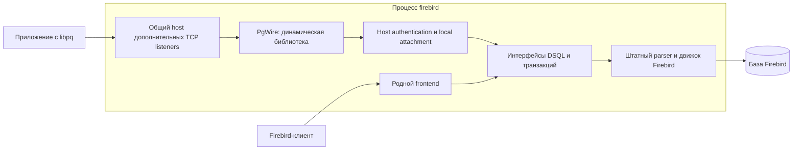

# Архитектура подключаемых сетевых протоколов

Дополнительные wire-протоколы реализуются динамическими плагинами внутри процесса `firebird`. Первый плагин — PostgreSQL. Общая серверная инфраструктура управляет TCP listeners, соединениями и workers; плагин реализует конкретный протокол и обращается к локальному движку через интерфейсы Firebird. Родной frontend сохраняет свой путь запуска, настройки, XDR и обработку запросов.

Документ определяет host/plugin contract и границы SQL. P4 с ограниченным lexer внутри плагина и существующими engine interfaces принят в целевом Linux/Super loopback профиле. Сборка, unit tests и повторные SQL/lifecycle/startup/native проверки прошли; evidence и исторические результаты находятся в [VALIDATION.md](VALIDATION.md). Следующий этап — P5: explicit I/T/E и session controls. TLS, Windows и другие server modes требуют отдельной реализации и приёмки.

## Разделение ответственности



| Компонент | Ответственность |
|---|---|
| Родной frontend | Существующий Firebird wire-протокол, родные порты и transport lifecycle |
| Общий wire host | Конфигурация endpoints, загрузка плагинов, bind/listen/accept, byte transport, peer metadata, лимиты, workers, registry, остановка |
| Host authentication/attachment bridge | Разрешённые aliases, проверка credentials, per-database policy, доверенный auth block, настоящий remote address, engine-only attachment |
| Плагин PgWire | Framing, Startup, PostgreSQL authentication messages, Simple/Extended Query state, codecs, errors, prepared statements/portals |
| DSQL и parser | Полная проверка SQL, штатные input/output metadata, подготовка и реальное исполнение |

Native не включается в список дополнительных плагинов и не переводится на новый ABI. Дополнительные listeners не вызывают вторую независимую `SRVR_multi_thread()` и не используют native `PACKET`/XDR. Между плагином и движком нет TCP/Unix socket connection, gateway или отдельного серверного процесса.

Плагины являются доверенным кодом в одном процессе. Модульная структура изолирует исходники и ABI, но не защищает процесс от аварии внутри DLL. Доступность native при ошибках дополнительного endpoint означает сохранение работы при предусмотренных конфигурационных, загрузочных, bind и session errors.

## SQL: ограниченная классификация в плагине, проверка и исполнение в движке

SQL передаётся в engine prepare целиком, с исходной byte length и без изменения текста. Ограниченный lexer внутри PgWire определяет вид команды, command tag, профиль transaction/session controls и признак tokenless EMPTY. Он учитывает comments, строки и quoted identifiers, но не проверяет grammar, имена объектов, privileges или типы. Общий wire host SQL не анализирует.

После успешного engine prepare плагин сочетает lexical descriptor с существующими `getType()`, `getFlags()`, input/output metadata и affected records. `FLAG_HAS_CURSOR` выбирает cursor/fetch; output metadata определяет singleton output и codecs. RETURNING не превращает DML в SELECT. Неподдержанный control либо UNKNOWN, включая USING wrapper, получает 0A000 до execution; ошибка самого prepare сохраняет приоритет. Новые публичные DSQL getInfo items, AST annotations и parser diagnostics для PgWire не добавляются.

Запрещены SQL rewriting, удаление comments из передаваемого текста, разбиение batches, замена `$n` на `?`, подстановка параметров SQL-литералами и эмуляция успешного SET/BEGIN. Совместимость синтаксиса и реальное исполнение определяет только Firebird. Неподдержанный batch передаётся parser целиком и отвергается без частичных эффектов.

EMPTY определяется ограниченным lexer только для нулевой строки, whitespace и полностью закрытых comments без SQL tokens. Даже такой текст передаётся в обычный engine prepare неизменённым. Только сочетание этого признака с engine syntax error 42601 после успешного cleanup преобразуется в EmptyQueryResponse; permission, cancellation, resource и другие ошибки не маскируются. Незаконченные строка/comment/statement и отдельный `;` остаются parser errors. Native parser diagnostics и `isql -autoterm` не меняются.

Одна implicit READ COMMITTED/write/nowait application transaction охватывает prepare/execute/open/fetch. Результат передаётся потоком, handles освобождаются до commit, CommandComplete выдаётся только после успешного commit. Ошибка вызывает rollback; неопределённое состояние после commit/cleanup требует закрытия connection. IOTimeout задаёт также engine statement timeout, но не hard deadline prepare.

Текущие text codecs: SMALLINT/INTEGER/BIGINT, BOOLEAN, CHAR/VARCHAR, NUMERIC/DECIMAL в SHORT/LONG/INT64 и NULL. CHAR читается через varying fetch metadata с сохранением logical OID и пробелов. Ограничения output/input проверяются до исполнения по штатным metadata.

Будущий P5 расширяет plugin-local control descriptor для retaining/savepoints/session actions и использует реальные transaction handles. PostgreSQL BEGIN и `$n` остаются ошибками native parser до отдельного будущего расширения grammar/functions. Это расширение не входит в текущий рефакторинг.

## Загрузка через существующий PluginManager

В `FirebirdInterface.idl` добавлен `IPluginManager::TYPE_WIRE_PROTOCOL = 13`, `TYPE_COUNT` увеличен до 14 с сохранением действующих значений. Загрузка использует существующие `FB_PLUGIN_ENTRY_POINT`, `registerPluginFactory`, `IPluginConfig`, `IPluginModule`, `StdPlugin` и `SimpleFactory`.

Начальные интерфейсы описаны в CLOOP IDL. C++, Pascal и C bindings обновляются штатным generator, без ручной правки сгенерированных vtables. ABI использует интерфейсы Firebird, явные размеры buffers и определённые integer types; STL, C++ exceptions, внутренние `rem_port`/`thread_db` и платформенные socket handles через границу модулей не передаются.

Роли реализованного начального ABI:

| Интерфейс | Роль и владение |
|---|---|
| `IWireProtocol : IPluginBase` | `createSession(status, host, connection)` возвращает одну owned reference; вызовы для instance последовательны, без network I/O и engine calls. Config получает factory штатным путём |
| `IWireSession : IReferenceCounted` | `run(status)` вызывается один раз в host worker; `stop()` — конкурентный, идемпотентный, неблокирующий запрос остановки, допустимый до `run()`, без join, engine calls и освобождения session/plugin |
| `IWireConnection : IReferenceCounted` | Host byte stream: `read`/`write` с partial I/O и timeout, конкурентный `shutdown`, неизменные peer address/port, `isEncrypted`; socket принадлежит host |
| `IWireServerHost : IReferenceCounted` | `isStopping()`, ограниченные diagnostics и P2 attachDatabase/detachDatabase; версия 4 выдаёт borrowed attachment, принадлежащий host. TLS upgrade остаётся будущим расширением |

В начальном ABI закреплён partial I/O contract: успешный `read` с нулевым результатом при ненулевом buffer size означает EOF; успешный `write` без прогресса недопустим; нулевой size — успешный no-op. Ошибка возвращает status и нулевой результат, ранее выполненный успешный I/O сохраняет силу. Нулевой timeout выбирает конечный host default; положительный может только сократить его. Timeout не является EOF. Один worker последовательно выполняет I/O; `shutdown()` будит ожидания и запрещает дальнейший I/O. Host ограничивает и экранирует diagnostics, plugin не передаёт туда credentials, auth payloads или значения SQL parameters.

`ProtocolPlugin` в `src/remote/server/wire/ProtocolPlugin.h` загружает ровно один configured name, проверяет имя, результат factory и версии интерфейсов. Создание sessions сериализовано. `ProtocolSession` удерживает plugin, host и connection до последнего release session; plugin освобождается через `IPluginManager::releasePlugin()`. Wrapper не отдаёт raw session вызывающему коду и запрещает повторный `run()`. Worker/registry обязаны завершить `run()` и все `stop()` до уничтожения wrapper. Bind/listen, очередь, workers и callbacks остановки реализованы отдельно в `wire/os/posix/Server.cpp`.

Host ограничивает workers/queue; codec P2 ограничивает startup 16 KiB, typed frame 1 MiB и password body 4096 bytes с NUL. Attach вызывается только session worker; plugin закрывает child interfaces перед host detach и не вызывает detach/drop/release borrowed attachment напрямую. Detach инвалидирует его даже при ошибке, оставленные attachments закрывает host после run. Cancellation использует отдельно защищённое host ownership; транспортный TLS потребует новой версии ABI.

Одна активная application transaction на PostgreSQL session — правило PgWire, соответствующее его transaction model. Общий plugin ABI не ограничивает любой будущий протокол одной транзакцией или одним attachment. Host отслеживает все выданные ресурсы для cancellation/shutdown; ограничения конкретного протокола и серверные resource limits задаются отдельно.

Authentication bridge реализован в `wire/Authentication.cpp`, без изменения EDS. Host проверяет DatabaseAliases, локальные database/security paths, наличие Engine14 в Providers security DB, RemoteAccess и разрешение Srp256 в AuthClient/AuthServer базы. In-memory exchange ограничен 16 rounds и 64 KiB на auth payload. Новый DPB содержит проверенный auth block, UTF8/dialect 3, реальный peer и engine-only Providers. В MON$REMOTE_PROTOCOL записывается TCPv4, в MON$REMOTE_VERSION — configured endpoint alias (обычно PgWire). Клиент не выбирает Remote/Loopback fallback и не передаёт trusted/config DPB. Полные byte limits и исключения профиля описаны в CODEX_CONTEXT и ABI contract.

## Конфигурация endpoints

Два новых глобальных параметра `firebird.conf` содержат позиционно связанные списки:

```ini
WireProtocolPlugins = PgWire
WireProtocolPorts = 15432
```

Оба значения по умолчанию пустые. `15432` — порт в примере, а не автоматически открываемый default. Элемент с индексом `i` из первого списка использует ровно порт с индексом `i` из второго. Первоначальный профиль слушает только `127.0.0.1`; IPv6 loopback и удалённый bind требуют явного расширения transport profile и тестов. Родной `RemoteServicePort` и его bind не меняются.

В первом списке используются логические имена плагинов Firebird. Имя разрешается в `.so`/`.dll` штатным PluginManager; расширение и платформенный префикс дополняет ModuleLoader. По умолчанию `PgWire` ищется в каталоге plugins и должен зарегистрировать factory с именем `PgWire`.

Если имя файла отличается или требуется явное сопоставление, используется существующий `plugins.conf`:

```ini
Plugin = PgWire {
    Module = $(dir_plugins)/PgWire
    RegisterName = PgWire
    Config = PgWireConfig
}

Config = PgWireConfig {
    BindAddress = 127.0.0.1
    DatabaseAliases = pgwire_test
    IOTimeout = 30000
}
```

Здесь `Module` указывает библиотеку; `RegisterName` — имя factory внутри неё. Например, `Module` можно направить на файл с иным именем без изменения `firebird.conf`. Один путь к `.so`/`.dll` не задаёт factory однозначно: модуль может регистрировать несколько плагинов, а зарегистрированное имя может отличаться от имени файла. Использовать уже существующее разделение module/factory и штатный загрузчик.

Гипотетический пример будущего второго протокола:

```ini
WireProtocolPlugins = PgWire, MySqlWire
WireProtocolPorts = 15432, 13306
```

`MySqlWire` в этом примере не является реализуемым компонентом текущего проекта. Для проверки нескольких endpoints достаточно одного минимального тестового модуля: одна factory создаёт два экземпляра под разными configured names, а их Config задаёт различимые ответы. Второй production-протокол и вторая тестовая библиотека не нужны. При необходимости тот же модуль может зарегистрировать две factories для отдельной проверки RegisterName.

### Дополнительные настройки по имени endpoint

Два позиционных параметра сохраняются согласно запросу пользователя. Bind address, TLS certificate/key/CA и protocol settings хранятся в именованном `Config` соответствующего alias; для них не добавляются новые параллельные списки. Порт имеет единственный источник — `WireProtocolPorts`. Дублирующий `Port` в endpoint Config диагностируется, а не переопределяет значение из списка.

Два endpoint одного протокола могут использовать одну библиотеку и одну зарегистрированную factory:

```ini
# firebird.conf
WireProtocolPlugins = PgLocal, PgRemote
WireProtocolPorts = 15432, 15433
```

```ini
# plugins.conf
Plugin = PgLocal {
    Module = $(dir_plugins)/PgWire
    RegisterName = PgWire
    Config = PgLocalConfig
}

Plugin = PgRemote {
    Module = $(dir_plugins)/PgWire
    RegisterName = PgWire
    Config = PgRemoteConfig
}

Config = PgLocalConfig {
    BindAddress = 127.0.0.1
    DatabaseAliases = pgwire_test
}

Config = PgRemoteConfig {
    BindAddress = 192.0.2.10
    # TLS settings добавляются после определения их контракта.
}
```

`BindAddress` — реализованная host setting с единственным допустимым значением `127.0.0.1`. PgRemote иллюстрирует будущий удалённый профиль; текущий host отвергает его запуск, без перехода на иной адрес. PgWire собирается отдельной production library; P2 startup/authentication проверен, P3 SELECT execution принят в целевом Linux/Super M0. Module/RegisterName совпадают, но aliases получают отдельные configurations и instances; library остаётся общей до завершения обоих endpoints.

Host использует существующий `IMaster::getConfigManager()->getPluginConfig(configuredName)` до bind/load и проверяет полученные transport settings. Разрешение конфигурации и fallback к module `.conf` остаются штатными. Named `Config` — обычный способ задать разные настройки aliases, а не обязательное условие загрузки. Factory получает конфигурацию через существующий `IPluginConfig::getDefaultConfig()`.

Конфигурацию подготавливают до запуска сервера. Для согласованных host/plugin settings разных aliases рекомендуется named Config, как в примере выше. NULL от getPluginConfig означает ошибку endpoint; отсутствующий host parameter в возвращённом IConfig получает документированный default. Host сохраняет проверенные значения настроек на срок endpoint и не перечитывает файл после bind.

| Host setting | Default | Начальный допустимый диапазон |
|---|---|---|
| `BindAddress` | `127.0.0.1` | Только `127.0.0.1` |
| `Workers` | 4 | Десятичное целое 1–16 |
| `QueueSize` | 16 | Десятичное целое 1–64 |
| `IOTimeout` | 30000 ms | Десятичное целое 1–300000 ms |
| `DatabaseAliases` | Пустой список | Comma-separated allowlist локальных aliases; пустой запрещает attachments |

Повтор любой host setting отвергается. Любой `Port` запрещён; любой `TLS` отвергается до реализации TLS transport. Остальные настройки остаются плагину. Глобальный предел — 16 configured endpoints и суммарный budget 64 workers. Заполненная очередь закрывает новое принятое соединение; queued socket не создаёт plugin session до свободного worker. `IOTimeout` ограничивает ожидание в очереди и отдельную transport operation. PgWire дополнительно применяет whole-frame и единый startup network deadline, включающий Password и ответы; partial reads/writes не продлевают его.

Пути, macros и module names разрешает штатный PluginManager; host не воспроизводит собственный поиск `.so`/`.dll`. Factory не открывает listener и не меняет сопоставление alias/port.

### Проверка списков и политика ошибок

1. До загрузки библиотек разобрать оба списка и сохранить исходные позиции. Разделитель — запятая; пробелы вокруг элемента допустимы. Пустые позиции, включая trailing comma, ошибочны; их нельзя удалять или объединять с соседними.
2. Оба пустых списка отключают дополнительные endpoints. Единственный пустой список или разное число элементов — ошибка всей дополнительной конфигурации.
3. Порт должен быть десятичным целым в диапазоне 1–65535 без переполнения. Повтор точного configured name отклоняется: разные endpoints одного module/factory получают разные aliases. В начальном loopback profile дубликаты портов также отклоняются. Получить и проверить config каждого alias, затем проверить конфликт с фактически привязанным native endpoint. Успешный bind дополнительного listener также предшествует загрузке модуля.
4. После успешной общей проверки загрузить каждый `(plugin, port)` отдельно. Не получать целиком список через iterator `getPlugins()` и затем присваивать порты успешным загрузкам: существующий manager способен пропускать отсутствующие optional modules. `Config::getPlugins(TYPE_WIRE_PROTOCOL)` явно отклоняет implicit lookup; raw settings читаются парой, затем loader получает одно проверенное имя, без запятых и других list separators.
5. Ошибка config конкретного alias, отсутствующая библиотека, неверный тип/factory, ошибка создания instance или bind отключает этот endpoint с явным сообщением в log. Оставшиеся endpoints сохраняют исходные порты. Не применять резервные порты и не пропускать ошибку молча.
6. Некорректное общее сопоставление отключает всю дополнительную конфигурацию. Ошибка дополнительного endpoint или неподдержанный server mode не запускает shutdown родного frontend.

Native запускается независимо от списка и не освобождает свой listener ради дополнительного endpoint. Host не заменяет родную startup policy. В первой версии конфигурация применяется при запуске; hot reload и runtime unload не входят в профиль.

Startup получает borrowed descriptor уже привязанного native listener и читает `getsockname`: порт включает `-p` и service-name resolution. Для дополнительного `127.0.0.1` пересечение существует при native IPv4 wildcard/127.0.0.1, IPv6 wildcard с отключённым `IPV6_V6ONLY` или соответствующем IPv4-mapped address. Native IPv6-only и Unix listener не резервируют этот IPv4 endpoint. Ошибка чтения native metadata отключает дополнительные endpoints; host не меняет и не закрывает родной descriptor. Ошибка bind остаётся локальной. Сравнение с сырым `RemoteServicePort` или константой 3050 не используется.

Endpoint creation и transport limits остаются под управлением host. Native `WireCrypt` не является шифрованием дополнительного transport; начальный host использует plaintext только на IPv4 loopback.

## Жизненный цикл и выгрузка

Host удерживает экземпляр plugin на всём протяжении работы его endpoints, sessions и callbacks. Дополнительно сохранять ссылку на всё время исполнения кода модуля из worker. Factory registration и создание объектов должны быстро возвращать управление; глобальные constructors модуля не запускают listener и не выполняют SQL.

Начальный startup hook подключён к Linux POSIX server после native bind и необходимой серверной инициализации. Дополнительные endpoints включаются только при `ServerMode=Super`; SuperClassic/Classic диагностируются с сохранением native. Общий native путь Super/SuperClassic не является доказательством готовности второго режима. Windows wiring, SuperClassic acceptance и Classic process/fork integration остаются отдельной работой; текущий срез не завершает P1 для всех платформ.

Остановка координируется общим host:

1. В `preproviders` прекратить accept и создание engine operations, разбудить socket readers/writers, инициировать session cancellation. Завершить доступный cleanup до остановки providers.
2. Не делать бесконечный join worker, который ожидает завершения SQL: provider shutdown должен получить возможность прервать операцию.
3. После остановки providers завершить оставшиеся workers и callbacks. Не выполнять новые prepare/execute/rollback/detach по уничтоженному provider; различать рабочий cleanup и освобождение оставшихся interface references.
4. Уничтожить sessions и освободить protocol instances через `IPluginManager::releasePlugin()`. Host code не вызывает `dlclose`/`FreeLibrary` самостоятельно.

В текущем host `preproviders` прекращает accept, закрывает queued transports и вызывает connection shutdown перед plugin stop; join в этом callback отсутствует. `postproviders` использует один общий deadline 5 секунд для всех acceptors/workers. После их завершения registry owners освобождаются вне lock. Если deadline истёк, callback сообщает ошибку и сохраняет owners: работающий модуль не выгружается. Этот предел относится к ожиданию threads и не изолирует зависший callback доверенного плагина. P2 host services управляют зарегистрированными attachments. Синхронный auth/attach callback до получения handle нельзя принудительно прервать codec deadline: stop проверяется между вызовами, provider shutdown должен получить возможность завершить операцию. Network deadline не обещает такой же hard upper bound на callback.

`PluginManager::shutdown()` запрещает новые загрузки, но не останавливает threads. Задержанная выгрузка модуля не заменяет refs и join. `releasePlugin()` освобождает owner только после возврата из plugin `release()`, предотвращая возврат в уже выгруженный код. `IPluginModule::doClean()` выполняет финальную уборку и не заменяет серверный stop protocol.

P0 должен установить завершённый state/ownership contract для остановки auth, idle read, incomplete frame, active SQL и lock wait. Приёмка включает отсутствие deadlock, double release, use-after-unload и вызовов движка после provider shutdown.

## TLS и граница transport

TLS реализуется поверх byte transport дополнительных endpoints. PostgreSQL SSLRequest и решение об upgrade принадлежат PgWire; безопасный transport, сертификаты и прерывание handshake должны иметь согласованное владение с host.

В P0 выбран OpenSSL 3 API и необязательная сборочная зависимость; transport TLS, packaging и удалённый профиль реализуются в P10. Предлагаемый configure option ещё не реализован. PgWire P2 отвечает `N` на SSLRequest и GSSENCRequest. Тестовый echo остаётся отдельным fixture и PostgreSQL Startup не реализует.

## Размещение кода и сборка

Размещение реализованных компонентов и дальнейшего execution scope:

- `src/remote/server/wire/`: generic host, listeners, connections, workers, session registry и server lifecycle integration;
- `src/remote/server/wire/Authentication.cpp`: transport-neutral Srp256/attachment helper без зависимости от PgWire или активного EDS attachment;
- `src/plugins/wire/pg/`: PostgreSQL messages, session, Simple/Extended exchanges, codecs и diagnostics;
- `src/include/firebird/FirebirdInterface.idl`: новый plugin type и ABI;
- DSQL/parser и публичные statement info interfaces сохраняются; будущий PostgreSQL syntax выделяется в самостоятельный scope.

В `Remote_Server` входит generic host, а PgWire собирается отдельной shared library в plugins. PostgreSQL-specific objects не включаются в `Remote_Common`, libfbclient common transport или сам `FB_DAEMON`. Штатная линковка плагина с public/runtime libraries допускается и не означает вторичного сетевого подключения. Private DSQL classes и `thread_db` не становятся ABI плагина.

Начальная executable приёмка — штатная POSIX сборка Linux/Super. PgWire добавлен в production build definitions POSIX и CMake, генерация ABI выполняется CLOOP. Результат полной CMake-сборки проверяется отдельно; Windows host wiring/runtime ещё отсутствуют. Переносимый ABI и CMake declaration сами по себе не доказывают готовую `.dll`.

## Проверенные точки исходников

| Подсистема | Файлы и символы |
|---|---|
| Plugin ABI | `src/include/firebird/FirebirdInterface.idl`: PluginBase, PluginConfig, PluginFactory, PluginManager |
| Загрузка | `src/yvalve/PluginManager.cpp`: PluginLoadInfo, PluginSet::next, loadModule, releasePlugin |
| Plugin helpers | `src/common/classes/ImplementHelper.h`: StdPlugin, SimpleFactory, UnloadDetectorHelper |
| Начальный wire host | `src/remote/server/wire/EndpointConfig.h`: parseEndpointConfig; `ProtocolPlugin.h` / `.cpp`: ProtocolPlugin, ProtocolSession; `os/posix/Server.cpp`: listeners, workers, shutdown; `os/posix/SocketConnection.cpp`: poll/recv/send transport |
| Конфигурация | `src/common/config/config.h`: ConfigKey, entries; `config.cpp`: Config::getPlugins; `src/yvalve/PluginManager.cpp`: существующие getPluginConfig, findPluginConfig и PluginLoadInfo |
| Module mapping | `builds/install/misc/plugins.conf` |
| POSIX startup | `src/remote/server/os/posix/inet_server.cpp`: registerAuthPlugins, Super initialization, SRVR_multi_thread |
| Windows startup | `src/remote/server/os/win32/srvr_w32.cpp`: start_connections_thread |
| Shutdown | `src/yvalve/why.cpp`: Dispatcher::shutdown; `src/remote/server/server.cpp`: set_server, pre_shutdown |
| Auth bridge | `src/remote/server/wire/Authentication.cpp`: authenticateAndAttach; native/EDS образцы: DatabaseAuth::accept и ValidatePassword.cpp |
| PostgreSQL module | `src/plugins/wire/pg/Protocol.{h,cpp}`: framing; `ResultCodec.{h,cpp}`: scalar results; `PgWire.cpp`: plugin/session; `Execute.cpp`: unchanged SQL через engine interfaces; `ErrorStatus.cpp`: full-vector diagnostics и explicit SQLSTATE fallback |
| SQL classification | `src/plugins/wire/pg/SqlInfo.{h,cpp}`: ограниченный plugin-local descriptor; `Execute.cpp` использует штатные getType/getFlags/input/output/affected records |
| POSIX objects/targets | `builds/posix/make.shared.variables`: Remote_Server и plugin object sets; `builds/posix/Makefile.in`: plugins, updateCloopInterfaces |
| Другие build paths | `src/CMakeLists.txt`; `builds/win32/make_boot.bat`; `builds/win32/msvc15` |

Существующие правила PluginManager подтверждены исходниками baseline. ABI и Linux/Super host используют штатный config API. P4 с ограниченным lexer внутри плагина и существующими engine interfaces принят в целевом Linux/Super loopback профиле. Сборка, unit tests и повторные SQL/lifecycle/startup/native проверки прошли; evidence и исторические результаты находятся в [VALIDATION.md](VALIDATION.md). Следующий этап — P5: explicit I/T/E и session controls. TLS, Windows и другие server modes требуют отдельной реализации и приёмки.