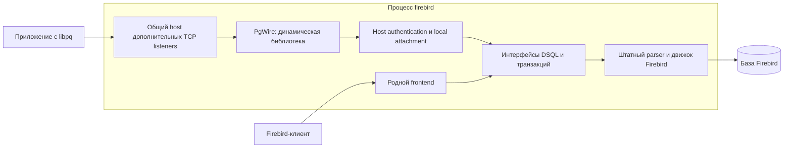

# Архитектура подключаемых сетевых протоколов

Дополнительные wire-протоколы реализуются динамическими плагинами внутри процесса `firebird`. Первый плагин — PostgreSQL. Общая серверная инфраструктура управляет TCP listeners, соединениями и workers; плагин реализует конкретный протокол и обращается к локальному движку через интерфейсы Firebird. Родной frontend сохраняет свой путь запуска, настройки, XDR и обработку запросов.

Это проектный контракт. Перечисленные новые интерфейсы и параметры ещё не реализованы; окончательные ABI-сигнатуры определяются в P0 до добавления плагина. Требование пользователя об отсутствии SQL-разбора во frontend применяется ко всем этапам.

## Разделение ответственности



| Компонент | Ответственность |
|---|---|
| Родной frontend | Существующий Firebird wire-протокол, родные порты и transport lifecycle |
| Общий wire host | Конфигурация endpoints, загрузка плагинов, bind/listen/accept, byte transport, peer metadata, лимиты, workers, registry, остановка |
| Host authentication/attachment bridge | Разрешённые aliases, проверка credentials, per-database policy, доверенный auth block, настоящий remote address, engine-only attachment |
| Плагин PgWire | Framing, Startup, PostgreSQL authentication messages, Simple/Extended Query state, codecs, errors, prepared statements/portals |
| DSQL и parser | Разбор SQL, классификация операций, входные/выходные metadata, подготовка и исполнение |

Native не включается в список дополнительных плагинов и не переводится на новый ABI. Дополнительные listeners не вызывают вторую независимую `SRVR_multi_thread()` и не используют native `PACKET`/XDR. Между плагином и движком нет TCP/Unix socket connection, gateway или отдельного серверного процесса.

Плагины являются доверенным кодом в одном процессе. Модульная структура изолирует исходники и ABI, но не защищает процесс от аварии внутри DLL. Доступность native при ошибках дополнительного endpoint означает сохранение работы при предусмотренных конфигурационных, загрузочных, bind и session errors.

## SQL целиком разбирается движком

После проверки структуры wire-сообщения плагин передаёт SQL движку с явной длиной, без изменения SQL bytes. Завершающий NUL сообщения PostgreSQL является частью wire framing и не входит в текст SQL. UTF8 проверяется как encoding, а не как SQL grammar.

Плагин и общий host не выполняют:

- поиск SQL keywords, распознавание BEGIN/COMMIT/ROLLBACK или DDL по тексту;
- tokenization комментариев, строк и quoted identifiers;
- разделение SQL по `;`, удаление комментариев или анализ «пустоты» через SQL lexer;
- определение RETURNING, statement kind и command tag через regex или префиксы;
- замену `$1` на `?`, перестановку SQL fragments или иную SQL-трансляцию.

Message type, длина payload, имена prepared statements/portals и форматы Bind разбираются плагином: это поля wire-протокола. SQL внутри Query/Parse остаётся входом штатного parser. Нулевую длину SQL payload можно установить из framing; смысл whitespace/comment-only SQL устанавливает parser.

CommandComplete и transaction transitions формируются по результату разбора/исполнения и DSQL metadata. Если существующие `getType()`, `getFlags()`, affected records и transaction handles не сообщают достаточно информации, добавить нейтральные semantic metadata на стороне DSQL. Они описывают операцию Firebird и не содержат готовые PostgreSQL responses. Плагин кодирует wire tag из этих данных.

Неподдержанный SQL, включая PostgreSQL `BEGIN` или параметры `$n`, пока получает ошибку штатного parser. Их поддержка требует отдельного будущего расширения parser/DSQL и тестов. В частности, Extended Query transport можно реализовать и проверить с совместимым SQL, но обычные параметризованные вызовы libpq с `$n` нельзя объявлять поддержанными до появления соответствующей поддержки в parser. Значения Bind преобразуются в buffers по metadata уже подготовленного запроса; текст запроса при этом не переписывается.

Для неподдержанных statement capabilities или codecs отказ до исполнения основывается на metadata после prepare. Ограничение batches проверяется поведением parser; frontend не ищет второй statement самостоятельно. Нехватка metadata фиксируется как задача DSQL, а не обходится дополнительным lexer.

## Загрузка через существующий PluginManager

Предлагается добавить `IPluginManager::TYPE_WIRE_PROTOCOL = 13` и увеличить `TYPE_COUNT` до 14 в `FirebirdInterface.idl`, сохранив действующие значения. Использовать существующие `FB_PLUGIN_ENTRY_POINT`, `registerPluginFactory`, `IPluginConfig`, `IPluginModule`, `StdPlugin` и `SimpleFactory`.

Новые интерфейсы описываются в CLOOP IDL. C++, Pascal и C bindings обновляются штатным generator, без ручной правки сгенерированных vtables. ABI использует интерфейсы Firebird, явные размеры buffers и определённые integer types; STL, C++ exceptions, внутренние `rem_port`/`thread_db` и платформенные socket handles через границу модулей не передаются.

Предлагаемые роли интерфейсов, без окончательных сигнатур:

| Интерфейс | Роль и владение |
|---|---|
| `IWireProtocol : IPluginBase` | Создаёт protocol sessions для endpoint; получает plugin config; экземпляром владеет host |
| `IWireSession : IReferenceCounted` | Обрабатывает одно соединение в выделенном host worker; сохраняет protocol state и ресурсы DSQL |
| `IWireConnection : IReferenceCounted` | Предоставляемый host byte stream с read/write, metadata и прерыванием ожиданий; socket принадлежит host |
| `IWireServerHost` | Доступ к проверенному локальному attachment, диагностике и состоянию остановки; точный базовый интерфейс и refcount contract определяются в P0 |

В P0 закрепить partial I/O/EOF/error contract, thread affinity, разрешённые конкурентные stop/cancel calls, владение каждым возвращённым интерфейсом, lifetime callbacks и запрет передачи секретов в diagnostics. Один последовательный worker исполняет одну session; frame sizes, количество сессий и buffers ограничены. Async cancellation получает отдельное синхронизированное владение attachment.

Одна активная application transaction на PostgreSQL session — правило PgWire, соответствующее его transaction model. Общий plugin ABI не ограничивает любой будущий протокол одной транзакцией или одним attachment. Host отслеживает все выданные ресурсы для cancellation/shutdown; ограничения конкретного протокола и серверные resource limits задаются отдельно.

Authentication bridge размещается в общем серверном коде. `ValidatePassword.cpp` служит образцом in-memory обмена auth plugins; первоначальный host helper может быть реализован без изменения EDS. Если общая часть выделяется из EDS, сохранить его guards и проверить регрессию. Плагин передаёт credentials по внутреннему интерфейсу; host проверяет policy, формирует auth block и remote metadata и создаёт attachment через локальный engine provider. Плагин не получает способ выбирать `Remote`/`Loopback` fallback или передавать client-controlled trusted DPB.

## Конфигурация endpoints

Два новых глобальных параметра `firebird.conf` содержат позиционно связанные списки:

```ini
WireProtocolPlugins = PgWire
WireProtocolPorts = 15432
```

Оба значения по умолчанию пустые. `15432` — порт в примере, а не автоматически открываемый default. Элемент с индексом `i` из первого списка использует ровно порт с индексом `i` из второго. Первоначальный профиль слушает только `127.0.0.1`; IPv6 loopback и удалённый bind требуют явного расширения transport profile и тестов. Родной `RemoteServicePort` и его bind не меняются.

В первом списке используются логические имена плагинов Firebird. Имя разрешается в `.so`/`.dll` штатным PluginManager; расширение и платформенный префикс дополняет ModuleLoader. По умолчанию `PgWire` ищется в каталоге plugins и должен зарегистрировать factory с именем `PgWire`.

Если имя файла отличается или требуется явное сопоставление, используется существующий `plugins.conf`:

```ini
Plugin = PgWire {
    Module = $(dir_plugins)/PgWire
    RegisterName = PgWire
}
```

Здесь `Module` указывает библиотеку; `RegisterName` — имя factory внутри неё. Например, `Module` можно направить на файл с иным именем без изменения `firebird.conf`. Один путь к `.so`/`.dll` не задаёт factory однозначно: модуль может регистрировать несколько плагинов, а зарегистрированное имя может отличаться от имени файла. Использовать уже существующее разделение module/factory и штатный загрузчик.

Гипотетический пример будущего второго протокола:

```ini
WireProtocolPlugins = PgWire, MySqlWire
WireProtocolPorts = 15432, 13306
```

`MySqlWire` в этом примере не является реализуемым компонентом текущего проекта. Для проверки нескольких endpoints достаточно одного минимального тестового модуля: одна factory создаёт два экземпляра под разными configured names, а их Config задаёт различимые ответы. Второй production-протокол и вторая тестовая библиотека не нужны. При необходимости тот же модуль может зарегистрировать две factories для отдельной проверки RegisterName.

### Дополнительные настройки по имени endpoint

Два позиционных параметра сохраняются согласно запросу пользователя. Bind address, TLS certificate/key/CA и protocol settings хранятся в именованном `Config` соответствующего alias; для них не добавляются новые параллельные списки. Порт имеет единственный источник — `WireProtocolPorts`. Дублирующий `Port` в endpoint Config диагностируется, а не переопределяет значение из списка.

Два endpoint одного протокола могут использовать одну библиотеку и одну зарегистрированную factory:

```ini
# firebird.conf
WireProtocolPlugins = PgLocal, PgRemote
WireProtocolPorts = 15432, 15433
```

```ini
# plugins.conf
Plugin = PgLocal {
    Module = $(dir_plugins)/PgWire
    RegisterName = PgWire
    Config = PgLocalConfig
}

Plugin = PgRemote {
    Module = $(dir_plugins)/PgWire
    RegisterName = PgWire
    Config = PgRemoteConfig
}

Config = PgLocalConfig {
    BindAddress = 127.0.0.1
}

Config = PgRemoteConfig {
    BindAddress = 192.0.2.10
    # TLS settings добавляются после определения их контракта.
}
```

`BindAddress` в примере — проектируемая host setting. PgRemote иллюстрирует будущий удалённый профиль; до реализации TLS и remote policy его запуск отвергается, без перехода на иной адрес. Module/RegisterName совпадают, но aliases получают отдельные configurations и instances; library остаётся общей до завершения обоих endpoints.

Host может получить конфигурацию до загрузки библиотеки и вызова factory через существующий `IMaster::getConfigManager()->getPluginConfig(configuredName)`. Метод возвращает `IConfig`; экземпляр plugin ему не нужен. `IPluginConfig::getDefaultConfig()` отдельно предоставляет конфигурацию factory. Для named Config blocks оба пути используют `findPluginConfig()`.

Перед bind требуется строгая проверка конфигурации:

- Явно заданный `Config = Name` должен ссылаться на существующий block. Текущий `findPluginConfig()` допускает fallback к module `.conf` при отсутствии block; host должен исключить такой fallback для ошибочной явной ссылки.
- `getPluginConfig()` возвращает NULL при перехваченном исключении; NULL означает ошибку endpoint, а не разрешение применить менее строгие Bind/TLS defaults. Отсутствующие необязательные параметры в корректном config получают только документированные defaults.
- Нельзя предполагать одинаковое поведение `ConfigFile` в обоих путях: `ConfiguredPlugin` учитывает override в constructor, а `ConfigManager::getPluginConfig()` использует default `plugConfigFile`. Первая реализация host settings опирается на named Config blocks; поддержку ConfigFile объявлять только после согласования разрешения и отдельной проверки.
- Host валидирует свои transport settings и передаёт plugin его configuration; factory не открывает listener и не меняет сопоставление alias/port.

Эти проверки выполняются через существующие config interfaces/resolver с явным учётом missing references; новый config accessor в wire ABI не требуется.

### Проверка списков и политика ошибок

1. До загрузки библиотек разобрать оба списка и сохранить исходные позиции. Разделитель — запятая; пробелы вокруг элемента допустимы. Пустые позиции, включая trailing comma, ошибочны; их нельзя удалять или объединять с соседними.
2. Оба пустых списка отключают дополнительные endpoints. Единственный пустой список или разное число элементов — ошибка всей дополнительной конфигурации.
3. Порт должен быть десятичным целым в диапазоне 1–65535 без переполнения. Повтор точного configured name отклоняется: разные endpoints одного module/factory получают разные aliases. В начальном loopback profile дубликаты портов также отклоняются. Получить и проверить config каждого alias, затем проверить конфликт с настроенным родным TCP endpoint до загрузки; фактический конфликт адреса также проверяется при bind.
4. После успешной общей проверки загрузить каждый `(plugin, port)` отдельно. Не получать целиком список через iterator `getPlugins()` и затем присваивать порты успешным загрузкам: существующий manager способен пропускать отсутствующие optional modules.
5. Ошибка config конкретного alias, отсутствующая библиотека, неверный тип/factory, ошибка создания instance или bind отключает этот endpoint с явным сообщением в log. Оставшиеся endpoints сохраняют исходные порты. Не применять резервные порты и не пропускать ошибку молча.
6. Некорректное общее сопоставление отключает всю дополнительную конфигурацию. Ошибка дополнительного endpoint или неподдержанный server mode не запускает shutdown родного frontend.

Native запускается независимо от списка и не освобождает свой listener ради дополнительного endpoint. Host не заменяет родную startup policy. В первой версии конфигурация применяется при запуске; hot reload и runtime unload не входят в профиль.

Endpoint creation и transport limits остаются под управлением host. Полный набор и типы Bind/TLS settings в named Config закрепляются до их реализации; не распространять native `WireCrypt` на PostgreSQL transport.

## Жизненный цикл и выгрузка

Host удерживает экземпляр plugin на всём протяжении работы его endpoints, sessions и callbacks. Дополнительно сохранять ссылку на всё время исполнения кода модуля из worker. Factory registration и создание объектов должны быстро возвращать управление; глобальные constructors модуля не запускают listener и не выполняют SQL.

Startup hook размещается в серверном lifecycle после необходимой auth initialization. Super и SuperClassic используют общий многоклиентский путь; каждый режим получает отдельную приёмку engine/cache lifecycle. PostgreSQL byte stream получает независимую обработку. Наличие Unix listeners, Classic child processes и иных native путей запуска не должно приводить к повторной загрузке endpoint или повторному bind; Classic требует отдельного проекта process/fork integration.

Остановка координируется общим host:

1. В `preproviders` прекратить accept и создание engine operations, разбудить socket readers/writers, инициировать session cancellation. Завершить доступный cleanup до остановки providers.
2. Не делать бесконечный join worker, который ожидает завершения SQL: provider shutdown должен получить возможность прервать операцию.
3. После остановки providers завершить оставшиеся workers и callbacks. Не выполнять новые prepare/execute/rollback/detach по уничтоженному provider; различать рабочий cleanup и освобождение оставшихся interface references.
4. Уничтожить sessions и освободить protocol instances через `IPluginManager::releasePlugin()`. Host code не вызывает `dlclose`/`FreeLibrary` самостоятельно.

`PluginManager::shutdown()` запрещает новые загрузки, но не останавливает threads. Задержанная выгрузка модуля не заменяет refs и join. `releasePlugin()` освобождает owner только после возврата из plugin `release()`, предотвращая возврат в уже выгруженный код. `IPluginModule::doClean()` выполняет финальную уборку и не заменяет серверный stop protocol.

P0 должен установить завершённый state/ownership contract для остановки auth, idle read, incomplete frame, active SQL и lock wait. Приёмка включает отсутствие deadlock, double release, use-after-unload и вызовов движка после provider shutdown.

## TLS и граница transport

TLS реализуется поверх byte transport дополнительных endpoints. PostgreSQL SSLRequest и решение об upgrade принадлежат PgWire; безопасный transport, сертификаты и прерывание handshake должны иметь согласованное владение с host.

В P0 выбрать TLS библиотеку и способ включения в POSIX/Windows builds, проверить доступность, лицензию и compatibility с shared-library lifecycle. Нельзя откладывать выбор зависимости до M3, если от него зависит ABI `IWireConnection`; сам TLS handshake и удалённый профиль реализуются позднее. Первоначальный loopback endpoint отвечает `N` на SSLRequest и не заявляет TLS.

## Размещение кода и сборка

Предлагаемое размещение:

- `src/remote/server/wire/`: generic host, listeners, connections, workers, session registry и server lifecycle integration;
- общая transport-neutral часть authentication/attachment bridge: серверный runtime, выбранный в P0 без зависимости от PgWire или активного EDS attachment;
- `src/plugins/wire/pg/`: PostgreSQL messages, session, Simple/Extended exchanges, codecs и diagnostics;
- `src/include/firebird/FirebirdInterface.idl`: новый plugin type и ABI;
- существующие DSQL/parser файлы: только согласованные neutral metadata; будущий PostgreSQL syntax выделяется в самостоятельный scope.

В `Remote_Server` входит generic host, а PgWire собирается отдельной shared library в plugins. PostgreSQL-specific objects не включаются в `Remote_Common`, libfbclient common transport или сам `FB_DAEMON`. Штатная линковка плагина с public/runtime libraries допускается и не означает вторичного сетевого подключения. Private DSQL classes и `thread_db` не становятся ABI плагина.

Начальная executable приёмка — штатная POSIX сборка Linux/Super. С самого начала определить packaging плагина, генерацию интерфейсов, exported entrypoint и установку конфигурации. Поддержку CMake/Windows builds и runtime проверять отдельно; переносимый ABI сам по себе не доказывает сборку `.dll`.

## Проверенные точки исходников

| Подсистема | Файлы и символы |
|---|---|
| Plugin ABI | `src/include/firebird/FirebirdInterface.idl`: PluginBase, PluginConfig, PluginFactory, PluginManager |
| Загрузка | `src/yvalve/PluginManager.cpp`: PluginLoadInfo, PluginSet::next, loadModule, releasePlugin |
| Plugin helpers | `src/common/classes/ImplementHelper.h`: StdPlugin, SimpleFactory, UnloadDetectorHelper |
| Конфигурация | `src/common/config/config.h`: ConfigKey, entries; `config.cpp`: Config::getPlugins; `src/yvalve/PluginManager.cpp`: ConfigManager::getPluginConfig, findPluginConfig, ConfiguredPlugin |
| Module mapping | `builds/install/misc/plugins.conf` |
| POSIX startup | `src/remote/server/os/posix/inet_server.cpp`: registerAuthPlugins, Super initialization, SRVR_multi_thread |
| Windows startup | `src/remote/server/os/win32/srvr_w32.cpp`: start_connections_thread |
| Shutdown | `src/yvalve/why.cpp`: Dispatcher::shutdown; `src/remote/server/server.cpp`: set_server, pre_shutdown |
| Auth extraction | `src/jrd/extds/ValidatePassword.cpp`; `src/remote/server/server.cpp`: DatabaseAuth::accept |
| POSIX objects/targets | `builds/posix/make.shared.variables`: Remote_Server и plugin object sets; `builds/posix/Makefile.in`: plugins, updateCloopInterfaces |
| Другие build paths | `src/CMakeLists.txt`; `builds/win32/make_boot.bat`; `builds/win32/msvc15` |

Существующие правила PluginManager подтверждены исходниками зафиксированного baseline. Предложенные wire interfaces, config keys и каталоги являются планом новых изменений.
