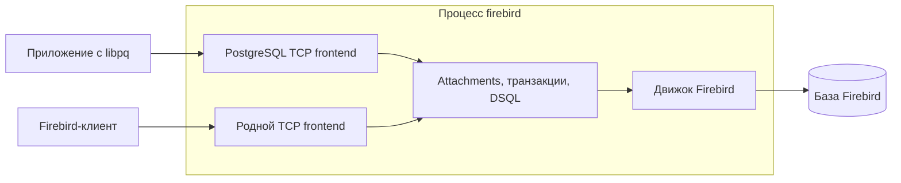

# PostgreSQL wire protocol в Firebird 6

План добавления PostgreSQL TCP frontend в штатный процесс `firebird`. Приложение использует обычный PostgreSQL-драйвер, включая libpq; запросы выполняет движок Firebird. Родной Firebird frontend продолжает работать параллельно с теми же базами.

Целевая база — `master` Firebird 6; рабочая ветка — `pg_wire_protocol`. Зафиксированный исходный коммит: `bf94598f8deefeb7cc4a8217ee43b3040d5d6650`, версия исходников `6.0.0.2199 Initial`, `Engine14`, C++20. Подробности — [BASELINE.md](BASELINE.md).

Пакет переработан 8 октября 2026 года. Сейчас подготовлены проектные документы и исходный набор будущих acceptance tests. Серверный frontend ещё не реализован; сборка и интеграционная приёмка не выполнены. Этот пакет сам по себе не является поручением начать реализацию.

## Цель и границы

PostgreSQL connection принимает сам `firebird`. Новый frontend имеет собственные codec и состояние сессии, вызывает внутренние attachment/transaction/DSQL interfaces и использует только локальный engine provider. Между frontend и движком нет дополнительного сетевого подключения.

Совместимость с PostgreSQL SQL grammar, системными каталогами, расширениями и хранимыми процедурами PostgreSQL пока за пределами задачи. Прикладной SQL должен быть совместим с Firebird. Служебные команды сессии, привязка параметров `$n`, типы данных и обмен Extended Query рассматриваются отдельно: без них совместимого текста запроса может оказаться недостаточно для работы обычного драйвера.



## Проверяемые результаты

| Результат | Содержание | Критерий завершения |
|---|---|---|
| M0 | Первый запрос внутри сервера | Настоящая authentication, вычисляемый SELECT, SQL error/recovery, disconnect; native клиент продолжает работать |
| M1, прежний v0 | Полный ограниченный Simple Query-прототип | Типы, CRUD, I/T/E, permissions, framing, отсутствие backend connection, cleanup/shutdown; psycopg2 и прямой libpq |
| M2 | Основные параметризованные вызовы libpq | Extended Query, `$n`, prepared statements/portals, text/binary codecs, расширенные scalar types, RETURNING, Sync recovery |
| M3 | Проверка прикладного сетевого профиля | Подключение с другого узла, TLS, cancellation, согласованные команды сессии и неизменённый PostgreSQL-драйвер целевого приложения |

M0 и M1 — промежуточные результаты. M2 и M3 входят в дорожную карту пользовательской цели. Успешный M1 не означает поддержку всех вызовов libpq или произвольного PostgreSQL-приложения. Если трасса приложения требует COPY, batches, pipeline или других пока исключённых возможностей, профиль расширяется отдельными этапами до объявления этого приложения совместимым.

Linux и `ServerMode=Super` — начальная платформа реализации. Listener выключен по умолчанию; предлагаемый порт — `15432`. Loopback и отсутствие TLS ограничивают M0–M2, но не являются окончательным сетевым профилем.

## Состав пакета

| Файл | Назначение |
|---|---|
| [BASELINE.md](BASELINE.md) | Ветка, SHA, версия исходников и проверенные точки интеграции |
| [CODEX_CONTEXT.md](CODEX_CONTEXT.md) | Архитектурные инварианты, подробный M1 contract и правила расширения до M2/M3 |
| [COMPATIBILITY.md](COMPATIBILITY.md) | Матрица возможностей по этапам и критерии совместимости приложения |
| [PLAN.md](PLAN.md) | Последовательность разработки, зависимости и условия завершения |
| [TEST_PLAN.md](TEST_PLAN.md) | Архитектурная, протокольная, клиентская и серверная приёмка |
| [RESEARCH.md](RESEARCH.md) | Обоснование решений и основные нерешённые вопросы |
| [SOURCES.md](SOURCES.md) | Первичные источники и карта исходников, закреплённая по SHA |
| [CODEX_START_PROMPT.md](CODEX_START_PROMPT.md) | Задание для будущего начала реализации |
| [tests/test_pgwire_acceptance.py](tests/test_pgwire_acceptance.py) | Исходные 20 функций / 56 случаев для M1, включая временные negative tests |
| [evidence/driver_probe.json](evidence/driver_probe.json) | Исторический driver-only probe на синтетическом сервере |

Для реализации читать README → BASELINE → CODEX_CONTEXT → COMPATIBILITY → PLAN → TEST_PLAN; RESEARCH/SOURCES дают обоснование и ссылки. При расхождении сначала учитываются прямые указания пользователя, затем актуальная матрица и контракт соответствующего этапа. Исторический probe не расширяет заявленную поддержку.

## Проверка подготовленного Python-набора

Из директории `pg_wire_protocol`:

```sh
python3 -m venv /tmp/firebird-pgwire-tests
. /tmp/firebird-pgwire-tests/bin/activate
python -m pip install -r requirements-tests.txt
python -m pytest --collect-only -q
```

Collection не подключается к серверу и не доказывает реализацию протокола. Реальный запуск требует отдельной тестовой базы, пользователей и переменных из [TEST_PLAN.md](TEST_PLAN.md). Текущий Python-файл предназначен для M1; правила переноса negative tests в M2 описаны там же.

После начала реализации результаты сборки и исполнения записываются в `VALIDATION.md` этой директории. Такой отчёт должен называть принятый этап, точные версии и ограничения, а не подменять интеграционные результаты синтетическим probe.
